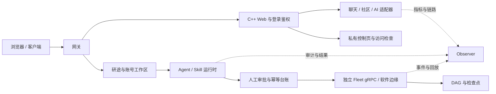

<div align="center">

# NEBULA

**从 C++20 网络服务，到可观测的业务系统与 Agent 工作流。**

A C++20 web server, business workbench, and approval-gated agent playground.

[](https://github.com/aurora-deng/web/actions/workflows/ci.yml?query=branch%3AFunction3.7)


[](https://github.com/aurora-deng/web/blob/Function3.7/LICENSE)


[快速开始](#快速开始) · [核心能力](#核心能力) · [架构](#架构一览) · [文档](#文档导航) · [版本与验证](#版本与验证)

</div>

---

NEBULA 把网络编程放进一个可以持续演进的真实工程：底层是 Linux C++20 通信服务，上层承载聊天、社区、研途学习与小研 AI；独立的 DAG、Fleet 和 Agent 子系统用于探索持久化工作流、审批与执行分离、故障恢复和可观测性。

项目面向 **C++ 后端、Linux 系统与 AI 工程化学习和实践**。它不是“下载即上生产”的通用平台，也不以尚未验证的压测数字或机器人能力作为卖点。

> **当前源码：`Function3.7` 分支 / 同名标签。** 本版是源码验证预览，新增 Agent 工具与技能运行时、私有执行工作台及恢复契约。`main` 保持项目介绍入口，不等于最新业务代码；请检出指定版本。现有 `Function3.6` 离线交付包仍属于该旧版本，不能当作 3.7 二进制使用。详见 [3.7 说明](https://github.com/aurora-deng/web/blob/Function3.7/docs/releases/function3.7.md)。

## 核心能力

| 层次 | 已有实现与用途 | 边界 |
| --- | --- | --- |
| 网络服务 | Reactor、非阻塞 I/O、协程与线程池，HTTP / WebSocket / SSE / HTTP/2 / TLS | Web 运行时以 Linux 为主；不是完整业务的 Windows 一键部署包 |
| 业务工作台 | 账号、联系人、聊天与附件、社区和研途学习入口 | 完整业务需要数据库、认证与运行配置，不能由最小构建替代 |
| AI 工程化 | 小研、检索与模型适配边界、私人推理隔离 | 模型和第三方服务需要单独配置；默认不自动下载模型或依赖 |
| DAG 与 Fleet | C++ 有界工作流、SQLite 检查点、独立 gRPC 协调器与边缘、ACK 与重启对账 | 软件边缘验证不等于真实机器人验收；Nav2 实机调度未开放 |
| Agent 与 Skill | Schema 参数校验、来源与新鲜度、幂等调用、精确技能版本、审批和结果台账 | 读、提案、外部效果分离；改派、隔离与提醒不自动变成真实控制 |
| Observer | 业务埋点、Trace、队列与 ACK 诊断、回放与证据查询 | 以具体测试和实测报告为准，不把理论吞吐当作实测性能 |

## 架构一览



**控制页不是公开静态文件夹。** `/phase11/agent-control/` 默认关闭，启用后仍复用原有登录和明确的账号白名单；普通前端快照不包含该目录。写入申请需要人工审批，检查点数据库与事务不暴露为 Agent 工具。详见 [Agent 与技能导读](https://github.com/aurora-deng/web/blob/Function3.7/docs/learning/nebula-fleet-agent-and-skills.md) 和 [C++ 系统架构](https://github.com/aurora-deng/web/blob/Function3.7/docs/architecture/overview/cpp-systems.md)。

## 快速开始

### 1. 获取指定版本

```bash
git clone --branch Function3.7 --single-branch https://github.com/aurora-deng/web.git
cd web
```

分支会继续演进；需要固定源码时使用同名标签对应的提交，而不是追随 `main`。

### 2. Linux 最小构建与测试

先准备项目要求的 **C++20 编译器、CMake ≥ 3.21、Ninja、OpenSSL、nghttp2 和 GoogleTest**。以下命令不安装依赖，不连接生产数据库，也不启动完整站点。

```bash
cmake --preset debug
cmake --build build/debug --parallel 2
ctest --test-dir build/debug --output-on-failure --no-tests=error
```

`debug` 预设默认关闭 PostgreSQL、Sodium、外部模型及 gRPC 适配器。完整业务环境、数据目录与启动配置请按 [从干净目录复现](https://github.com/aurora-deng/web/blob/Function3.7/docs/ops/validation/reproduce.md) 逐项准备，不能省略认证配置。

### 3. 独立 Fleet / Agent 验证

在已经具备兼容 gRPC、Protobuf 和 SQLite 开发环境的机器上：

```bash
python3 -B scripts/project/cpp_systems.py \
  --build-dir build/fleet-release --with-grpc
```

该入口构建并运行隔离的契约与进程测试，**不是生产启动命令**。不具备依赖时应先核实环境，不会替你静默安装。可从 [原生交付预检](https://github.com/aurora-deng/web/blob/Function3.7/docs/ops/validation/native-delivery.md) 继续了解环境要求。

## 版本与验证

| 版本 / 入口 | 定位 | 应该怎么看 |
| --- | --- | --- |
| [`Function3.7`](https://github.com/aurora-deng/web/tree/Function3.7) | Agent / Skill 与私有控制台的源码验证预览 | [本次改动、已验证项与未通过项](https://github.com/aurora-deng/web/blob/Function3.7/docs/releases/function3.7.md) |
| [`Function3.6`](https://github.com/aurora-deng/web/releases/tag/Function3.6) | 已有 Linux ZIP 与离线 Docker 交付 | [对应部署手册](https://github.com/aurora-deng/web/blob/Function3.6/docs/ops/runtime/function3.6-deployment.md)，不要混用版本 |
| `main` | 项目介绍与导航 | README 更新不表示业务源码已经合并 |

**验证口径：** 单元测试、进程契约、长稳压测、性能预算和真实机器人是不同门槛。Windows 的长跑超时 / 退出异常以及完整 gRPC TSan 的未通过项仍需跟进；本版不宣称这些问题已解决，也不宣称虚拟机已经部署。CI 徽章是远端实时状态，不替代本地或部署验收记录。

## 文档导航

| 你想做什么 | 从这里开始 |
| --- | --- |
| 浏览所有文档 | [文档分类](https://github.com/aurora-deng/web/blob/Function3.7/docs/README.md) |
| 理解业务和实现边界 | [业务导读](https://github.com/aurora-deng/web/blob/Function3.7/docs/business/README.md) · [上线台账](https://github.com/aurora-deng/web/blob/Function3.7/docs/business/release-matrix.md) |
| 查看接口与协议 | [接口契约](https://github.com/aurora-deng/web/blob/Function3.7/docs/contracts/README.md) |
| 阅读 C++ / Fleet / Agent | [系统架构](https://github.com/aurora-deng/web/blob/Function3.7/docs/architecture/overview/cpp-systems.md) · [Agent 与 Skill](https://github.com/aurora-deng/web/blob/Function3.7/docs/learning/nebula-fleet-agent-and-skills.md) |
| 构建、校验与运行 | [干净环境复现](https://github.com/aurora-deng/web/blob/Function3.7/docs/ops/validation/reproduce.md) · [原生包预检](https://github.com/aurora-deng/web/blob/Function3.7/docs/ops/validation/native-delivery.md) |
| 学习监控与故障排查 | [Observer 课程与实操](https://github.com/aurora-deng/web/blob/Function3.7/docs/observability/README.md) |

<details>
<summary>历史版本与演进</summary>

- [版本差异目录](https://github.com/aurora-deng/web/blob/Function3.7/docs/releases/README.md)
- [Function3.6：DAG、Fleet 与离线交付](https://github.com/aurora-deng/web/blob/Function3.7/docs/releases/function3.6.md)
- [Function3.5：记忆、工作流与网关](https://github.com/aurora-deng/web/blob/Function3.7/docs/releases/function3.5.md)

阶段记录是历史证据，请结合对应提交和版本说明阅读，不直接等同于当前验收状态。

</details>

## 参与与许可

欢迎围绕可复现问题、契约测试、边界清晰的小改动提出 Issue 或 Pull Request。提交前请阅读 [贡献指南](https://github.com/aurora-deng/web/blob/Function3.7/CONTRIBUTING.md)。不要提交密钥、真实用户数据、模型文件或运行数据库。

本项目采用 [Apache License 2.0](https://github.com/aurora-deng/web/blob/Function3.7/LICENSE)。第三方依赖与模型遵循各自许可。
