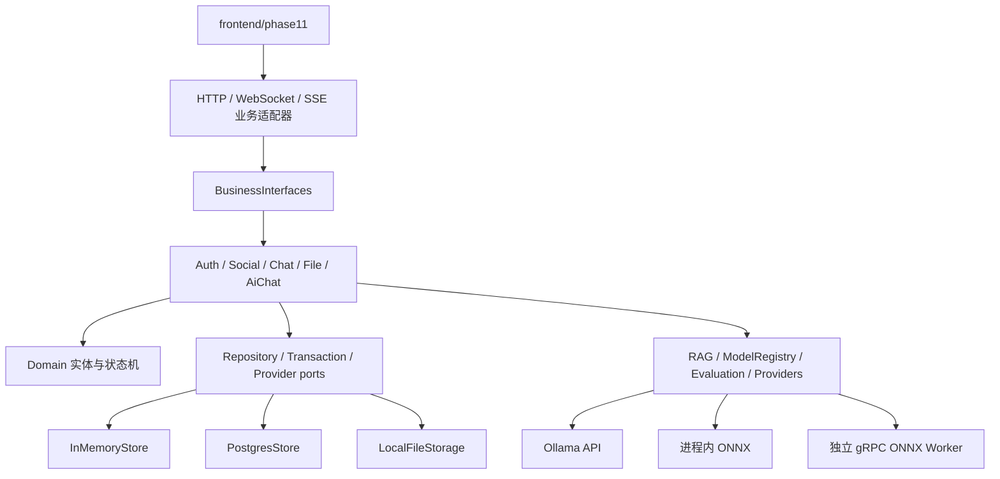

# 业务功能架构

本目录集中说明“用户能做什么，以及这些操作如何落到业务服务、Repository、数据库、实时通知和模型系统”。
通信层负责送货，业务层负责判断这件货能不能收、应该写入哪些状态、之后通知谁。

底层 HTTP/WebSocket/SSE/gRPC 不在这里重复，见 [底层通信架构](../communication/README.md)。

学习“业务如何接到服务器接口”请从 [接入教学讲义](server-business-integration-tutorial.md) 开始：按六课跟踪真实登录、消息提交、Outbox、未读/撤回和 AI 链路，附代码索引、自检题以及当前仍需补齐的验收与交互边界。

## 1. 当前功能入口

| 业务域 | 主要能力 | 详细流程 |
|---|---|---|
| 账号与会话 | 注册、登录、退出、资料、Cookie Session、CSRF、限流 | [业务调用流程](business-call-flows.md#2-账号注册与登录) |
| 社交关系 | 好友申请、接受/拒绝、好友列表、备注、免打扰、黑名单 | [业务调用流程](business-call-flows.md#3-好友与联系人) |
| 聊天 | 私聊、群聊、离线消息、幂等、未读、送达/已读、撤回、搜索 | [业务调用流程](business-call-flows.md#4-消息发送与离线接收) |
| 群治理 | 创建群、邀请、角色、禁言、移除、退出、解散 | [业务调用流程](business-call-flows.md#5-群聊治理) |
| 文件 | 头像、分片上传、完整性校验、文件消息、授权下载 | [业务调用流程](business-call-flows.md#6-文件与头像) |
| 实时事件 | WebSocket 命令、SSE 通知、Outbox、Presence | [业务调用流程](business-call-flows.md#7-outbox-与实时通知) |
| AI 对话 | 模型路由、流式 token、取消、超时、配额、熔断、备用端点 | [业务调用流程](business-call-flows.md#8-ai-生成与-rag) |
| RAG | 知识登记、切片、权限过滤、检索、引用追踪 | [业务调用流程](business-call-flows.md#8-ai-生成与-rag) |
| 模型生命周期 | 训练授权、数据集、LoRA、候选版本、评测、门禁、激活/回滚、审计 | [业务调用流程](business-call-flows.md#9-训练评测发布与回滚) |
| 运行保障 | 指标、健康检查、性能基线、监督与异常恢复 | Phase 15、16、25、26 |

## 2. 分层



上层只依赖接口，PostgreSQL、Ollama、ONNX 和 gRPC Worker 都是可替换的适配器。这样测试可以使用内存实现，
正式运行再切换真实依赖，而业务规则不会复制两份。

## 3. Phase 11–27

| 阶段 | 内容 |
|---|---|
| [Phase 11](phase11.md) | 账号、社交聊天、AI Provider 与模型治理地基 |
| [依赖审批](phase11-dependency-gates.md) | PostgreSQL、libsodium、curl、ONNX、训练工具链 |
| [Phase 12](phase12.md) | 持久消息、未读、送达/已读和撤回 |
| [Phase 13](phase13.md) | 群聊治理与权限 |
| [Phase 14](phase14.md) | 联系人、黑名单和多设备 Presence |
| [Phase 15](phase15.md) | 真实业务性能基线 |
| [Phase 16](phase16.md) | 可观测性、Outbox 主动唤醒和运维闭环 |
| [Phase 17](phase17.md) | 头像、图片与文件消息 |
| [Phase 18](phase18.md) | AI 生成韧性与资源治理 |
| [Phase 19](phase19.md) | 模型审计与生成追踪 |
| [Phase 20](phase20.md) | 评测集和激活质量门禁 |
| [Phase 21](phase21.md) | RAG 权限隔离与引用链 |
| [Phase 22](phase22.md) | 授权数据集与 LoRA 闭环 |
| [Phase 23](phase23.md) | 候选模型真实评测与人工发布 |
| [Phase 24](phase24.md) | 数据、制品和模型版本血缘 |
| [Phase 25](phase25.md) | 用户态进程监督与恢复 |
| [Phase 26](phase26.md) | 长连接、AI 并发和混合负载容量 |
| [Phase 27](phase27.md) | 历史分页、断线补齐、ACK 超时幂等重试与管理员撤回入口 |

## 4. 代码区域

```text
server/phase11/
├─ domain/          用户、会话、消息、文件、知识、训练与模型实体
├─ ports/           Repository、事务、安全、索引和模型端口
├─ business/        Auth、Social、Chat、File、AiChat、Outbox 用例
├─ transport/       HTTP 路由、实时命令/事件、序列化契约
├─ storage/         内存、PostgreSQL、文件正文
├─ ai/              Provider、RAG、模型注册、评测和韧性封装
├─ training/        授权数据、审核、数据集和 JSONL 导出
├─ security/        密码哈希与登录限流
└─ runtime/         数据库等慢任务的有界执行器
```
