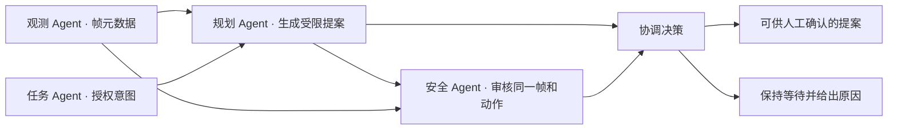

# Agent 工作流与具身协作基础

小研的对话流程复用独立的 DAG 执行器。会话读取、历史压缩、偏好召回和生成是节点。回答成功后，保存摘要及记忆的节点才具备执行条件。[小研业务与验收](../../../reports/xiaoyan-personalization-progress.md)

## 调度怎样工作

| 能力 | 行为 |
|---|---|
| 图定义 | 工作流名称含版本，节点声明依赖。加载时检查循环、缺失和重复依赖。共享前置节点每次运行只执行一次。 |
| 容量 | 单份图最多 64 个节点，工作流实例共享工作槽和运行名额。小研启用 4 个执行槽和 4 个运行名额。 |
| 超时和取消 | 总时限与节点时限独立。取消信号传入正在运行的适配器。忽略取消的任务仍占用原槽位，直到实际退出。 |
| 重试 | 显式配置的读或计算节点可在超时或明确的暂时失败后重试，最多三次。每次尝试有独立 Span ID，幂等编号沿用同一运行和节点编号。 |
| 提交 | 写节点只在依赖成功后执行，并且只尝试一次。需要汇总部分结果时，由计算节点读取依赖状态，给出保守决策。 |
| 事件 | 每次运行可产生 `dag.run`、`dag.edge` 和 `dag.node`。传输字段包括 Trace ID、节点、状态、尝试次数和耗时，业务载荷留在原适配器。 |

这套接口支持 AI 应用把模型负责的理解、判断或草稿，接到已有的资料和权限服务。模型输出作为待验证数据交给节点。实际的发消息、发布内容或设备执行由能力注册、权限核查与人工确认控制。[执行器](../../../../frontend/phase11/shared/AgentRuntime/DagExecutor.js) · [小研节点装配](../../../../frontend/phase11/shared/PersonalAgent/AgentTurnDag.js)

## 具身多 Agent 的协作接缝



观测与任务读取可并行。规划和安全审核按工作区、任务、运行编号与帧编号关联。协调决策再次校验观测时效。缺依赖、快照过期、工作区错配、帧错配或场景受阻都会进入等待状态。示例提供「记录观测」和「总结观测」两种允许的提案。当前适配器由模拟数据驱动，结果止于提案。[协作源代码](../../../../frontend/phase11/shared/AgentRuntime/AgentCoordination.js)

```powershell
node examples/agent-coordination.mjs retry
node examples/agent-coordination.mjs stale
python -B tests/project/test_observability.py ObserverContract.test_executable_multi_agent_workflow_is_consumed_by_observer
```

`retry` 演示观测失败后使用同一幂等编号再次尝试，安全审核成功后返回待确认提案。`stale` 演示过期观测让规划跳过并返回等待。Observer 测试将执行器当场生成的事件通过已认证的上传入口写入 SQLite，再用同一个 Trace ID 查回节点、边和尝试。浏览器执行器开放事件回调，日常小研页面由现有业务接口服务，长期后台采集与真实设备接入需各自验收。[可执行示例](../../../../examples/agent-coordination.mjs) · [Observer 事件契约](../../../observability/architecture.md)

后续 Linux 汇聚层可以把这四个端口分别接到模型 Worker、视觉元数据、任务状态和安全服务。跨进程调度需额外提供持久任务、租约、重放、消息顺序和独立执行确认。在真实系统接入相机、执行器或 ROS 2 前，应以事件回放证明时间戳与帧编号一致，并保留独立的设备安全控制。
