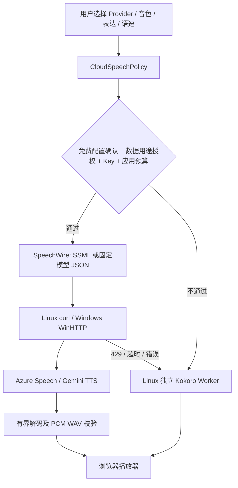

# Phase40：语音表达、个人设置与免费云适配

本阶段继续复用 Linux 已安装的 sherpa-onnx/Kokoro、libcurl、Protobuf，以及 Windows 自带 WinHTTP、SQLite 和 DPAPI，没有新增依赖下载。日常 18090 服务与原业务库没有切换。

## 1. 本地语音改变了什么

1. `SpeechText` 先检查 UTF-8、长度和控制字符，再处理公告的数字读法，例如“第10名”转为“第十名”。按句号、问号、长句中的逗号分段，最多32段。
2. 独立 `SherpaSpeechWorker` 每个任务只加载一次模型，逐段合成，句间增加180ms停顿，最终音频限制60秒。默认女声0.95倍、男声0.94倍；试听可选0.75–1.25倍。
3. 缓存摘要纳入 `prosody-v2` 和语速，旧的1.0倍音频不会误当作新结果。云音频同样受音频格式、时长、240MiB缓存和24小时过期限制。
4. Kokoro没有情绪或角色接口。这里没有声称用调整语速就实现“御姐感”或自然情绪；这些听感需要同文案试听。

## 2. 云语音如何接入

- Azure：固定区域主机、REST SSML；女声晓墨 `zh-CN-XiaomoNeural`，男声云希 `zh-CN-YunxiNeural`。只允许这些音色实际支持的表达，分别采用成熟女性/青年男性角色。音调和语速为SSML控制项。[官方REST协议](https://learn.microsoft.com/en-us/azure/ai-services/speech-service/rest-text-to-speech)、[音色与表达](https://learn.microsoft.com/en-us/azure/ai-services/speech-service/language-support?tabs=tts)。
- Gemini：固定 `gemini-2.5-flash-preview-tts` 与 `generateContent` 契约，Kore/Charon音色；原始24kHz PCM校验后封装WAV。表达和语速通过提示建议，不保证精确执行。[固定模型说明](https://ai.google.dev/gemini-api/docs/models/gemini-2.5-flash-preview-tts)、[REST协议](https://ai.google.dev/api/generate-content)。
- 免费档必须由用户自行申请并确认，程序不创建账号、不更换付费档。Azure F0目前列出每月50万神经语音字符免费额度；应用以UTF-8字节及额外开销保守计数，不能替代平台计费。[Azure价格](https://azure.microsoft.com/en-us/pricing/details/speech/)。
- Gemini免费档的数据用途需要单独同意，不默认用于私人内容。模型固定后也应在启用前复查可用性及免费档政策。[Gemini定价与数据用途](https://ai.google.dev/gemini-api/docs/pricing)。

## 3. 密钥、预算与故障边界

| 场景 | 保存位置 | 浏览器可见内容 |
|---|---|---|
| 个人云语音Key | Windows每账号SQLite内DPAPI密文 | 仅“已配置/未配置”；输入框保存后清空 |
| 站点公告Key | Linux当前用户私有文件，拒绝符号链接和组/其他用户权限 | 仅配置状态 |
| 音色设置 | Windows私人库 / Linux `speech_profiles` | Provider、音色、语速、表达等普通设置 |
| 应用预算 | Windows `personal_speech_usage` / Linux `speech_usage` | 应用用量估计，不声称云端余额 |

Linux通过 `WEB_SPEECH_AZURE_KEY_FILE`、`WEB_SPEECH_GEMINI_KEY_FILE` 指定已有私有文件。不要把Key写进命令参数、Git、HTML或浏览器持久存储。未配置时不发起云请求。

预算按UTC月份和分钟持久保存，失败尝试也占预算，重启不会重置。应用限制Azure每月500000预算单位/每分钟20次，Gemini每月100000单位/每分钟3次；后者是本项目的保守上限，**不是官方免费额度声明**。429后冷却60秒，不自动循环重试。

出站目标固定为官方HTTPS主机，不允许任意URL，不跟随跳转；保持正常证书验证，3秒连接、15秒云请求期限、4MiB响应上限。无Key、无授权、预算耗尽、429、认证错误、网络错误或坏音频都会尝试本地回退。本地也失败时返回明确失败，文字公告仍可使用。

个人试听只发送固定公开文案，不自动朗读私人会话或资料。个人回退使用强制本地预置接口，和站点公告的云偏好分离。需要浏览器主动操作或点击播放器时会显示提示。

## 4. 接口与调用顺序

| 接口 | 用途 |
|---|---|
| 本机 `/api/local/assistant/speech/settings` GET/PATCH | 个人偏好与DPAPI Key；带本机会话、CSRF、账号身份 |
| 本机 `/speech/preview` POST、`/speech/preview/{voice}` GET | 后台单任务有界试听，查询状态和实际回退原因 |
| 本机 `/speech/preview/{voice}/audio` GET | 读取账号专属内存音频；页面用带身份头的fetch转Blob播放 |
| `/api/admin/speech/settings` GET/PATCH | 仅站点管理员配置公告偏好；同事务保存审计 |
| `/api/admin/speech/preview` | 站点偏好试听；内容管理员保留预置试听权限，不能改全站配置 |
| `/api/me/speech/preview` | 登录用户固定文案本地试听，可传字符串语速 |

私人助手“设置”及管理中心“公告音色”都有独立设置弹窗，不把表单挤进主聊天区。新增022迁移只应用到既有隔离库；正式升级仍需备份后按顺序执行新增迁移。

## 5. 代码索引

- 纯协议与策略：[SpeechProfile](../../../../backend/ai/speech/domain/SpeechProfile/SpeechProfile.h)、[SpeechText](../../../../backend/ai/speech/application/SpeechText/SpeechText.cpp)、[SpeechWire](../../../../backend/ai/speech/application/SpeechWire/SpeechWire.cpp)、[WaveCodec](../../../../backend/ai/speech/application/WaveCodec/WaveCodec.cpp)、[CloudSpeechPolicy](../../../../backend/ai/speech/application/CloudSpeechPolicy/CloudSpeechPolicy.cpp)。
- Linux驱动：[CurlCloudSpeech](../../../../backend/ai/speech/infrastructure/CurlCloudSpeech/CurlCloudSpeech.cpp)、[SiteSpeechRenderer](../../../../backend/ai/speech/infrastructure/SiteSpeechRenderer/SiteSpeechRenderer.cpp)、[SherpaSpeechWorker](../../../../backend/ai/speech/infrastructure/SherpaSpeechWorker/SherpaSpeechWorker.cpp)。
- 本机驱动：[WindowsCloudSpeech](../../../../client/assistant/WindowsCloudSpeech/WindowsCloudSpeech.cpp)、[PersonalSpeech](../../../../client/assistant/PersonalSpeech/PersonalSpeech.cpp)。
- 页面：[SpeechSettings](../../../../frontend/phase11/shared/SpeechSettings/SpeechSettings.js)；数据：[022迁移](../../../../backend/application/storage/postgres/migrations/022_speech_profiles_and_budget.sql)。

## 6. 验证记录与限制

- Linux Release完整回归111项通过；Windows五项原生契约通过，包含免费档/Key/数据授权/预算/429冷却/异常回退、UTF-8、SSML/JSON转义、PCM和WAV边界。
- `speech_profiles_blackbox.py` 在既有 `function3_runtime_test` 完成普通用户越权拒绝、管理员配置审计、男女两种缺Key回退、真实非静音WAV验证，并保存同文案试听文件。
- Windows到Linux的个人试听缺Key回退、音频获取、切号隔离及设置弹窗三尺寸检查已通过，完整结果汇总在Phase41。
- 没有用户云Key，**真实Azure/Gemini调用未验收**；没有将“生成了WAV”当成自然度合格。试听的成熟感、磁性与自然程度仍需人工判断。

复现：先按[Phase38](../client-ui/phase38.md)启动本机入口；隔离服务加 `--tts`，执行 `python3 tests/function3/integration/speech_profiles_blackbox.py --output /home/pikachu/phase11-data/function3/validation/phase40/speech.json`。输出目录仅保留测试结果及固定公开文案音频。
