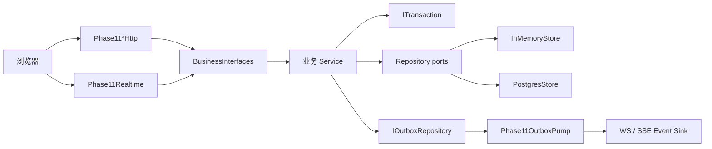
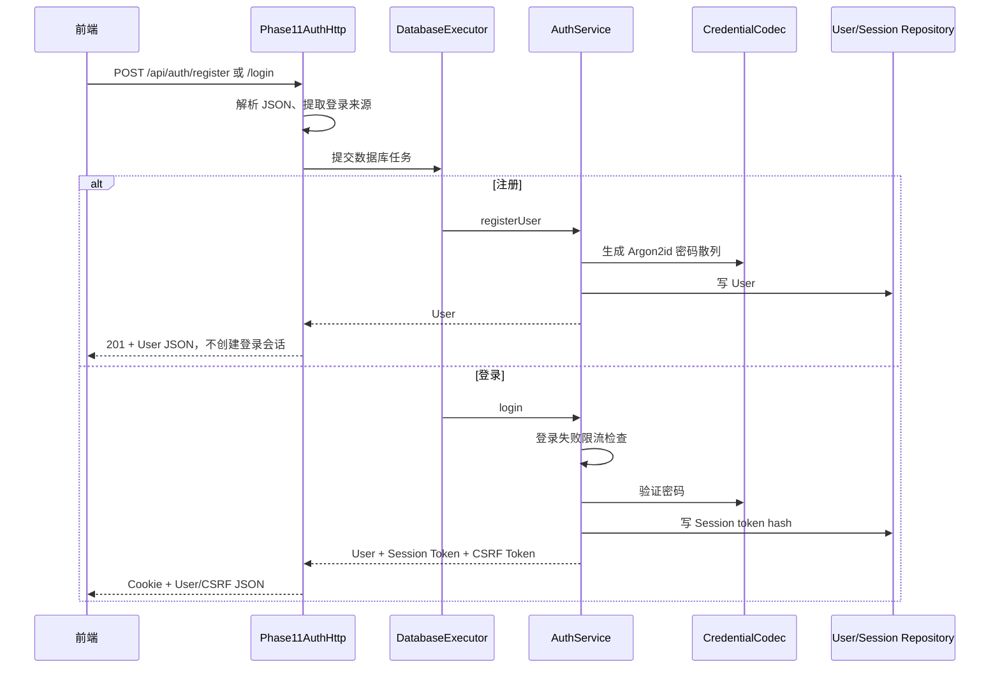
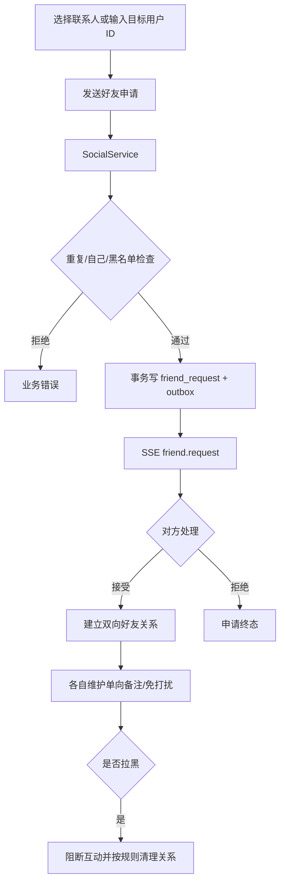
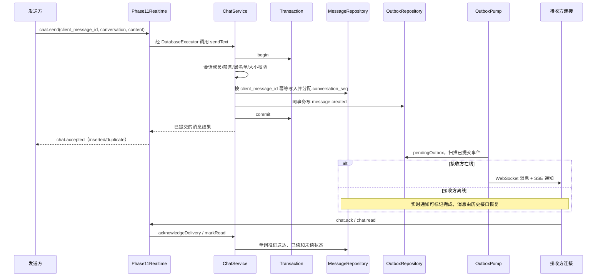
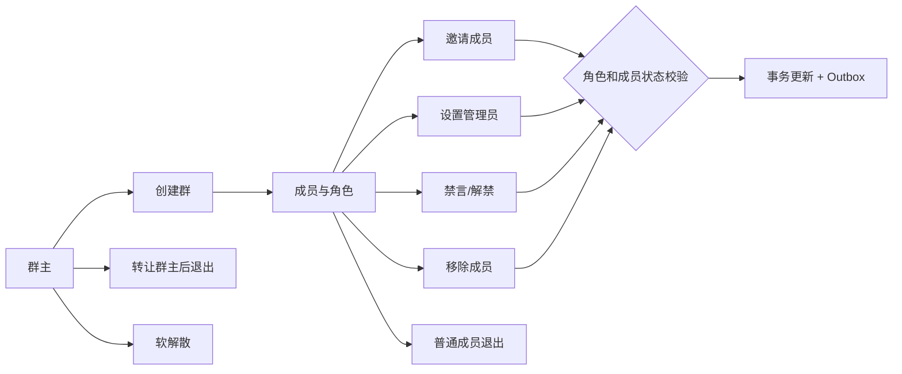
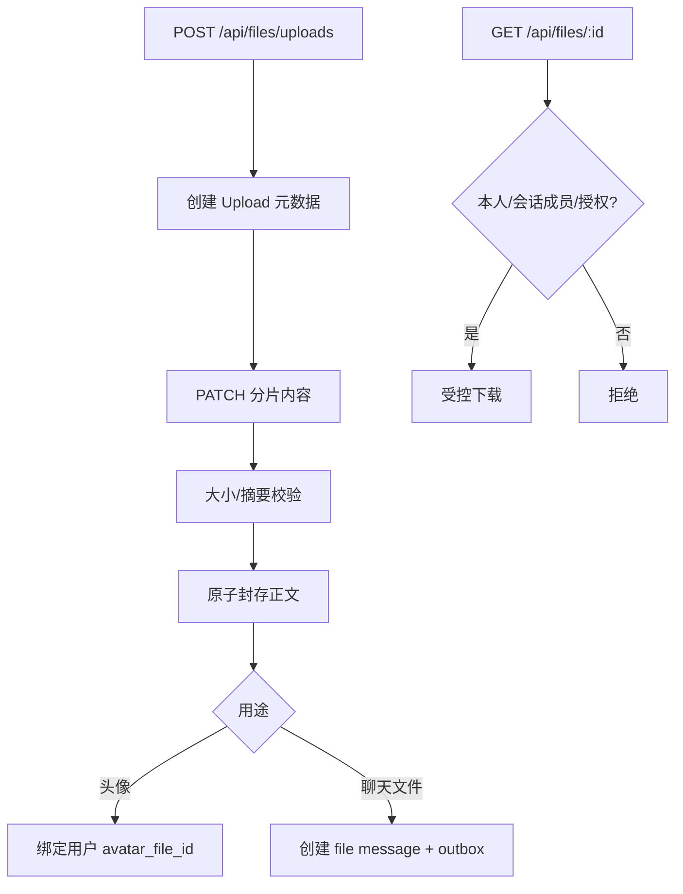
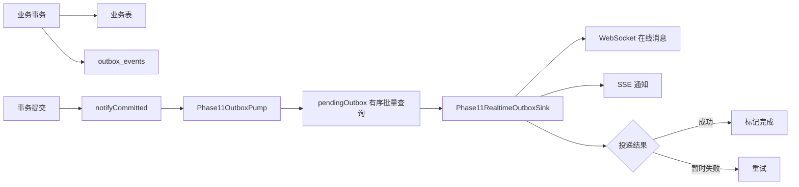
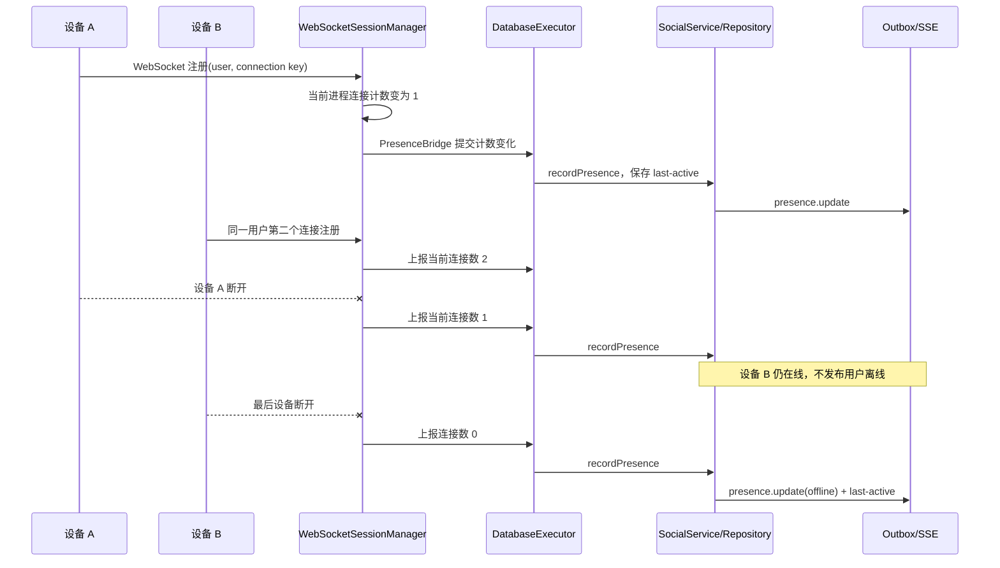
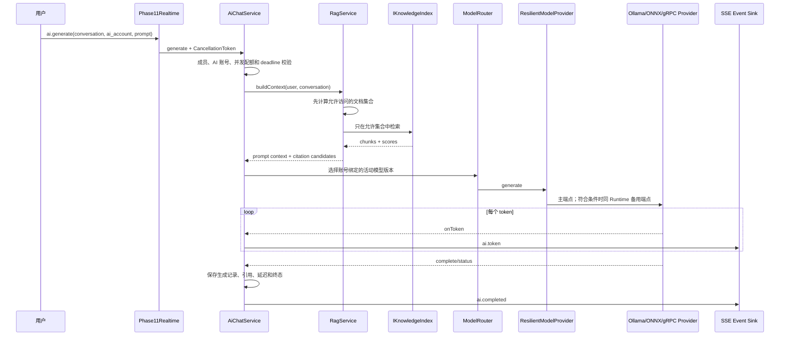
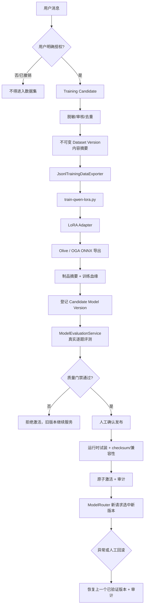

# 业务功能实现与调用关系

## 1. 统一调用边界



HTTP、WebSocket 和 SSE 只负责翻译协议。权限、幂等、事务和状态机放在业务 Service，持久化细节放在 Repository。

## 2. 账号注册与登录



代码：[`Phase11AuthHttp`](../../../server/phase11/transport/http/Phase11AuthHttp/Phase11AuthHttp.cpp)、
[`AuthService`](../../../server/phase11/business/AuthService/AuthService.cpp)、
[`SodiumCredentialCodec`](../../../server/phase11/security/SodiumCredentialCodec/SodiumCredentialCodec.cpp)。

## 3. 好友与联系人



好友关系是双方确认后的关系；备注和免打扰是每个用户自己的单向设置。联系人离线不会阻止发送持久消息。

代码：[`SocialService`](../../../server/phase11/business/SocialService/SocialService.cpp)、
[`Phase11SocialChatHttp`](../../../server/phase11/transport/http/Phase11SocialChatHttp/Phase11SocialChatHttp.cpp)。

## 4. 消息发送与离线接收



“离线可发”的关键不是把 WebSocket 变成永久连接，而是**先提交数据库，再尝试实时投递**。对方重新上线后按
`conversation_seq` 拉取缺失历史，重复 `client_message_id` 不会再写一条消息。

同一条消息的后续操作仍经过业务层：

- `chat.ack` 和 `chat.read` 只能单调推进状态，迟到或重复回执不会让状态倒退；变化通过 `chat.receipt` 通知成员；
- `chat.recall` 校验发送者、会话权限和当前状态，再事务化写撤回结果和 Outbox；
- `/api/search/messages` 要求指定 `conversationId`，校验成员身份后搜索该会话，当前不是跨全部会话的全局搜索；
- 会话列表和历史查询从持久状态恢复，因此浏览器刷新或服务器重启不会只剩内存中的消息。

[Phase 27](phase27.md) 补齐浏览器侧的恢复编排：最新页用 `before=0`、旧页用排他 `before`、缺口用排他 `after` 逐页读取；重连也刷新可见旧消息的撤回状态。
文字命令 5 秒未确认时，先用 `messages/by-client-id` 查询当前发送者的原幂等键，再有限重试；前端按角色显示“管理撤回”，最终仍由 `ChatService` 授权。

代码：[`ChatService`](../../../server/phase11/business/ChatService/ChatService.cpp)、
[`Phase11Realtime`](../../../server/phase11/transport/realtime/Phase11Realtime/Phase11Realtime.cpp)、
[`OutboxDispatcher`](../../../server/phase11/business/OutboxDispatcher/OutboxDispatcher.cpp)。

## 5. 群聊治理



所有权限判断都在 `ChatService/SocialService` 和 Repository 事务内完成，前端隐藏按钮只改善体验，不构成安全边界。

## 6. 文件与头像



元数据由 Repository 管理，文件正文由 `LocalFileStorage` 管理；临时分片只有完成摘要校验后才原子变成正式文件。

代码：[`FileService`](../../../server/phase11/business/FileService/FileService.cpp)、
[`Phase11FileHttp`](../../../server/phase11/transport/http/Phase11FileHttp/Phase11FileHttp.cpp)、
[`LocalFileStorage`](../../../server/phase11/storage/files/LocalFileStorage/LocalFileStorage.cpp)。

## 7. Outbox 与实时通知



Outbox 解决“数据库已经成功，但进程在发通知前崩溃”的夹缝问题。业务数据与事件写在同一事务，推送可以稍后重试。

当前是单 Pump 顺序扫描，没有多消费者 claim/lease。Sink 的“成功”不是客户端送达回执；零在线连接也可以标记事件已发布，离线用户依靠消息历史恢复。AI 中间 token 由独立 SSE Event Sink 直接发布，不逐 token 写入 Outbox。详见 [教学讲义](server-business-integration-tutorial.md#10-outbox保证的是什么不保证什么)。

### 多设备 Presence



Presence 是“用户是否至少有一个有效设备在线”，不能把某一个 fd 当成用户本身。连接注册和断开先回到所属
Reactor，再把持久化工作交给数据库执行器，避免占住网络线程。当前连接计数由进程内 SessionManager 维护，没有数据库设备租约表或跨实例 lease 协调。

## 8. AI 生成与 RAG



Provider 统一接口屏蔽 Ollama HTTP、进程内 ONNX 和独立 gRPC Worker 的差异。RAG 先做权限集合，再做检索；
引用保存的是生成当时真正使用的切片，而不是事后重新搜索的结果。

代码：[`AiChatService`](../../../server/phase11/business/AiChatService/AiChatService.cpp)、
[`RagService`](../../../server/phase11/ai/RagService/RagService.cpp)、
[`ModelRegistryService`](../../../server/phase11/ai/ModelRegistryService/ModelRegistryService.cpp)、
[`ResilientModelProvider`](../../../server/phase11/ai/ResilientModelProvider/ResilientModelProvider.cpp)。

## 9. 训练、评测、发布与回滚



训练脚本不直接改线上活动模型。数据授权、数据集摘要、模型制品摘要、评测结果、人工发布和审计串成一条可追踪血缘。
任何一步失败都保留当前活动版本。

代码：[`TrainingDataService`](../../../server/phase11/training/TrainingDataService/TrainingDataService.cpp)、
[`JsonlTrainingDataExporter`](../../../server/phase11/training/JsonlTrainingDataExporter/JsonlTrainingDataExporter.cpp)、
[`ModelEvaluationService`](../../../server/phase11/ai/ModelEvaluationService/ModelEvaluationService.cpp)、
[`ModelRegistryService`](../../../server/phase11/ai/ModelRegistryService/ModelRegistryService.cpp)、
[`训练管理工具`](../../../tools/phase11_training_admin.cpp)、
[`模型管理工具`](../../../tools/phase11_model_admin.cpp)。

## 10. 数据与迁移对应关系

| 迁移 | 业务主题 |
|---|---|
| `001_phase11.sql` | 用户、Session、好友、会话、消息、Outbox、基础模型表 |
| `002_message_lifecycle.sql` | 送达、已读、撤回、会话摘要 |
| `003_group_governance.sql` | 群角色、禁言、退出与解散 |
| `004_contacts_presence.sql` | 联系人设置、黑名单、多设备在线状态 |
| `005_files.sql` | 文件元数据、上传、头像和文件消息 |
| `006_ai_governance.sql` | 模型审计和生成追踪 |
| `007_model_evaluation.sql` | 评测运行与结果 |
| `008_evaluation_suite_versioning.sql` | 不可变评测集版本 |
| `009_rag_knowledge_and_citations.sql` | 知识文档、切片、检索与引用 |
| `010_training_dataset_artifacts.sql` | 训练数据集和制品 |
| `011_training_candidate_deduplication.sql` | 授权候选去重 |
| `012_model_training_lineage.sql` | 训练到模型版本的不可变血缘 |

表字段和关系详见 [数据库文档](../../database/README.md)。

## 11. 健康检查、指标与进程恢复

```mermaid
flowchart LR
    Runtime[ServerRuntime] --> Live["/health/live<br/>进程存活"]
    Runtime --> Ready["/health/ready<br/>server.ready + store.healthy"]
    Runtime --> Metrics[/metrics<br/>HTTP/WS/SSE/DB/AI/Outbox 指标]
    PG[(PostgreSQL)] --> Ready
    Provider[AI Provider] --> Metrics
    Outbox[OutboxPump] --> Metrics
    LongConn[WS/SSE 长连接] --> Metrics
    Supervisor[用户态 Supervisor] --> Live
    Supervisor --> Ready
    Supervisor --> Decision{异常类型与重启预算}
    Decision -->|可恢复| Restart[有退避地重启服务]
    Decision -->|反复失败| Stop[停止重启并保留诊断]
    Benchmark[Phase 15/26 基准] --> Metrics
    Benchmark --> Capacity[QPS/P99/长连接/AI 并发容量证据]
```

- **liveness** 回答“进程是否仍在运行”，**readiness** 回答“现在是否适合接新请求”；两者不能共用一个结论。
- 当前 readiness 检查服务器状态与数据库健康，不探测每个 AI Provider 的生成能力；`/metrics` 输出 Prometheus 文本。
- Supervisor 使用 PID 与进程启动时刻共同确认身份，避免 PID 被复用后误杀另一个进程。
- Phase 15 测真实账号和聊天业务，Phase 26 测长连接与 AI 混合负载；测试数字必须和硬件、构建类型、配置及错误数一起记录。
- 指标用于定位容量瓶颈，不替代业务持久化，也不能把单机一次通过写成生产 SLA。

对应文档：[Phase 15](phase15.md)、[Phase 16](phase16.md)、[Phase 25](phase25.md)、[Phase 26](phase26.md)。
