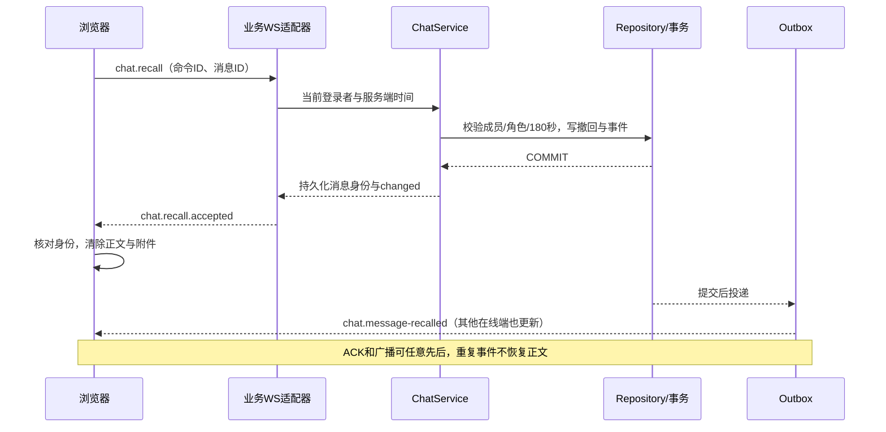

# 三分钟撤回修复与神树聊天背景

更新：2026-11-05。沿用现有 Linux 服务器、业务模块和浏览器分工，没有修改 `backend/server/` 通信核心，也没有新增依赖、数据库或迁移。

## 1. 撤回修复了什么

1. 原来服务端写的是 `minutes(2)`，浏览器也是 `120000` 毫秒，与三分钟要求不一致。现在两端统一为 **180 秒**：恰好 180000 毫秒允许，180001 毫秒拒绝，最终按服务端时间判断。
2. 原来收到 `chat.recall.accepted` 只结束等待，正文仍依赖另一条 Outbox 广播更新。若广播延迟或丢失，旧消息不一定进入“新消息序号补齐”的范围。现在确认回执同时核对**命令 ID、消息 ID、会话 ID、序号与成功状态**，匹配后立刻应用撤回终态，清除页面正文和附件。
3. 点击按钮不等于成功。没有确认时仍显示结果未确认并同步；不匹配或旧账号的回执不能清除正文。广播先到也能收敛，迟到旧历史不能覆盖撤回终态。
4. 可见的撤回按钮过期后自动移除；只为当前有界 DOM 设置一个最近截止时间定时器，不为全部历史逐条创建定时器。页面销毁时释放定时器和观察器。
5. 重复点击同一条待确认操作被合并。已成功撤回的请求在时间窗之后重试，仍返回 `already_recalled`，不再生成第二份撤回事件。

权限没有扩大：本人撤回自己的消息；群主管理群内消息；管理员只能管理普通成员消息，不能撤回群主或其他管理员消息。所有操作仍要求有效成员、活动会话和三分钟窗口；数据库保留撤回记录，不在历史和公开投影中返回原正文及附件。

## 2. 背景如何嵌入聊天布局

背景初版遵循手绘，以 SVG 表现左上花冠和左下树干。同日根据用户镜像参考图进一步替换为[樱花水岸背景](sakura-lake-background.md)：同源 JPEG 表现细致花冠、树干和水面倒影，中央柳絮、零星落叶与落花仍由有界 CSS 粒子承担；没有新开 WebGL 上下文。

背景与消息列表共用显式 `messages` Grid 区域，消息独立滚动，背景固定，输入区仍在 `composer` 区域贴底。背景 `pointer-events:none`、`aria-hidden` 和 `inert`，不拦截气泡、附件、选择文本或发送按钮。

颜色与遮罩统一放在 DesignSystem Token 中，深浅主题分别设置。桌面固定 20 个粒子，手机显示 8 个；切到后台或背景不可见时暂停动画；系统要求减少动态时停止粒子。没有逐帧 JavaScript 循环；背景通过本服务的版本化原生模块加载，源JPEG按内容哈希管理。

## 3. 代码索引

|职责|实现|
|---|---|
|服务端时间窗、权限、事务与幂等|[ChatService.cpp](../../../../backend/application/modules/chat/application/ChatService/ChatService.cpp)|
|按钮时间与角色规则|[ChatHistory.js](../../../../frontend/phase11/chat/ChatHistory.js)|
|命令发送、待确认状态|[MessageController.js](../../../../frontend/phase11/chat/MessageController/MessageController.js)|
|回执身份匹配、终态投影、按钮过期|[MessageRecall.js](../../../../frontend/phase11/chat/MessageRecall/MessageRecall.js)|
|实时回执与广播收敛|[RealtimeController.js](../../../../frontend/phase11/chat/RealtimeController/RealtimeController.js)|
|背景构图与生命周期|[ChatBackdrop.js](../../../../frontend/phase11/chat/ChatBackdrop/ChatBackdrop.js)、[ChatBackdrop.css](../../../../frontend/phase11/chat/ChatBackdrop/ChatBackdrop.css)|
|组件装配与页面销毁|[ChatApplication.js](../../../../frontend/phase11/chat/ChatApplication/ChatApplication.js)|
|主题颜色|[tokens.css](../../../../frontend/phase11/shared/DesignSystem/tokens.css)|

## 4. 验证与上线

|检查|结果与范围|
|---|---|
|前端回归|79 项通过，含新加的回执匹配、单定时器清理与背景生命周期测试|
|Linux Release|重新构建后 4 项相关用例通过：核心业务、工作区契约、聊天可靠性、HTTP 认证|
|Debug / ASan+LSan+UBSan|聊天可靠性用例分别通过；不冒充全服务器测试矩阵|
|真实 HTTP/WS/PostgreSQL|复用 `function3_runtime_test`：150 秒允许、181 秒拒绝、600 秒重复撤回仍幂等、仅一份 Outbox 事件、非成员拒绝、离线历史不暴露正文|
|浏览器|真实前端＋本机协议替身，故意丢弃撤回广播，只发 ACK；页面正确出现撤回占位。检查 1440×900、1920×1080、390×844，输入框贴底、无横向溢出、背景不挡操作|
|通信边界|152 份通信核心文件保持不变|
|上线|18090，前端版本 `b72df43c75b2ce02`；原库 `phase11`、68 个账号、密码散列、Token Key、证书与迁移版本 24 保持不变|

真实网络测试在既有隔离库执行，没有向原库写测试账号或聊天。未重新进行完整压力测试，不宣称吞吐或 GPU 性能提升。浏览器减少动态规则有代码和契约检查，未声称跨设备像素一致。

验证命令与报告见[历史验收摘要](../../../ops/validation/function3.1.md#历史补丁)。历史 Phase12/13/27 中“两分钟”的文字保留为当时设计，本页为当前三分钟规则。当前业务教学中的说明同步更新。

访问 [原聊天服务](http://192.168.239.135:18090/phase11/?v=b72df43c75b2ce02) 后刷新即可。已有超过三分钟的消息不会重新获得撤回权限。
