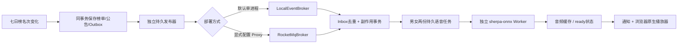
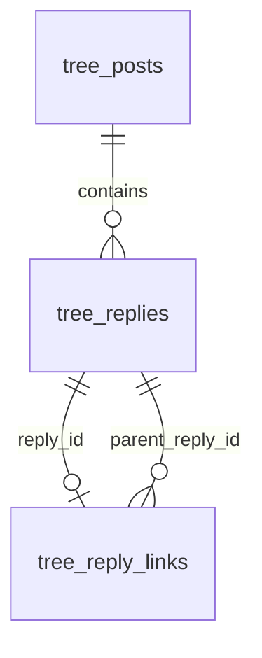
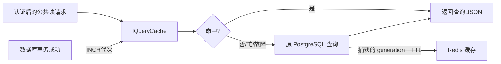

# Phase35：复用原业务库、语音修复、Redis 与界面重构

本阶段承接 Phase28–34，仍在本地分支 `feature/function3-tree`，没有提交或推送 GitHub。按本轮要求，日常 Linux 实例改用原 `phase11` 数据库和 **18090** 端口；隔离测试继续使用既有 `_test` 库。

## 1. 用户问题与对应改动

| 原问题 | 当前处理 | 主要文件 |
|---|---|---|
| 开了声音却没有播报 | 补齐无 MQ 时的持久任务投递；引擎状态、两种音色试听、播放器和错误提示 | `Function3Runtime`、`LocalEventBroker`、`SpeechAdminHttp`、`AnnouncementPlayer` |
| 新功能总换数据库，原账号失效 | 日常入口锁定原库、原密钥与原文件；先备份再执行缺失迁移 | `scripts/function3/runtime/service.py` |
| 聊天、树、后台难切换 | 三页共享导航，桌面顶部与移动底部可切换 | `shared/AppNavigation` |
| 尝试 Redis 优化 | 复用现有 6379；分类和榜单读缓存，故障回落 PG | `modules/cache` |
| 聊天布局拥挤 | 左会话、右消息，详情抽屉、折叠次级工具、紧凑输入区 | `chat/ChatWorkbench`、`app.js` |
| 树页面、评论和举报拥挤 | 神树/广场/榜单分视图；详情、发布、筛选、举报、图片各自弹层 | `TreeApp`、`tree/index.html` |
| 树本身造型不好看 | 重建渐细曲线枝干、树根、五瓣花冠、落瓣、发光果实与排行光环 | `TreeScene` |
| 回复没有明确对象 | 新增真实父回复关系，同事务保存，幂等键包括回复目标 | `TreeService`、`TreePostgresRepository`、迁移018 |

没有下载新的软件或美术资源。树皮、花瓣纹理由 Canvas 生成，树体为 Three.js 代码建模；界面借鉴聊天软件的会话布局与评论区层次，没有复制第三方页面或素材。

## 2. 语音：开关只是遥控器，后端还必须有“音响”

原来的 `run_server.py start --ai` 只配置了 AI；用户打开声音只是在保存通知偏好，并不会自动配置语音 Worker。此外，原装配在缺少 MQ 地址时提前返回，社区 Outbox 的语音请求没有继续消费。

现在把消费逻辑复用到两种显式投递方式：

1. 本地适配器仍走持久 Outbox、Inbox 和语音任务，不是用前端假音频冒充成功。
2. 默认本地模式保留原聊天实时通道；只有明确选择 MQ 才启用原聊天 MQ 路径。MQ 消费确认仍不替代消息 ACK 或已读。
3. 一次固定文案试听通过短 HTTP 请求创建有界任务，再查询状态；不让 Reactor 等待冷生成。
4. 普通登录用户可以试听，管理员原有试听接口保留。公开试听音频只能取当前已准备好的固定音色缓存键，不开放任意缓存路径。
5. 播放器提示生成、失败和浏览器播放限制；多标签页领取去重、录音期间暂缓、公告过期策略仍保留。

新增普通用户接口：

| 方法 / 路径 | 职责 |
|---|---|
| `GET /api/me/speech/status` | 是否启用引擎、实际投递模式 |
| `POST /api/me/speech/preview` | 校验登录和 CSRF，提交固定音色试听 |
| `GET /api/me/speech/preview/{voice}` | 查询 pending / ready / failed |
| `GET /api/me/speech/audio/{key}` | 读取已完成的固定试听音频 |

## 3. 原数据库与账号保留

2026-10-24 的升级在原 `phase11 / 5432` 上执行，只补齐012–018。升级前生成自定义格式备份并检查可读取性，升级前后比较 `(id, username, password_hash)` 摘要，**68 个原账号均保持不变**。备份路径与校验报告保存在 Linux 日常运行目录，不纳入 Git。

首次管理员按你“随便”的授权选择已有 `nebula_owner`，使用官方 bootstrap 工具登记为站点管理员，保留审计。没有修改密码；授权时吊销旧 Session，重新登录后生效。角色变更和登录会产生合理的 Session / 审计写入，不应误解为数据库完全没有写入。

新迁移 [018_tree_reply_links.sql](../../../../backend/application/storage/postgres/migrations/018_tree_reply_links.sql) 只新增 `tree_reply_links`：

回复关系像“信封上的收件人”：`tree_replies` 保存正文，`tree_reply_links` 保存回复给哪条评论。父回复必须属于同一果实且有效，子 ID 大于父 ID 防止向后成环；这条跨果实规则由业务层校验，数据库外键保护引用。原评论无关系记录时仍是主评论。删除使用原软删除策略，不破坏历史引用。

客户端传 `parentReplyId`，服务端返回 `parentReplyId / replyToName`。重复请求键只有正文和目标一致才复用原结果，换目标会冲突。关系和正文在同一数据库任务、同一事务提交。前端不再只在输入框插入 `@名字` 来假装关联。

## 4. Redis：放一份可丢弃的“查询小抄”

PostgreSQL 是原账本；Redis 只是查询小抄，丢掉也能重建。本轮复用现有 **Redis 6.2.19 / 6379**，没有重复安装，也没有停止或修改共享 Redis。

| 缓存内容 | TTL | 失效点 |
|---|---:|---|
| 公共分类 | 30秒 | 管理员分类写入成功后 |
| 最新榜单快照 | 2秒 | 榜单结算成功后 |

重要边界：

1. 身份认证在查询缓存之前执行；账号、Session、权限、用户正文、写操作和消息 ACK 不缓存。
2. `generation` 像小抄的版号。数据库查询前读到版号，迟到的旧查询只准填旧版缓存，不能污染失效后的新版。
3. 第一轮实现分两次 GET，又逐字节读取响应头，给便宜的分类查询增加了开销。随后改为**固定只读 Lua 一次往返取得版号和内容**，并用 4 KiB 接收缓冲解析 RESP。
4. 四个连接使用 `try_lock`，忙则回源；默认每次缓存操作20ms期限，失败后1秒旁路；内容上限128 KiB。阻塞等待只发生在业务 Worker，不占 Reactor。
5. 驱动只发送内部固定的 EVAL / SETEX / INCR（可选 AUTH），不接受用户命令。RESP2 格式参考 [Redis 官方协议说明](https://redis.io/docs/latest/develop/reference/protocol-spec/)。
6. 它不是完整 Redis 客户端：本轮只支持数值 IPv4、单节点、可选密码；未提供集群、TLS、ACL 用户名、自动拓扑发现或高可用承诺。公共读缓存失效失败时可能延迟到 TTL 到期，不能拿来缓存权限。
7. 管理员 `GET /api/admin/cache` 可看 hits / misses / errors / bypassed；后台运行状态展示实际计数。

性能记录和最终回归结果见第7节。接入 Redis 本身不等于所有接口变快，更不等于修复了 Phase34 的聊天 ACK 尾延迟。

## 5. 前端如何拆分

- **公共导航**：三个页面共享身份和声音入口。桌面顶部、移动底部切换，后台仍由服务端权限控制。
- **聊天**：会话与联系人在左，消息与输入在右；详情用抽屉，低频模型/训练操作收进“更多工具”。分页、断线补齐、固定消息 ID 重试和 ACK 状态逻辑保留。
- **神树**：场景只承担旋转、缩放和选果实；故事广场承担浏览筛选，七日榜承担名次展示。发布、举报、筛选放单独对话框。
- **树形**：渐细曲线主干、三级侧枝、根系和树皮，实例化五瓣花、近景花、落瓣；前十果实有金色光环与编号。移动端减少花和落瓣数量，远景降级，WebGL 不可用保留列表。
- **评论**：头像、昵称、作者标识、时间、正文、回复入口分层；有明确回复对象与取消回复；详情左右分区，移动端为可滚动面板。举报使用原因单选和补充说明，有提交状态，不用浏览器原生 prompt。
- **管理中心**：保留职责页签，修复移动宽度下表格撑开整页的问题；表格区域内部滚动。

前端只展示服务器确认的结果；未增加假在线人数、假吞吐、虚构图片/语音状态或不存在的评论点赞、热门排序。

## 6. 代码与复现索引

| 组件 / 工具 | 位置 |
|---|---|
| 日常服务、备份与账号摘要 | [service.py](../../../../scripts/function3/runtime/service.py) |
| 投递装配与引擎状态 | [Function3Runtime.cpp](../../../../backend/application/modules/bootstrap/Function3Runtime/Function3Runtime.cpp) |
| 本地 Broker 适配 | [LocalEventBroker.h](../../../../backend/application/modules/messaging/infrastructure/LocalEventBroker/LocalEventBroker.h) |
| 缓存端口 | [IQueryCache.h](../../../../backend/application/modules/cache/ports/IQueryCache/IQueryCache.h) |
| Redis 驱动 | [RedisReadCache.cpp](../../../../backend/application/modules/cache/infrastructure/RedisReadCache/RedisReadCache.cpp) |
| 普通试听接口 | [SpeechAdminHttp.cpp](../../../../backend/ai/speech/transport/SpeechAdminHttp/SpeechAdminHttp.cpp) |
| 公共导航 | [AppNavigation.js](../../../../frontend/phase11/shared/AppNavigation/AppNavigation.js) |
| 公告播放器 | [AnnouncementPlayer.js](../../../../frontend/phase11/shared/AnnouncementPlayer/AnnouncementPlayer.js) |
| 聊天布局 | [ChatWorkbench.css](../../../../frontend/phase11/chat/ChatWorkbench/ChatWorkbench.css) |
| 树业务页面 | [TreeApp.js](../../../../frontend/phase11/tree/TreeApp/TreeApp.js) |
| 3D 树模型 | [TreeScene.js](../../../../frontend/phase11/tree/TreeScene/TreeScene.js) |
| 回复用例 / 存储 | [TreeService.cpp](../../../../backend/application/modules/tree/application/TreeService/TreeService.cpp)、[TreePostgresRepository.cpp](../../../../backend/application/modules/tree/infrastructure/TreePostgresRepository/TreePostgresRepository.cpp) |
| Redis 真实契约 | [redis_cache.cpp](../../../../tests/function3/integration/redis_cache.cpp) |
| 原库只读功能验收 | [shared_runtime.py](../../../../tests/function3/integration/shared_runtime.py) |
| 隔离自动公告/媒体/权限链路 | [local_delivery_runtime.py](../../../../tests/function3/integration/local_delivery_runtime.py) |
| 原库页面与真实音频 | [live_browser.cjs](../../../../tests/function3/frontend/live_browser.cjs) |
| 同配置缓存对照 | [function3_read_cache.py](../../../../benchmarks/function3_read_cache.py) |

每个 C++ 新组件保持同名目录；`IQueryCache` 为纯接口，不创建空 `.cpp`。新增 `function3_cache` 独立 target。业务层不包含 Redis socket、libpq 或语音引擎类型。完整组件表见 [代码索引](../indexes/function3-code-index.md)。

## 7. 验证结果与限制

证据独立存入 `docs/evidence/function3-phase35/`；旧 Phase34 结果保留，不被覆盖。

| 最终检查 | 结果 |
|---|---|
| Linux Release | 108/108，37.25秒 |
| Linux Debug | 108/108，34.51秒 |
| ASan / LSan / UBSan | 108/108，44.87秒；detect_leaks=1，ASan/UBSan遇错终止；第三方预编译库未重新插桩 |
| Node前端单元 | 18/18 |
| 原聊天浏览器回归 | 分页、断线补齐、丢ACK、待确认恢复、角色入口五组全部通过 |
| 树/后台浏览器 | WebGL、分视图、移动、发布CSRF、父回复、举报、后台越权、异步模型和试听通过 |
| 公告播放器浏览器 | 自动播放被拒后的恢复、原生播放、录音暂停恢复、多标签领取去重、销毁后的迟到请求通过 |
| 原库真实页面 | 原账号登录、统一导航、原生播放、390×844三页无横向溢出，页面异常0 |
| 原库数据保护 | 收尾再次校验68账号ID/用户名/密码散列摘要一致；隔离服务已停止，日常18090 ready |
| 真实Redis | 代次失效、迟到读保护、TTL、64 KiB分块响应、空值区分、不可达旁路通过 |
| 真实本地投递 | 既有测试库的榜单→Outbox→Inbox→男女语音、回复目标冲突、媒体权限、HTTP/2流和相邻取消通过 |
| 结构与文档 | 组件/依赖边界、相对文件链接、JS语法及差异空白检查通过 |

原库试听的女声WAV为206,948字节、4.311秒、RMS 2234.90；男声208,694字节、4.347秒、RMS 1794.20，均为16位PCM非静音。此次试听复用已生成音频，约0.7–0.9秒ready不代表冷生成速度；完整摘要见 `shared-runtime.json`。实际浏览器播放时间已前进，`paused=false / muted=false / volume=1`。

白名单证据由 [collect_phase35_evidence.py](../../../../scripts/function3/validation/collect_phase35_evidence.py) 收集；相关源码整体SHA-256为 `4cbb4dc83866975fc11dab6284aa402f48687fc44e6de26b354803db1cc06633`，计算范围和结果文件摘要见[证据清单](../../../evidence/function3-phase35/MANIFEST.json)。浏览器预览使用合成数据，测试范围见[证据索引](../../../evidence/function3-phase35/README.md)。

### 7.1 公共分类接口三轮对照

同一虚拟机、同一最终Release二进制，AI/TTS在两种配置下均关闭，普通后台任务保留；4个客户端Worker各持续8秒，AB/BA/AB交替开关缓存，热身16次。测试期间没有编译或模型推理。所有请求仍先经过真实原账号Session校验。使用同一个已存在原库，不发布内容。

| 轮次 | 无缓存QPS | Redis QPS | 无缓存P95 ms | Redis P95 ms | 错误 |
|---|---:|---:|---:|---:|---:|
| 1 | 1252.928 | 1584.561 | 4.660 | 3.814 | 0 / 0 |
| 2 | 1103.565 | 1494.421 | 4.662 | 4.013 | 0 / 0 |
| 3 | 1224.639 | 1606.310 | 4.751 | 3.700 | 0 / 0 |
| 中位数 | 1224.639 | 1584.561 | 4.662 | 3.814 | 全部0 |

此接口吞吐中位数提升 **29.39%**，P95中位数下降 **18.19%**。`pg_stat_database.xact_commit` 增量/请求的中位数从3.821降至1.884；这个库级统计包含后台事务与采样延迟，只能说明明显减少数据库事务压力，不能解释为逐请求精确SQL条数。

六轮共66,285请求，错误0。额外将客户端地址改为不可达的本地端口1，818请求、错误0、P95 2.974ms，证明回源可用；**没有停止共享Redis**。不可达端口测试主要覆盖连接拒绝和熔断旁路，不等同于真实网络黑洞的所有故障。

第一次短突发对照出现负收益，原始结果保留为 `read-cache-first-attempt.json`。随后修正两次GET往返和逐字节读取，并将测试延长到稳定窗口。两批测试时长不同，不能用它们的绝对QPS直接算“代码优化提升”；上表结论仅来自最终同配置开关缓存的三轮比较。该小型读接口基准也不代表全站容量或聊天写入吞吐。

当前已验证：原账号登录、三页导航、移动三页无横向溢出；真实男女 WAV 非静音；浏览器原生音频 `currentTime` 前进、未静音、音量1；自动本地投递的榜单公告和两种语音；真实 HTTP/2 业务流与相邻取消；回复目标、幂等冲突、媒体和管理权限。

自动化听音边界：WAV 信号与浏览器播放状态已经验证，尚不能证明用户电脑的物理扬声器/耳机设置正确。手机检查采用390×844浏览器视口，不代替各型号真机录音测试。

原业务库没有写入测试动态、评论或合成账号；破坏性业务夹具只写入既有测试库。测试会登录原账号，因此 Session、审计和用户最后活跃时间可能更新。

**Phase34 的 ACK P99 +79.65% 门槛失败仍保留。** 本轮的分类/榜单读缓存不解决额外持久投递事务造成的 WAL 与尾延迟，也没有重跑并宣称聊天混合压测达标。单进程本地投递不提供跨进程 MQ 竞争消费或 HA；真实 RocketMQ 的旧验收另见 Phase29/34。

日常操作见 [启动说明](../../../ops/runtime/function3-runtime.md)。
