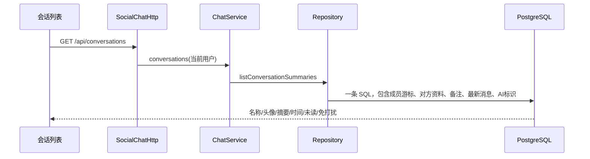

# Phase36：聊天布局与后端边界

## 1. 本阶段解决什么

旧 `.conversation-pane` 有四行 Grid，却没有给子元素指定行。重连条、欢迎页隐藏以后，浏览器按剩余元素顺序排位：消息列表落入 `auto` 行，输入区落入 `1fr` 行，出现大片留白。

现在四个区域固定为 `heading / connection / messages / composer`，只有 `messages` 使用 `minmax(0,1fr)`。隐藏提示条只会让提示条那行变为零，不会让输入框“换座位”。

桌面为 56px 功能栏、272px（宽屏280px）会话栏、可伸展消息区。移动端在会话列表和消息页间切换；消息区独立滚动，输入区有最大高度。深色为默认，浅色偏好可跨刷新保留。没有添加尚未实现的通话按钮或假消息。

## 2. 会话列表的数据链路

最新消息用现有 `(conversation_id, conversation_seq)` 索引读取；不存在 HTTP 层逐会话再查用户/消息的往返。撤回终态显示“这条消息已被撤回”，而不是继续泄露原文。WebSocket 事件可以更新摘要，但发送成功状态仍由原 ACK/恢复逻辑决定。

## 3. 目录和构建

| 区域 | 职责与构建目标 |
|---|---|
| `backend/server` | 原通信核心，`webserver_core` |
| `backend/application` | 账号、聊天、社区、数据库与 HTTP 业务适配 |
| `backend/ai/models` | Provider、模型注册、评测、RAG，独立 `webserver_ai` |
| `backend/ai/training` | 授权训练数据与导出 |
| `backend/ai/speech` | 语音任务、Provider、独立 Worker 及适配器 |
| `frontend/phase11` | 浏览器交互与展示 |
| `client` | Windows 本地入口与私人数据，独立 CMake 项目 |

`webserver_application_support` 只编译可移植的有界执行器和 JSON 工具，供业务与 AI 复用，不链接 Reactor。原有目标名保留，避免打断部署脚本。移动记录在 `docs/architecture/source-layout-migration.json`；历史测试证据保持原版本路径，不改写历史结果。

这是代码组织和链接边界的调整，不据此宣称推理变快。冷启动、热启动、首 Token 延迟需要后续实测。

## 4. 验证与限制

- Linux Release 构建成功。
- 原108项 CTest：首轮107通过、Redis因缺显式测试连接跳过；随后在现有 Redis 6379 单独补跑并通过。
- 真实 Edge：1440×900、1920×1080、390×844；短输入/多行输入贴底、消息区高度、无横向溢出、主题跨刷新均通过；原分页、管理员撤回、断线补发、ACK丢失核对与固定ID重试通过。
- 新增 PostgreSQL 会话投影断言随后纳入 Phase37 回归。
- 没有替换18090运行服务，没有迁移原业务库，没有推送 GitHub。
- Phase34 的持久化 ACK P99 回退记录继续保留，目录调整和读缓存收益均不能抹去该记录。

## 5. 文件索引

- `frontend/phase11/chat/ChatWorkbench/ChatWorkbench.css`：布局与主题变量。
- `frontend/phase11/shared/Theme/Theme.js`：展示偏好与跨标签同步。
- `frontend/phase11/app.js`：列表投影、真实消息状态。
- `backend/application/storage/postgres/PostgresStore/PostgresStore.cpp`：批量会话投影。
- `tests/phase11/frontend/chat_browser_smoke.cjs`：尺寸/输入区和可靠性回归。
- `scripts/project/layout/migrate_source_layout.py`：带快照前置检查的一次性源目录迁移。
