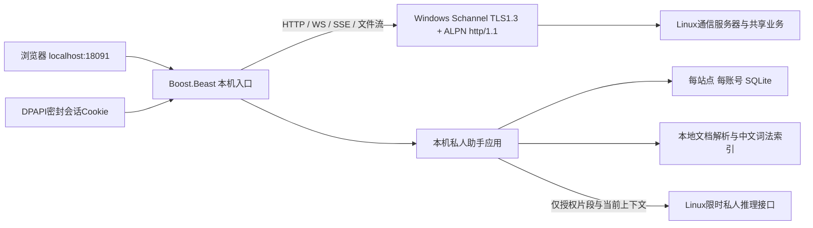

# Phase38：Windows 本机入口与私人知识空间

本阶段把“私人助手”放在用户电脑上。Linux 继续负责共享业务与模型计算，浏览器负责呈现。
原数据库和正式18090服务没有切换。验证仅使用已有隔离库与18444端口。

## 1. 通信与数据边界



1. `/api/local/assistant/*`永远由本机处理，未知路径直接404，不回退普通Linux代理。
2. 完整资料、倒排索引、两套私人历史、长期记忆保存在Windows。数据库正文不是整库加密；目录用当前Windows用户/SYSTEM的NTFS权限保护，会话Cookie单独用DPAPI密封，不保存登录密码。
3. 好友入口与侧栏使用不同`surface`线程，共享同一账号的知识和确认记忆。群AI无权访问本机存储。
4. 私人生成绑定开始时的账号/Cookie/CSRF快照；切号后取消旧任务，不使用新账号提交旧上下文。旧页面收到账号变化会清空并刷新。

## 2. 为什么使用 Schannel

本机HTTP/WS由已获许可的Boost1.92.0头文件实现。HTTPS采用Windows原生Schannel，证书验证必须先于任何账号或正文发送。
旧`SCHANNEL_CRED`不会协商TLS1.3，本项目改用`SCH_CREDENTIALS`，并显式提供ALPN `http/1.1`；Linux原有TLS1.3要求保持不变。
TLS1.3的会话票据会返回`SEC_I_RENEGOTIATE`，它不是业务数据，必须把实际控制记录继续交给SSPI，不能重复解密同一记录。

用户已确认的学习证书只放进程内独占根存储，继续检查指纹、地址、有效期和服务端用途。没有导入Windows根证书或关闭证书检查。
本轮Windows直连18443超时，真实联调使用临时SSH转发到隔离18444，不修改防火墙；直接HTTPS端口的可达性仍需部署时检查。

参考：[微软凭据说明](https://learn.microsoft.com/en-us/windows/win32/secauthn/obtaining-schannel-credentials)、[TLS控制记录处理](https://learn.microsoft.com/en-us/windows/win32/secauthn/decryptmessage--schannel)。

## 3. 生命周期、背压与资源上限

| 边界 | 实现 |
|---|---|
| 本机监听 | 仅127.0.0.1；Host固定为localhost端口；写入与WS必须同源Origin |
| 本机会话 | 一次性引导片段、HttpOnly/SameSite Cookie、24小时服务端期限、本机CSRF |
| 普通业务 | 4个有界任务Worker；最多24个在途/排队任务；JSON响应最多2MiB |
| 长连接 | 最多8条；专用有界读写池；浏览器写完一个16KiB块才读取下一个上游块 |
| WS | 两方向各一读一写，消息最多128KiB；复用真实聊天ACK，不自行宣布发送成功 |
| 请求缓冲 | 单请求10MiB，全局32MiB；连接最多16 |
| 私人生成 | 本机2个Worker、4个在途/排队任务；每会话一次生成；正文64KiB上限 |
| 私人资料 | 每账号200份，提取正文每份200KiB，原文件每份10MiB/合计100MiB |
| 本地库 | 192MiB页预算、有限WAL与页缓存；最多缓存4个账号空间 |

这些是初版容量边界，不代表已经验证了任何规模的生产负载。

## 4. 文档导入与检索

TXT/Markdown按UTF-8读取；DOCX使用Python标准库ZIP/XML，不执行宏；文本PDF复用已经安装的PyMuPDF1.28.0，没有安装新解析依赖。
PyMuPDF采用AGPL-3.0或商业许可，分发时必须审查适用许可；不使用它时可以先导出TXT/DOCX。
解析器在独立任务进程中运行，最长10秒、512MiB、一个进程；PDF最多64页，扫描件明确提示需要另行OCR。

检索采用SQLite倒排表，英文词项与中文单字/相邻双字计分，是**词法检索**，不是语义向量检索。
资料默认不授权发送；用户勾选后，仅命中的有限片段进入自己的Linux私人推理接口。
相同正文按SHA-256去重，重复导入不会自动扩大已有资料的授权。

## 5. 构建与启动

`client/CMakeLists.txt`是独立Windows工程，不要求Linux服务器依赖。当前MinGW Ninja对中文路径使用ANSI文件接口，已验证的替代构建入口为：

```powershell
python -X utf8 scripts/client/build_windows.py --boost-root 'E:\虚拟机高级web开发\deps\boost-1.92.0'
```

仅使用已有编译器和获批头文件，不执行包安装或下载。启动时必须明确选择私人资料目录与前端目录：

```powershell
.\build-client\release\nebula_companion.exe `
  --server 192.168.239.135 --tls-port 18443 `
  --certificate-sha256 <经本人确认的当前证书SHA256> `
  --frontend 'E:\虚拟机高级web开发\github-test6.3-staging\frontend\phase11' `
  --data-dir '<本人选择的私人资料绝对目录>' `
  --python 'C:\Users\24851\AppData\Local\Programs\Python\Python312\python.exe' `
  --parser 'E:\虚拟机高级web开发\github-test6.3-staging\scripts\client\documents\extract_document.py'
```

终端输出只供本人使用的一次性本机打开链接。关闭程序可按Ctrl+C；不会安装常驻系统服务。
SSH测试转发另加`--connect-host 127.0.0.1 --tls-port 18444`，证书名称仍校验192.168.239.135。

## 6. 验证记录与代码索引

- 原生C++契约：系统SQLite3.51.1、中文绑定参数、事务回滚、DPAPI、站点隔离、独立历史、确认记忆、授权检索、重启持久化通过。
- 本机Host/Origin/Cookie/CSRF与一次性引导拒绝测试通过。
- 真实Windows→TLS1.3/ALPN→Linux隔离库：注册、登录、服务端Cookie不交浏览器、DOCX导入、切号隔离通过。
- 真实Edge：本机代理恢复登录、WebSocket消息持久化ACK、SSE连接、三尺寸导航、私人助手侧栏通过。
- 原聊天浏览器可靠性与布局回归通过。上述不等于Phase41完整性能和Sanitizer验收；后续结果独立记录。

代码：`client/companion/{ProxyServer,SChannelStream,UpstreamTransport,LoopbackPolicy,BoundedPool,CompanionMain}`、`client/storage/{SqliteStore,WindowsProtection,CredentialVault}`、`client/assistant/{LocalKnowledge,PrivateHistory,DocumentImport,LocalAssistantService}`。
界面：`frontend/phase11/shared/{ClientBootstrap,LocalAssistantApi,AssistantPanel}`、`frontend/phase11/assistant/`。
测试：`tests/client/`；本机运行结果在忽略Git的`build-client/integration/validation.json`。


Phase41补充：本机入口同时绑定IPv4和IPv6回环地址，Host/Origin仍只接受配置的localhost入口，连接/流/缓冲预算共用，不绑定局域网地址。修复前测得约2秒的localhost附加延迟，修复后的同配置数据见Phase41验收记录。当前日常18443仍是此前运行版本；新私人推理API应先在隔离18444验证，不应据此文直接假定正式服务已升级。
