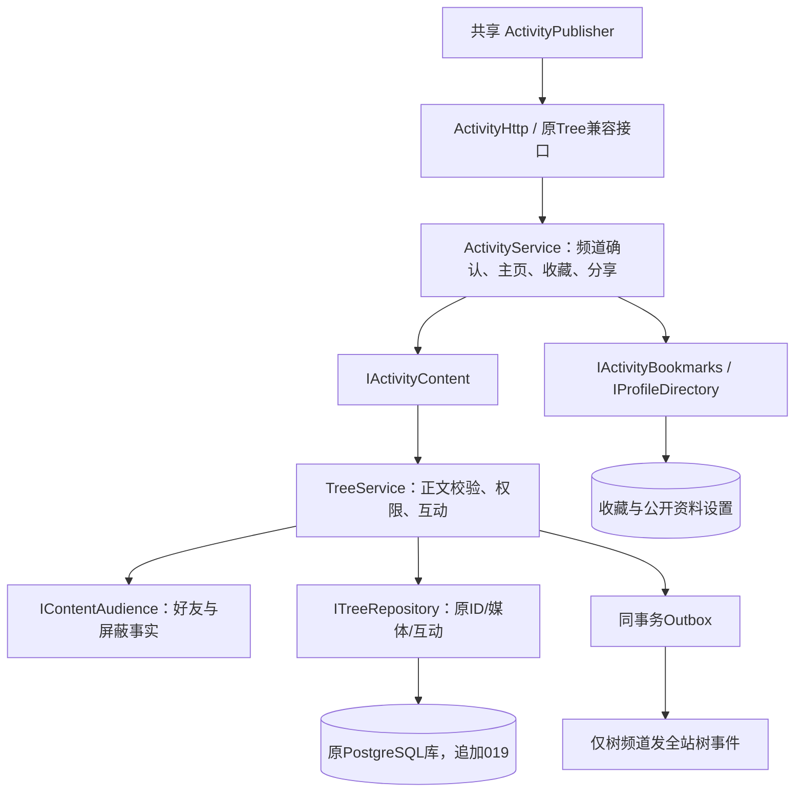

# Phase37：统一动态、个人主页与精致神树

## 1. 一份内容，多个展示入口

保留旧 `tree_posts` 作为规范正文表，追加频道、可见范围和收藏表。旧果实ID就是动态ID；没有复制正文、媒体、点赞或评论，也没有重建用户数据库。

| 发布位置 | 可见范围 | 进入树大小/热度榜 |
|---|---|---|
| 个人主页 | 默认好友，可选登录用户或自己 | 否 |
| 苦情树 | 必须确认所有登录用户可见 | 是 |
| 两者 | 同上；同一ID | 是 |

仅树频道的动态可在作者的“树上故事”筛选中查看。仅主页的好友或私有动态不进入树列表、数量和七天排名，也不通过全站树事件广播。收藏和分享不增加热度。

## 2. 调用关系与事务

发布与 Outbox 同事务。删除与管理员审计同事务；事务失败，两者一起回滚。收藏通过 `(user_id,post_id)` 唯一键幂等，不生成热度事件。收藏列表和分享入口每次重新检查内容权限，旧链接和旧媒体下载仍经过同一可见性校验。

主页公开资料不返回密码、Token、登录安全字段。本人设置与公开投影分开；头像/简介的开关控制公开主页展示，不改变原聊天界面已有的头像授权规则。

## 3. 删除权限

作者可软删除自己的内容；站点管理员删除他人内容必须填写原因并写审计；内容管理员可以处理举报/隐藏，不能借此删除他人果实。服务端返回 `capabilities` 决定按钮可见性，服务端仍独立执行授权。管理员身份不自动赋予读取私人动态的权限。

## 4. 造型与页面

- 保留花冠，增加14条（移动）/34条（桌面）错落流苏，每条18个实例花片。
- 果实复用一套旋转曲面，增加珠光材质和五瓣花萼；前十光环变为较细的纵向光环。
- 加宽根颈、八条板状根、接地阴影与岩土衔接，移除旧圆盘外装饰环。
- 装饰数量固定，业务果实仍按分区加载；减弱动画和远景LOD保留。
- 个人主页提供基本信息、对外资料和动态；原生JS，复用导航、主题、公告、发布与详情组件。

## 5. 当前验证

- Release 构建通过；109/109 CTest通过，包含真实测试库、真实Redis和新增统一动态契约。
- 新契约覆盖：好友/私有隔离、频道确认、跨频道同ID与互动、请求载荷变化冲突、收藏幂等、不计热度、删除后收藏/分享失效、非公开事件隔离。
- 真实 Edge 神树、列表、移动端、发布CSRF、公开范围确认、录音拒绝、父评论与举报回归通过。
- 真实HTTP新接口通过：好友/私有隔离、幂等、确认公开、树计数、收藏、删除权限/审计、旧媒体与分享链接失效、屏蔽后的好友范围撤销和公开资料字段过滤。个人主页三尺寸与本人/对外区域、发布器确认及重开状态通过。Debug/Sanitizer及完整混合性能仍待Phase41验证。
- 019仅应用到已存在的两个隔离测试库；原库、68个原账号及18090服务未变。

## 6. 代码/数据库索引

- `backend/application/modules/activities/`：独立业务与接口、收藏/资料投影。
- `backend/application/modules/tree/`：兼容正文引擎、权限与原互动。
- `backend/application/storage/postgres/migrations/019_unified_activities.sql`：追加迁移。
- `frontend/phase11/profile/`：个人主页。
- `frontend/phase11/shared/ActivityPublisher/`、`ActivityDetail/`、`MediaUploader/`：共享交互组件。
- `frontend/phase11/tree/TreeAccents/`：有界装饰与果体几何。
- `tests/function3/unit/activities_contract.cpp`：业务契约。

兼容边界：正文引擎暂保留 TreeService/TreePost 的旧名称，但通过 IActivityContent 对统一发布模块开放；这不是两个存储模型。新模块不会直接读取其他业务实现的内部C++对象。
