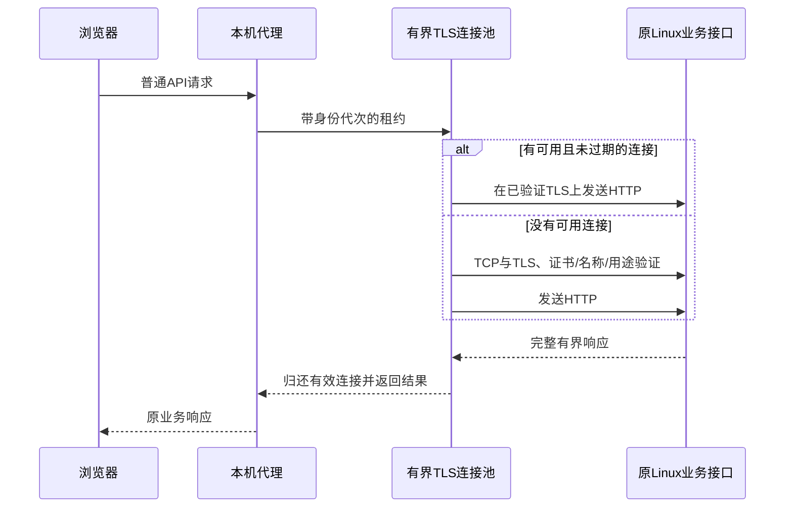

# Phase42：保持架构方向，优化响应与神树外观

本轮保持 `backend/server + backend/application + backend/ai`、Windows `client` 与浏览器 `frontend` 的既有分工。没有再移动目录、拆服务或更换技术路线；重点是少握手、少查询、少绘制。没有新增安装依赖、数据库表或迁移，没有推送仓库；日常18090保留原可执行进程与页面版本，资源隔离修正见下文。

## 1. 普通请求复用已经验证的TLS连接

原本每次普通API调用都新建TCP/TLS连接；现在由同名组件 [HttpConnectionPool](../../../../client/companion/HttpConnectionPool/HttpConnectionPool.cpp) 管理最多8条连接，普通短请求独占租约，返回完整响应后再归还。

可以把它理解成“保留已经检查过的电话线路”。每次办事仍然报自己的身份，保留线路不会省略登录、CSRF或服务端权限判断。

- **范围**：普通HTTP和私人助手的短轮询使用池；WebSocket、SSE和流式下载沿用自己的独立连接，不占用短请求租约。
- **边界**：总数8，空闲逾10秒或绝对生命周期逾60秒，在下次获取/统计时清理；每连接最多64次请求。响应正文2MiB、头32KiB。超过并发预算明确失败，不无限排队或创建连接。
- **身份隔离**：Cookie只在请求中设置。恢复、登录、退出、401和切换账号使空闲池失效；旧代次租约完成后不能回到新账号的池。
- **失败处理**：只有复用连接发生EOF、断开等传输错误时，GET/HEAD允许一次新连接重试。超大/非法响应和证书错误不盲目重试；POST/PATCH/DELETE的结果可能已经落库，绝不自动重发，保留业务幂等确认流程。
- **资源归还**：TLS、解析、分配异常都归还并发许可；不完整、EOF定界、`Connection: close`和升级响应不能入池。连接拥有自己的`io_context`，避免引用请求栈上已经销毁的对象。
- **小包延迟**：[SChannelStream](../../../../client/companion/SChannelStream/SChannelStream.cpp)设置TCP_NODELAY，减少TLS小记录与延迟ACK互相等待；证书指纹、名称、有效期、用途和进程内信任范围保持原样。

连接池统计只在本机已引导会话的`/api/local/session/info`返回计数，不返回Cookie、Key、请求正文或私人资料。

## 2. 神树查询从逐条装配改为批量装配

[TreePostgresRepository](../../../../backend/application/modules/tree/infrastructure/TreePostgresRepository/TreePostgresRepository.cpp)此前先查询ID，再逐条读取正文、标签和媒体：一页24枚是`1 + 3 × 24 = 73`次SQL。

现在同一Port的实现分三步：

1. 一个查询执行频道、可见范围、筛选、游标与LIMIT，并读取该页正文和每个果实的有效点赞/独立回复计数。
2. 用这页ID数组一次读取全部标签，保留Unicode、逗号和引号的原始内容。
3. 用相同ID一次读取媒体，再按位置放回对应果实。

数据库调用变成**3次**，没有通过缓存跳过实时权限。点赞/回复计数仍使用现有索引约束到每个果实，不声称将所有数据库内部工作变成常数。写事务仍锁定果实行；正文与Outbox的提交和持久性没有改变。

`PostQuery.ids`增加可选的有界ID筛选。`GET /api/tree/posts?ids=...&limit=10`允许最多10个ID，继续先校验身份、频道、状态和可见范围，再返回结果。已隐藏、已删除或只属于个人主页的内容不会因批量查询泄露。业务Port与内存实现保持同一语义。

[TreeApp](../../../../frontend/phase11/tree/TreeApp/TreeApp.js)用这一个请求读取前十果实，替代10个详情请求；同一时刻的榜单刷新合并，榜单版本未变也重新验证可见性。页面数据与3D模块加载并行；点赞直接使用服务端返回结果，省去额外详情请求，保留已有收藏状态。

## 3. 保留树形，降低绘制开销并细化外观

- 保留主干、分枝位置与粉色花冠。用 [WoodGeometry](../../../../frontend/phase11/tree/TreeScene/WoodGeometry.js)将静态同材质枝干和根系合并为一次绘制，保留原顶点、法线与纹理，不减少枝干轮廓。
- [TreeAccents](../../../../frontend/phase11/tree/TreeAccents/TreeAccents.js)错落调整花穗长度、渐细层次，前排保持点选通道。根颈衔接稍加厚重，增加有固定数量上限的落花花毯。
- 果实调整为更圆润的泪滴花苞，共用一张程序生成的珠光纹理；前十改用较小的底部金色光环与细边名次牌，减少环绕果体的笼罩感。
- [TreeScene](../../../../frontend/phase11/tree/TreeScene/TreeScene.js)只在果实ID、名次、媒体外观或总树高变化时重建果实资源。点赞、文字或分数变化保持现有GPU几何体。
- 桌面最高30fps、移动24fps；后台、离屏、广场/榜单页停止动画。减弱动画偏好采用按需绘制。复用临时矩阵对象，停止远景不可见花瓣的逐帧更新。
- 窄屏按宽高比拉开构图距离，避免花冠被切掉；隐藏挡住果实的装饰文案。保留列表降级、真实果实点选与作者/管理员删除规则。

这是绘制预算与资源更新方式的优化，**帧率上限降低不等于设备渲染能力提高**；实际GPU和移动设备的表现仍需在对应硬件上观察。

## 4. 验证与性能结果

原始结果保存于`artifacts/function3/phase42/`；保留优化前可执行文件的摘要以及同配置、交错顺序的结果。浏览器使用确定性UI夹具，不能替代真实HTTP权限验证。

### 已执行的正确性检查

- Linux Release、Debug、ASan/LSan/UBSan各111项通过，包含新增批量读取、查询次数、可见范围与既有协议/业务回归。
- Windows连接池故障测试：20次读取只建立1条TLS；主动close、空闲回收、旧代次迟到租约、超大响应、并发上限、超时清理通过。16个并发长读取有8个明确拒绝；GET失效重连一次，结果不确定的POST在对端只观察到1次。
- 真实HTTP检查：批量读取不扩大个人/好友可见范围；管理员删除仍需原因与审计，旧媒体/分享/收藏和批量入口都不能读取已删除内容。
- 原有Node18项聊天分页、ACK幂等重试和撤回测试通过。
- Edge三种宽度1440、1920、390验证布局、果实点选、榜单请求合并、页面切换与减弱动画；固定24果实夹具单帧绘制调用80→25，几何体70→15，100次仅点赞数据刷新不再更换果实几何体。
- Windows Release/Debug各5项契约通过；真实Debug入口完成注册/登录、DOCX授权检索、资料迁移、确认式写入、私人生成完成/取消、账号切换、WebSocket持久化ACK和SSE。观察到12次新连接、419次复用、0次传输失败；空闲工作集12.367MiB、峰值15.957MiB，不含浏览器和Linux模型。
- 既有测试库建立100000条动态夹具，连续20个分区抽样480条及最老边界通过，分区上限24。20页总读取37.3114ms，七日榜查询629.6602ms，测试进程峰值12416KiB；不是逐条遍历十万条，也不是在十万在线用户下的容量结论。
- 首次十万条夹具以单条INSERT建立时触发既有SQL超时，已改为每批2000条建立夹具，不提高数据库超时或降低持久性；被测查询保持原样，异常和修正如实保留。

### 同配置服务器三轮对比

基线是本轮修改前保存的Phase41可执行文件，SHA256为`1437ebfc8c5ca689807a865ce1101d8b1678c1f6d5e594340d1644205f690f22e`。两侧使用同一虚拟机、2个Reactor、4个HTTP Worker、4个数据库Worker/连接、本地持久投递、同步提交；关闭AI、Redis和TTS。三轮交错顺序，每侧使用各自既有可重置测试库，不改原业务库。

`/fast`预热3秒、测量10秒、64连接；混合业务每轮1200次操作、360个聊天持久化ACK；神树每轮同样24果实、10次预热、60个带登录态的顺序读取。

| 轮次 | 优化前树页P50 | 优化后树页P50 | 优化前ACK P99 | 优化后ACK P99 | ACK变化 |
|---|---:|---:|---:|---:|---:|
| 1 | 36.167ms | 3.659ms | 14.577ms | 14.311ms | -1.82% |
| 2 | 37.557ms | 4.386ms | 17.565ms | 15.969ms | -9.09% |
| 3 | 37.062ms | 4.844ms | 17.264ms | 18.825ms | +9.04% |

- 树页三轮P50的中位数37.062→4.386ms，降低约88.17%。该结果是本机到Linux的HTTP业务读取，不包含浏览器3D加载或Windows代理。
- `/fast`中位数50536.55→50146.01 QPS，回退0.77%；三轮ACK相对同轮基线均未增加超过20%，六轮混合业务错误为0。**本轮固定负载门槛通过**。
- 首次预备测量与Windows Debug编译有部分重叠，完整保留在`benchmarks-build-overlap/`；停止构建后重新执行上述三轮，不用预备数据代替最终表。
- 这次虚拟机的绝对延迟与Phase41不同，不能把跨轮次、不同IO状态下的QPS/ACK差异归功于本轮修改。Phase34/41的历史尾延迟失败记录仍保留，也没有完成生产长稳或真实高并发AI验收。

### Windows真实TLS代理

同一隔离Linux服务、已批准证书和SSH转发，保存优化前后两个Windows可执行文件；每轮先记录首次请求，再测30次顺序健康读取。浏览器侧每次新建本机HTTP连接，优化后仅复用上游TLS。三轮交错执行，错误为0。

| 轮次 | 优化前连续请求P50 | 优化后连续请求P50 |
|---|---:|---:|
| 1 | 185.029ms | 62.465ms |
| 2 | 185.778ms | 61.087ms |
| 3 | 185.044ms | 61.868ms |

三轮P50的中位数降低约66.57%；每次新进程的第一次TLS请求仍约105–152ms（优化后约126–142ms），没有声称冷握手消失。优化后每轮的计数均为建立1条、复用30次、失败0次，说明改善确实发生在复用路径。

剩余时间仍包含本机HTTP、SSH转发、TLS和服务端往返，不能当作纯数据库或Reactor耗时，也不外推成所有AI请求的首Token延迟。

真实助手用例的首段分别55.390秒（完成）、26.187秒（主动取消），包含模型冷启动、私人检索与历史输入。本轮没有修改推理引擎或下载模型，不能声称这些等待已经消除。Windows进程、独立Worker与测试服务在验收后停止，日常18090和原68个账号保留。

### 运行资源隔离修正

收尾检查发现：旧18090进程的工作目录仍是`function3-src/build-release`，构建同步前端资源会顺带影响它实际读取的页面，即使没有重启二进制。这是运行目录隔离问题，不能只凭“PID没变”声称页面未变。

本次先保留资源备份，再从已核验SHA256的Phase35快照恢复该目录的原页面，并通过18090的真实HTTP响应校验关键页面/脚本摘要。日常进程没有重启，数据库没有切换。构建资源同步增加旧运行PID保护；测试启动与未来显式日常启动各自准备独立工作目录/页面快照，避免后续构建重复覆盖运行页面。

- [sync_frontend.cmake](../../../../scripts/project/sync_frontend.cmake)：有效旧PID仍以构建目录为cwd时跳过覆盖。
- [run_server.py](../../../../scripts/function3/validation/run_server.py)：测试cwd为已有验证根下的`current-work`，测试文件/媒体仍保留原位置。
- [service.py](../../../../scripts/function3/runtime/service.py)：只有用户显式启动且没有旧实例时才准备日常`runtime/work`。本轮没有执行日常start/stop或迁移。

该修正不改变通信核心或业务分层，证据为`asset-isolation.json`。本轮三轮性能是在修正静态资源隔离前测得；随后仅改变启动资源目录，不改变被测二进制、连接池、持久性或数据库查询。

## 5. 复现与学习索引

| 目的 | 文件 |
|---|---|
| 有界连接复用、生命周期与失败策略 | [HttpConnectionPool.cpp](../../../../client/companion/HttpConnectionPool/HttpConnectionPool.cpp) |
| 身份代次、Cookie与普通请求装配 | [UpstreamTransport.cpp](../../../../client/companion/UpstreamTransport/UpstreamTransport.cpp) |
| TLS故障对端与C++验证 | [http_pool_fixture.py](../../../../tests/client/http_pool_fixture.py)、[http_pool_probe.cpp](../../../../tests/client/http_pool_probe.cpp) |
| 三轮真实本机代理对比 | [proxy_latency_compare.py](../../../../tests/client/proxy_latency_compare.py) |
| 真实神树分页基准 | [function3_tree_reads.py](../../../../benchmarks/function3_tree_reads.py) |
| 三轮服务器交错基准 | [phase42_benchmark.py](../../../../scripts/function3/validation/phase42_benchmark.py) |
| 3D前后对比与多尺寸截图 | [tree_scene_browser.cjs](../../../../tests/function3/frontend/tree_scene_browser.cjs) |
| 原有失败记录与WAL诊断 | [Phase41](../../../reports/stages/phase41.md)、[Phase34](../../../reports/stages/phase34.md) |

学习时先追踪“租出→发送→完整读取→归还”，再追踪“一页ID→批量标签/媒体→权限过滤”，最后观察`geometryKey`和`invalidate()`如何决定哪些内容需要更新。三条路径都沿用既有接口分工，不需要更换系统架构。
