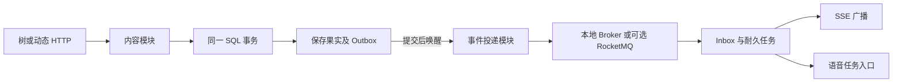

# 社区内容与事件投递模块

[Function3Runtime](../../../../backend/application/modules/bootstrap/Function3Runtime/Function3Runtime.cpp) 连接共享 SQL、权限桥、内容、投递、榜单、管理和语音。内容与投递分别成为可独立编译的目标；HTTP 路由、数据库模式、WebSocket 和 SSE 协议保持兼容。

| 组件 | 拥有的资源 | 对外边界 |
|---|---|---|
| [CommunityContentRuntime](../../../../backend/application/modules/bootstrap/CommunityContentRuntime/CommunityContentRuntime.cpp) | 树、动态、举报、媒体的服务/仓储/HTTP 适配，媒体执行器 | 注册内容路由，提供树和举报服务供管理接口使用 |
| [CommunityDeliveryRuntime](../../../../backend/application/modules/messaging/bootstrap/CommunityDeliveryRuntime/CommunityDeliveryRuntime.cpp) | 写入 Outbox 的适配器、发布线程、Broker、失败重放路由 | 提供事件写入 Port、提交唤醒函数和通知回调 |
| [RealtimeRuntime](../../../../backend/application/bootstrap/RealtimeRuntime/RealtimeRuntime.cpp) | 聊天实时 Sink、持久 Outbox Pump、WS 命令与在线状态 | 在借出的 Sink 析构前停止 Broker 回调，包括装配失败时 |

内容服务只调用事件 Port，仍在同一个数据库任务和事务里提交正文与事件。投递模块不持有语音引擎对象，装配层传入接收语音任务的回调。唤醒函数只持有独立信号，即使最后一个事务晚到，也不会访问已释放的发布器。退出时先停止入口并排空业务任务，再停发布和 Broker 回调，最后停语音并释放其资源。

本次没有拆数据库、引入微服务或重新实现协议。管理、榜单和私人档案仍由装配层接线。验证入口见[干净环境指南](../../../ops/validation/reproduce.md)。
