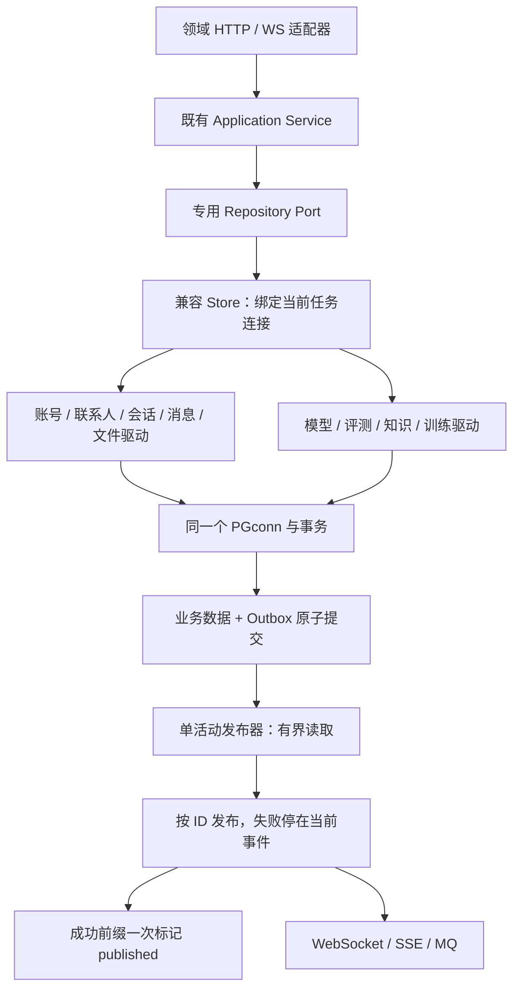

# Phase48：补齐配色、领域拆分与 Outbox 提交优化

2026-10-30。范围由用户再次确认：补齐 Phase43–47 的未完成项，不扩展通知中心、邮件找回、消息编辑、中文全文检索等后续功能。通信核心继续冻结；不安装依赖、不写原业务库、不推送 GitHub、不替换日常服务。

## 1. 针对上一轮缺口的变化

| 缺口 | 本轮处理 | 验证方式 |
|---|---|---|
| 页面主题已能切换，但颜色仍分散 | 组件 CSS 的颜色改为语义变量，集中到 tokens；移除晚加载的 Theme.css 覆盖层 | 静态门禁、深浅主题截图、实际文本对比度、动态模型弹窗 |
| PostgresStore 仍承担跨领域 SQL | 101个实现迁到11个领域驱动；门面只管理连接/事务并委托 | 真实 PG 共享契约、并发去重、跨领域回滚 |
| InMemoryStore 仍混合所有实现 | 111个实现迁到12个领域驱动；共享 MemoryState 与同一事务快照 | 与 PG 相同契约，批量确认失败及回滚 |
| Domain/Ports 是大杂烩头文件 | 11组领域类型、IdentityTypes、20个专用端口；原头文件变兼容聚合 | 独立依赖、全量编译，缺失本地头文件检查 |
| HTTP 好友/聊天集中注册 | 联系人、会话、消息历史、群治理4个适配器；原类只装配 | 原有路由、认证、CSRF、权限与真实 HTTP/WS 回归 |
| 聊天函数换文件后仍隐式依赖大量全局动作 | 9个控制器声明资源/命令/类型端口，ChatScope 仅提供声明能力；8组领域事件绑定 | 依赖缺失立即失败、越界命令不可见、销毁撤销监听、原交互回归 |
| main 混合装配与长段示例/格式化代码 | 教学路由、模型 Provider 装配、业务指标格式化独立 | Release/Debug/Sanitizer、真实模型与教学协议回归 |
| Outbox 逐条标记产生额外持久化提交 | 有界批次按顺序投递，成功前缀一次确认 | 失败前缀、确认失败重试、原始三轮性能门槛 |

## 2. 文件大小变化不能代替架构判断

| 兼容入口 | 前一版本行数 | 本轮形态 |
|---|---:|---|
|PostgresStore.cpp|2586|连接/事务与薄委托，不再混合各领域 SQL|
|InMemoryStore.cpp|1506|共享锁/事务快照与薄委托，不在每个驱动复制一份状态|
|Domain.h|614|14行兼容聚合，领域对象在同名目录|
|Ports.h|385|22行兼容聚合，专用端口在同名目录|
|Phase11SocialChatHttp.cpp|749|9行装配，4个领域适配器独立|
|ChatBindings.js|618|19行装配，8组业务订阅独立|
|ChatContext.js|377|228行，删除搬迁后遗留注释/空白，保留单一会话状态|
|main.cpp|1598|约964行；示例路由、模型装配和指标格式化已迁出|

门面仍需实现兼容接口，行数不一定很小；关键是 SQL、字段映射与规则是否已经有明确归属。AI 编排等同一生命周期内的较长组件没有为追求行数再拆成互相回调的碎片。旧命名空间与兼容入口保留，不把全项目改名当作解耦。

## 3. 配色规则与验收边界

`frontend/phase11/shared/DesignSystem/tokens.css`保存语义色、深浅主题与工作区表面；组件使用文字、表面、描边、强调色、按钮前景、状态、遮罩和场景背景等角色。导航品牌色独立于苦情树的玫瑰强调色。旧 `--chat-*`、`--p-*`、`--a-*`变量均映射到语义角色。

删除 `shared/Theme/Theme.css` 后，主题切换只更新 `data-theme`并发出已有场景事件，不再等待额外 CSS 下载。3D 树材质与果实颜色属于美术数据，保留；HTML浏览器栏的 theme-color 也不冒充组件配色。

`check_presentation.py`检查16份组件样式及 HTML style 块，禁止散落的颜色字面量、自引用变量。浏览器计算抽样文字的前景与有效背景，要求正常文本≥4.5:1；渐变样本单独标记并人工看截图，不伪造全页面 WCAG 认证。对比度计算中的1像素 Canvas 仅在测试中使用，产品没有增加画面亮度读回。

## 4. 事务边界

领域驱动接收现有 PGconn，不再借池连接。少数原来允许独立调用的组合写入，仅在调用方没有事务时保留原有局部事务行为。内存实现共用 MemoryState，门面持有递归锁；事务保存整份状态快照，保证用户、消息、Outbox等不同领域一起回滚。

`markPublishedBatch`在 PG 中通过一个参数化 CTE 检查全部 ID 并更新；缺失、重复或超出上限不产生部分确认。内存实现先完整校验再更新。旧第三方端口保留默认逐条兼容实现，不冒充原子批处理。

投递成功不等于客户端已读。批量标记之前崩溃，成功前缀可能再次投递；原事件/消息 ID不变，接收端和 Inbox继续去重。本轮维持 at-least-once，没有改成 exactly-once，也没有关闭 WAL 同步提交。

## 5. 构建与源码同步保障

- HTTP 领域适配器属于 `webserver_phase11_http`，服务和测试链接同一实现，避免只给主程序补源码导致测试缺符号。
- Windows 构建也观察共享后端头文件的修改时间，避免领域头文件拆分后错误复用旧对象。
- 源码归档附公开文件清单与摘要。后续同步只清理上轮清单中由同步工具拥有、且内容未改动的退役文件；未知文件和用户修改过的旧文件保留。构建、私有资料、模型与数据库不在清理集合。
- 首次升级同步工具前遗留的 Theme.css，经确认是隔离源码副本、内容符合退役样式后单独移除；没有清理日常服务目录。

新增 `CommitWakeClock`以常数空间记录一次合并唤醒中最早的提交通知，提供 `commit_notify_to_dispatch`与`outbox_cycle`计数/总耗时/最大值。空轮询不伪造提交样本，批次执行统计包含空轮询和失败。它测量通知调度与批次执行，不是逐事件COMMIT到网卡发出的时间；不能将几个累计平均值相加当成请求延迟。客户端ACK仍由真实黑盒测量。

同时修复 OutboxPump 的成员初始化顺序：后台线程现在最后构造，确保它访问的计数器、互斥量与时钟都已初始化；销毁前先join。之前线程字段位于部分计数器之前，存在启动时观察未完成构造对象的风险。

版本指纹统一按保留大小写的POSIX相对路径排序，并规范CRLF/LF，修正WindowsPath与PosixPath排序差异导致的跨平台指纹不一致；新增大小写混排与换行回归测试。

## 6. 验收台账

**功能、配色和边界重整验证通过；严格性能门槛仍未通过。** 原始记录见 `artifacts/function3/phase48/`。Phase47 的 ACK 第2轮+23.33%失败保留。

|检查|本轮结果|范围|
|---|---|---|
|冻结通信核心|152份文件不变|原始字节与跨平台LF摘要|
|Linux Release / Debug / ASan-LSan-UBSan|各115/115|真实隔离PG、Sodium和已安装可选AI依赖|
|前端逻辑 / 工程负向测试|28 / 12项通过|含作用域、装配校验、生命周期、缺失测试矩阵、源码同步安全清理|
|浏览器|七组通过|1440×900、1920×1080、390×844，深浅主题、431条历史、弹窗、神树、主页、助手与公告|
|Windows原生客户端|Release/Debug各5项通过|复用现有Boost/工具链|
|Windows真实代理|通过|TLS指纹、Cookie隔离、WS ACK、SSE、真实私人ONNX/取消、资料迁移、Agent确认、语音缺Key回退|
|Linux真实业务|九组通过|工作区、树社交、动态、私人迁移、网页AI、群AI、语音、附件、聊天可靠性|
|独立Worker故障|通过|仅终止测试Worker；普通消息继续持久化，私人正文未写聊天库，恢复后可推理|
|最终C++改动后补验|通过|115项全矩阵，真实工作区HTTP/WS/PG及新指标有样本|

九组真实业务、独立Worker和Windows代理先于最后的唤醒指标/线程构造顺序修正执行；修正后重新跑了三种完整115项矩阵和真实工作区，不把此前全部模型与语音检查称为“最后一次二进制逐项重跑”。Windows原生进程空闲约12.934MiB、峰值17.133MiB，不含浏览器；其中一次空闲GET连接安全重连，所有业务结果正确，写操作没有自动重放。

## 7. 三轮性能：保留失败而非只选较好的测量

同步提交保持开启，2 Reactor、4 HTTP/数据库Worker、连接池4；1200次混合操作、360次持久化ACK、4条SSE。模型/TTS/Redis关闭，构建与模型验证不在测速窗口。基线与当前交错运行；两库都是原有可重置测试库。各轮原始报告保留，不覆盖。

最终C++构建摘要为 `e7f00da218f28a57f27b86282d09b56fadab845d8281e8352abfbff3ea5ed75a5`。与最初Phase43基线比较：

|轮次|基线/当前 /fast QPS|基线/当前混合 ops/s|基线/当前 ACK P99 ms|ACK变化|
|---|---:|---:|---:|---:|
|1|57407.90 / 57708.20|562.709 / 676.832|11.860 / 13.783|+16.21%|
|2|57166.86 / 57620.32|568.545 / 712.025|14.730 / 13.059|-11.34%|
|3|57909.04 / 57654.06|588.311 / 672.904|11.576 / 14.297|**+23.51%**|

`/fast`中位吞吐+0.43%，混合吞吐中位数+19.05%，业务错误0；第3轮ACK超过20%，所以整体门槛失败。证据：`linux/benchmarks-final/`。

另外与直接上一版1c3c7e6的保留Release二进制比较：

|轮次|基线/当前 /fast QPS|基线/当前混合 ops/s|基线/当前 ACK P99 ms|ACK变化|
|---|---:|---:|---:|---:|
|1|44212.34 / 40884.34|446.503 / 395.847|23.398 / 27.092|+15.79%|
|2|47557.36 / 46634.78|474.075 / 473.479|20.771 / 25.934|**+24.86%**|
|3|44074.08 / 43263.91|442.690 / 358.486|21.722 / 33.495|**+54.20%**|

该组/fast中位吞吐-2.15%，混合吞吐中位数-11.35%，错误0；ACK两轮失败。该测量窗口中两版绝对速度都明显降低；没有同时期宿主机负载证据，不能据此宣布环境是唯一原因，更不能丢弃这组结果。证据：`linux/benchmarks-previous-final/`。

此前C++观测改动前的两组三轮均通过，保留在`linux/benchmarks/`和`linux/benchmarks-previous-release/`，但对应另一构建`5e9c1ff…`，只能作为过程记录。不能用它们替换最终失败。此前口头提到的第一组第3轮12.661ms应以原始报告的**12.610ms**为准。

补充诊断`linux/diagnostic-on-final-durable/`不参与门槛：仍开启同步提交，PG活动等待包含`IO:WalSync`/`WALWrite`，客户端后台fsync次数708→557、累计fsync时间446.830→290.142ms。这支持批量确认减少提交开销，不能证明单请求P99一定降低。正式最终第3轮业务排队平均约0.072ms；连接池等待累计251.054→174.041ms。累计值跨并发任务，不是单请求墙钟耗时；本轮未完成逐消息COMMIT→网络发出关联和严格因果归因。

因此：**当前功能可供继续学习和隔离验证，性能验收仍有待办，未进入日常发布。** 下一步应在固定到达率与闭环饱和两种负载下分别记录每次写入的事务、刷盘和ACK阶段，再决定是否调整业务读写调度；不放宽门槛、不关闭WAL、不动通信核心。

远程CI实际执行、真实云Key调用、主观语音自然度及日常部署没有被本轮验证替代。没有新增依赖、原库写入或GitHub推送。最终状态页版本构建与测速构建摘要分开记录。

教学见 [Phase48 讲义](../guides/phase48-teaching.md)，旧完整主流程继续见 [端到端架构](../flows/phase43-47-end-to-end.md)。
