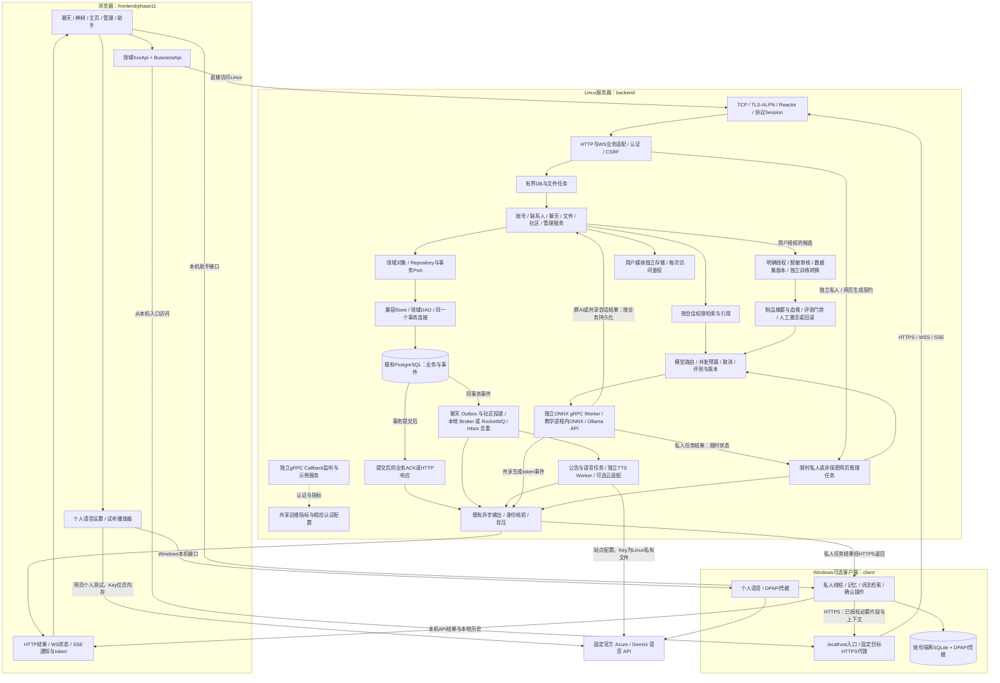
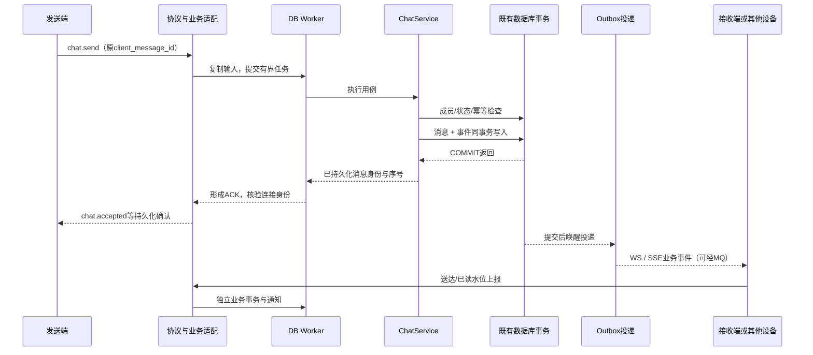

# 当前系统完整架构与消息流

本图对应 `Function3.2` 的源码，数据库要求迁移 001–024。聊天 ACK 的分段与故障恢复见[发布说明](../../../releases/function3.2.md)；日常实例见[当前状态](../../../../STATUS.md)，旧版对照见 [Phase49 阶段图](phase49-end-to-end.md)。

## 1. 从用户界面到共享业务、私人资料和模型更新

源码允许多种可选运行模式；图中的分支不是全部同时启用。API、Provider和Worker没有配置时，不能仅凭存在源码就认定可用。`outbox_events`与Function3事件管道各有适配关系，不把图中的“事件”误读为只有一张通用表。

独立gRPC监听使用gRPC自身运行时，不经过本图的HTTP Router；它与ONNX gRPC Worker是两种用途，不能把通用Chat RPC示例当作已接入PostgreSQL的聊天业务。

## 2. 聊天的两条返回路径

ACK不是等对方在线才生成，也不等于对方已读。Outbox、MQ和客户端均可能重试，靠原事件/消息身份去重；MQ消费确认不能代替客户端ACK。离线用户通过持久化历史和序号恢复，不依赖“当时正好有一条在线连接”。图中ACK和Outbox两支不承诺网络到达先后顺序。

2026-11-05 的[撤回修复](../client-ui/chat-recall-and-tree-background.md)沿用上述事务与双路返回：三分钟内的新撤回由服务端授权；页面核对持久化 ACK 的命令、消息、会话和序号后进入撤回终态，不再必须等待另一条广播才能清除正文。

发布果实走社区链路。内容模块在同一事务写入果实和事件，提交后唤醒社区投递。投递通过本地 Broker 或已配置的 RocketMQ 处理事件，再广播 SSE 或交给语音任务入口。这个链路与聊天持久化 ACK 的时机分别定义。[社区投递图](../engineering/community-runtime-modules.md)

## 3. 私人助手与训练边界

1. 好友式私人助手和全局侧栏有独立线程历史，共享Windows账号内的授权知识、记忆和设置；群AI只读群可见历史与共享资料。
2. Windows资料原文/索引留本机，当前推理默认仍走Linux或用户配置的服务；授权片段可能离开本机。本机存储不是完全离线推理。
3. 网页助手在使用前提示非保密上传，不能悄悄冒充Windows私人模式。自定义模型接口测试成功也不等于证明该服务的隐私或模型质量。
4. 独立私人推理不把正文和回答写进服务器聊天/训练库；旧历史迁移需校验与明确清理同意，不自动删除原副本。必要任务元数据与限时状态不等于零服务器处理。
5. 训练不是聊天后的自动分支。授权候选经过脱敏、审核和版本化数据集，由显式任务训练/转换，验证制品、评测与血缘后才允许人工发布。
6. 已有教学样本/制品验证只证明基础设施能工作，云Key、真实业务质量和语音自然度分别验收。

## 4. 资源、线程和停止顺序

入口为 `main → ApplicationRuntime`，由 `BusinessRuntime` 组合Storage、Identity、Contacts、Chat、File、Knowledge、AI、Realtime与社区装配。各模块拥有自己的资源，使用其他模块的接口；兼容Store和聚合头仍保留。

网络 Reactor 负责连接、协议与发送，SQL 由数据库执行器处理，文件、知识、推理、语音各有任务边界。网络任务排空后，停止 RPC、解除 Presence、取消私人和 AI 任务，排空文件、知识和数据库任务，再停止投递与社区后台。Broker 回调结束后，语音和实时 Sink 才能释放。

语音设置和播放的入口、权限及组件详见[修复讲义](../../../ops/runtime/speech-settings-and-playback.md)。个人试听配置与全站广播配置分开；短语音在业务适配层使用有界 WAV 响应，没有改动通信核心。

## 5. 计划不混进现有图

建议的逐消息追踪、修复与后续验收只在 [下一阶段路线图](../../../roadmap/next-steps.md) 中描述。本页没有新增“已完成的分布式追踪”或“已经达标的生产部署”。当前严格性能门槛仍失败；业务形成ACK或交给队列不等于已观察到socket写完成。

[架构总览](../../overview/ARCHITECTURE.md) · [目录边界](../../overview/project-layout.md) · [组件索引](../indexes/README.md) · [数据库分层](../../../database/domain-layering.md) · [复现验收](../../../ops/validation/reproduce.md)
