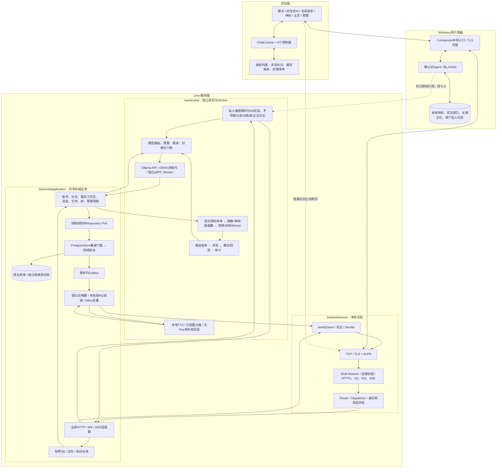

# Phase43–47端到端：通信核心固定，业务逐领域演进

1. **权威状态在Linux**：账号、群成员、共享消息、公开故事和权限不能让浏览器或Windows自行决定。HTTP/WS只是不同入口，同一业务规则与事务不可分叉。
2. **私人资料在Windows**：好友式和侧栏历史独立，共享授权资料/长期记忆；仅必要授权片段送往私人推理路径。群AI不读取这些私人知识。网页助手走明确非保密确认，和本地私人入口区分。
3. **数据库任务有界**：一个事务持有一条任务作用域连接；领域驱动委托不会拆掉消息/偏好与Outbox的原子性。网络完成由既有连接/Stream身份和至多一次完成规则守护。
4. **输出有两种证明**：HTTP/PATCH结果或chat.accepted证明服务器已接受/落库；WS/SSE投递是后续通知；chat.ack和chat.read又是接收与已读水位。MQ确认不能代替它们。
5. **模型质量另算**：既有转换、Adapter、评测门禁与训练授权流程保留。本轮真实调用证明链路可通，不证明模型质量、语音自然度或生产容量。没有自动训练、自动发布或新云账号。
6. **部署另算**：本轮只升级隔离环境、构建客户端和验证定义；原业务库、日常端口/服务不因源码更新而自动替换。状态页区分运行二进制、前端资源和测试结论。

逐文件索引见 [本轮代码索引](../indexes/phase43-47-code-index.md)，一次业务如何接入见 [三次用户操作教学](../guides/phase43-47-teaching.md)。

## Phase48内部细化

网络、Windows私人存储与Linux权威业务的位置不变。业务HTTP细分为联系人/会话/消息历史/群治理适配器，Store只保留连接/事务及兼容委托；数据库驱动与内存驱动按领域配对。前端事件与控制器通过显式资源/命令端口协作，成功Outbox前缀采用批量确认。详图和事务边界见 [Phase48](../engineering/phase48.md)。
