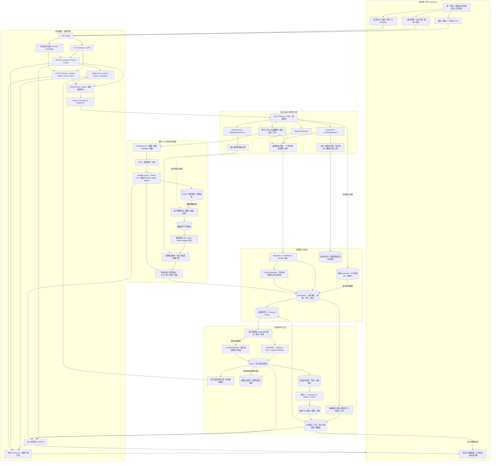

# Function3 从协议到业务、模型与公告的整体架构

1. **通信层决定如何收发字节**，不写分类、热度或站点权限判断。
2. **Transport 决定 DTO 如何转成业务调用**，不是业务规则的唯一防线。
3. **业务层决定能不能做和如何原子完成**，依赖端口，不包含数据库和 SDK 头文件。
4. **基础设施实现端口**，把业务决定落实到 PostgreSQL、RocketMQ、文件与模型引擎。
5. **装配根连接对象**，后台 Worker 的拥有者负责停机和资源回收。
6. **客户端 ACK、MQ ACK、送达与已读各有含义**；前端状态依据服务器事实收敛。

训练图表示复用原有受控训练流程，不表示用户上传内容会自动触发训练；本轮没有启动新的自动训练任务。历史验收与性能限制见 [Phase34](phase34.md)，当前原库、语音、Redis与界面增量见[Phase35](phase35.md)。

MQ 消费者和普通聊天提交使用独立数据库连接预算。两者仍访问同一业务事实库；这是连接资源隔离，不是复制数据或拆成两个不一致数据库。

默认日常入口使用原 `phase11 / 5432` 和18090，本地持久投递支持单进程公告语音；MQ路径只有显式配置Proxy时启用。Redis不是账号、权限或消息事实库，无法命中时回落PG。实际部署入口见[日常启动](../../ops/function3-runtime.md)。
