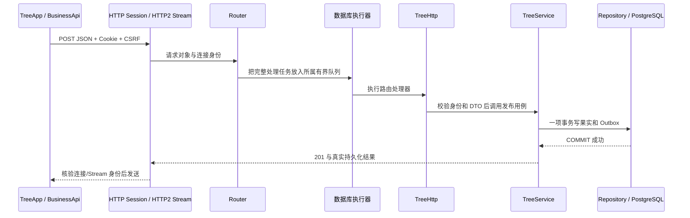
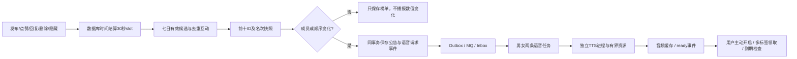

# Function3 学习路线：一枚果实怎样穿过服务器

建议先跟踪一次真实请求，再阅读组件内部细节。通信层像快递道路，Transport 像收件窗口，业务服务决定能否寄送，Repository 负责把事实放进保险箱，Outbox 是保险箱里的发货单。

## 1. 从浏览器找到第一站

入口为 `frontend/phase11/tree/TreeApp/TreeApp.js`，公共请求封装为 `shared/BusinessApi/BusinessApi.js`。发布时发往 `POST /api/tree/posts`，携带正文、分类、标签、媒体 ID 和 `requestId`。

- Cookie 由浏览器管理，JavaScript 不读取 Session Token。
- 写操作带 CSRF Token；界面隐藏按钮不代表已经获得权限。
- 新资源 ID 使用十进制字符串，避免 JavaScript 大整数被四舍五入。
- `requestId` 是这次投稿的业务凭证。网络断了再寄，继续用原凭证，服务器才知道这是重试。

上传和发布是两步：先完成原文件上传与真实解码校验，再把通过校验的文件 ID 关联到果实，不能仅凭前端声明的 MIME 放行。

## 2. 字节如何找到业务代码



当前装配从 `main.cpp` 经 `ApplicationRuntime` 和 `BusinessRuntime` 到 `Function3Runtime`，由 `CommunityContentRuntime` 组合 `TreeHttp` 并注册 URL。Router 保存执行器归属，Session 提交任务后继续处理网络事件。[当前社区装配](../engineering/community-runtime-modules.md)

这里仍使用阻塞 libpq。异步的是网络任务交付和完成通知，数据库查询在专用 Worker 中执行，不是把同步驱动改称协程驱动。

## 3. TreeHttp 与 TreeService 各做什么

`tree/transport/TreeHttp/` 解析 HTTP 字段、恢复登录身份、校验 CSRF 并把错误转换成状态码。`tree/application/TreeService/` 决定用户是否有效、分类是否可用、内容和媒体是否合规、同一投稿凭证是否已经提交过。

业务服务只依赖 `ITreeRepository`、`IActorDirectory`、`IUnitOfWork` 和 `IEventWriter` 等端口。它不接触 `PGconn`、socket、WebSocket Session 或 RocketMQ SDK。

```cpp
// 示意职责顺序，完整实现以 TreeService.cpp 为准。
work.transact([&] {
    // 校验与查重之后，事实和发货单必须一起保存。
    repository.insert(post);
    events.appendEvent(created);
});
// 到这里才允许把“已接受投稿”返回客户端。
```

若只保存果实就崩溃，通知可能永远不发；若先通知再提交，用户可能看到数据库里不存在的果实。因此两个写入必须共用同一事务。

## 4. 为什么有 Outbox、RocketMQ 和 Inbox 三站

1. **Outbox**：本地持久发货单，失败后仍在数据库中。
2. **Broker**：负责转运，按果实/会话分组保存顺序。
3. **Inbox**：收货方的处理收据，重复转运也只执行一次持久副作用。

发布器一次领取最多四个不同 aggregate 的队首，释放数据库连接后再等 SDK。失败退避、到达预算转死信，管理员填写原因后重放；同一 aggregate 的后续事件不能越过前面未完成的事件。

消费事务把 Inbox 与后续持久任务一起提交，成功后才确认消费。WS/SSE 的在线提示在提交之后发送；页面断线时根据数据库游标恢复，MQ 确认不会代替客户端送达或已读。

原聊天另有一条兼容路径：`ChatOutboxWriter` 在原事务里原子写旧事件索引与新队列，去掉中间搬运的两次额外提交。`PostgresOutboxWriter` 是驱动内部策略，借用当前连接，禁止自行提交。部署前遗留的旧事件仍由旧搬运器补齐。

## 5. 前十变化怎样变成语音



首次榜单作为静默基线。热度排除作者自身互动，回复按独立用户计分；筛选页面不会改变全站树高和榜单。

TTS 是单独进程，因为它有自己的 ONNX Runtime 版本和内存负担。父进程限制输出、内存、CPU 时间和运行期限，关闭继承的服务器 fd，退出时回收子进程。生成失败有限重试，文字公告继续存在。显式配置损坏模型时启动校验会拒绝新实例，这与运行中单项语音任务失败的处理不同。

播放声音不需要麦克风权限；只有用户发布录音时才申请。浏览器拒绝自动播放时保留手动继续入口，不能伪装成已经播完。

## 6. 取消与“已经成功”不是一回事

- 请求尚未执行，取消可阻止它进入业务代码。
- 事务已经提交，连接断开不能把事实变回未提交；客户端应使用幂等键查询结果。
- HTTP/2 取消一条 Stream，不关闭同连接其他 Stream。
- 后台模型发布返回 202 后是独立操作。页面不再等待同一条 HTTP；最终状态以任务查询、版本和持久审计为准。
- 管理员吊销会先撤销 WS 新业务准入并移除广播目录，再投递关闭帧，避免把权限边界寄托在一个可能排队失败的 Close 帧上。

## 7. 推荐亲手跟踪的顺序

1. 用浏览器发布纯文字，沿 `TreeApp → TreeHttp → TreeService → TreePostgresRepository` 找到落库点。
2. 用同一 `requestId` 重发，观察返回同一个果实；换正文后观察冲突。
3. 暂停隔离 Broker，确认 HTTP 接受与队列重试是两件事。
4. 看 `PostgresEventPipeline` 的 Inbox 事务，再看 `SpeechPostgresTasks` 为什么在同一事务建两条任务。
5. 最后读 `TreeScene`，观察“全站总数”“当前分区”“前十快照”为什么需要三个不同数据来源。

每一步读懂后再进入下一步。可以自检：201、Broker ACK、Inbox 提交、客户端收到、客户端已读，各自究竟承诺了什么？

接口与文件链接见 [组件索引](../indexes/function3-code-index.md)，完整调用图见 [整体架构](../flows/function3-end-to-end.md)，实际测试与尚未达标项见 [Phase34](../../../reports/stages/phase34.md)。
