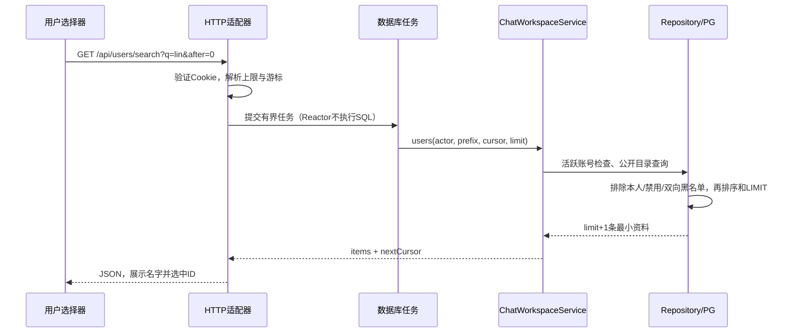

# 业务如何接进服务器：沿三次用户操作读代码

建议先读本讲义，再打开对应组件；通信核心已冻结，可以把它当成道路，专心看业务这辆车如何上路。每一节都给出入口、规则、事务、返回和容易误解的地方，不需要先读完全部协议实现。

## 1. 先认识四层

1. **适配器是前台**：把URL、Cookie、CSRF、JSON换成C++参数，把结果换回JSON。它知道HTTP，却不决定“谁可以改谁”。本轮入口是 `ChatWorkspaceHttp::registerRoutes`。
2. **Application Service是办事流程**：检查账号、成员关系和业务规则，组织事务。`ChatWorkspaceService`不认识fd、libpq、HTTP/2 Stream或ONNX。
3. **Repository Port是仓库窗口**：只承诺“查用户”“写偏好”“取消息”。`IWorkspaceRepository`不会让业务拿到PGconn。内存与PG都实现同一窗口，所以能考同一套契约试卷。
4. **驱动是仓库内部**：PostgresStore取得连接，把已有连接交给领域驱动。SQL、转义、行映射、附件批量装配都留在这里。线程与连接必须一起明确：一个事务不能跨到另一个任务/连接。

代码阅读顺序：`ChatWorkspaceModule.h` → `ChatWorkspaceHttp.cpp` → `ChatWorkspaceService.cpp` → `IWorkspaceRepository.h` → `PostgresWorkspaceRepository.cpp`。对照 `InMemoryStore` 和 `WorkspaceContract.h`，看相同规则如何换存储仍成立。

## 2. 操作一：输入用户名，搜索好友



`limit+1`像多拿一张号码牌：用户要20张，我们最多取21张。第21张只用于知道“后面还有”，不会展示；下一页用本页最后一张ID继续。这样不需要再查一次总数。

`q`中的`%`和`_`按字面量搜索。驱动用参数化SQL和LIKE转义，二者解决不同问题：参数化防止SQL拼接注入；LIKE转义防止用户输入不小心变成通配模式。用户名和显示名前缀匹配，不是中文全文检索。

选中后回填旧的 `receiverId/peerId/memberIds`，所以好友申请、建私聊、建群仍走原业务规则。前端显示“可以申请”只是帮助用户；伪造ID、重复申请、被拉黑仍由服务端拒绝。

自检：为什么要先做黑名单和成员过滤再LIMIT？如果先取20人再过滤，用户可能只看到2人，并错误地认为没有下一页。

## 3. 操作二：开启群聊免打扰

偏好不是群属性，而是“我对这一个会话的设置”。主键 `(conversation_id,user_id)`像同一间教室里每个人自己的耳机开关；不会替其他人关闭声音。

用例等价于下面的C++伪代码，实际实现见 `setPreferences`：

```cpp
auto transaction = database.beginTransaction();
requireActiveMember(actor, conversation);
auto result = workspace.writePreference(actor, conversation, muted);
if (result.changed)
    outbox.append(eventForThisUser(result.value));
transaction->commit();
// 适配器在commit之后唤醒投递器。
```

1. 改偏好和写Outbox共用一个事务。若异常发生在commit前，两个一起回滚。
2. 同值重试不增加revision、不产生重复事件；结果依然告诉客户端服务器目前的版本。
3. commit成功只代表数据已保存。随后Outbox异步投递WS/SSE，断线不影响持久化。
4. 事件只发给这个用户的各连接，不广播整个群。
5. 页面按revision合并，旧列表不能覆盖新版WS/PATCH结果。

免打扰不会停收消息、清未读或改变群禁言。前者是提醒偏好，后者是发送权限。

最值得亲手验证的失败点：在写Outbox后、commit前制造异常，重查偏好和待投递事件。`WorkspaceContract`已经用未提交事务验证这个边界；PG连接必须保持同一个任务作用域，不能在驱动里另借连接。

## 4. 操作三：从搜索结果跳回第十条消息

原来需要从最新页向前连翻很多页；现在一次请求 `/messages/{messageId}/context?radius=30`，最多返回61条。

1. 服务端再检查账号与会话成员，目标消息必须属于指定会话。URL里有会话ID不等于拥有权限。
2. 返回目标前后有界上下文；撤回消息只保留占位，正文/附件不会重新出现。
3. `ChatHistory.focusContext`替换阅读窗口，保留真正连续恢复过的cursor。**正在看第10条，不等于已经收齐第11–1000条。**
4. 较新/更早分页继续可用；实时最高水位不会把旧阅读位置挤走。
5. 请求完成时比较账号和视图版本。期间切号/切会话，就放弃旧结果。

`cursor`像“已经逐页检查过的书签”，窗口像“手里正在看的这一页”。不要因为一次跳页就把书签越过中间没检查的内容。这个区别同样适用于断线补发、ACK和已读。

## 5. 为什么未读要用两根水位

把数字写出来就能发现旧方案的问题：

```python
latest = 20
read = 10
latest = max(latest, 21, 22)  # 请求列表期间又来了两条
unread = max(latest - read, 0)  # 12
read = max(read, 22)           # 另一端读完
unread = max(latest - read, 0)  # 0
```

这里的`max`用于合并**消息序号**，不是合并两个未读计数。重复收到22不会变13；旧HTTP的20/10也不能倒退已经确认的22/22。`UnreadWatermarks`对新字符串序号使用BigInt。旧消息DTO仍有数字字段，因此本轮不宣称已完成所有64位ID迁移。

## 6. 为什么附件批量读取能减少往返

旧流程像快递员逐条问：“第1条有什么附件？第2条呢？”50条可能有50次补查。新流程一次拿到整页消息ID，再问：“这50条的附件一起给我”。

`PostgresMessageRepository::hydrate`用message_id建立位置表，批量查询后把文件装回对应消息，不改变原排序。驱动非空页两次查询；账号/成员验证仍另计。共享契约检查20条附件映射，PG额外断言查询次数，不能仅凭代码里看见两个SQL字符串认定性能提升。

## 7. 新业务照着什么模板接入

1. 在对应领域的同名目录定义值对象和Port，明确权限、幂等键、游标与错误。
2. 先写共享契约与内存实现，再写PG驱动；业务和Outbox需要同事务时先画出连接边界。
3. 写Application Service，再写HTTP/WS适配器，明确放到哪个有界执行器。
4. 在领域装配根注入实现，main只做组合；停止顺序与所有权一起考虑。
5. 前端接同一请求层，给初始化、取消、销毁和迟到响应明确规则。
6. 分开记录替身、真实服务、权限、故障和性能证据。最终看三轮数据，不能用代码行数代替收益。

适用场景：继续接通知收件箱、消息编辑或业务查询时可复用这条接入路径。优点是协议核心稳定、业务可替换存储、测试容易定位；代价是增加明确的DTO/Port/装配文件，需要维护契约一致性。本轮先完成聊天闭环，后续功能继续等你决定。
