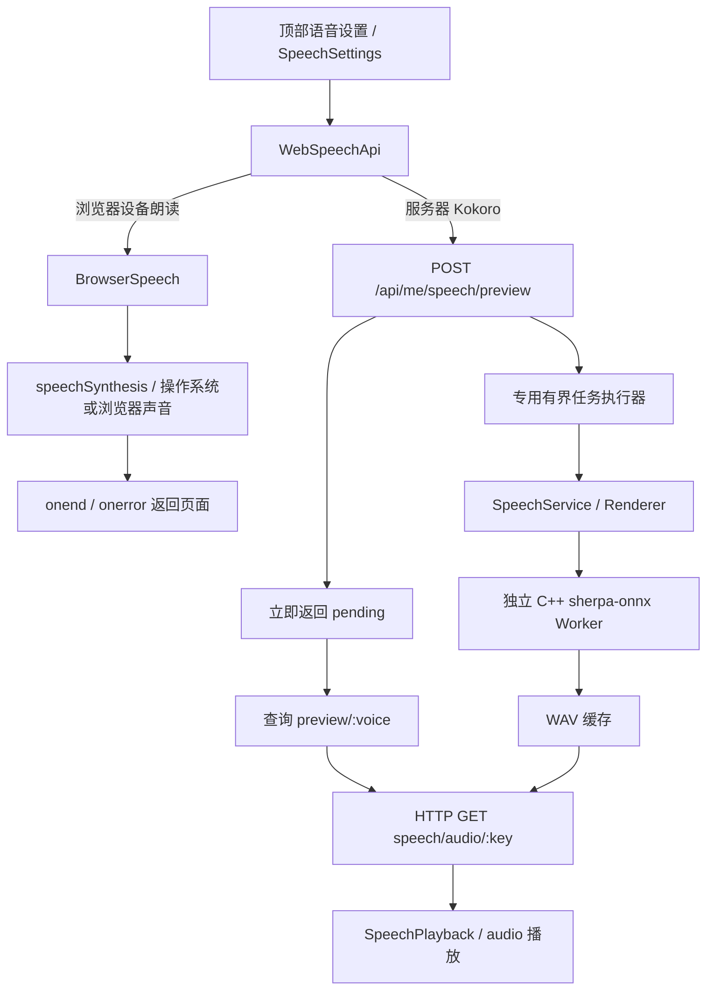

# 语音怎样嵌入现有服务器

更新：2026-11-05。按当前代码讲解；使用说明与替换旧代理的证据见[免 Key 语音说明](../../../ops/runtime/free-speech.md)。

## 1. 先看三种角色

可以把它看成一家餐厅：**页面是点餐台，业务适配器是派单员，独立语音 Worker 是厨师，浏览器播放器是端上桌的那一步**。通信服务器负责运送请求和音频，不负责在 Reactor 线程里加载模型。

“服务器本地 Kokoro”的本地指 Linux，不是 Windows。浏览器设备朗读则由 Windows/浏览器现有声音提供；其中标为在线的音色可能把文本送到浏览器供应商处理。

## 2. 统一入口，按能力分流

顶部导航的“♫ 语音设置”打开 `SpeechSettings`。同一份设置表单可以连接 Windows 客户端的本地接口，或者网页端的 `WebSpeechApi`。

这里的 `WebSpeechApi.request()` 是 JavaScript 适配接口，并非每次都发 HTTP：选设备朗读时直接调用 `BrowserSpeech`；选服务器 Kokoro 时才请求 Linux。这样的适配让页面不必为每种 Provider 再写一套按钮和状态处理。

## 3. 模型合成为什么不堵塞服务器

`SpeechAdminHttp::previewState()` 把合成任务提交到专用 `BoundedExecutor`，HTTP 立即返回 `pending`。队列满会明确拒绝，不无限堆积；完成后写 `ready` 和缓存地址，出错写 `failed`。

`SpeechService` 通过渲染接口调用已有独立 C++ Worker。Worker 使用 sherpa-onnx C API 和 Kokoro ONNX 模型生成 PCM，写成 WAV。缓存键包含文案、模型摘要、音色、语速等信息，命中后复用；进程运行有超时，文件先写临时结果再原子落盘，并受缓存配额约束。

因此“连接一直等待”与“一个工作线程一直合成”没有绑定在一起。浏览器查询状态，拿到音频后再下载；网络线程仍能处理聊天等请求。

## 4. 公告文字和声音分开走

榜单变化提交公告与 Outbox 后，所有登录页面可以收到文字。语音后台领取公告音频任务，生成男女音频，成功后更新音频状态并产生 `announcement.audio.ready` 事件；播放器还会定时检查状态，补上错过的通知。

**SSE/事件传的是“有音频了”的通知，WAV 文件仍经 HTTP 下载。** 浏览器随后用 `Audio` 播放；声音开关、用户手势限制、多标签页播放权和正在录音/播放的状态由前端协调。合成失败不阻止文字公告出现。

设备朗读目前用于个人试听，不能导出 WAV，也没有自动取代全站公告的男女音频。全站公告仍由站点配置和原有任务、缓存、播放权控制。

## 5. 身份、取消和失败

1. 服务器试听要求登录；写请求检查 CSRF。全站设置另查站点权限，Key 更新要求安全传输，Key 不回显到页面。
2. 浏览器以真正的播放结束/失败事件显示结果，不能把“请求成功”当成“用户听到了声音”。
3. 切换音色、关闭窗口或主动停止，会取消旧试听；过期回调不能覆盖新的任务。
4. 设备没有中文音色或不支持朗读时明确提示；现有 Kokoro 可用，不需要为正常使用开通 Azure。自有 Key 的云服务是显式可选能力。

## 6. 沿代码阅读

|顺序|组件|
|---|---|
|入口与设置表单|[AppNavigation.js](../../../../frontend/phase11/shared/AppNavigation/AppNavigation.js)、[SpeechSettings.js](../../../../frontend/phase11/shared/SpeechSettings/SpeechSettings.js)|
|网页适配、设备朗读|[WebSpeechApi.js](../../../../frontend/phase11/speech/WebSpeechApi/WebSpeechApi.js)、[BrowserSpeech.js](../../../../frontend/phase11/speech/BrowserSpeech/BrowserSpeech.js)|
|HTTP 鉴权、异步试听、音频下载|[SpeechAdminHttp.cpp](../../../../backend/ai/speech/transport/SpeechAdminHttp/SpeechAdminHttp.cpp)|
|业务调度|[SpeechService.cpp](../../../../backend/ai/speech/application/SpeechService/SpeechService.cpp)|
|进程、缓存与模型执行|[SpeechProcessRenderer.cpp](../../../../backend/ai/speech/infrastructure/SpeechProcessRenderer/SpeechProcessRenderer.cpp)、[SherpaSpeechWorker.cpp](../../../../backend/ai/speech/infrastructure/SherpaSpeechWorker/SherpaSpeechWorker.cpp)|
|公告播放|[AnnouncementPlayer.js](../../../../frontend/phase11/shared/AnnouncementPlayer/AnnouncementPlayer.js)|

学习时先跟踪一次“试听”直到实际播放结束，再对照公告任务多出来的持久化、重试和去重。确认这条链路理解后，再继续分析其他 Provider 或音频格式即可。
