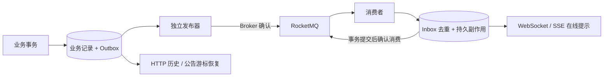

# Phase 29：RocketMQ、Outbox、Inbox 与失败恢复

## 1. 沿用已有安装

虚拟机已有 RocketMQ 5.1.4，已使用 C++ SDK 5.1.1 进行真实 FIFO 收发验证，因此没有再下载 5.5.1 服务端。测试服务运行在独立用户/网络命名空间，仅有本机回环端口。旧安装与正式服务保持原样。

C++ SDK 使用批准的源码版本，复用现有 gRPC、Protobuf、OpenSSL 和 zlib。新 Protobuf/Abseil 的编译兼容调整属于依赖适配，不是另装一套依赖。构建开关 `WEBSERVER_ENABLE_ROCKETMQ` 默认关闭，CMake 不下载源码。

## 2. 三张“收据”不能混为一谈

1. **聊天持久化 ACK**：消息事务已经提交，服务器接受了消息。
2. **Broker 发送确认 / 消费确认**：事件已进入 MQ，或者消费方持久处理已经提交。
3. **客户端送达、已读**：某个用户设备收到消息、或者用户读到对应序号。

MQ 是中转站。中转站签收包裹不表示收件人已读；离线恢复仍依据 `conversation_seq`。

Tree、Chat 使用 FIFO Topic，分别以果实和会话作为消息分组；Speech 使用普通 Topic。新聊天在原事务里原子移交到持久发布队列；部署前遗留的旧 Outbox 由搬运器补齐，避免一个 Broker 故障阻塞旧 Outbox 的全部会话。

## 3. 顺序、幂等与故障

- 发布器使用短事务领取最多四个不同 aggregate 的到期队首事件，释放数据库连接后才调用 SDK；等待发送确认仅发生在发布线程。
- 同一 aggregate 的前序事件未完成时，后序事件不能越过；其他 aggregate 仍可推进。
- 领取后有租约，进程故障后可以再次领取；发送确认丢失允许重复投递。
- 消费方先以 `(consumer,event_id)` 插入 Inbox，持久副作用与去重记录在同一事务。TTS 两个音色任务在这里创建。
- 数据库提交后才返回消费成功。在线提示允许通过 HTTP 恢复，不能用其失败回滚已经提交的业务。
- 发布失败指数退避，达到八次进入死信；后台人工重放需要站点管理员权限和原因，并写审计。
- 第一版部署单个发布器。使用多个进程时还需要部署层明确单活动实例，不能把本轮单实例演练当成高可用集群验收。

## 4. 代码索引与观察点

| 内容 | 组件 |
|---|---|
| Broker 端口 | `modules/messaging/ports/IEventBroker/` |
| 原生 SDK 封装 | `modules/messaging/infrastructure/RocketMqBroker/` |
| 业务事件写入 | `modules/messaging/infrastructure/PostgresEventWriter/` |
| 领取、重试、Inbox、旧聊天搬运 | `modules/messaging/infrastructure/PostgresEventPipeline/` |
| 重放权限与审计 | `modules/messaging/application/MessagingService/` |
| 后台接口 | `modules/messaging/transport/MessagingHttp/` |
| 组装与发布线程 | `modules/bootstrap/Function3Runtime/` |
| 隔离 Broker 启停 | `scripts/function3/dependencies/isolated_rocketmq.py` |

上表的 `modules/` 均位于 `backend/application/modules/`。队列状态、失败原因和重放入口位于 `/api/admin/messaging`。SDK 日志限制为 Warn，文件滚动受大小和数量限制；旧 Proxy 的遥测地址警告仍单独记录，不能称为零诊断警告。

故障演练与量化结果见 [Phase 34](../../../reports/stages/phase34.md)。

## 5. 本轮实际故障中发现的细节

- 普通 `Producer` 的异步接口拒绝 FIFO 消息，最终使用专用 `FifoProducer`。
- 上游 FIFO 分区对最终错误重新排队，会与持久 Outbox 形成两套重试。私有 SDK 的显式补丁将成功/最终失败均回调一次；项目内保留完整差异、原始/修改后摘要和验证脚本。没有静默修改系统库。
- C++ 封装最多保留 16 个待完成 SDK 发送；超时不提前释放计数，只有最终回调或同步异常释放，防止 Broker 不可用时内存持续增加。
- 消费事务失败返回 NACK，独立记录到 `function3_delivery_failures`。管理员可查看并带原因重新投递；Inbox 已成功的消息不会重复执行持久副作用。
- 消费方单队列缓存仍沿用 SDK 上限：1024 条/128 MiB。这是每队列上限，不能当成全进程统一内存上限。
- 发布器增加提交后唤醒和唤醒代次，回滚丢弃通知，避免提交与开始等待之间丢失提示；250ms 轮询保留为漏通知/恢复兜底。
- 连接构造时已设置 SQL 期限，删除每条事件事务中重复的两次 `SET LOCAL`。并未取消 SQL 的超时保护。

复现 SDK：先运行 `scripts/function3/dependencies/reuse_sdk.py` 核验已有源码；只有显式 `--rebuild` 才重新编译，脚本不联网。

批量发布最多四条，SDK 单次等待 8 秒，租约相应为 45 秒。确认合并在一项短事务；同一会话前序未确认时不会领取后序。投递消费者的消息、成员和通知偏好查询采用独立两连接小池，避免抢占普通聊天的四连接预算；对应等待指标进入 `/metrics`。

## 6. 删除聊天事件的中间落盘

第一轮实现把旧 Outbox 搬到新 Outbox，再分别提交“入队”和“旧事件已移交”，每条消息多两次提交。最终使用存储驱动内部的 `PostgresOutboxWriter` 策略，由 `ChatOutboxWriter` 在原业务事务、原连接中写入旧事件索引和可重试队列，单语句保证一起成功。业务层仍只看到 `IOutboxRepository`，不依赖 Function3 或 PostgreSQL 类型。

新请求不再依赖搬运线程做中间移交；部署前遗留的旧事件仍通过原搬运器补齐。Broker 发送确认、Inbox、重试和死信不变，没有用非持久队列替代成功承诺。没有配置 MQ 时不装配此策略，保留原来的直接 Outbox 路径。

`published_at` 在旧表中表示已移交到下一段持久队列，不能解释成客户端已经收到。新的 `function3_outbox.state` 才表示 Broker 发布状态。

原子移交之后，旧 Outbox Pump 的 published 计数只表示补搬的旧事件量，不代表全部新消息。新消息应结合 `function3_outbox` 队列状态、消息表和客户端 ACK 判断。
