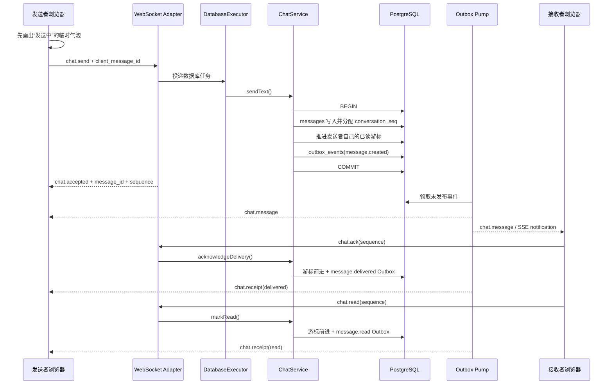

# Phase 12：持久消息生命周期

> 本文记录本地 `phase12` 历史基线，提交为 `ecec6d2`。后续群聊治理见
> [Phase 13](phase13.md)；两个阶段均已纳入 Function2。

## 1. 本阶段解决什么问题

Function1.0 已经能把消息写入 PostgreSQL，并通过 WebSocket/SSE 推送，但浏览器对“未读、送达、已读”
的显示仍有一部分是临时状态，刷新页面后不一定能还原；消息也没有正式的撤回生命周期。

Phase 12 把一条消息从“发出”到“读完或撤回”的状态补成持久闭环：

1. 发送按钮立即显示“发送中”，服务端落库后变为“已保存”。
2. 接收者收到消息后发送 `chat.ack`，发送者看到“已送达”。
3. 接收者打开会话后发送 `chat.read`，发送者看到“已读”。
4. 未读数从 PostgreSQL 游标计算，刷新页面或换设备后仍然存在。
5. 发送者可在两分钟内撤回自己的消息；历史、实时事件和搜索都不再暴露原正文。
6. 接收者离线不影响发送，重新登录后仍可按会话序号恢复消息。

可以把消息理解成一件快递：

- `client_message_id` 是寄件单号，重复点击不会生成两件货；
- `conversation_seq` 是这个聊天房间内的流水号；
- `last_delivered_sequence` 是“已送达哪一件”；
- `last_read_sequence` 是“已拆开看到哪一件”；
- 撤回不是撕掉仓库记录，而是在记录上盖章，外部只能看到“已撤回”。

## 2. 当前完整流程



Reactor 仍只负责网络收发。数据库操作先进入有界 `DatabaseExecutor`，因此一次慢查询不会把负责 epoll 的
线程堵住。WebSocket 是实时双向通道，SSE 是通知补充通道；两者收到同一持久消息时，浏览器按消息 ID 去重。

## 3. 领域模型与持久状态

### 3.1 `ConversationSummary`

会话列表不再只返回 `Conversation`，而是返回：

```cpp
struct ConversationSummary {
    Conversation conversation;
    std::uint64_t lastDeliveredSequence;
    std::uint64_t lastReadSequence;
    std::uint64_t unreadCount;
};
```

它像“房间信息 + 当前用户书签”。PostgreSQL 在一条查询中读取会话、成员游标并计算未读数，避免前端逐个会话
发请求形成 N+1 查询。

### 3.2 `MessageState`

```cpp
enum class MessageState { Active, Recalled };
```

`Message` 还保存 `recalledBy` 和 `recalledAt`。数据库迁移
[002_message_lifecycle.sql](../../../server/phase11/storage/postgres/migrations/002_message_lifecycle.sql)
用约束保证三者形状一致：正常消息没有撤回元数据，撤回消息必须同时有撤回人和时间。

### 3.3 三条关键不变量

1. **游标只前进，不倒退。** SQL 更新带有“小于新序号”的条件，重复 ACK/已读直接成为幂等操作。
2. **发送者自己的消息不计入自己的未读。** 新消息入库时同步把发送者游标推进到该序号。
3. **撤回不复用序号。** 消息行仍在，房间流水保持连续，断线恢复不会因物理删除出现空洞语义。

## 4. 业务层如何接入

协议适配器只依赖 `IChatBusiness`，不直接拼 SQL：

```text
HTTP / WebSocket / SSE
          ↓
IChatBusiness
          ↓
ChatService
          ↓
IConversationRepository / IMessageRepository / IOutboxRepository
          ↓
InMemoryStore 或 PostgresStore
```

`ChatService` 负责以下业务判断：

- 发送前校验会话成员、正文长度和幂等 ID；
- 相同幂等 ID 与相同正文返回已有消息，不重复写入；
- 相同幂等 ID 配不同正文返回冲突，防止客户端误用 ID；
- ACK/已读序号不能超过会话当前最大序号；
- 只有原发送者能撤回，并且必须在发送后两分钟内；
- 消息、游标和对应 Outbox 事件在同一事务边界内提交。

撤回窗口像电影票的退票时限：身份正确仍不代表任何时间都能撤回。当前采用两分钟作为清晰的学习规则，后续可改成
租户或产品配置。

## 5. WebSocket 与 SSE 事件

### 浏览器发给服务器

| 类型 | 关键字段 | 作用 |
|---|---|---|
| `chat.send` | `id`、`conversationId`、`content` | 幂等发送文字消息 |
| `chat.ack` | `conversationId`、`sequence` | 确认消息已到客户端 |
| `chat.read` | `conversationId`、`sequence` | 确认用户已读到该序号 |
| `chat.recall` | `id`、`replyTo=message_id` | 请求撤回一条持久消息 |

### 服务器发给浏览器

| 通道 | 类型 | 作用 |
|---|---|---|
| WebSocket | `chat.accepted` | 告知临时气泡对应的服务端消息 ID 与序号 |
| WebSocket/SSE | `chat.message` / `message.notification` | 分发已持久化消息 |
| WebSocket/SSE | `chat.receipt` / `message.receipt` | 广播送达或已读游标 |
| WebSocket/SSE | `chat.message-recalled` / `message.recalled` | 广播撤回后的消息状态 |
| WebSocket | `chat.recall.accepted` | 回应本次撤回命令是否首次生效 |

Outbox 仍是至少一次投递，所以浏览器维护一个有界的“验票册”：最近 4096 个消息 ID 已处理过就不再重复渲染。
容量有上限，页面长期打开也不会让这个集合无限增长。

## 6. 前端状态变化

### 6.1 乐观发送

点击发送后，前端先生成带 `client_message_id` 的临时气泡并显示“发送中”。收到 `chat.accepted` 后用服务端
`message_id/sequence` 替换临时状态；出错则标为“发送失败”。这让网络有轻微延迟时，按钮仍有即时反馈。

### 6.2 私聊与群聊回执

- 私聊：显示“已保存 → 已送达 → 已读”。
- 群聊：根据除自己外的成员游标显示“已读 2/5”“全部已读 5/5”。
- 成员详情同步展示每个人“已读至 #序号”。

### 6.3 持久未读

页面加载会话列表时，直接读取服务端 `unreadCount`。实时收到其他成员发往非当前会话的消息时，本地先递增；
用户打开会话并发送 `chat.read` 后，数据库游标推进，刷新后仍是正确结果。同账号其他标签页发出的消息不会被错误
计为自己的未读。

### 6.4 撤回

自己的正常消息在两分钟内显示“撤回”按钮。撤回成功后，所有在线成员把正文替换为“这条消息已被撤回”；离线成员
以后查询历史也只能拿到空正文和 `state=recalled`。

## 7. 文件索引

| 职责 | 文件 |
|---|---|
| 会话摘要、消息状态、撤回结果 | [Domain.h](../../../server/phase11/domain/Domain/Domain.h) |
| Repository 接口 | [Ports.h](../../../server/phase11/ports/Ports/Ports.h) |
| 业务门面 | [BusinessInterfaces.h](../../../server/phase11/business/BusinessInterfaces/BusinessInterfaces.h) |
| 发送、回执、未读与撤回规则 | [ChatService.cpp](../../../server/phase11/business/ChatService/ChatService.cpp) |
| 内存 Repository | [InMemoryStore.cpp](../../../server/phase11/storage/InMemoryStore/InMemoryStore.cpp) |
| PostgreSQL 查询与原子更新 | [PostgresStore.cpp](../../../server/phase11/storage/postgres/PostgresStore/PostgresStore.cpp) |
| 第 2 号迁移 | [002_message_lifecycle.sql](../../../server/phase11/storage/postgres/migrations/002_message_lifecycle.sql) |
| 顺序增量迁移脚本 | [postgres-migrate.sh](../../../scripts/phase11/postgres-migrate.sh) |
| HTTP 会话摘要与历史 JSON | [Phase11SocialChatHttp.cpp](../../../server/phase11/transport/http/Phase11SocialChatHttp/Phase11SocialChatHttp.cpp) |
| WebSocket 命令与 Outbox 实时事件 | [Phase11Realtime.cpp](../../../server/phase11/transport/realtime/Phase11Realtime/Phase11Realtime.cpp) |
| 浏览器状态与交互 | [app.js](../../../frontend/phase11/app.js) |
| 消息状态样式 | [styles.css](../../../frontend/phase11/styles.css) |
| 领域与事务测试 | [core.cpp](../../../tests/phase11/unit/core.cpp) |
| PostgreSQL 契约 | [postgres_contract.cpp](../../../tests/phase11/unit/postgres_contract.cpp) |
| 真实运行黑盒 | [runtime_blackbox.py](../../../tests/phase11/integration/runtime_blackbox.py) |

## 8. 数据库升级

升级前先备份正式学习库，再执行迁移：

```bash
cd /home/pikachu/phase11-full-src
scripts/phase11/postgres-migrate.sh phase11
scripts/phase11/postgres-migrate.sh phase11_test
```

脚本逐个检查 `phase11_schema_migrations`，已经执行的版本会跳过。2026-10-06 的虚拟机升级前备份位于
`/home/pikachu/phase11-data/backups/pre-phase12-20261006-140211.dump`；该运行数据不提交 Git。

## 9. 验证结果

验证环境仍是 `192.168.239.135` 上的 CentOS Stream 9，未安装新依赖。

| 检查 | 结果 |
|---|---|
| Windows JavaScript 语法 | `node --check` 通过 |
| Windows Python 黑盒脚本语法 | `py_compile` 通过 |
| Linux Release 构建 + CTest | **93/93**，27.28 秒 |
| Linux Debug 构建 + CTest | **93/93**，29.33 秒 |
| Linux ASan + LSan + UBSan 构建 + CTest | **93/93**，39.85 秒 |
| Ollama Provider 并发上限稳定性 | Sanitizer 下连续 **5/5** 通过 |
| 真实 PostgreSQL/HTTP/WS/SSE 黑盒 | `PHASE11_RUNTIME_BLACKBOX_OK` |
| 服务状态 | Release 服务运行于 `0.0.0.0:18090` |

黑盒实际完成：注册两名用户、申请并接受好友、创建私聊、发送消息、检查持久未读 1、ACK、已读归零、幂等重发、
两端 WebSocket 回执、SSE 通知、撤回、历史正文隐藏以及搜索排除。

Sanitizer 首轮暴露的是测试夹具竞态：假 Ollama 服务器可能在“队列已满”断言前释放第一个并发槽。测试现在先保持
第一条连接占位，再提交第二个请求；生产 Provider 的并发限制与 5 秒请求超时没有被放宽。

## 10. 适用场景、优点与限制

### 适用场景

- 单机文字聊天、学习型内部协作工具；
- 需要离线可恢复消息和刷新后仍准确未读数的应用；
- 用同一业务层学习 HTTP、WebSocket、SSE、事务 Outbox 和 PostgreSQL 游标。

### 优点

- 实时显示与数据库事实一致，页面不再自己猜测未读状态；
- 回执、撤回和普通消息都走业务层与 Outbox，权限和事务边界统一；
- 接收者无需在线，消息不会因没有 WebSocket 连接而拒绝写入；
- Repository 接口同时支持内存测试与 PostgreSQL 真实实现。

### 当前限制

- 未实现在线状态 Presence 的心跳、过期与多设备合并；
- 未实现失败消息的一键重发和客户端离线发送队列；
- 撤回正文仍保留在数据库供审计，尚未实现数据保留期限与管理员审计界面；
- 未实现附件、图片、内容审核、消息编辑和引用回复；
- 未实现多实例广播、Outbox 多消费者租约和跨节点一致未读；
- 本阶段没有重新宣称业务聊天 QPS；`/fast` 协议热路径未被此次代码改动触碰。

## 11. 后续学习建议

下一步适合继续完成 Presence 与多设备会话：为每个用户维护带过期时间的连接租约，并把“在线”定义为至少一个有效设备
连接；随后再做失败重试、消息分页和附件。等单机业务边界完整、指标可观测后，再进入 Redis/NATS 跨实例广播和真正的
分布式部署会更容易判断每个组件解决了什么问题。
