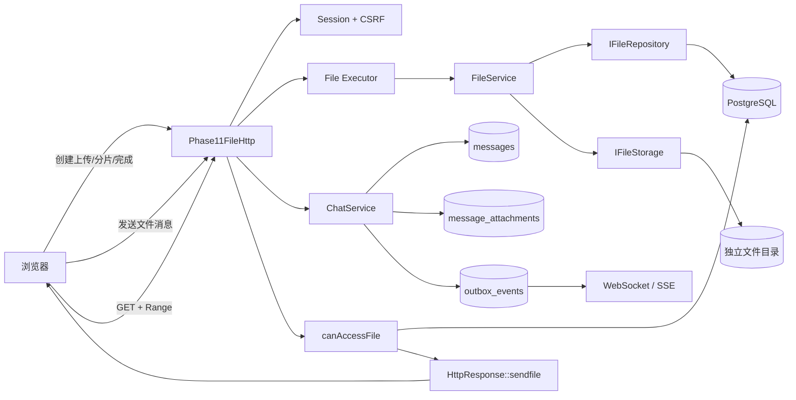
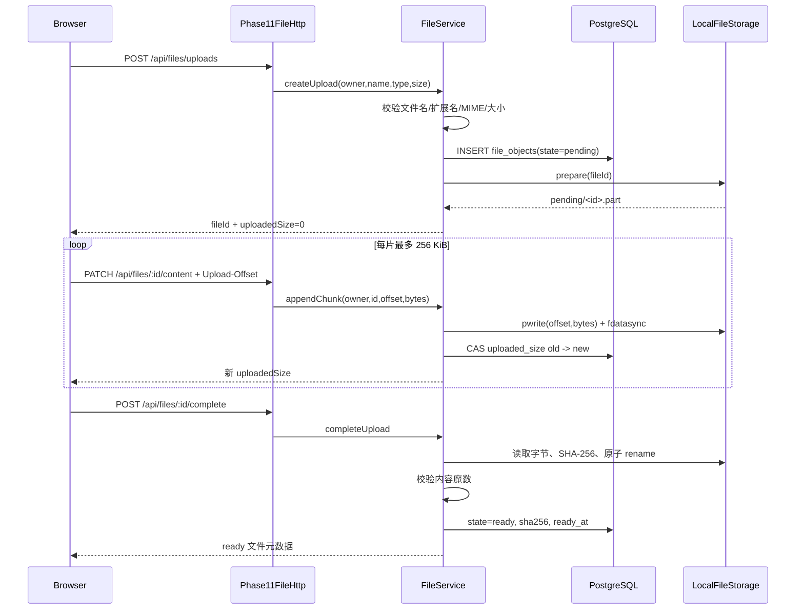

# Phase 17：头像、图片与文件消息

Phase 17 在文字聊天稳定、可观测和可运维之后，加入第一版文件能力：用户头像、图片/普通文件消息、
有界分片上传、SHA-256 封存、访问控制和 HTTP Range 下载。文件元数据进入 PostgreSQL，文件正文进入
独立目录；消息依旧先持久化，所以接收者离线时也可以发送，之后按会话历史恢复。

可以把整个设计想成物流系统：

- PostgreSQL 保存“货物登记卡”，记录货主、文件名、大小、状态和指纹；
- `LocalFileStorage` 是仓库，只保存字节，不理解好友或群聊；
- `FileService` 是验货员，检查申报类型、上传游标、内容魔数和访问资格；
- `ChatService` 把已经封存的货物编号贴到消息上；
- HTTP 下载像提货窗口，先查证件和房间成员关系，再按整件或指定 Range 交货。

## 1. 本阶段完成内容

| 能力 | 当前实现 |
|---|---|
| 用户头像 | 图片上传完成后绑定 `users.avatar_file_id`，登录用户可读取 |
| 图片/普通文件消息 | 一条消息当前最多关联一个文件，文字说明可为空 |
| 离线发送 | 消息和附件关系进入 PostgreSQL，对方无需在线 |
| 大小限制 | 普通文件 25 MiB，图片 10 MiB |
| 分片上传 | 每片最多 256 KiB，严格检查 `Upload-Offset` |
| 幂等重试 | 磁盘已写而数据库暂未推进时，相同分片可安全重放 |
| 类型检查 | 扩展名、MIME 和常见文件魔数三层检查 |
| 可执行文件阻断 | `.bin` 也拒绝 PE `MZ` 和 ELF 魔数 |
| 完整性 | 完成上传时计算 SHA-256 并保存到元数据 |
| 权限下载 | 文件所有者、附件所在会话成员，或登录用户读取公开头像 |
| Range 下载 | 复用服务器已有 `sendfile`/mmap 和 HTTP Range 能力 |
| 资源隔离 | 文件操作进入独立有界 Executor，不占用 Reactor 或数据库 Worker |
| 前端 | 选择文件、上传进度、图片预览、普通文件卡片、头像上传 |

本阶段没有实现病毒扫描、缩略图转码、对象存储、多副本、过期上传清理和用户存储配额。这些是走向
公网生产前的后续工作，不应把“扩展名检查通过”理解成文件绝对安全。

## 2. 总体架构



协议层、业务层和存储层各自只回答一类问题：

1. `Phase11FileHttp` 回答“HTTP 请求长什么样、身份和 CSRF 是否有效”；
2. `FileService` 回答“这个用户能否创建、完成、读取或设为头像”；
3. `IFileRepository` 回答“登记卡和附件关系如何持久化”；
4. `IFileStorage` 回答“字节如何安全写入、封存和找到”；
5. `ChatService` 回答“这个文件能否作为当前会话的一条消息发送”。

因此以后把本地磁盘换成 S3/MinIO，只需增加新的 `IFileStorage` 适配器；聊天权限、HTTP DTO 和消息事务
不需要跟着重写。

## 3. 上传全流程



### 3.1 为什么必须由服务端维护上传游标

`Upload-Offset` 像仓库收货单上的页码。客户端说“我从 262144 开始送下一箱”，服务端只有在数据库和
磁盘都确认前 262144 字节存在时才接受。否则两个重试或并发请求可能覆盖、跳过或重复字节。

更新元数据使用比较并交换语义：只有数据库中旧 `uploaded_size` 等于本次 offset 才能推进。磁盘写入后若
数据库短暂失败，客户端重发同一 offset 和相同字节时，`LocalFileStorage` 会比对已有内容并把它当作幂等
重放；不同字节则返回冲突。

### 3.2 为什么完成时才计算 SHA-256

分片阶段文件还会继续变化，提前保存指纹没有意义。完成时从头读取临时文件，一次得到：

- 实际大小；
- SHA-256；
- 前 32 字节，用于常见格式魔数检查。

核验成功后通过同一文件系统内的原子 `rename` 从 `pending` 移到 `objects`。之后正文不可再修改，数据库
状态才改为 `ready`。可以把 `ready` 理解为仓库封条：只有封条完整的文件可以绑定头像或发送到聊天。

## 4. 文件消息为什么支持接收方离线

文件上传和发送消息是两个动作。上传成功只表示“货物已经入仓”，还不表示任何聊天成员能看到它。

```text
文件 ready
   ↓
POST /api/conversations/{id}/file-messages
   ↓ 同一数据库事务
messages 新消息
+ message_attachments 文件引用
+ outbox_events 实时通知
   ↓ COMMIT
在线成员：WebSocket/SSE 立即收到
离线成员：以后 GET 历史，按 conversation_seq 恢复
```

`client_message_id` 仍是幂等键。同一发送人、同一会话、同一客户端 ID 重试时：

- 文字说明和文件 ID 都相同：返回原消息，不重复写入；
- 任一内容不同：返回冲突，防止错误复用 ID 偷换附件。

文件字节不会进入 WebSocket 帧。WebSocket/历史接口只传文件元数据和 `/api/files/{id}` URL，浏览器再走
普通 HTTP 下载。这样大文件不会挤占聊天帧、实时出站队列或 Reactor 内存。

## 5. 下载权限

`IFileRepository::canAccessFile` 按以下顺序判断：

1. 文件必须为 `ready`；
2. 所有者始终可读自己的文件；
3. 若文件已绑定为任一用户头像，任意已登录用户可读；
4. 若文件关联消息，请求者必须仍是该会话成员；
5. 其余情况返回 403。

好友关系本身不是附件读取凭证，真正凭证是“消息所在会话的当前成员”。群成员退出或被移除后，当前
实现会失去附件访问权；这与其失去会话历史访问权保持一致。

下载响应包含：

- 原始 MIME，但同时设置 `X-Content-Type-Options: nosniff`；
- 图片使用 `inline`，其他文件使用 `attachment`；
- 文件名使用 RFC 5987 风格百分号编码；
- `Range: bytes=start-end` 返回 206，并复用现有小文件内存、热点 mmap、大文件 sendfile 路径；
- 缓存策略是登录用户私有缓存。

## 6. 类型与安全边界

允许列表如下：

| 类型 | 扩展名 |
|---|---|
| 图片 | `.png`、`.jpg/.jpeg`、`.gif`、`.webp` |
| 文档 | `.pdf`、`.txt`、`.md`、`.json` |
| 压缩/Office | `.zip`、`.docx`、`.xlsx`、`.pptx` |
| 通用字节 | `.bin` + `application/octet-stream` |

文件名不会拼入磁盘路径。磁盘路径只由数据库生成的数字 `FileId` 组成，因此 `../../secret` 即使漏过前端，
也不能决定服务端写到哪里；业务层仍会直接拒绝斜杠、反斜杠、控制字符、`.` 和 `..`。

本地存储目录权限为 0700，正文文件为 0600；打开临时文件使用 `O_NOFOLLOW`（平台支持时），降低符号链接
替换风险。图片、PDF 和 ZIP/Office 检查常见魔数；PE/ELF 可执行内容无论 `.bin` 与否都拒绝。

这些检查属于入口防线，不等于杀毒或内容安全系统。公网文件服务还需要异步恶意文件扫描、图片重新编码、
压缩炸弹防护、每用户配额、上传过期回收、审计和内容处置流程。

## 7. PostgreSQL 与磁盘布局

迁移 [005_files.sql](../../../server/phase11/storage/postgres/migrations/005_files.sql) 增加：

```text
users.avatar_file_id ───────┐
                            v
file_objects <──── message_attachments ────> messages
```

- `file_objects`：文件登记卡；包含所有者、原名、MIME、预期/已上传大小、SHA-256、状态和时间；
- `message_attachments`：消息与文件的关系；当前业务只发一个附件，表结构保留 0–7 的位置字段；
- `users.avatar_file_id`：当前头像引用；删除文件时设空的外键规则为后续生命周期管理保留边界。

默认运行脚本把正文放在：

```text
/home/pikachu/phase11-data/files/
├─ pending/
│  └─ 42.part
└─ objects/
   └─ 0/
      └─ 42
```

对象每 1000 个 ID 分一个目录，避免单目录无限膨胀。二进制本身的便携默认目录是当前工作目录下的
`phase11-files`；虚拟机服务脚本显式设置 `WEB_PHASE11_FILE_ROOT`，不会把运行数据混进 build 目录。

## 8. HTTP API

| 方法与路径 | 用途 | 关键请求 |
|---|---|---|
| `POST /api/files/uploads` | 创建上传 | JSON: `name`、`mediaType`、`size` |
| `PATCH /api/files/{id}/content` | 写入一片 | 原始字节 + `Upload-Offset` |
| `POST /api/files/{id}/complete` | 核验并封存 | 无正文 |
| `GET /api/files/{id}` | 权限下载 | 可带 `Range` |
| `POST /api/me/avatar` | 绑定头像 | JSON: `fileId` |
| `POST /api/conversations/{id}/file-messages` | 发送附件消息 | `clientMessageId`、`fileId`、可选 `caption` |

除 GET 外全部需要 Session、CSRF Token 和同源检查。浏览器以 256 KiB 为上传分片，并根据每次响应中的
`uploadedSize` 更新进度，不能根据“已经点击发送多少次”自行猜测进度。

## 9. 前端交互

聊天输入区增加回形针按钮和已选文件条。发送时先创建上传，再顺序发送分片，完成后才创建消息。失败时
保留明确错误，前端不会把未入库附件伪装成发送成功。

消息渲染规则：

- 图片显示受权限保护的预览卡；
- 普通文件显示文件名、MIME 和大小，并可点击下载；
- 被撤回的消息不显示附件；
- 乐观消息先显示本地文件信息，HTTP 返回持久消息后用服务器 ID、序号、哈希和 URL 替换；
- 个人资料框可以选择图片并显示上传进度，成功后刷新用户头像。

## 10. 执行器与背压

文件读写和 SHA-256 计算不会在 Reactor 线程运行，也不与 PostgreSQL 查询共用 Worker。`main.cpp` 新建
独立 `BoundedExecutor`：

| 配置 | 默认值 | 范围 |
|---|---:|---:|
| `WEB_PHASE11_FILE_WORKERS` | 2 | 1–16 |
| `WEB_PHASE11_FILE_QUEUE` | 64 | 1–4096 |
| `WEB_PHASE11_FILE_ROOT` | 运行脚本下 `${data_root}/files` | 可自定义绝对目录 |

队列满时返回 503，防止慢磁盘、并发哈希或大量下载授权任务无限积压。`/metrics` 增加文件执行器的接收、
拒绝、失败、活动数、排队数和队列最高水位。

## 11. 代码索引

| 文件 | 职责 |
|---|---|
| `server/phase11/domain/Domain/Domain.h` | `FileObject`、`MessageAttachment`、头像和消息附件字段 |
| `server/phase11/ports/Ports/Ports.h` | `IFileRepository` 与 `IFileStorage` 端口 |
| `server/phase11/business/FileService/` | 上传、核验、下载权限和头像业务 |
| `server/phase11/business/ChatService/` | 文件消息事务、幂等和会话权限 |
| `server/phase11/storage/files/LocalFileStorage/` | 分片写入、SHA-256、原子封存和路径安全 |
| `server/phase11/storage/postgres/PostgresStore/` | 文件元数据、附件关系、头像与权限 SQL |
| `server/phase11/storage/postgres/migrations/005_files.sql` | 数据库版本 5 |
| `server/phase11/transport/http/Phase11FileHttp/` | 文件 HTTP API 与 Range 下载 |
| `server/phase11/transport/serialization/MessageJson/` | HTTP/WS/SSE 共用消息 JSON，避免三份格式漂移 |
| `frontend/phase11/` | 上传、进度、头像与附件卡片 UI |
| `tests/phase11/unit/files.cpp` | 文件业务与本地存储生命周期测试 |
| `tests/phase11/integration/file_blackbox.py` | 真实 PostgreSQL/HTTP/离线/Range 整链黑盒 |

## 12. 验证结果

2026-10-07 在 CentOS Stream 9 虚拟机完成：

| 验证 | 结果 |
|---|---|
| Release 全量 CTest | 94/94，26.82 秒 |
| Debug 全量 CTest | 94/94，27.15 秒 |
| ASan + LSan + UBSan 全量 CTest | 94/94，36.60 秒 |
| PostgreSQL 文件 Repository 契约 | 通过隔离 `phase11_test` 数据库 |
| HTTP 适配器文件流程 | 创建、原始分片、完成、发送、下载、头像均通过 |
| 真实网络文件黑盒 | 上传、错误 offset=409、离线历史、整文件、Range、权限、头像均通过 |
| JavaScript 语法 | `node --check frontend/phase11/app.js` 通过 |

黑盒实际结果：文件 37 字节，Range 返回 12 字节；接收者全程未打开 WebSocket/SSE，之后通过历史接口
取回附件并按 SHA-256 对应的不可变文件下载成功。正式数据库迁移前已生成逻辑备份，迁移审计结果为
`expected=5 applied=5 latest=5`。

## 13. 适用场景、优缺点与下一步

这套实现适合单机学习、内网团队聊天和预生产功能验证。它的优点是边界清楚、内存有界、离线可靠、
权限与会话一致，并且以后可替换对象存储。代价是每片都 `fdatasync`，安全但吞吐保守；本地磁盘不能天然
支持多实例共享，也没有媒体处理和恶意内容隔离。

理解本阶段时，建议按下面顺序阅读：

1. 从 `FileObject` 和两类 Port 看“元数据/正文分离”；
2. 跟 `createUpload → appendChunk → completeUpload` 看上传状态机；
3. 跟 `ChatService::sendFile` 看消息、附件和 Outbox 的同事务；
4. 跟 `canAccessFile → HttpResponse::sendfile` 看授权与高效下载；
5. 最后运行 `file_blackbox.py`，观察离线接收者为什么仍能恢复文件消息。

文件阶段的后续优先级是：临时上传 TTL 清理与用户配额 → 病毒扫描/图片重编码 → 对象存储与多实例 →
直传签名与 CDN。完成这些基础治理后，再进入语音/视频或 WebRTC，避免把文件服务尚未解决的问题带进
更复杂的实时媒体系统。
