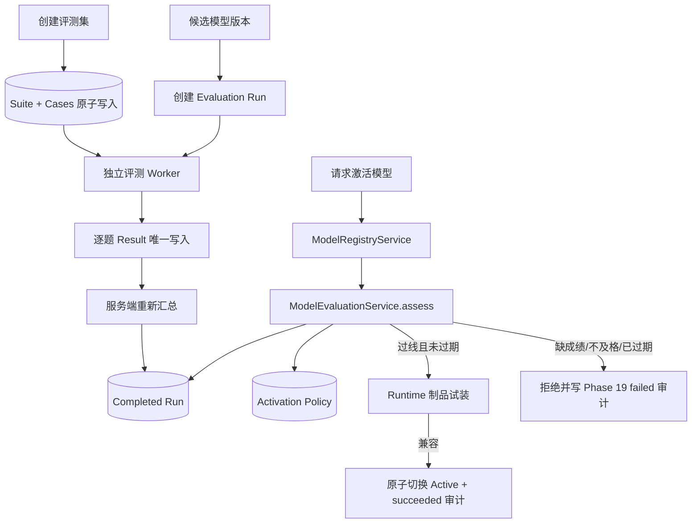

# Phase 20：模型评测集、结果对比与激活质量门禁

## 1. 本阶段解决什么问题

Phase 19 已经能回答“哪个模型版本被谁启用、一次回答使用了哪个版本”，但它仍不能证明新版本比旧版本好。
模型文件能加载成功，只相当于机器可以通电；是否真的会做题，还需要一套固定试卷和可复现成绩。

Phase 20 增加五个完整环节：

1. 版本化保存评测集和题目；
2. 每次评测严格绑定一个模型版本；
3. 保存逐题分数、通过状态、输出摘要和耗时；
4. 服务端重新计算加权分数和必答题结果；
5. `ModelRegistryService` 在启用候选版本前检查节点的质量策略。

本阶段没有下载新依赖，也没有向远程仓库推送。

## 2. 核心概念

| 名词 | 类比 | 作用 |
|---|---|---|
| Evaluation Suite | 一张固定试卷 | 定义一组不可混淆的评测题 |
| Evaluation Case | 一道题 | 保存 Prompt、期望答案、权重和是否必答 |
| Evaluation Run | 某位考生的一次考试 | 固定绑定一个 `model_version_id` |
| Case Result | 单题答题卡 | 保存分数、通过状态、输出 SHA-256 和耗时 |
| Activation Policy | 岗位及格线 | 规定通过率、加权分、成绩有效期 |
| Quality Gate | 上岗闸机 | 在模型激活前给出放行或拒绝决定 |

评测结果不保存完整模型输出，只保存 SHA-256。完整输出可由受控评测工件系统保管；数据库中的摘要用于确认
当时打分对应的是哪份内容，避免评测表变成新的大文本仓库。

## 3. 总体流程



这里有两道门：

1. **质量门**：回答质量是否达到策略；
2. **制品门**：模型、Adapter 和 Runtime 是否真的能加载。

只有两道门都通过，新版本才会成为 Active。

## 4. 评测集与计分规则

### 4.1 评测集原子创建

`createSuite` 一次接收试卷及全部题目。PostgreSQL 在一个事务内写入 `model_evaluation_suites` 和
`model_evaluation_cases`；中途任意题写入失败，整张试卷都不会出现。这样不会产生“试卷存在，但只有一半题目”的状态。

当前边界：

- 每套 1–256 道题；
- 名称、Prompt 和权重均校验；
- 权重范围 `(0, 1000]`；
- 同一评测集中的题目名称唯一；
- `name + version` 唯一，`checksum` 是整套评测资产的 64 位摘要；
- 已创建的评测集按不可变资产使用，修改内容应以新 version 创建。

### 4.2 逐题结果

同一 `run_id + case_id` 只能写入一次。Repository 同时检查：

- Run 仍处于 `running`；
- Case 属于该 Run 使用的 Suite；
- 分数在 `[0, 1]`；
- 输出摘要为空或为 64 位 SHA-256；
- 同一道题没有被重复提交。

唯一约束类似答题卡上的题号格：同一道题只能涂一次，重复到达的 Worker 消息不会生成两份成绩。

### 4.3 服务端汇总

客户端不能直接提交总分。`completeRun` 重新读取 Suite 和全部单题结果，并计算：

```text
weighted_score = Σ(case_score × case_weight) / Σ(case_weight)
pass_rate      = passed_cases / total_cases
required_cases_passed = 所有 required 题均通过
```

只有每道题都已有结果，Run 才能从 `running` 进入 `completed`。Worker 中断时可以进入 `aborted`，
但 aborted 成绩永远不能用于激活。

## 5. 激活质量门禁

每个模型节点最多配置一条策略：

| 字段 | 含义 |
|---|---|
| `suite_id` | 必须使用哪套评测集 |
| `minimum_pass_rate` | 最低单题通过率 |
| `minimum_weighted_score` | 最低加权总分 |
| `max_run_age_seconds` | 成绩最长有效期 |

门禁只接受“同一模型版本、同一评测集”的最新 completed Run，并依次检查：

1. 成绩存在且有完成时间；
2. 完成时间没有来自未来，也没有超过有效期；
3. 所有 required 题通过；
4. 通过率达到策略；
5. 加权分达到策略。

任何一项失败，`ModelRegistryService` 都会拒绝启用，保留旧 Active 版本，并把原因写进 Phase 19 的
`model_activation_audits`。质量门会在 Runtime 试装前后各检查一次，避免耗时试装期间策略收紧或成绩过期后
仍使用旧决定；成功审计会记录最终采用的 evaluation run ID。

### 为什么紧急回滚不受质量门阻断

回滚仍会重新执行 Runtime 制品校验，但跳过“成绩是否过期”的质量门。如果线上新版本故障，而旧稳定版本的评测恰好
超过有效期，系统必须保留恢复通道。它类似消防通道：平时新员工必须考试，事故时不能因为旧证件到期而锁住出口。

## 6. 分层与接口

```text
管理端 / 评测 Worker
        ↓
ModelEvaluationService
        ├── IModelRepository
        ├── IModelEvaluationRepository
        └── IModelQualityGate
                  ↓
ModelRegistryService.activate
                  ↓
InMemoryStore / PostgresStore
```

业务层只依赖领域对象和端口，不包含 `PGconn`、SQL、Ollama 或 ONNX 类型。未来把评测 Worker 拆成独立服务时，
只需要通过管理 API 调用现有业务接口，不需要重写计分和激活规则。

## 7. 数据库迁移

第 7 号迁移新增：

```text
model_evaluation_suites
model_evaluation_cases
model_evaluation_runs
model_evaluation_case_results
model_activation_policies
```

第 8 号迁移为 Suite 增加 `version + checksum`，并把唯一约束调整为 `(name, version)`。正式学习库和
隔离测试库均已应用 1–8 号迁移：

```text
database=phase11 expected=8 applied=8 latest=8
```

`phase11_test` 契约测试会主动清空评测表，只能连接隔离测试库。

## 8. 代码索引

| 职责 | 文件 |
|---|---|
| 评测、Run、结果与策略领域对象 | [Domain.h](../../../server/phase11/domain/Domain/Domain.h) |
| Repository 与质量门接口 | [Ports.h](../../../server/phase11/ports/Ports/Ports.h) |
| 校验、计分、终态和门禁判断 | [ModelEvaluationService.cpp](../../../server/phase11/ai/ModelEvaluationService/ModelEvaluationService.cpp) |
| 激活前接入质量门 | [ModelRegistryService.cpp](../../../server/phase11/ai/ModelRegistryService/ModelRegistryService.cpp) |
| 无依赖参考实现 | [InMemoryStore.cpp](../../../server/phase11/storage/InMemoryStore/InMemoryStore.cpp) |
| PostgreSQL 事务与查询实现 | [PostgresStore.cpp](../../../server/phase11/storage/postgres/PostgresStore/PostgresStore.cpp) |
| 第 7 号迁移 | [007_model_evaluation.sql](../../../server/phase11/storage/postgres/migrations/007_model_evaluation.sql) |
| 评测集版本与摘要迁移 | [008_evaluation_suite_versioning.sql](../../../server/phase11/storage/postgres/migrations/008_evaluation_suite_versioning.sql) |
| 内存业务与门禁测试 | [core.cpp](../../../tests/phase11/unit/core.cpp) |
| PostgreSQL 持久化契约 | [postgres_contract.cpp](../../../tests/phase11/unit/postgres_contract.cpp) |

## 9. 验证结果

环境为 `192.168.239.135` 的 Linux 虚拟机，PostgreSQL、libsodium、libcurl、ONNX Runtime GenAI 和
gRPC 构建开关全部启用。

| 检查 | 结果 |
|---|---|
| 无成绩版本激活 | 拒绝，旧 Active 不变，失败审计保留 |
| 重复单题结果 | 拒绝 |
| 必答题失败 | 拒绝激活 |
| 通过率、加权分和有效期 | 均由门禁验证 |
| 紧急回滚 | 保留 Runtime 校验，跳过质量成绩时效门 |
| PostgreSQL Suite/Case 原子写入 | 通过 |
| PostgreSQL Run/Result/Policy 重载 | 通过 |
| 正式/测试库迁移状态 | `expected=8 applied=8 latest=8` |
| Linux Debug 全量 | **95/95**，27.17 秒 |
| Linux Release 全量 | **95/95**，26.82 秒 |
| ASan + LSan + UBSan 全量 | **95/95**，31.77 秒 |

三套全量测试在停止常驻学习服务后运行，避免黑盒测试与常驻进程争用固定 gRPC 地址。Sanitizer 没有报告
内存泄漏、越界或未定义行为。测试中还修正了 AI 熔断用例把“熔断窗口”和“30 ms 请求超时”耦合在一起的
时序不稳定：熔断场景使用宽松超时，超时切换场景继续单独验证 30 ms 边界。测试结束后已重新启动最新
Release 服务，`/health/ready` 返回 ready。

## 10. 当前限制与下一步

当前已经完成评测领域、持久化和激活门禁，但评测 Worker 仍需要显式调用 `recordResult`，尚未提供带管理员权限的
HTTP 管理接口，也没有保存完整评测输出工件。评分器目前接受上游给出的单题 `score/passed`，后续应增加可版本化的
评分器身份和评分规则，避免不同评分器的结果混在一起。

下一阶段继续 RAG：文档登记、授权、切片、可替换向量索引端口、检索结果和回答引用链。先用无外部依赖的确定性
检索实现打通业务流程，再决定是否安装向量数据库或 Embedding Runtime。
