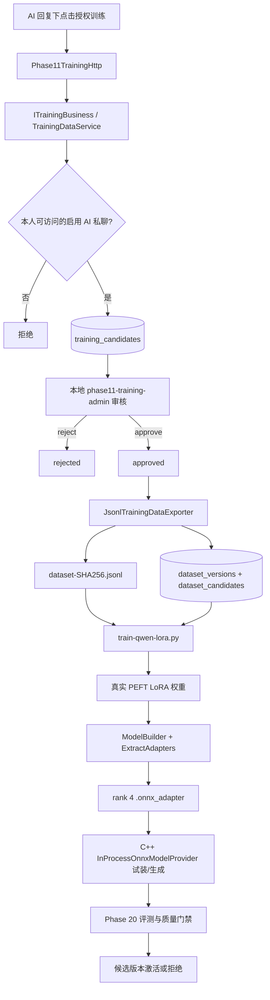

# Phase 22：授权数据集与真实 LoRA 微调闭环

Phase 22 把原来“模型可以装载 Adapter”的工程夹具推进为一条真实但仍受控的微调流水线：用户只对
AI 私聊中的某一条回复明确授权，服务端保存脱敏副本；管理员离线审核并导出内容寻址 JSONL；训练脚本
核对数据集与基础模型指纹后执行真实反向传播；Olive 再生成与现有 OGA 图匹配的
`.onnx_adapter`，最后由 C++ Provider 试装和生成。

这里的真实是指 **LoRA 参数确实经过 loss.backward() 和 optimizer.step() 发生变化**。本阶段只用一条
合成样本做流水线验证，因此不能把结果解释成模型质量已经提高，也没有自动激活新模型。

## 1. 完整架构



可以把它类比成出版流程：用户授权是“投稿许可”，人工审核是“编辑审稿”，内容寻址 JSONL 是不可
偷偷换页的“定稿”，LoRA 训练是印刷，C++ 试装与 Phase 20 评测则是发行前质检。网页不能绕过审稿
直接启动训练。

## 2. 用户授权与撤销

新增接口：

| 方法 | 路径 | 作用 |
|---|---|---|
| `POST` | `/api/training/candidates` | 提交来源消息、脱敏问题、脱敏回答和明确同意 |
| `GET` | `/api/training/candidates` | 只查看当前用户自己的授权记录 |
| `POST` | `/api/training/candidates/{id}/revoke` | 撤销本人授权 |

提交同时满足以下条件才会写库：

1. Cookie Session 有效，写请求通过 CSRF；
2. 来源消息存在，当前用户仍是会话成员；
3. 会话是 `active` 的双人私聊，另一端是启用的 AI 账号；
4. 用户传入固定同意协议版本与明确同意；
5. 脱敏后的问题和回答均非空且分别不超过 32 KiB；
6. 同一用户、同一来源消息不存在另一条未撤销授权。

最后一条同时由 Repository 查询和 PostgreSQL 部分唯一索引保护。业务层检查提供清楚的冲突提示，
数据库索引负责挡住两个 Worker 同时提交的竞态。撤销后可以重新脱敏并再次授权。

```text
submitted ──审核通过──> approved ──导出──> exported
    │                      │                  │
    └──审核拒绝──> rejected│                  │
                           └──────撤销─────────┘
任一已有记录也可以进入 revoked
```

撤销能阻止样本进入后续新数据集。已经训练完成的参数不会自动“反向遗忘”，这项限制在授权界面中直接
告知用户；已经发布模型若需要删除影响，仍要建立模型下线、重训和删除请求流程。

## 3. 不可变数据集

`JsonlTrainingDataExporter` 只接受 `approved` 样本，并执行：

- 按候选 ID 排序，生成稳定的 `phase22-chat-jsonl-v1`；
- 正确转义引号、换行和控制字符；
- 对完整正文计算 SHA-256，文件名固定为 `dataset-<sha256>.jsonl`；
- 先写同目录临时文件，再原子 `rename`；
- 并发导出相同正文时复用同一文件，并逐字节复核；
- 文件成功后再开启数据库事务，事务内重查授权状态；
- `dataset_versions`、`dataset_candidates` 和 `approved → exported` 同时提交。

因此“文件有一半”“数据库记了但文件没写完”“撤销与导出互相覆盖”都会被挡住。数据库失败时最多
留下一个未引用的内容寻址文件，它可以按 SHA-256 安全复用或由运维清理。

迁移 010 为 `dataset_versions` 增加 `artifact_path`、`record_count` 和路径/哈希约束；迁移 011 增加
未撤销授权的来源去重索引。

## 4. 审核与导出操作

管理员工具只运行在服务器本地，不监听网络端口，通过 `WEB_PHASE11_DATABASE` 使用现有数据库连接：

```bash
phase11-training-admin list submitted
phase11-training-admin review 12 approve
phase11-training-admin export support-v1 /home/pikachu/phase11-data/training 12 15 18
phase11-training-admin authorize 4 /home/pikachu/phase11-data/training /tmp/support-v1.authorization.json
```

输出会给出 `dataset_id`、记录数、SHA-256 和相对路径。训练时必须把这个 SHA-256 作为独立参数传给
脚本，不能只按一个容易写错的文件名取数据。`authorize` 会在训练前重新确认每一条候选仍为
`exported`、仍绑定该数据集，并复核文件哈希与行数；它生成的授权清单默认只有 10 分钟有效期。训练
脚本必须提供该清单。撤销和训练启动之间仍存在很短的窗口，因此正式任务还需要任务状态与取消联动。

## 5. 真实训练

[train-qwen-lora.py](../../../scripts/phase11/train-qwen-lora.py) 使用现有
PyTorch、Transformers 与 PEFT，不依赖额外 `datasets` 包，也不会联网下载。训练前会验证：

- 数据集文件与数据库导出 SHA-256 一致；
- 每行都是固定 schema 的一问一答；
- Qwen 源目录固定为批准的仓库与 revision；
- 清单内 10 个模型文件的大小和 Git Blob SHA-1、普通 SHA-256 或 LFS SHA-256 摘要正确；
- `model.safetensors` 等于批准的固定 SHA-256；
- 输出目录不存在，避免覆盖旧实验。
- 本地管理工具刚生成且未过期的训练授权清单有效；仅流水线合成测试允许显式
  `--pipeline-smoke`，并强制每条记录使用 `pipeline-smoke-only` 同意标记。

训练只对 Assistant 回答 Token 计算损失，Prompt Token 的 label 为 `-100`。基础模型被冻结，默认只
训练 24 层注意力中的 `q_proj/k_proj/v_proj/o_proj` LoRA A/B，共 540,672 个参数；默认 `r=4`、
`alpha=8`，与当前 ONNX Adapter 插槽一致。若改变 rank，就像把四针插头改成八针，必须重新生成匹配
的基础 ONNX 图。

产物 `PHASE22_TRAINING_MANIFEST.json` 保存数据集指纹、基础版本、超参数、逐步 loss、权重指纹和
参数变化 L2。脚本若发现所有参数都没有变化，会直接失败。

## 6. 为什么不能直接使用 `olive convert-adapters`

通用转换保留了 Transformers 的名称，例如：

```text
model.layers.9.self_attn.q_proj.lora_B.weight
```

当前 OGA ModelBuilder 图的输入则是量化后的规范名称：

```text
model.layers.9.attn.q_proj.lora_B.MatMul.weight_Q4
model.layers.9.attn.q_proj.lora_B.MatMul.weight_scales
```

第一次直接转换被 C++ Runtime 以 `Invalid input name` 正确拒绝。项目随后新增
[export-trained-lora-onnx.py](../../../scripts/phase11/export-trained-lora-onnx.py)，复用已验证的
`ModelBuilder(INT4) → ExtractAdapters` 流程，让 Olive 完成名称映射、INT4 权重与 scale 提取。
导出的基础 `model.onnx` 必须与已验证参考图 SHA-256 完全相同，脚本才会用硬链接复用它，并补齐
Tokenizer/GenAI 配置文件；不同则停止，防止把“Adapter 变化”混成“基础图也变化”。

## 7. Linux 实测证据

流水线使用一条明确标记为 `pipeline-smoke-only` 的合成样本，不包含用户聊天数据：

| 检查 | 结果 |
|---|---|
| 数据集记录 | 1 |
| 训练步数 | 1 |
| LoRA rank / alpha | 4 / 8 |
| 可训练参数 | 540,672 |
| 单步 loss | 4.9310669899 |
| 参数变化 L2 | 0.0885472765，非零 |
| PEFT 权重 SHA-256 | `e69a3db9a3e55cc2b76961460c3999dfe0f49dbb1896c042e3f5ee0d1e11ba762` |
| ONNX Adapter SHA-256 | `b04035425bcbd454d9c013ffeddfba25e30fc48cd6ef8981e5640227da0112a49` |
| 基础 ONNX 图 SHA-256 | `518cb7afd088ab5a297bf37152b8fc984cec6c93daa3635705e121dfc1e30a25`，与参考图相同 |
| 零 Adapter 对照 | 151,936 个 logits 全部发生变化，最大绝对差约 0.68998 |
| C++ Runtime | 试装成功并生成 `phase11 onnx ready`（18 字节） |
| 数据库授权清单 | 真实 `phase11_test` 数据集生成清单后，训练脚本以 `database-verified` 模式校验通过 |
| 撤销竞态门禁 | 候选改为 `revoked` 后再次授权返回失败，且不留下正式文件或 `.tmp` 文件 |
| Release CTest | **97/97**，31.06 秒 |
| Debug CTest | **97/97**，31.72 秒 |
| ASan + LSan + UBSan | **97/97**，38.51 秒，未报告泄漏、越界或未定义行为 |

这些数据证明授权文件、真实梯度、PEFT、Olive、`.onnx_adapter` 和 C++ 装载链路成立。它们不证明
单步合成数据产生了有价值的回答能力。正式模型仍必须用真实授权数据训练，并通过 Phase 20 评测集与
激活质量门禁。

验证时还发现下载清单对大权重使用 `digest_kind: sha256`，而早期脚本只把 `lfs-sha256` 当作
SHA-256，导致正确文件被误判为 Git Blob 摘要不匹配。现已按摘要类型明确分流；固定权重摘要仍会再与
代码中的批准值独立比较，因此兼容清单写法不会放宽模型来源约束。

## 8. 代码索引

| 职责 | 文件 |
|---|---|
| 领域对象 | [Domain.h](../../../server/phase11/domain/Domain/Domain.h) |
| 业务接口 | [BusinessInterfaces.h](../../../server/phase11/business/BusinessInterfaces/BusinessInterfaces.h) |
| Repository 端口 | [Ports.h](../../../server/phase11/ports/Ports/Ports.h) |
| 授权、审核、状态机与事务导出 | [TrainingDataService.cpp](../../../server/phase11/training/TrainingDataService/TrainingDataService.cpp) |
| 内容寻址 JSONL | [JsonlTrainingDataExporter.cpp](../../../server/phase11/training/JsonlTrainingDataExporter/JsonlTrainingDataExporter.cpp) |
| 用户 HTTP 接口 | [Phase11TrainingHttp.cpp](../../../server/phase11/transport/http/Phase11TrainingHttp/Phase11TrainingHttp.cpp) |
| PostgreSQL 实现 | [PostgresStore.cpp](../../../server/phase11/storage/postgres/PostgresStore/PostgresStore.cpp) |
| 数据集元数据迁移 | [010_training_dataset_artifacts.sql](../../../server/phase11/storage/postgres/migrations/010_training_dataset_artifacts.sql) |
| 授权去重迁移 | [011_training_candidate_deduplication.sql](../../../server/phase11/storage/postgres/migrations/011_training_candidate_deduplication.sql) |
| 本地审核/导出工具 | [phase11_training_admin.cpp](../../../tools/phase11_training_admin.cpp) |
| 真实 LoRA 训练 | [train-qwen-lora.py](../../../scripts/phase11/train-qwen-lora.py) |
| OGA Adapter 导出 | [export-trained-lora-onnx.py](../../../scripts/phase11/export-trained-lora-onnx.py) |
| 前端授权界面 | [app.js](../../../frontend/phase11/app.js) |
| 数据集/并发测试 | [training.cpp](../../../tests/phase11/unit/training.cpp) |

## 9. 当前边界与下一步

- 当前正式数据库没有用户授权样本，本阶段没有拿演示账号消息冒充训练数据；
- 管理工具是服务器本地运维入口，生产多管理员场景还需要 RBAC 和审核人审计；
- 撤销发生在训练开始后时，需要人工停止任务；已经完成的模型不会自动遗忘；
- 当前 CPU 路径适合小规模验证，大数据正式训练需要单独审批 GPU、训练预算和存储位置；
- Phase 24 已提供带完整训练血缘的 Candidate 登记，仍不会自动激活；正式流程必须继续跑 Phase 20
  对照评测，再经 Runtime 试装与质量门禁切换。

后续优先补齐“训练任务登记、取消/恢复、评测自动触发、Candidate 注册和人工发布审批”，然后再讨论
GPU 扩容或定期训练调度。
