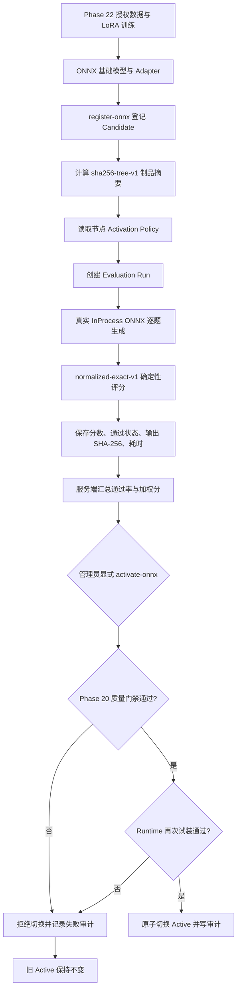

# Phase 23：候选模型真实评测、人工发布与长稳证据

## 1. 本阶段解决什么问题

Phase 22 已经证明“授权数据可以进入 LoRA 训练，训练产物能转换并被 C++ Runtime 加载”。但训练成功
只相当于工厂把产品造了出来，并不等于质检合格，更不等于可以直接替换线上版本。

Phase 23 在 Phase 20 已有的评测表和质量门禁之上，补齐三个可实际执行的入口：

1. 将本地 ONNX/Adapter 制品登记为 `Candidate`，同时计算完整目录摘要；
2. 用真实 `InProcessOnnxModelProvider` 逐题生成答案，并把分数、输出摘要和耗时写入 PostgreSQL；
3. 只有评测满足节点策略后，管理员才能显式激活，Runtime 仍会在切换前再次试装制品。

同时，本阶段把原来的短时健康探测升级为固定 PID 的长稳证据采集器。它会记录延迟分位数、RSS、
虚拟内存、线程数和文件描述符，避免“端口还活着，但原服务已经被另一进程替换”这类假阳性。

## 2. 完整发布流程



这里有三道相互独立的门：

- **制品门**：路径不能逃出模型根目录，Adapter 必须存在且扩展名正确，并保存目录摘要；
- **质量门**：评测必须属于当前版本和策略指定的 Suite，不能过期，必答题、通过率和加权分都要达标；
- **运行门**：即使分数达标，也必须由真实 ONNX Runtime 重新加载制品，试装失败不会替换旧版本。

可以把它类比为“身份证核验、考试、上岗体检”。三项都通过，候选模型才会成为 Active。

## 3. 评测器为什么先采用精确匹配

本阶段增加 `normalized-exact-v1`：

- 折叠连续 ASCII 空白，并忽略首尾 ASCII 空白；
- ASCII 英文字母统一为小写；
- 中文和其他非 ASCII 字节保持原样；
- 规范化后的答案完全一致得 `1.0`，否则得 `0.0`；
- 预期答案为空时拒绝评测，防止一条没有判定标准的题目进入发布门禁。

它适合“只回答 yes/no”“返回一个固定标签”“复述一个确定短句”等回归题。它的价值是结果可复现、
不依赖第二个模型、也不会因为评分模型版本变化而漂移。它不适合开放问答、摘要和创作；这类任务后续
需要规则评分、结构化校验、人工盲评或固定版本的模型裁判共同组成多评分器体系。

## 4. 管理工具的使用流程

工具只在 PostgreSQL 和 ONNX Runtime 都显式启用时构建，不会下载依赖或模型。数据库连接由
`WEB_PHASE11_DATABASE` 提供。

### 4.1 登记候选版本

```bash
WEB_PHASE11_DATABASE='postgresql:///phase11?host=/path/to/socket' \
  ./build-release/phase11-model-admin register-onnx \
  <node-id> <model-root> <relative-model-dir> <relative-adapter-or-dash>
```

无 Adapter 时最后一个参数写 `-`。工具保存 `onnx-inprocess` Runtime、相对路径和
`sha256-tree-v1` 摘要，初始状态固定为 `Candidate`。

### 4.2 真实逐题评测

```bash
WEB_PHASE11_DATABASE='postgresql:///phase11?host=/path/to/socket' \
  ./build-release/phase11-model-admin evaluate-onnx \
  <version-id> <model-root> [max-tokens] [case-timeout-seconds]
```

工具读取该节点已有的 Activation Policy 和 Suite，为每一道题构造固定 System Prompt，加上数据库中的
用户问题，调用真实 C++ ONNX Provider。每题有独立超时；生成错误、取消失败或持久化错误会把整个 Run
标记为 `aborted`，不会留下看似完整的半份成绩。

### 4.3 人工激活

```bash
WEB_PHASE11_DATABASE='postgresql:///phase11?host=/path/to/socket' \
  ./build-release/phase11-model-admin activate-onnx \
  <node-id> <version-id> <model-root> <actor>
```

`actor` 会进入模型变更审计。这个命令不会跳过 Phase 20 门禁：没有完成的成绩、成绩过期、必答题失败、
通过率不足或加权分不足都会被拒绝。

## 5. 已验证的正向与反向路径

在隔离的 `phase11_test` PostgreSQL 数据库中，使用真实 Qwen ONNX 制品完成了两组验证：

- **正向**：Candidate 制品摘要为
  `sha256-tree-v1:937439e8acd879e815038e43e99ba1d925755f5bd57b1b09e60928a6dbb48f1f`；
  Run 2 为 1/1 通过、加权分 1.0，显式激活后版本和节点均为 Active，审计记录引用 Run 2；
- **反向**：另一候选版本故意配置错误预期答案，Run 3 为 0/1；激活返回失败，原因是必答题未通过，
  候选版本没有替换旧 Active。

这证明当前链路会真实调用模型，也证明失败门禁确实阻止切换。测试题规模仍然很小，不能据此宣称
Phase 22 的训练让模型质量提升；要得到质量结论，仍需真实授权数据、独立验证集和更完整的评分方案。

## 6. 长稳证据采集

`phase16-soak.py` 现在只使用 Python 标准库，并新增：

- `--expected-pid`：每次从 Linux `/proc/<pid>` 读取资源，并固定进程启动时钟；PID 消失或复用即判失败；
- `--max-rss-growth-kib`：为 RSS 增长设置明确上限；
- P50、P95、P99 和最大探测耗时；
- RSS、虚拟内存、线程数和文件描述符的初值、末值与峰值；
- 原始 JSONL 的 SHA-256，以及原子写入的汇总 JSON；
- 已存在证据拒绝覆盖，防止误删或混淆不同运行。

短时 smoke 已完成 10/10 次探测，失败数为 0；固定进程的 RSS、FD 和线程数均未增长。随后用不存在的
PID 做反向验证，4/4 次均判失败且进程退出码为 1；用真实 PID 复测为 7/7 成功。这个 smoke 只验证
采集器和服务接口能工作，不能代替 24 小时结果。本阶段会以固定服务 PID 启动 24 小时运行，只有最终
汇总文件生成、失败数为 0 且资源增长不越界后，才可写成“24 小时通过”。

示例：

```bash
python3 scripts/phase11/phase16-soak.py \
  --duration 86400 --interval 1 \
  --expected-pid <webserver-pid> \
  --max-rss-growth-kib 262144 \
  --output /path/to/evidence/soak.jsonl \
  --summary /path/to/evidence/summary.json
```

## 7. 回归结果

| 构建 | 结果 | 用时 |
|---|---:|---:|
| Release | 97/97 | 31.05 秒 |
| Debug | 97/97 | 30.90 秒 |
| ASan + LSan + UBSan | 97/97 | 38.99 秒 |

Sanitizer 未报告内存、泄漏或未定义行为问题。`normalized-exact-v1` 另外覆盖了 ASCII 大小写/空白、
中文保持、中文差异和空预期拒绝。

## 8. 代码索引

| 文件 | 作用 |
|---|---|
| `tools/phase11_model_admin.cpp` | Candidate 登记、真实评测和人工激活命令入口 |
| `server/phase11/ai/DeterministicExactScorer/` | 可复现的确定性精确评分器 |
| `server/phase11/ai/ModelEvaluationService/` | Run 生命周期、逐题结果、汇总和质量门禁 |
| `server/phase11/ai/ModelRegistryService/` | Runtime 校验、原子激活/回滚与审计 |
| `server/phase11/ai/InProcessOnnxModelProvider/` | 真实 ONNX 加载与逐 Token 生成 |
| `server/phase11/storage/postgres/PostgresStore/` | 评测、策略、模型版本和审计持久化 |
| `scripts/phase11/phase16-soak.py` | 固定 PID 的长稳与资源证据采集 |
| `tests/phase11/unit/core.cpp` | 评分规则与既有业务回归 |

## 9. 当前边界和后续顺序

当前版本已经形成“训练制品 → 候选登记 → 真实评测 → 人工激活”的技术闭环，但仍不能称为生产级
模型发布平台：

1. 尚无足量的真实授权训练数据和独立验证集，因此只有流水线证据，没有模型质量提升证据；
2. `normalized-exact-v1` 只适合确定答案，开放问答需要多评分器和人工盲评；
3. 管理入口目前是 Linux CLI，只支持进程内 ONNX，尚未接入后台 RBAC、双人审批和发布窗口；
4. Phase 24 已保存训练数据集、训练配置、基座 revision 和部署制品的不可变数据库血缘；管理入口仍是
   本地 CLI，尚未提供多管理员审批工作流；
5. 24 小时长稳运行需等待最终汇总，之后还应加入数据库中断、模型进程崩溃和磁盘压力等故障注入；
6. 单机通过后，仍需多实例 Outbox 协调、集中监控告警、异机备份和灰度/回滚演练。

不可变血缘已经在 [Phase 24](phase24.md) 补齐。下一步应等待 24 小时长稳汇总，再用真实授权数据建立
首个血缘完整的 Candidate，并扩展评分器和管理员发布 API。这样每个线上模型都能回答三个问题：
用什么数据训练、经过什么评测、由谁在什么时间发布。
