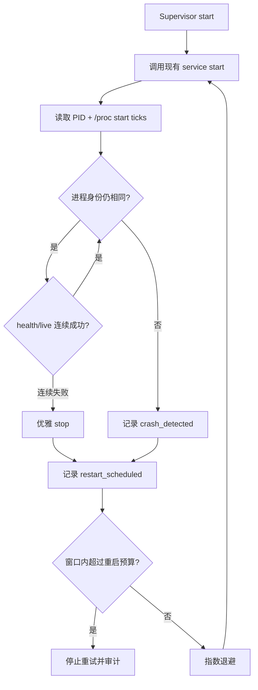

# Phase 25：用户态进程监督与异常恢复

Phase 16 的 `webserver-user-service.sh` 已能手动启动、优雅停止、轮转日志并用 readiness 判断启动是否
完成，但进程意外退出后仍需要人手执行 `restart`。Phase 25 增加不依赖 systemd 的用户态 Supervisor，
让学习虚拟机先具备可验证的单机异常恢复能力。

它没有安装依赖、没有注册系统服务，也没有修改正在运行的正式进程。当前 24 小时长稳结束前，只使用
隔离的假服务验证崩溃恢复和重启预算，避免人为杀死被长稳采集器固定监控的正式 PID。

## 1. Supervisor 做什么



可以把 Service 脚本看成“汽车的启动/熄火按钮”，Supervisor 是“值班司机”。司机发现发动机真的熄火才
重新点火；如果发动机连续熄火，则停止反复打火并报告故障，防止重启风暴。

## 2. 为什么区分 liveness 与 readiness

Supervisor 默认检查 `/health/live`，而不是 `/health/ready`：

- liveness 失败表示 Web 进程或事件循环自身无法工作，可以尝试重启；
- readiness 失败可能只是 PostgreSQL 临时中断。Phase 16 已验证数据库恢复后 Web 进程能自行恢复就绪；
  此时重启 Web 进程只会扩大故障。

默认连续 3 次 liveness 失败才触发重启，避免一次短暂网络抖动造成服务切换。测试可将健康 URL 设为
`-`，只验证进程监督。

## 3. PID 为什么还要 start ticks

Linux 会复用 PID。只保存 `33479` 类似只记住“酒店房间号”：原住客离开后，后来的人也可能入住同一
房间。`/proc/<pid>/stat` 的 start ticks 相当于入住时间。PID 和 start ticks 必须同时相等，才能确认
还是原进程。

服务脚本现在会同时保存：

```text
webserver.pid
webserver.pid.start_ticks
```

Supervisor 自身也使用同样的双字段身份。`Z`（zombie）和 `X` 状态被视为已经退出，因为
`kill -0` 对僵尸进程仍可能返回成功。

## 4. 重启边界

默认策略：

| 配置 | 默认值 | 含义 |
|---|---:|---|
| `PHASE11_SUPERVISOR_MONITOR_SECONDS` | 1 秒 | 检查间隔 |
| `PHASE11_SUPERVISOR_HEALTH_FAILURES` | 3 | 连续 liveness 失败阈值 |
| `PHASE11_SUPERVISOR_RESTART_LIMIT` | 5 | 时间窗内允许的失败次数 |
| `PHASE11_SUPERVISOR_RESTART_WINDOW_SECONDS` | 60 秒 | 重启预算时间窗 |
| `PHASE11_SUPERVISOR_STABLE_SECONDS` | 60 秒 | 连续稳定多久后重置预算 |
| `PHASE11_SUPERVISOR_INITIAL_BACKOFF_SECONDS` | 1 秒 | 第一次重启前等待 |
| `PHASE11_SUPERVISOR_MAX_BACKOFF_SECONDS` | 30 秒 | 最大退避 |

退避按 1、2、4、8……秒增长并封顶。窗口内失败次数超过预算后，Supervisor 非零退出并写入
`restart_budget_exhausted`。这比无限循环更安全：配置错误、缺少密钥或二进制损坏时，系统不会每秒创建
一批新进程和日志。

## 5. 使用方法

不要求脚本拥有 executable 位，可以显式交给 Bash：

```bash
cd /home/pikachu/phase11-full-src

bash scripts/phase11/webserver-user-supervisor.sh start
bash scripts/phase11/webserver-user-supervisor.sh status
bash scripts/phase11/webserver-user-supervisor.sh logs
bash scripts/phase11/webserver-user-supervisor.sh stop
```

`start` 会在后台运行 Supervisor；`stop` 先通知 Supervisor，再由它调用现有 Service 脚本优雅停止
Webserver。结构化事件继续写入 `${PHASE11_DATA_ROOT}/operations.jsonl`，监督器自己的文本日志写入
`webserver-supervisor.log`。

若以后部署 systemd，推荐由 systemd 前台运行：

```bash
bash scripts/phase11/webserver-user-supervisor.sh run
```

正式 systemd unit、开机自启和系统目录写入需要单独审批，本阶段没有执行。

## 6. 隔离故障演练结果

`supervisor_recovery.py` 只使用 Python 标准库，在临时目录创建一个假 Service。它不连接正式数据库、
不占用 18090 端口，也不操作正式 PID。

测试流程：

1. Supervisor 启动假服务并记录 PID + start ticks；
2. 测试用 `SIGKILL` 模拟不可优雅处理的崩溃；
3. Supervisor 检测旧进程消失，按退避策略启动新进程；
4. 验证新 PID 与旧 PID 不同，且审计包含 `crash_detected`、`restart_scheduled`；
5. 给 Supervisor 发 `SIGTERM`，验证托管进程也被回收；
6. 换成永久启动失败的 Service，验证第三次失败触发预算耗尽，而不是无限重试。

Linux 连续独立执行 3 轮全部通过，PID 依次完成替换；重启预算反向路径每轮也通过。CMake/CTest 已登记
`phase11_supervisor_recovery` 为第 98 个测试，单独连续运行 3 次均为 1/1 通过。公开的
`start → status → SIGKILL → 自动更换 PID → stop → status` 命令链也在隔离目录完成验证。

第一次编写演练时发现两个边界并修复：

- `kill -0` 会把僵尸进程误认为仍存活，因此增加进程状态判断；
- 退避计算曾把 `next` 当作 awk 变量，而它是 awk 关键字。执行跟踪准确定位后改为普通变量名。

## 7. 代码索引

| 文件 | 作用 |
|---|---|
| `scripts/phase11/webserver-user-service.sh` | 保存并核验 Webserver PID + start ticks |
| `scripts/phase11/webserver-user-supervisor.sh` | 进程监督、liveness、退避、重启预算和审计 |
| `tests/phase11/integration/supervisor_recovery.py` | 隔离 SIGKILL 恢复与重启风暴反向测试 |
| `CMakeLists.txt` | Linux CTest 注册与 90 秒上限 |

## 8. 当前边界与下一步

这层 Supervisor 适合单机学习环境和没有 root 权限的临时部署。它不是 systemd/Kubernetes 的替代品：

- 还没有开机自启、cgroup 资源限制和系统级依赖顺序；
- Supervisor 自身退出后没有更外层进程负责拉起它；
- 没有集中告警，预算耗尽目前只能从日志/审计发现；
- 正式 Webserver 的真实 `SIGKILL → 自动恢复 → readiness → 登录/消息恢复` 演练要等当前 24 小时长稳
  汇总后再做，不能为了演练破坏固定 PID 证据。

因此当前结论是“监督算法和脚本接口已通过隔离验证”，还不能写成“正式服务异常恢复演练已完成”。
