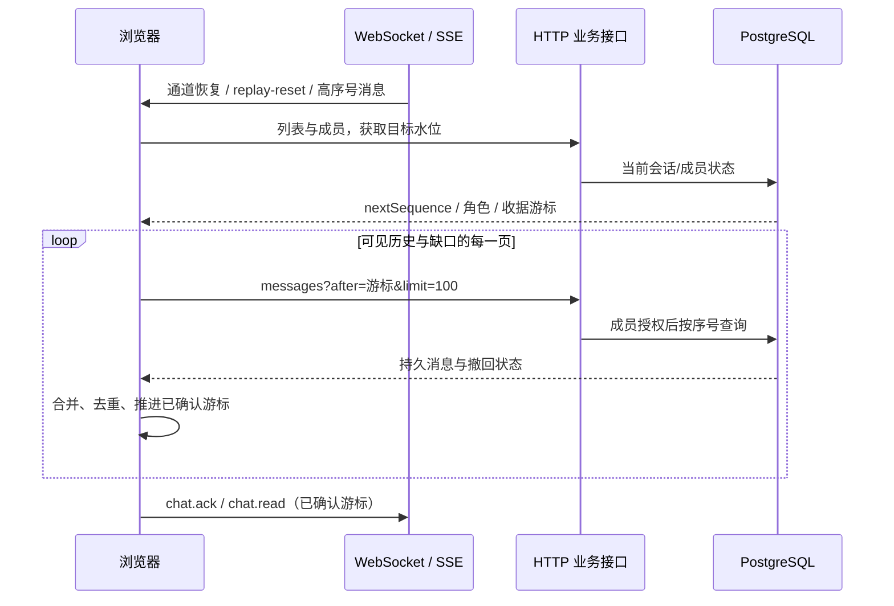
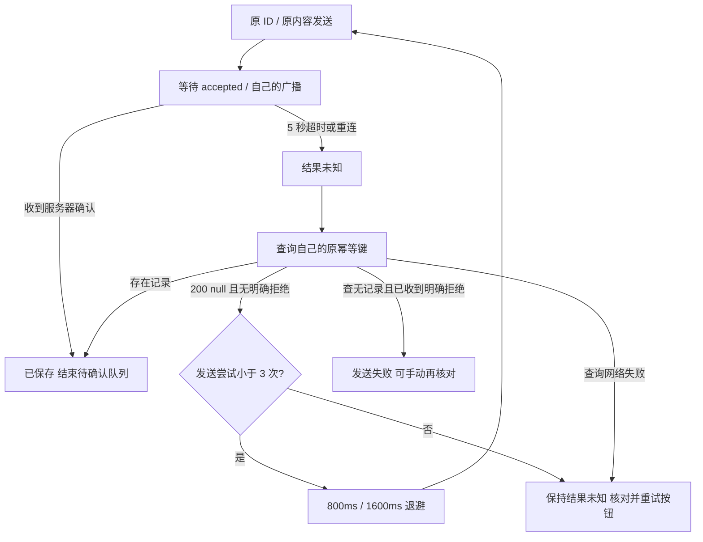

# Phase 27：聊天历史、断线恢复与发送确认闭环

日期：2026-10-12。实现基于本地 `Function2`，本阶段只完成历史分页、断线补齐、ACK 超时幂等重试、管理员撤回入口。后续按用户指令归档到 `Function2.1`，版本对比见 [发布说明](../function2.1-vs-function2.md)；下一阶段仅提供建议。

## 1. 这次改变了什么

| 功能 | 之前 | 当前 |
|---|---|---|
| 打开会话 | 从最早序号取最多 100 条 | 首先取最新 100 条；点击“加载更早消息”向前翻页 |
| 断线恢复 | 重开会话，单页查询不能覆盖较大缺口 | WS/SSE 重连后刷新会话水位、成员权限和可见历史，再逐页补齐新消息 |
| 发送确认 | accepted/广播能确认成功，丢回复时缺少主动核对 | 5 秒未确认先查询当前账号的原幂等键；查无记录才重放原命令 |
| 管理撤回 | 后端有规则，前端只有本人撤回入口 | 权限允许时显示“管理撤回”，点击确认后发送原有 `chat.recall` |

对方离线不影响发送。消息先持久化再推送，“对方在线”不是保存条件。发送者自己与服务器断线时，文字命令进入有界待确认队列，恢复连接后先核对再发送。

## 2. 三个编号各司其职

1. **`message.id`：服务器档案号。** 合并 HTTP、WS、SSE 得到的同一条记录，使用它去重。
2. **`conversation_seq`：会话里的页码。** 历史排序、分页、补齐和已读游标都使用它。收到 #105 不代表 #101–104 都已收到。
3. **`client_message_id`：寄件凭证。** 客户端首次发送时生成；重试保持原编号、原会话、原内容。数据库以“会话 + 发送者 + 客户端编号”保证唯一。

可以把重试看成拿同一张寄件凭证问柜台：“这份已经入库了吗？”而不是每次重新领号寄一份。

## 3. 历史分页：接口到数据库

| 请求 | 语义 |
|---|---|
| `GET /api/conversations/:id/messages?before=0&limit=100` | 最新一页；返回结果仍按序号升序 |
| `GET /api/conversations/:id/messages?before=132&limit=100` | 只取序号小于 132 的最近 100 条 |
| `GET /api/conversations/:id/messages?after=231&limit=100` | 只取序号大于 231 的最早 100 条，用于向后追赶 |
| 同时提供 `after` 和 `before` | 参数冲突，HTTP 400 |

`before/after` 都不包含游标那条消息；业务层限制 `limit` 为 1–500。未给方向参数时保持原有 `after=0` 行为，兼容旧客户端。


PostgreSQL 利用已有 `(conversation_id, conversation_seq)` 索引，`ORDER BY conversation_seq DESC LIMIT ...` 选一页，驱动反转结果后返回。无需新增迁移。内存驱动提供同一接口，通过同一份契约测试。

例如 231 条消息：首次 #132–231，前一页 #32–131，再前一页 #1–31。避免 offset 分页因持续插入而偏移。

## 4. 断线补齐：高水位不等于已同步游标

1. `ChatHistory.cursor` 表示当前窗口已确认的连续尾部；`latest/target` 表示已经看到或列表报告的最高序号。
2. WS/SSE 重新连接、SSE `replay-reset` 或实时消息出现缺口时，进入合并后的 `recoverRealtime()`。
3. 刷新会话列表，从 `nextSequence - 1` 获取服务端目标；刷新成员，恢复断线期间的权限、送达和已读状态变化。
4. 重查**已经显示的历史窗口**。撤回不产生新消息序号，只从旧记录变更状态，所以仅查询“最新序号之后”会漏掉撤回。
5. 按 `after=cursor` 逐页读取，直到达到本轮目标。每页推进游标；空页或无进展页报告“历史补发未完成”，不会无限空转。
6. 合并同步目标、阻止重复旧页请求；切换会话时递增版本号，忽略旧页面迟到响应。
7. 完成后只向后端报告已经确认的游标；收到高序号广播时不直接跳过中间缺口。撤回是终态，迟到的旧 HTTP 响应不能恢复正文。



没有加载的很早历史不在重连时全部下载；用户翻页时再取得当前持久状态。已加载的历史重新查询，不依赖有限 SSE 回放缓存。

## 5. ACK 超时：先核对，再决定重试

新增接口：

```text
GET /api/conversations/:id/messages/by-client-id?clientMessageId=原编号
```

HTTP 200 返回完整消息或 JSON `null`。这个查询只查**已认证用户自己**在该会话下的消息；客户端不能用参数指定另一个发送者。没有成员权限仍返回错误。查询结果包含撤回终态，因此不会错误重发一条已撤回消息。



1. `WebSocket.send()` 只是浏览器交出字节，不是数据库成功的证据。只有 accepted、自己的持久广播或查询到完整记录才收敛为成功。
2. 默认最多 **3 次实际发送，包含首次**；查服务器失败时保留未知，不盲目重发。用户点击“核对并重试”开启新的有限尝试。
3. 当前账号的待确认文字命令最多 32 条，存入该标签页的 `sessionStorage`；刷新页面会恢复原 ID。只保存消息载荷，不保存密码、Cookie 或 Token。
4. 收到广播先于 accepted，或 ACK 在别的会话打开时到达，都能结束对应队列；根据会话和命令 ID 关联。
5. 后端复用原有消息事务、唯一约束、内容冲突检查与 Outbox，不新增第二套发送接口。
6. 当前只自动重试 **普通文字消息**。文件上传与 AI 生成有不同副作用和资源生命周期，不套用文字重试规则。

注意：关闭标签页可能丢失 sessionStorage；这不是跨设备的永久发件箱。服务端保存成功但通知延迟时，由查询/历史恢复得到结果。服务端业务的已读策略仍是“本人发送新消息推进本人已读游标”，本次没有改写这条规则。

## 6. 管理员撤回入口

| 操作者 | 可撤回范围 |
|---|---|
| 普通成员 | 自己的消息 |
| 群管理员 | 自己的消息，以及普通成员消息；发送者已离群无成员记录时，按后端现有规则处理 |
| 群主 | 自己的消息和其他群成员消息 |

共同条件：有效会话成员、会话未解散、消息未撤回、服务端两分钟窗口内。管理员不能撤回仍是群主/管理员的他人消息。前端显示入口只是交互，`ChatService::recallMessage()` 才是最终权限边界。

别人消息显示“管理撤回”，点击有确认框；等待期间按钮禁用。5 秒没有确认会恢复入口并核对历史，**不自动重复撤回命令**。在线成员看到实时占位，离线成员补齐历史后看到同一撤回状态。

## 7. 对应文件与改动目的

| 文件 | 作用 |
|---|---|
| [ChatHistory.js](../../../frontend/phase11/chat/ChatHistory.js) | 最新页、旧页、缺口追赶、撤回终态合并、页面版本隔离 |
| [ReliableSender.js](../../../frontend/phase11/chat/ReliableSender.js) | 超时状态机、查询、有限退避、原 ID 重试、待确认恢复 |
| [app.js](../../../frontend/phase11/app.js) | 接入上述两个模块；分页按钮、状态/重试入口、重连编排、管理撤回 |
| [index.html](../../../frontend/phase11/index.html) / [styles.css](../../../frontend/phase11/styles.css) | 脚本版本与历史工具条/待确认状态样式 |
| [main.cpp](../../../main.cpp) | 注册两个新 ES Module 的静态资源路由 |
| [BusinessInterfaces.h](../../../server/phase11/business/BusinessInterfaces/BusinessInterfaces.h) | 增加 `historyBefore/ownMessage` 业务接口 |
| [ChatService.h](../../../server/phase11/business/ChatService/ChatService.h) / [ChatService.cpp](../../../server/phase11/business/ChatService/ChatService.cpp) | 成员权限、分页参数与当前发送者作用域 |
| [Ports.h](../../../server/phase11/ports/Ports/Ports.h) | `messagesBefore/findOwnMessage` 仓储端口 |
| [InMemoryStore.h](../../../server/phase11/storage/InMemoryStore/InMemoryStore.h) / [InMemoryStore.cpp](../../../server/phase11/storage/InMemoryStore/InMemoryStore.cpp) | 不依赖数据库的同语义实现 |
| [PostgresStore.h](../../../server/phase11/storage/postgres/PostgresStore/PostgresStore.h) / [PostgresStore.cpp](../../../server/phase11/storage/postgres/PostgresStore/PostgresStore.cpp) | 利用已有索引查询旧页与自己的幂等记录 |
| [Phase11SocialChatHttp.cpp](../../../server/phase11/transport/http/Phase11SocialChatHttp/Phase11SocialChatHttp.cpp) | 翻译 HTTP 参数，在原有数据库执行器上执行查询 |
| [CMakeLists.txt](../../../CMakeLists.txt) | 登记新 C++ 回归测试；不下载依赖 |

协议解析器、Reactor、Sender、消息表结构和撤回权限规则保持已有实现。新增查询经过现有业务层、Repository 和数据库执行器，没有让 Reactor 同步执行 SQL。

## 8. 验证记录与复跑

本次使用已有工具，无新增安装或下载。虚拟机独立目录 `/home/pikachu/phase27-chat-reliability`，专用数据库 `phase27_chat_test`，测试服务器端口 18091；不使用正式业务库做清空式契约测试。

| 验证 | 本次结果 / 覆盖内容 |
|---|---|
| Node 单元测试 | 13/13；分页、乱序缺口、撤回终态、切会话迟到响应、有限重试、未知结果与角色规则 |
| Windows C++ 核心 | `chat_reliability` 通过；内存契约、分页、发送者隔离、同 ID 冲突、权限/时间窗、单调已读 |
| Chrome 浏览器 | 5 组通过；实际页面交互、231 条翻页、129 条缺口、离线撤回、真实 5 秒 ACK 超时、同 ID 二次发送、刷新待确认恢复、发送者断线排队、三角色入口，无 JavaScript 页面错误 |
| Linux 完整 Release 构建 | 开启 PostgreSQL、libsodium、curl、ONNX、gRPC 构建通过 |
| Linux 真实 HTTP/WS + PostgreSQL | 3 组通过；倒序选页、作用域授权、丢 ACK 查询、重复只保存一份、不同内容冲突、管理员撤回/拒绝越权、离线跨两页恢复 |
| Linux 完整 CTest | 100/100，0 失败，29.06 秒；含真实 PostgreSQL 仓储契约和原协议回归 |
| Linux ASan / LSan / UBSan | 新增 C++ 核心可靠性测试通过，开启泄漏检测与遇错停止；未报告内存或未定义行为错误。该项是本次核心测试，不是完整服务器 Sanitizer 压测 |

浏览器测试使用可控 HTTP/WS 替身来故意丢回复，不当作真实数据库证据。真实服务器黑盒测试另行覆盖协议与持久化；忽略一条 accepted 后核对并重放，浏览器测试覆盖实际定时器和渲染。

```bash
# 不需要 npm install
node --test tests/phase11/frontend/chat_reliability.test.mjs

# 使用已经安装的 Playwright 与 Chrome，设置模块和浏览器绝对路径
PLAYWRIGHT_MODULE=/path/to/installed/playwright \
CHAT_TEST_BROWSER=/path/to/installed/chrome \
node tests/phase11/frontend/chat_browser_smoke.cjs

# 必须连接隔离测试服务器；会创建测试用户和聊天记录
python3 tests/phase11/integration/chat_reliability_blackbox.py --port 18091

# PostgreSQL 契约会 TRUNCATE：连接串只能指向专用测试库
PHASE11_POSTGRES_CONNECTION='host=/path/to/socket dbname=isolated_test user=...' \
ctest --test-dir build-release --output-on-failure
```

测试代码：[前端单元测试](../../../tests/phase11/frontend/chat_reliability.test.mjs)、[浏览器](../../../tests/phase11/frontend/chat_browser_smoke.cjs)、[C++ 核心](../../../tests/phase11/unit/chat_reliability.cpp)、[通用仓储契约](../../../tests/phase11/unit/RepositoryContract.h)、[真实接口黑盒](../../../tests/phase11/integration/chat_reliability_blackbox.py)。

本次修复了浏览器测试发现的定时器接收者绑定及局部变量遮蔽问题；新增分页测试群在结束时软解散，避免改变后续扩展契约的活跃会话数量。
第一次完整 CTest 的 PostgreSQL 失败来自这个夹具，已修复；第二次协议黑盒失败来自继承了隔离服务器的鉴权环境变量，清除运行环境后最终 100/100 通过。测试服务已停止，原项目源码/运行目录未替换。
验证结果不包含容量测试、24 小时长稳或真实模型质量评测。

## 9. 学习时的阅读顺序

1. 先读 `ChatHistory.open → older → synchronize`，解释“页码上限”和“已经确认的游标”为何不能共用。
2. 再读 `ReliableSender.attempt → check → finish`，列出已提交/未提交/查不到服务器三种超时情形。
3. 跟踪 `ownMessage → findOwnMessage`，检查为什么不能由请求指定 `senderId`。
4. 最后对照 `canRecallMessage` 与 `ChatService::recallMessage`，理解前端可见性和后端授权的区别。

自检：收到 #105 时缺 #103–104，能立即报告读到 #105 吗？收到 200 `null` 和查询网络失败，分别能做什么？管理员在前端伪造按钮，能撤回群主消息吗？把这些解释清楚，再继续下一阶段。本次到此停止。
