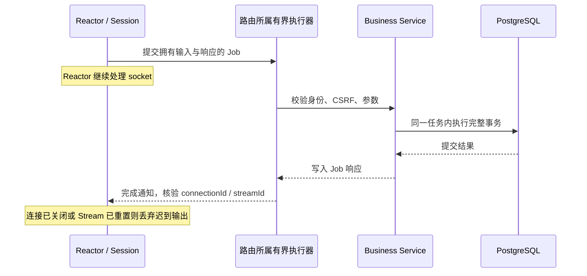

# Phase 28：业务执行器、长会话与重连

基线是 Function2.1 `ffc0e14`；Function3 在本地 `feature/function3-tree` 开发。阶段汇总和实际验收状态见 [实施台账](function3-progress.md)。

## 1. 为什么改

原来的 HTTP 业务处理器会先占住 HTTP Worker，再把数据库工作排入另一个线程池并等待。可以把它理解为：一个窗口工作人员把业务交给后台后，仍坐在窗口等后台完成。高并发时，两个线程池都可能被等待占满。

现在在注册路由时标记所属执行器。Session 把拥有独立输入和响应的完整 Job 直接交给该执行器；只有数据库操作确实已经处于同一数据库 Worker 时，事务助手才直接执行。文件、知识索引、模型管理和媒体解码使用各自的有界队列。

这仍是阻塞 libpq 配合专用 Worker，并非把 PostgreSQL 改造成无阻塞驱动。跨执行器的旧兼容调用仍可能短暂等待，不应称为“所有业务完全异步”。

## 2. 线程与生命周期

- `HandlerExecutorScope` 在启动注册期间绑定执行器，离开作用域后恢复；请求期间不改全局默认执行器。
- `Router::enqueue`、`WebSocketDispatcher::enqueue` 返回队列是否接受，满队列明确拒绝。
- Job 自己拥有请求数据和响应，完成路径保留原有连接世代与 HTTP/2 Stream 校验。
- `BoundedExecutor::isCurrentThread()` 只用于识别当前池，避免把任务重新排回自己并等待自己。
- 一个事务回调保持在一个 Worker、一个连接内；禁止事务中途切线程。

## 3. 浏览器为何不会越聊越卡

消息缓存默认最多 1,000 条；翻页可以重新取回被淘汰的页面，不把缓存上限误当成历史总量上限。阅读旧历史时，新消息先推进已知目标，不挤走当前阅读窗口。撤回终态、未确认消息和 AI 输出分别保留。

虚拟列表只把视口附近的消息放进 DOM，大量历史用上下占位元素保持滚动范围。窗口最多 160 个消息节点；高度测量和消息 ID 用来维护节点与阅读位置。当前浏览器实测覆盖一万条合成历史，不能把此测试说成一万条真实数据库消息。

服务器另设每用户历史查询预算：最多两项同时在办、每秒补充 60 个令牌、突发 30 次，最多跟踪 4,096 个用户，满额时回收空闲条目或明确返回 429。预算只管历史查询，聊天持久化 ACK 不与其共用令牌。

重连使用有上下界的随机退避；恢复闸机串行发送补齐任务，限制频率、排队数量并在切换会话时取消旧请求。

## 4. 代码入口

| 内容 | 文件 |
|---|---|
| 执行器绑定接口 | `backend/server/Executor/HandlerExecutor/HandlerExecutor.h` |
| HTTP 路由、会话派发 | `backend/server/Route/Router.*`、`backend/server/http/HttpSession/HttpSession.cpp` |
| HTTP/2 派发 | `backend/server/http2/Http2Session.cpp` |
| WebSocket 派发 | `backend/server/websocket/WebSocketDispatcher/`、`WebSocketSession/` |
| 线程池上下文 | `backend/application/runtime/BoundedExecutor/` |
| 有界历史 | `frontend/phase11/chat/ChatHistory.js` |
| 虚拟列表 | `frontend/phase11/chat/VirtualMessageList/` |
| 恢复预算和退避 | `frontend/phase11/shared/RecoveryBudget/` |

## 5. 学习自检

1. 队列接受任务和数据库提交成功，分别能向客户端承诺什么？
2. 为什么不能只检查 fd，而需要连接世代和 Stream 身份？
3. 为什么“缓存最多 1,000 条”不等于“只能看到最近 1,000 条”？

后续可沿 [Phase 29](phase29.md) 学习提交后的事件投递。完整回归、性能对比和限制统一记录在 [Phase 34](phase34.md)。
