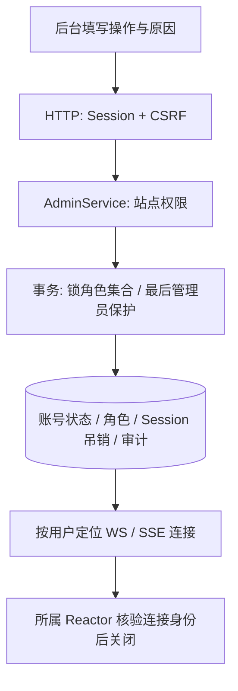

# Phase 30：站点管理与模型控制入口

## 1. 权限不是一顶通用帽子

群主只管理自己的群；内容管理员处理举报、分类和违规内容；站点管理员管理账号、站点角色、模型切换和失败事件重放。拥有某个群不代表可以停用全站用户。

| 身份 | 能力 |
|---|---|
| 普通用户 | 修改本人通知设置、发布/删除本人果实、举报 |
| 内容管理员 | 处理举报、隐藏果实、分类管理、试听公告音色 |
| 站点管理员 | 上述能力，加用户启停、会话吊销、角色、模型与 MQ 运维 |

首个管理员通过 Linux `function3-site-admin --bootstrap 用户名 原因` 指定已有正常账号。数据库已有有效站点管理员时拒绝再次 bootstrap；降权或停用操作不能移除最后一个有效管理员。

## 2. 账号处置链路

HTTP 后续请求重新经过 Session 校验；已排队的聊天任务也检查用户状态。在线关闭只操作连接管理器中的对应用户，不通过遍历和关闭任意 fd 实现。

## 3. 模型治理复用旧能力

后台通过 `IModelAdministration` 端口查询注册节点和版本，查看质量门禁，再发起启用/回滚。适配器调用原有 `ModelEvaluationService` 和 `ModelRegistryService`，不从浏览器接受任意模型路径，不把“前端说评测通过”作为证据。

模型试装使用单独一个 Worker、最多四个排队任务；不会占用 Reactor 或普通聊天数据库任务池。操作原因写入站点审计，最终切换或失败继续进入旧模型激活审计。原有回滚规则保留：重新校验旧制品，允许在历史评测过期时恢复已退役的稳定版本。

本轮提供的是既有评测证据的查看与发布控制。评测数据生成和模型训练仍沿 Phase 20–24 的受控工具流程，后台不能伪造分数或绕过授权训练数据规则。

## 4. 组件与接口

- `admin/application/AdminService/`：账号与角色规则。
- `admin/application/ModelAdminService/`：模型管理权限和操作意图审计。
- `admin/ports/IModelAdministration/`：隔离模型实现的公开控制端口。
- `admin/infrastructure/Phase11ModelAdministration/`：调用旧模型服务。
- `admin/transport/AdminHttp/`、`ModelAdminHttp/`：HTTP 适配器。
- `frontend/phase11/admin/AdminApp/`：真实接口驱动的用户、举报、分类、模型、审计与 MQ 页面。

C++ 路径基于 `backend/application/modules/`。主要 URL 为 `/api/admin/users`、`/reports`、`/audits`、`/tree/categories`、`/models`、`/messaging`。浏览器隐藏按钮只是体验优化，最终权限始终由业务服务校验。

实际越权、会话吊销和模型门禁结果见 [Phase 34](phase34.md)。

吊销会先移除 WS/SSE 广播目录，并原子撤销 WS 新业务准入，再尝试投递关闭帧。即使普通出站队列满，旧连接也不会继续接收新广播或提交新任务。吊销前已开始的事务仍可能完成，不能承诺撤销已提交消息。

## 5. 冷试装的后台操作语义

启用/回滚 POST 返回 HTTP 202 和十进制 `operationId`，由单 Worker、四项排队预算执行。GET `/api/admin/model-operations/{id}` 查询 pending/completed/failed。查询不排在试装任务后面，也不需要维持同一条 HTTP 长连接。试装后再次校验管理员权限，原子切换和质量门禁仍由原服务执行。

操作状态缓存最多 64 项，已完成状态十分钟后可回收；并发相同目标合并。进程重启或状态过期后查询返回 404，管理员应先查看实际版本与持久审计，再决定是否重试。这个状态缓存不是新的发布事实数据库，不能把页面断线当成已经撤销后台发布。

未配置质量策略的节点沿用旧服务允许激活的行为；这不等于通过了真实质量评测。正式模型应先按 Phase20 的流程配置评估集与策略。
