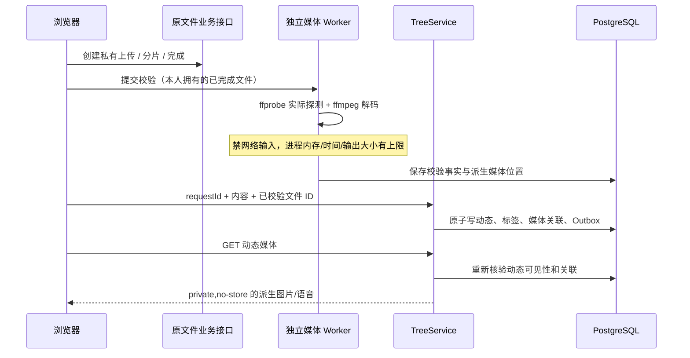

# Phase 31：苦情树动态、媒体与内容处置

## 1. 一枚果实对应什么

一条主动态对应一枚果实，文字、图片、语音可以组合，至少提供一种内容。文字最多 2,000 个 Unicode 标量，最多六张图片（每张 5 MiB）和一段语音（60 秒、10 MiB）。第一版不编辑正文，作者可以删除，管理员可以隐藏；记录保留，公开内容与媒体立即变为不可见。

回复只显示在详情中，不增加树上果实数。点赞按用户唯一，重复设置同一状态不会重复计数。排名不计算作者自己点赞或回复，同一用户多次回复只计一个有效回复用户。

## 2. 从上传到公开访问

浏览器申报的 MIME、大小、时长不能作为真实媒体事实。图片必须能解码且尺寸不超过 4096×4096；语音转换后再检测实际时长，兼容浏览器 WebM 没有预先填写 duration 的情况。原始上传使用不作为公开图片入口的私有名字，公开访问使用移除元数据后的派生文件。

隐藏媒体后的旧链接不能继续访问；不把原聊天附件的权限扩大为全站可读。上传或发表内容均不会自动授权训练。

## 3. 幂等与事务

`(author_id,request_key)` 唯一约束固定一次发布。相同键、相同规范化载荷返回原结果；相同键、不同内容返回冲突。规范化使用长度前缀编码，标签先排序去重，避免仅靠短散列判断内容相同。

点赞、回复、删除对单个果实加事务锁并推进版本，事件与业务记录同事务提交。回复也有用户级请求键。浏览器网络重试保留原请求键，并复用已成功上传的文件 ID。

## 4. 文件和接口

核心组件位于 `backend/application/modules/tree/`：

| 层 | 组件 |
|---|---|
| domain | `TreePost/`、`TreeReply/` |
| ports | `ITreeRepository/`、`ITreeMediaProcessor/` |
| application | `TreeService/`、`TreeMediaService/` |
| infrastructure | `TreePostgresRepository/`、`TreeMediaPostgresRepository/`、`FfmpegMediaProcessor/` |
| transport | `TreeHttp/`、`TreeMediaHttp/` |

`moderation/` 单独处理举报和处置审计，不把举报判断写进 Tree DTO。列表使用独占 ID 游标，按分类、心情、标签、作者、时间区间和媒体类型筛选；筛选不改变全站树大小和七日榜。

数据库关系见 [Function3 表说明](../../database/function3-tables.md)，真实解码、权限与幂等结果见 [Phase 34](phase34.md)。
