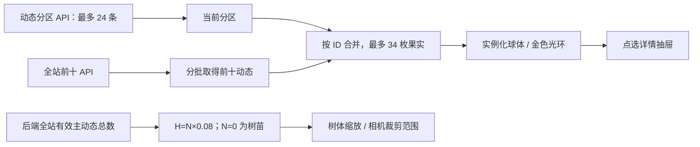

# Phase 32：三维苦情树与有界浏览

## 1. 渲染与业务分工

Three.js r186 只负责把真实动态画成果实。后端决定哪些动态可见、总数和榜单；浏览器不能修改树高或凭空给果实加热度。

场景使用程序生成的树干、盘根、枝条、粉白树冠、飘落花瓣与发光果实，不依赖外部贴图或网络模型。参考动画中的树形意象，没有下载原作美术资产。

树体的逻辑高度与有效动态数成正比，场景摄像机随高度调整。筛选只改变当前浏览分区，不改变全站总数；前十果实独立于当前筛选加载。

## 2. 不把十万个动态变成十万个模型

后端列表有页大小上限，前端每次取 24 个动态。所有动态都可通过游标分区访问，不在内存一次性创建全部果实。树冠、花瓣和果实采用实例化渲染；拉远时减少树冠实例和花瓣，移动端降低像素比与几何体数量。

前十名次变化时只插值改变相应果实位置，普通果实根据 ID 固定位置。尊重系统减少动态效果设置；页面隐藏时暂停渲染工作，离开页面释放 WebGL 资源。WebGL 创建失败时保留完整列表模式。

这不是十万颗同时可见的高精度树模型。分区与 LOD 的目的正是让资源规模取决于视口，而不是数据库总量。

## 3. 前端文件

- `frontend/phase11/tree/index.html`：场景、榜单、筛选、发布和详情入口。
- `tree/TreeApp/TreeApp.js`：真实 API、分页、发布幂等、点赞与回复。
- `tree/TreeApp/TreeApp.css`：桌面和移动布局。
- `tree/TreeScene/TreeScene.js`：几何体、相机、实例化、交互和释放。
- `tree/VoiceRecorder/VoiceRecorder.js`：用户点击后请求录音授权，时间与大小有上限。
- `vendor/three-r186/`：固定版本浏览器模块、必要控件、MIT 许可与制品清单。

录音需要浏览器认可的可信上下文。测试证书仅用于隔离 HTTPS 入口，不修改用户系统信任。拒绝麦克风授权后，文字与文件上传仍可使用。

浏览器截图、DOM 上限、移动适配与实际数据容量结果见 [Phase 34](phase34.md)。

## 视觉参考与实现资产

题材参考入口：[《狐妖小红娘》动画官方账号的苦情树相关宣传](https://weibo.com/5616549369/PF143ghsq)。这里只作为作品题材的出处；本项目实际几何、树冠、花瓣和果实由 `TreeScene` 程序生成，没有把搜索结果中的原作模型、人物、贴图或视频打包进项目。当前模型是用于社区交互的风格化场景，不声称逐帧复刻原动画。
