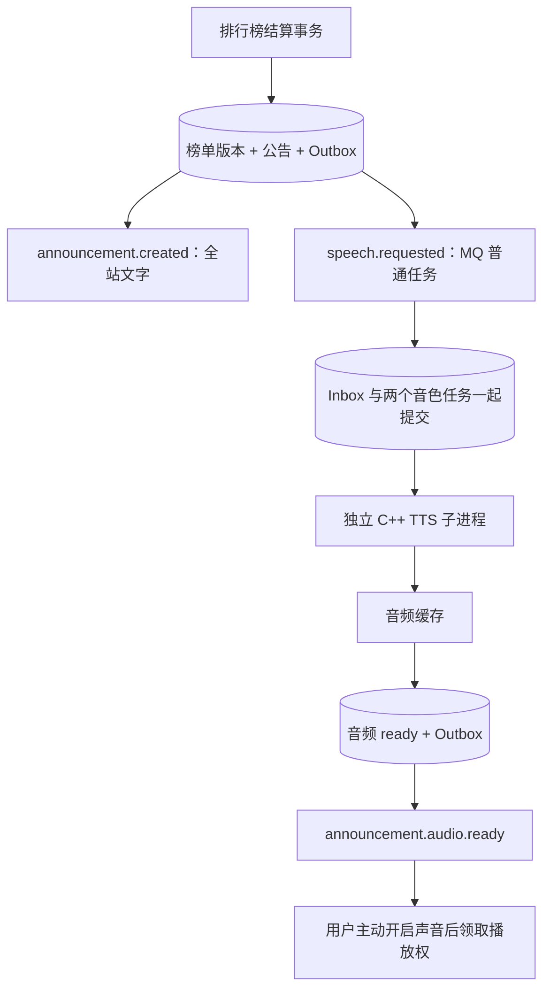

# Phase 33：七日热度、全服公告和本地语音

## 1. 结算规则

每 30 秒按数据库时间结算，候选为发布不足七天且仍公开的主动态：

```text
L = 除作者外的有效点赞人数
R = 除作者外的有效回复的独立用户数
score = (3L + 2R) / (发布小时数 + 2)^1.2
排序：score 降序 → 发布时间升序 → ID 升序
```

它像一个会逐渐降温的聚光灯：互动加分，但旧动态不会永久霸榜。取消点赞、删除回复、隐藏动态和七天过期都会影响下一轮结果。

单条数据库快照查询汇总互动，再保存榜单版本。同一个结算槽用事务锁与唯一约束保证只有一个版本。第一轮建立基线，不播报；之后只比较前十成员与顺序，分值自然衰减本身不触发公告。

## 2. 为什么文字不会等语音



使用 Linux sherpa-onnx 1.13.8 与 Kokoro v1.1 中文 INT8 模型，默认女声 `zf_001`、男声 `zm_009`。这与 Ollama 无关，未重复安装用户的 Windows Ollama。

TTS 在独立进程加载自己的 ONNX Runtime，避免主服务已有 GenAI 的不同 ORT 版本符号冲突。进程时间、内存、输出、日志都有上限；超时或停机取消后杀死并回收子进程。失败有限重试，文字公告继续可见。

## 3. 缓存与播放控制

- 缓存键包含文案、固定模型摘要、音色和语速；不使用用户输入作为路径。
- 模型从官方摘要校验过的压缩包生成逐文件清单，启用 TTS 时再次流式校验资源。
- 音频缓存预留 256 MiB，清理到约 240 MiB，并清除超过 24 小时的音频。
- 用户默认关闭声音，可选择男女音色；后台可以生成固定文案试听。
- 服务器以 `(user_id,announcement_id)` 唯一领取播放权，多个标签页不会重复领取。
- 录音或播放用户语音时延后公告，领取成功的标签页可以续播；过期公告不补播。
- 浏览器限制自动播放时显示“继续播报”，由用户点击触发播放，不声称开启麦克风等同于允许自动播放。

## 4. 组件与限制

`ranking/` 负责名次，`announcement/` 负责公告与用户设置，`speech/` 负责持久任务、Worker 和缓存，`messaging/` 只投递事件。模块通过端口与事件协作。

关键入口：`RankingService/`、`TreeRankingSource/`、`AnnouncementService/`、`SpeechService/`、`SpeechPostgresTasks/`、`SpeechProcessRenderer/`、`SherpaSpeechWorker/`。前端播放器位于 `frontend/phase11/shared/AnnouncementPlayer/`。

当前预置两种音色，未提供任意模型上传或任意命令执行入口。语音试听证明本地链路可运行，不代表所有文本的发音质量都已评估。真实测试、模型词典警告与故障演练结果见 [Phase 34](phase34.md)。

## 后台试听的请求生命周期

冷加载约 14 秒，超过服务器默认 5 秒 handler 期限。后台试听改为 POST 领取任务、GET 查询 `pending/ready/failed`，只有 ready 后请求受权限保护的音频 URL。队列独立且有界，固定两个音色的状态合并复用；重试不会无限创建线程或加载模型。页面明确显示准备进度，HTTP 请求立即结束。
