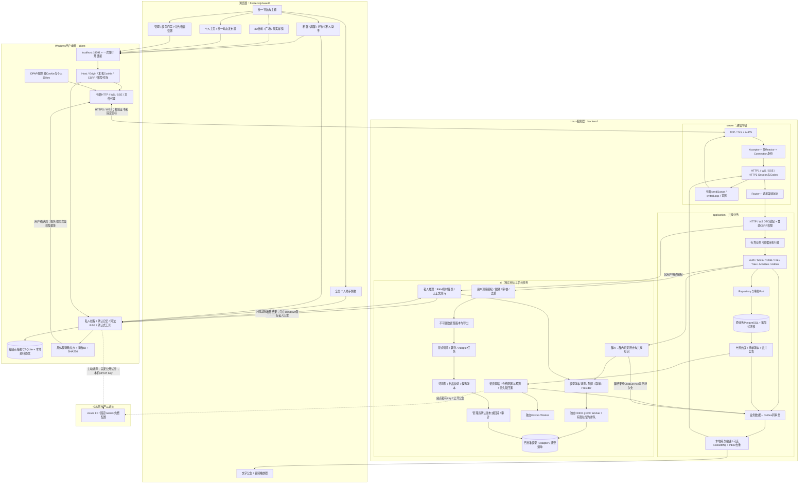

# 从 Windows 私人助手到 Linux 共享业务与 AI 的总图

本图对应当前本地实现；Phase41最终验收仍在进行。Windows客户端是本机业务入口，不是共享聊天的权威服务器。目录、构建目标和独立进程分别描述不同边界，不能互相替代。

## 1. 普通消息如何完成一次往返

1. 浏览器发送 `chat.send` 和稳定的 `client_message_id`。代理转发帧，Linux连接身份与用户会话分别校验。
2. WebSocket适配器将DTO交给Chat业务服务；慢任务进入有界执行器，Reactor继续处理其他连接。
3. 同一数据库事务更新会话序号、消息及Outbox。重复操作返回同一业务结果；只有提交后才返回持久化ACK。
4. 发布器投递事件，消费去重后向在线连接发送消息。离线用户通过历史分页/恢复游标读取；MQ确认不替代聊天ACK、送达或已读。
5. 出站由连接所属Reactor和有界队列发送；取消、连接代际、H2 Stream重置防止迟到完成写到其他请求。

## 2. 神树与个人主页为什么不会保存两份动态

统一动态沿用原果实ID和一套正文、媒体、点赞、回复。频道决定显示位置，可见范围决定谁能读取；这些判断先在服务端查询中完成，再分页。树频道必须面向登录用户；个人/好友动态不增加树高度和热度。作者删除、站点管理员有原因的删除、内容管理员隐藏分别校验，旧媒体链接跟随内容权限失效。

## 3. 私人助手与群AI的关键分界

- 好友式与全局侧栏拥有独立历史，共用Windows私人词法索引和长期记忆。资料默认不获得片段上传授权，记忆候选需要确认。
- 群AI只使用群内可见历史与共享知识，经显式请求、结构化提及或回复触发，不读取成员Windows资料或私人记忆。
- 新私人推理接口只保存有界、限时RAM状态；结果由本机客户端写本地历史，不经过服务器ChatService/Outbox/训练链路。
- 当前模型没有通过可靠结构化工具调用验收，界面明确采用问答、草稿和用户确认式白名单操作，不执行自由文本Shell命令，不自主训练或发布模型。

## 4. 模型更新不会自动发生

训练授权、审核、数据集、外部训练/转换任务、评测、候选制品和发布是分开的步骤。已有教学Adapter证明加载/切换接口，不证明训练质量。只有显式任务完成、摘要正确、质量门禁通过并有管理员确认，版本才可发布；回滚同样留审计。私人推理、神树语音和用户资料不会自动加入训练集。

## 5. 阅读与代码入口

- 通信与线程：[通信说明区](../communication/README.md)、[既有内核总图](../ARCHITECTURE.md)。
- 共享业务：[业务接入教学](server-business-integration-tutorial.md)、[Phase37](phase37.md)。
- Windows代理与私人存储：[Phase38](phase38.md)，入口 `client/companion/CompanionMain`。
- 私人推理与确认操作：[Phase39](phase39.md)，入口 `backend/ai/private`、`client/assistant`。
- 语音与两种平台驱动：[Phase40](phase40.md)，入口 `backend/ai/speech`、`client/assistant/PersonalSpeech`。
- 原始文件移动：[目录索引](../project-layout.md)、[机器可读移动记录](../source-layout-migration.json)。

全局图表示代码链路，不等于所有可选依赖、真实云调用、真实训练质量或性能门槛均已验收。各阶段文档保留具体结果和限制。
