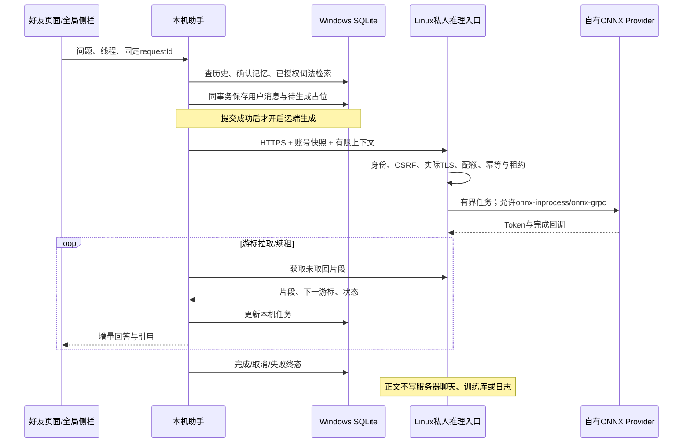

# Phase39：三种AI入口、私人推理、确认行动与旧资料迁移

状态：本阶段实现及真实链路验证已完成。完整回归、独立Worker资源测量、语音与性能未达标项统一见[Phase41](phase41.md)，不把接口存在当成生产能力或模型质量证明。

## 1. 三种入口的边界

| 入口 | 历史与知识 | 传输 |
|---|---|---|
| 好友式私人助手 | Windows的friend线程 | 本机HTTP → 专用私人推理 |
| 全局个人侧栏 | Windows的sidebar线程，与friend共享授权资料/确认记忆 | 所有大页面左上入口、右侧栏，可配置快捷键 |
| 群AI成员 | Linux群消息和该群共享知识；不读本机资料或私人记忆 | WebSocket显式生成/提及/回复 → SSE Token → 消息事务 |

可以把前两种入口看成同一个私人书房里的两张书桌：各自放聊天笔记，共用书架与记忆卡。群AI在另一个公共会议室，不能打开私人书房。

群成员管理继续复用既有群主/管理员规则。新`AiTriggerPolicy`区分`explicit`、`mention`、`reply`；回复会检查引用消息是否属于当前会话、仍可见且由目标AI发送。普通群消息不会自动触发推理。
现有RAG权限仍以会话成员和共享知识为准，群聊不会因为请求者有私人资料而把它混入群回答。

## 2. 私人推理的完整调用链

`RequestContext.transportSecure`来自真实TLS连接，不相信浏览器伪造的转发头。HTTP/1和HTTP/2都在所属Reactor上记录这个事实，再把拥有独立数据的请求交给业务执行器。
私人任务限时保存在内存：默认30秒租约、180秒硬期限、5分钟终态保留；取消、超时、退出或迟到回调不能覆盖既有终态。
`PrivateModelRouter`在模型拿到正文之前限制Provider，仅允许自有ONNX路径，阻止Ollama或云端降级把私人片段送往其他目的地。

## 3. 确认式Agent

本轮先提供可审查的工具和草稿，不声称已有任意任务自治能力。

- 只读能力：检索已授权资料、查询本人资料、查询本人可见会话、打开白名单页面。
- 写能力：发送消息、发布统一动态、修改本人资料。
- `ToolCall`只接受严格结构化契约；任意文字、未知工具、任意Shell不执行。
- 每张`ActionProposal`保存规范化载荷、SHA-256、期限与状态。确认请求只能包含提案ID和摘要，不能带替换后的内容。
- 重复确认返回已有结果。网络结果不明确时保留原操作编号供核对和重试，不能重新生成编号冒充新请求。
- 模型可靠工具调用尚未验证的配置明确使用问答/草稿能力；不会把普通回答解释成指令。

Linux新增HTTP文字发送入口`POST /api/conversations/{id}/messages`，与WS复用ChatService、`client_message_id`去重、同一消息/Outbox事务及权限规则。
资料修改增加`operationId`：`profile_operation_receipts`与资料更新同事务提交。旧操作重放只返回当前资料，不会覆盖用户之后正常进行的修改。
统一动态继续复用自己的`requestId`幂等规则。确认卡本身保存在Windows，服务端仍再次检查Cookie、CSRF与业务权限。

## 4. 旧资料迁移向导

1. 只列出本人旧私人知识及“本人+AI”的双人对话，群聊与真人私聊不进入此向导。
2. 每页最多500条/512KiB正文，使用固定快照上界和游标，不把整段长历史塞进一个响应。
3. Linux和Windows按相同UTF-8长度前缀格式计算SHA-256。本机先核验、落盘归档并写入私人库；资料默认不授权再次发送。
4. 用户另行选择清除时，本机再次验证归档文件。服务端持锁重新读取同一页，确认摘要未变化，再清除该页正文并保存幂等收据。
5. 导出之后新出现的消息保留。包含附件的分页拒绝自动清除，文件需要独立迁移。
6. 知识清除后撤销派生索引，后续RAG不可继续检索；聊天保留撤回墓碑，沿用原Outbox通知机制。

这是**文字副本迁移**。旧知识在服务器上已经分成带重叠的切片，因此本机保留原切片归档，不谎称还原了从未保存的原始PDF/DOCX文件。
这项清除不包含已经授权导出的训练数据、模型制品、附件、数据库备份或已接收推理任务的临时内存；界面明确列出范围。
021迁移只追加收据表。原业务库尚未应用019—021，切换原服务需要先备份并协调版本，避免旧二进制忽略新的私有动态规则。

## 5. 分项验证记录

- Linux Release新增私人生成身份隔离、配额、幂等、游标、取消、租约到期及对象析构后的迟到回调测试通过。
- 原生Windows工具契约：白名单、载荷摘要、取消、重复确认测试通过。
- 真实Windows→Linux隔离库：Agent发送与资料更新、替换载荷拒绝、重复确认去重、旧资料修改重放不覆盖之后修改，通过。
- 真实迁移：OpenSSL/BCrypt摘要互通、复制后原副本保留、默认关闭新资料授权、单独确认清除、重复清除通过。
- 真实已有Phi3 ONNX模型：两轮本机私人链路有增量回答，分别完成与取消，本机历史终态正确。观察到首段返回约69.750秒/20.516秒，含加载与链路开销；不能把它称为纯模型TTFT或性能提升。
- 真实Edge聊天ACK、SSE、三尺寸与助手侧栏回归通过。完整Debug/Sanitizer、独立Worker、混合负载与资源报告仍由Phase41记录。

## 6. 代码索引

- `backend/ai/private/`：私人推理Port、模型路由适配、限时内存任务、HTTPS适配器。
- `backend/application/modules/assistant/`：群触发策略、私人模型安全目录、旧数据迁移业务/Port/驱动/HTTP。
- `backend/application/modules/profiles/ports/IProfileOperations/`：资料操作幂等端口；内存与PostgreSQL实现同契约。
- `backend/application/storage/postgres/migrations/020_profile_operations.sql`、`021_private_archive_receipts.sql`。
- `client/assistant/ActionService/`、`PrivateMigration/`、`LocalAssistantService/`。
- `frontend/phase11/shared/AssistantPanel/`、`frontend/phase11/assistant/`。
- `tests/function3/unit/private_generation.cpp`、`tests/function3/integration/private_archive_blackbox.py`、`tests/client/`。
