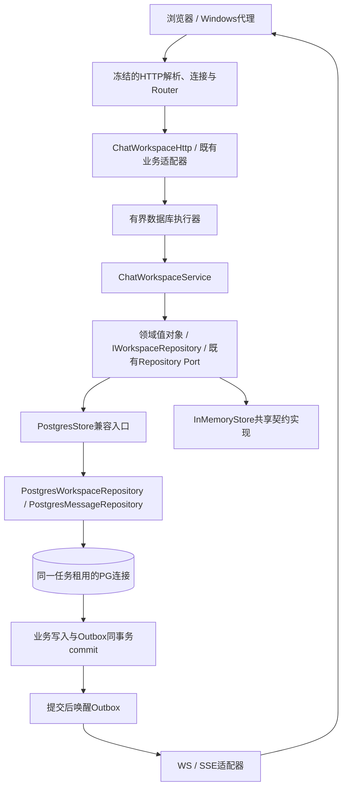

# Phase45：聊天领域边界、批量读取与社交接口

## 1. 领域和通信核心如何协作

新模块位于 `backend/application/modules/chat/`；用例独立目标 `webserver_chat_workspace` 不链接libpq、模型库或网络核心。HTTP适配器才知道认证与执行器。`ChatWorkspaceModule`是该领域装配根；main只注入端口、认证、执行器和提交通知。旧账号、发送、ACK、撤回等服务继续复用，未复制规则。

消息业务与 `modules/messaging/` 的事件投递模块职责不同。前者决定能否读取/发送，后者负责Outbox/MQ/Inbox的投递与失败恢复。

## 2. 新接口

| 接口 | 权限和行为 |
|---|---|
| `GET /api/users/search?q=&after=&limit=` | 活跃登录；用户名/显示名大小写不敏感前缀；排除本人、禁用、任一方向黑名单；最小公开资料与好友/待处理能力；ID升序，最多50 |
| `GET /api/search/messages/page?q=&conversationId=&before=&limit=` | 0表示本人全部可见会话；活动成员/会话/消息过滤在LIMIT前；ID倒序，最多100；literal substring，不把 `%`、`_` 当通配符 |
| `GET/PATCH /api/conversations/{id}/preferences` | 当前成员；写入需CSRF；同值不增版本、不重复产生事件；只改变本人的提醒 |
| `GET /api/conversations/{id}/messages/{messageId}/context?radius=` | 再查成员权限；目标须属于指定会话；前后各1–50条，默认20；撤回返回空正文/附件 |
| `GET /api/client-capabilities` | 登录后按聊天、头像、树图、树语音返回限制与允许类型；来自服务端实际校验策略 |

新增资源/游标以十进制字符串返回，结束游标是`"0"`。旧消息DTO及旧搜索接口保留兼容；没有完成全项目数字ID替换。会话摘要增加 `peerId`、`latestSequence`、`readSequence`、`preferencesVersion`，旧字段保留。

免打扰不会阻止写库、WS同步或未读计数。群禁言是另一条权限规则，不能与免打扰混淆。显式会话偏好优先于旧联系人默认偏好；未设置会话偏好时才使用联系人默认值。

## 3. 事务和版本

`setPreferences`在同一数据库任务中开始事务，校验成员，幂等写入 `conversation_preferences`，并写 `conversation.preferences` Outbox，最后commit。PostgresStore委托驱动时传入当前作用域的同一个PGconn，驱动不另借连接、不自行commit。

新迁移 [024](../../../backend/application/storage/postgres/migrations/024_chat_workspace.sql) 追加偏好表与索引，没有修改001–023。偏好主键是 `(conversation_id,user_id)`，外键绑定成员；退出成员后该偏好随成员删除。revision用于多端HTTP/WS乱序收敛。事件只推送给操作者的连接和SSE会话。

## 4. 消除附件N+1

历史/搜索/消息定位的读取委托给 `PostgresMessageRepository`：先批量查正文，再用 `ANY($1::bigint[])` 一次查整页附件，按message_id装配回原顺序。非空页是两次驱动查询，空页一次。鉴权、成员校验、事务及其他固定查询另计，不能宣称整个HTTP请求只有两次数据库工作。

共享契约用20条各带附件的消息检查内容映射；PG测试精确断言 `messagesBefore` 驱动调用增加2次，而非21次。内存版运行同一业务契约；PG另覆盖真实事务、连接池及并发。

前缀用户索引和活动消息游标索引是增量优化。包含词搜索仍是ILIKE过滤，没有中文分词或语义检索；小表选择顺序扫描并不自动构成故障。执行计划和规模必须与数据一起分析。

## 5. 线程、监控和停止

业务SQL运行在数据库执行器；Reactor只接收请求并恢复完成响应。新增指标记录数据库执行总量/总耗时/最大值、业务排队等待、Outbox事件年龄。事件年龄不是网卡发送延迟，客户端持久化ACK延迟由黑盒压测单独测量；连接池等待指标沿用现有实现。

网络排空返回后，显式停止顺序为：解除在线观察 → 取消私人生成 → 停AI编排（此时DB仍可写审计）→ 排空文件/知识任务 → 排空已接受DB任务 → 停Outbox → 停社区后台Worker。连接池/模型/服务对象在此期间保持存活，之后才按所有权析构。`BusinessShutdown`停止幂等，单个步骤异常也继续清理后续资源。

这轮不是把旧业务一次拆光。旧PostgresStore写入和其他领域保持兼容门面，后续可沿这条有契约保护的路径逐领域迁移。
