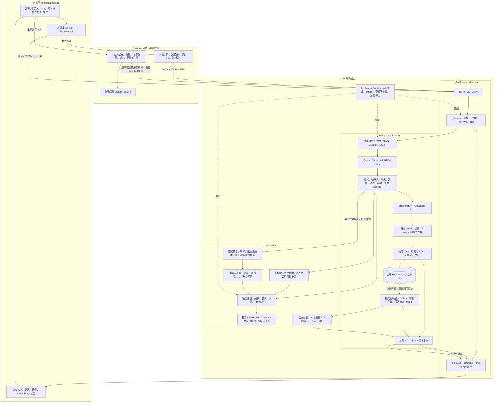

# Phase49：三端、业务契约、事务与模型的整体调用图

本轮保持原三端部署和通信内核；新增的是业务领域归属、接口绑定和装配生命周期。先按图跟踪消息，再看私人助手及模型更新分支。

## 必须分清的边界

1. 前端绑定统一了方法和路径，页面状态和业务权限仍分别归前端及服务端。服务器不信任按钮是否显示。
2. DB Worker 中的一次事务覆盖消息与 Outbox；网络 Reactor 不运行阻塞 SQL，领域 DAO 不另借连接拆散事务。
3. 业务公开投影与 DAO 行分别定义；用户搜索不暴露凭据，撤回/隐藏内容在每个读取入口重新过滤。
4. Windows 私人资料原文和索引留本机，授权片段可能发送自有 Linux 推理；这不是所有处理都在本机。网页助手需要非保密上传同意。
5. 普通聊天、群 AI 和私人助手使用不同的历史/知识边界；群 AI 不能读取个人私人知识。TTS 与推理 Worker 故障不得阻塞普通消息保存。
6. 训练、转换与模型发布是既有显式任务和评测门禁，不由普通聊天或动态发布自动触发；本轮没有训练新模型，也没有证明模型质量提高。

实现索引见 [Phase49 组件](phase49-code-index.md)，数据库对象与事务见 [领域分层规范](../../database/domain-layering.md)。底层协议细节见 [通信架构](../communication/README.md)。
