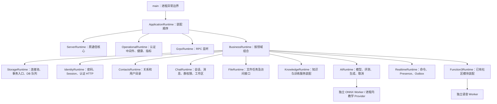

# Phase49：业务契约对齐、领域装配与数据库对象分层

2026-10-30 至 31，基于本地 Phase48 检查点 `42b3f8f`。保持 Linux 共享业务、Windows 私人客户端、浏览器展示的分工；通信核心继续冻结。不添加依赖、迁移或数据库，不推送 GitHub，不替换日常运行服务。

## 1. 本轮修改与目的

|问题|实现|边界|
|---|---|---|
|main 集中管理 37 个 unique_ptr 和路由/启停|入口 964→14 行；ApplicationRuntime 组合业务、网络、运维和 gRPC；各领域 Runtime 拥有本领域资源|保留有意义的独占所有权，不以删除智能指针为目标|
|前端路径散落、接口缺少可检查联系|实际 C++ 注册生成 119 个方法/路径契约、18 个领域绑定；106 处字面路径调用迁到绑定；统一请求层校验|116 个业务契约+3 个健康契约；字段和权限仍需契约及集成测试|
|账号、联系人、聊天、文件混放在 business 或 chat|核心服务/HTTP 适配器与前端控制器移动到对应领域|旧头文件转发兼容；旧实现文件移除，构建只编译新实现|
|用户搜索由聊天工作区承担|独立 UserDirectoryService / IUserDirectoryRepository / UserDirectoryHttp，归 contacts|旧 users 方法只委托，不保留第二份规则|
|数据库对象跨层含义不清|显式 Query/Command、驱动内 DirectoryRow、公开 UserCard/UserPage 与 transport 序列化|不盲目复制五套对象，不将联查结果冒充完整表实体|
|重构后的退出顺序不易证明|资源按依赖构造；显式幂等停止；故障检查覆盖部分构造、TLS、HTTP/gRPC 监听失败|底层协议及发送队列未改|
|有资料时知识列表显示失败|修复回调数据变量覆盖 DOM document；新增非空资料浏览器回归|保留最初失败记录，不用空数据绕过|

## 2. 新的装配与所有权

装配层可以看到具体实现，它负责把窄接口交给服务。业务规则不能反过来包含装配组件。KnowledgeRuntime 同时装配两个已有独立的知识/训练服务，不将训练审核规则复制到知识服务。社区原有装配入口也保留，未为了行数再拆一遍。

## 3. 前后端契约与文件归属

接口契约要求一致，目录按领域对应；不要求一对一文件数量。共享 `BusinessApi`、文件上传、通知播放器与导航仍由多个页面复用。返回事件仍经既有 WebSocket/SSE 契约，MQ 确认不替代聊天 ACK 和已读。

检查入口：`python scripts/project/sync_api_contracts.py --check`。新增路由须同步生成、审核 payload/权限契约并补充测试。路由索引采用源码注册提取，动态注册另有明确提取规则；将来新增其他动态注册方式必须更新提取器，不能将正则提取器宣称为完整编译器。

## 4. 数据库层次和兼容

[数据库领域分层规范](../../database/domain-layering.md)详细说明 DO、DTO、BO、Query、VO 的用途和真实映射。

本轮不修改表。现有 PostgresStore 继续管理事务上下文并委托领域驱动，内存驱动共享 MemoryState。消息和 Outbox 仍在同一数据库任务/同一连接提交，权限由服务与查询共同验证。旧大头文件仍作兼容聚合，不代表所有遗留用例已重命名或逐字段转换。

## 5. 验证与限制

**功能与结构回归通过，严格性能门槛未通过。** 证据在 `artifacts/function3/phase49/`；Phase48 的失败记录继续保留。

|验证|结果|范围|
|---|---|---|
|冻结内核|152份文件不变|原字节与跨平台摘要检查|
|Linux Release / Debug / ASan-LSan-UBSan|各115/115|真实隔离PG、已安装可选驱动|
|前端 / 工程|33 / 14项通过|包括接口错配、失效成员、缺失导入、请求取消与不确定写操作|
|浏览器|七组通过|三种尺寸、深浅主题、431条历史、神树、主页、管理、助手、公告|
|Windows|两种构建各5项通过；真实代理通过|TLS指纹、WS/SSE、私人模型、迁移、确认操作、语音回退|
|真实业务|10组通过|含HTTP/2 ALPN、重置Stream、用户目录、权限、消息、群AI与网页AI|
|启动失败清理|三种构建各4项通过|部分构造、TLS、HTTP/gRPC监听失败，无泄漏/挂起|
|独立Worker|真实崩溃/恢复通过|故障期间聊天仍持久化；私人任务失败不写聊天正文|
|可选驱动关闭|构建与真实冒烟通过|Phase11 OFF，健康200、业务未配置明确503|

第一次Release回归遇到测试PG未运行，恢复后全量通过；非空知识列表的浏览器失败已修正。真实HTTP/2业务检查原来硬编码日常18443端口，改为隔离18444和已确认学习证书。原始失败日志保留，未把环境错误隐藏成绿色跳过。

## 6. 性能结果与下一步定位

同一VM、配置、数据规模，保存实际Phase48二进制作为基线，三轮交错测量，WAL同步提交保持开启。第一次执行中断，只保存了一轮，不作验收依据；恢复后另建 `benchmarks-resume-after-interruption` 完整执行，未覆盖原记录。

|轮次|基线 /fast QPS|当前 /fast QPS|基线ACK P99 ms|当前ACK P99 ms|ACK增幅|
|---|---:|---:|---:|---:|---:|
|1|54211.97|54202.98|17.688|17.720|+0.18%|
|2|53986.61|52102.40|11.915|12.906|+8.32%|
|3|59176.21|49878.08|8.710|15.545|+78.47%|

/fast中位下降3.89%，满足≤10%；第三轮ACK超过≤20%门槛，**整体验收失败**。混合吞吐中位681.119→565.786 ops/s（约-16.93%），六组业务错误均为0。不能仅展示第一轮或以Phase48某组较好结果替代。

第三轮聚合观测：数据库调用平均0.3303→0.6047ms，提交唤醒到投递调度平均0.8905→1.7411ms，Outbox周期平均2.6743→4.7878ms；业务排队平均0.0391→0.0695ms。两版队列高水位均为2，连接池超时和Outbox失败均为0。说明该轮数据库执行与投递同时变慢，没有明显队列满证据；**这些累计量不能相加成一次ACK耗时，也不能证明根因是新装配层或某条SQL**。

剩余定位应对同一消息关联DB任务、事务COMMIT、ACK排队与实际发送时间，并增加持久化与VM资源观测；保留同步提交，继续冻结通信核心。当前未完成精确逐消息因果定位，不宣称性能优化或生产就绪。Windows探针与代理连接复用策略不同，且经过SSH测试通道，负的“附加延迟”不能解释成纯代理开销收益。

验证顺序：完整真实模型/Windows链路先于最后DAO文本移动优化和状态清单更新；此后重新运行三种115项矩阵与生命周期检查，最终版本再做工作区与版本冒烟。测量二进制和最终状态清单构建的摘要分别记录。完整回退见 [验证说明](../../ops/phase49-validation-and-rollback.md)。

学习入口：[接入教学](phase49-teaching.md)、[组件索引](phase49-code-index.md)、[端到端调用图](phase49-end-to-end.md)。
