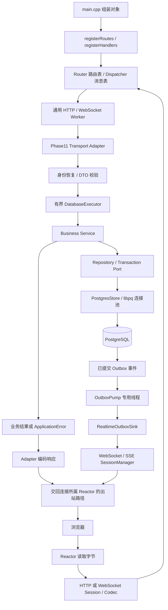
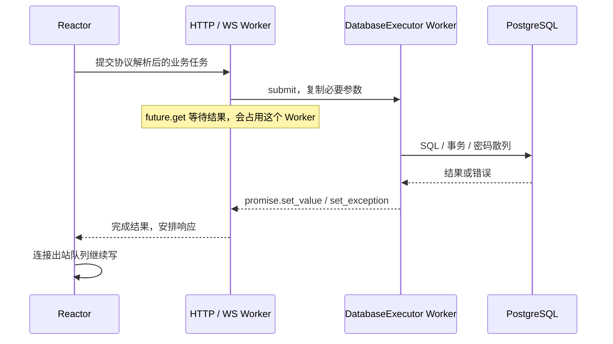
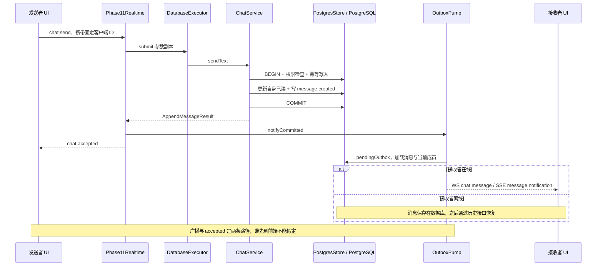
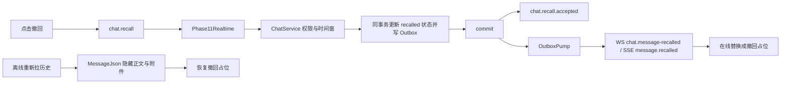
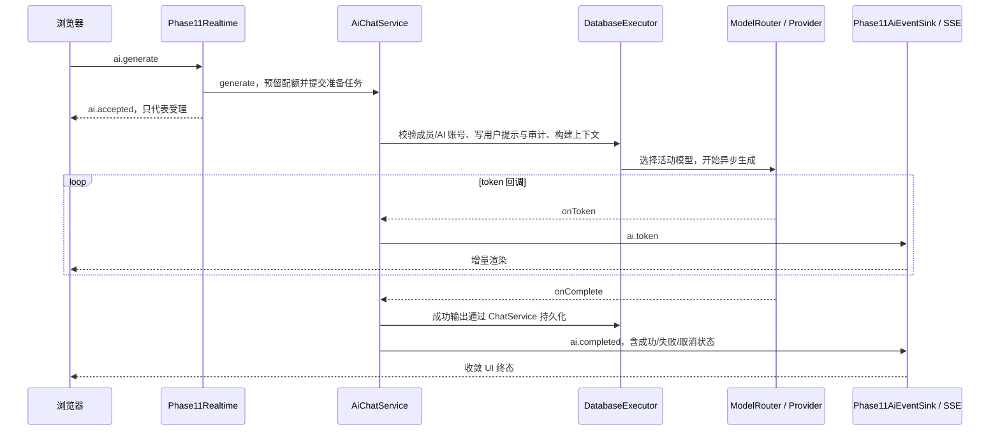

# 教学：业务怎样接入这台 C++ 服务器

本文面向已经熟悉 Reactor、HTTP、WebSocket、SSE 和 HTTP/2 的你。学习目标不是再写一遍协议，而是能回答：**一个按钮触发的业务，怎样经过已有服务器，安全地改变数据库，再把结果返回到正确的用户？**

以 2026-10-12 本地 Function2 工作区的源码为依据。本文是代码核对和学习路线，不是新一轮虚拟机测试报告；历史 Phase 的测试结论仍以各自记录为准。代码入口使用相对链接，便于本地和 GitHub 阅读。

## 1. 目前到了哪一步，下一步做什么

### 1.1 原计划与当前实现

| 原计划 | 当前源码中已有的内容 | 仍要区分的边界 |
|---|---|---|
| 未读、送达、已读、撤回 | 数据库游标、WS 命令、Outbox 事件、前端状态；Phase 27 最新页/旧页、断线补齐和 ACK 核对重试 | 文字重试队列保留在当前标签页，不是跨设备永久发件箱 |
| 群聊权限 | 群主/管理员/成员、邀请、角色、禁言、移除、退出、软解散、群名/公告；Phase 27 管理撤回入口 | 前端只展示入口，后端仍校验角色、成员和两分钟撤回窗口 |
| 联系人 | 备注、删除好友、黑名单、免打扰、连接数 Presence、最后活跃 | Presence 是当前进程连接状态，不是跨实例共享的在线租约系统 |
| 真实业务性能 | Phase 15 基线工具、Phase 26 长连接/AI/混合容量工具 | 工具实现不能代替当前版本的真实容量报告 |
| 运维 | `/health/live`、`/health/ready`、Prometheus 文本 `/metrics`、监督/恢复及长稳工具 | 当前 ready 检查服务器与数据库，不代表所有模型都可生成；正式故障/长稳结论需要证据 |
| 文件 | 头像、分片上传、校验、文件消息、授权下载/Range | 需要继续验证大文件、取消上传和存储故障下的用户体验与资源边界 |
| AI 与模型治理 | 三类 Provider、配额/期限/取消/熔断、审计、RAG、授权数据、评测/发布/回滚工具 | 教学制品加载成功不等于真实训练质量达标，也不等于自动训练平台已经建成 |

功能主链与本轮指定的四项交互闭环已经补齐，具体实现和验证见 [Phase 27](phase27.md)。容量、长稳与模型质量仍要用各自证据判断。

### 1.2 下一轮建议的顺序

1. **已完成交互可靠性**：[Phase 27](phase27.md) 的分页、断线补齐、原幂等键核对/重试与管理员撤回入口。普通发送仍允许对方离线。
2. **再补验收证据**：归档长稳汇总，按 Phase 26 做同配置的三轮容量测试。Phase 26 文档的“长稳仍在采样”是 2026-10-08 的记录，本次没有据此推断虚拟机现在仍在运行该任务。
3. **按证据优化**：重点观察通用 Worker 等待数据库结果、数据库连接池等待、单会话写锁、Outbox 积压，以及 AI 负载对普通聊天 P99 的影响。
4. **最后做模型质量验证**：使用明确授权数据与独立评测集，比较基线/候选版本，再人工激活。不要把 token 能输出当成模型能力已经提升。

对应验收入口：[Phase 15](phase15.md)、[Phase 16](phase16.md)、[Phase 23](phase23.md)、[Phase 25](phase25.md)、[Phase 26](phase26.md)、[Phase 27](phase27.md)。第 2–4 项仅保留学习路线，本轮按你的指令完成第 1 项后停止，没有启动容量测试或安装依赖。

## 2. 先建立一个容易记住的类比

把服务器想成一家有外卖业务的餐厅：

1. **Reactor = 门口收发员**：关注哪条连接可以读写，不负责炒菜或查库存。
2. **Session/Codec = 拆包装与翻译员**：把字节恢复为请求或消息，再把响应包装成协议字节。
3. **Router/Dispatcher = 分机表**：根据 HTTP 路径或 WS `type` 找到处理函数。
4. **Transport Adapter = 接单前台**：解析参数、恢复登录身份、调用业务，把业务结果翻译回协议。
5. **Business Service = 业务主管**：决定能不能发、有没有权限、是否重复、哪些操作必须一起成功。
6. **Repository Port = 仓库的取存接口**：主管说“保存消息”，不用知道仓库具体用哪条 SQL。
7. **PostgresStore = 真正的仓库实现**：执行参数化查询、拿连接、提交事务。
8. **Outbox = 同时入账的通知待办单**：菜已做完但骑手还没取走，待办单不会因进程重启凭空消失。

这里有两种“接口”：

| 名称 | 本项目例子 | 面向谁 |
|---|---|---|
| 网络接口 | `POST /api/auth/login`、WS `chat.send` | 浏览器/客户端 |
| C++ 业务接口 | `IAuthBusiness::login`、`IChatBusiness::sendText` | Transport 与测试代码 |
| Repository 端口 | `IMessageRepository::appendMessage` | Business Service |

业务接口不是新的网络协议。它是一层 C++ 边界，让 HTTP 和 WS 都能使用同一套业务规则。

## 3. 总调用图：注册接口和执行请求是两件事



### 3.1 启动时的“接线”

从 [main.cpp](../../../main.cpp) 搜索这些名字，按顺序看：

1. `phase11Store`：创建一个 `PostgresStore`，它实现多种 Repository 和事务端口。
2. `phase11Auth`、`phase11Social`、`phase11Chat`：把端口注入业务服务。
3. `phase11DatabaseExecutor`：创建有界慢任务执行器。
4. `phase11AuthHttp`、`phase11SocialChatHttp`、`phase11Realtime`：把业务接口与执行器交给协议适配器。
5. `phase11OutboxSink`、`phase11OutboxPump`：组装持久事件到 WS/SSE 的出口。
6. `registerHandlers(server.wsDispatcher())` 和 `registerRoutes(server.router())`：真正登记可调用的网络入口。

下面是帮助理解的缩略写法，省略了配置、依赖与对象生命周期，**不是可直接替换 main 的代码**：

```cpp
// store 同时扮演 IUserRepository、IMessageRepository 等多种端口。
PostgresStore store(config);
DatabaseExecutor databaseExecutor;
ChatService chat(store, store, store, store, store, store, store);

// 适配器拿的是 IChatBusiness，而不是在路由中手写 SQL。
Phase11Realtime realtime(chat, databaseExecutor, ai, notifyOutbox);
realtime.registerHandlers(server.wsDispatcher());
```

`main` 是“组装地点”，不是所有功能的实现地点。对象必须活得比引用它们的路由和回调更久。不能在某个临时函数里创建 `ChatService`，注册一个捕获其地址的回调，然后让该对象离开作用域。

### 3.2 请求到来时的“使用接线”

HTTP 的接线方式：

```cpp
router.POST("/api/auth/login", [this](RequestContext& context) {
    // 解析 HTTP 参数 → 调用 IAuthBusiness → 填写 HTTP 响应。
});
```

WS 的接线方式：

```cpp
dispatcher.on("chat.send", [this](WsMessageContext& context) {
    // 解析后的 WS 应用消息 → 调用 IChatBusiness → 设置 WS 回复。
});
```

Router 按“方法 + 路径”查找，Dispatcher 按“应用消息 type”查找。WebSocket 帧的 Text/Ping/Close 由协议层处理；`chat.send/chat.read` 是你自己定义的业务消息。

路由表在服务器运行前登记，在 [ServerRuntime](../../../server/Runtime/ServerRuntime.cpp) 中冻结。往 [Contracts.h](../../../server/phase11/transport/Contracts/Contracts.h) 里加一个字符串常量，只是起了名字，**不会自动注册功能**。例如常量中有 `presence.subscribe`，当前 `Phase11Realtime::registerHandlers` 并没有对应处理器。

## 4. 线程边界：目前是隔离执行，不是每一层都异步等待

### 4.1 当前真实执行顺序



看 [Phase11AuthHttp.h](../../../server/phase11/transport/http/Phase11AuthHttp/Phase11AuthHttp.h) 的 `runDatabase`，以及 [Phase11Realtime.h](../../../server/phase11/transport/realtime/Phase11Realtime/Phase11Realtime.h) 的同名函数：

```cpp
// 原实现的核心思想，省略 void 返回与异常分支。
auto completion = std::make_shared<std::promise<Result>>();
auto future = completion->get_future();
bool accepted = databaseExecutor.submit([completion, operation] {
    completion->set_value(operation());
});
if (!accepted) throw ApplicationError(ErrorCode::Unavailable, "busy");
return future.get(); // 等待的是通用 Worker，Reactor 没有在这里等。
```

1. 有界队列满时拒绝任务，而不是无限积压内存。
2. `future.get()` 会等待；“用了线程池”不等于“调用方没有被占用”。
3. 当前 DB/Argon2 工作与 Reactor 隔离，但慢数据库仍可能耗尽通用 Worker。
4. 文件、知识处理有各自的执行器；Outbox 有自己的搬运线程；Provider 有自己的 I/O 或推理运行边界。
5. 以后若压力测试证明 Worker 等待是瓶颈，再考虑响应 continuation/协程 awaitable；必须同时解决连接关闭、取消与响应对象生命周期，不能只删掉 `get()`。

### 4.2 为什么参数要复制

真实 `chat.send` 任务复制 `uid`、会话 ID、客户端 ID 和正文。不要把 `RequestContext&`、`WsMessageContext&` 或某个请求缓冲区的 `string_view` 随手捕获进另一个线程。

可以把它想成前台给后厨递一张独立订单，而不是让后厨一直握着前台正在擦写的白板。`this` 仍然需要依赖正确的服务生命周期，复制正文并不能让所有引用自动安全。

## 5. 第一条链：登录如何接入 HTTP

### 5.1 浏览器发出的请求

```http
POST /api/auth/login
Content-Type: application/json

{"username":"example_user","password":"示例密码，不代表真实账号"}
```

[frontend/phase11/app.js](../../../frontend/phase11/app.js) 的 `api()` 使用同源 Cookie；修改登录后的业务数据时附加 `X-CSRF-Token`。登录请求还没有已登录会话，不能把所有 POST 都理解成先要求用户已登录。

### 5.2 HTTP 前台做什么

读 [Phase11AuthHttp.cpp](../../../server/phase11/transport/http/Phase11AuthHttp/Phase11AuthHttp.cpp) 的 `registerRoutes`：

1. `requestObject` 限制/解析 JSON，取 `username/password`。
2. 提取来源信息，供登录限流使用。
3. `runDatabase` 调用 `IAuthBusiness::login`。
4. 收到 `LoginSession`，返回用户资料和 `csrfToken`，通过 `Set-Cookie` 保存 Session Token。

读 [AuthService.cpp](../../../server/phase11/business/AuthService/AuthService.cpp)：验证账号、限流和密码；生成会话；数据库保存 Token Hash。密码散列与随机 Token 的具体能力交给 [SodiumCredentialCodec](../../../server/phase11/security/SodiumCredentialCodec/SodiumCredentialCodec.cpp)。

**注册与登录要分开理解**：`POST /api/auth/register` 返回 `201` 和 `User`，它不创建登录 Cookie；`POST /api/auth/login` 才创建会话。不要把“创建了账号”画成“自动获得登录 Session”。

### 5.3 登录身份怎样进入后续接口

HTTP 业务调用 `authorizeRequest(context, requireCsrf)`：Cookie Token → `restoreSession` → 过期/吊销检查 → 用户身份；需要 CSRF 的操作再校验 Token。

WS/SSE 在 `/ws`、`/events` 握手时，经 `main` 的中间件恢复可信身份，再转入相应 Session。因此业务用 `context.uid`，不是相信客户端 JSON 中自称的 `senderId`。

Cookie 默认安全配置与明文学习环境的配置不同；当前虚拟机 HTTP 开发入口需要明确的开发配置。不要把本地 HTTP 能登录推断成生产 HTTPS/Cookie 配置已经验收。

## 6. 第二条链：发送一条消息，从按钮到数据库再到对方

### 6.1 三个 ID，分别解决什么问题

| 字段 | 类比 | 用途 |
|---|---|---|
| 客户端命令 `id` / `clientMessageId` | 同一订单的取号单 | 关联回复、重试去重；重试同一业务必须复用原 ID |
| 服务端 `message.id` | 仓库正式入账编号 | 查消息、撤回、前端按服务端 ID 去重 |
| `conversation_seq` / JSON `sequence` | 同一会话里的页码 | 排序、恢复历史、推进已读/送达游标 |
| `conversationId` | 哪本账 | 会话定位与成员权限判断 |
| `replyTo` | 回复哪张取号单 | 普通回复关联原命令 ID；撤回请求中则用它指定服务端消息 ID |

注意 `replyTo` 的含义取决于消息类型。不要把客户端命令编号与服务端消息编号混用。

### 6.2 前端如何发送

```json
{"v":1,"type":"chat.send","id":"client-order-001","conversationId":42,"content":"你好"}
```

这些 ID 是结构示例，不是数据库中已存在的账号/会话。实际执行需使用自己的有效会话。

`sendSocket()` 返回 `true` 只说明浏览器调用 `socket.send` 成功。前端可以先画“发送中”气泡，但此时不能宣布已写入服务器。消息真正落库后，发送者会收到如下结构的回复：

```json
{"type":"chat.accepted","replyTo":"client-order-001","id":"9001","conversationId":42,"sequence":18,"status":"inserted"}
```

示例省略编码器添加的其他字段。重复提交成功时 `status` 为 `duplicate`，仍返回原消息的 ID/sequence。

### 6.3 后端关键步骤

读 [Phase11Realtime.cpp](../../../server/phase11/transport/realtime/Phase11Realtime/Phase11Realtime.cpp) 的 `registerHandlers`：

1. Dispatcher 找到 `chat.send`。
2. 从可信 `context.uid` 得到发送人；复制 DTO 参数进入 DB 任务。
3. 调用 `IChatBusiness::sendText`。
4. 业务返回后唤醒 Outbox，然后设置 `chat.accepted`。

读 [ChatService.cpp](../../../server/phase11/business/ChatService/ChatService.cpp) 的 `sendText → sendMessage`：

1. 检查客户端 ID、正文长度。
2. 开事务；检查会话未解散、发送人是成员、未被禁言。
3. 私聊检查黑名单、好友关系；AI 账号按当前特殊规则处理。
4. `appendMessage` 做幂等检查并分配序号。
5. 重复键且正文/附件一致：返回原记录；键相同却内容变了：报冲突。
6. 新消息推进发送者自己的已读游标。
7. 同事务写 `message.created` Outbox 事件。
8. `commit()` 成功，才返回结果。

这条链**没有要求对方在线**。普通用户发送私聊需要已有好友关系和有效会话，群聊需要成员权限；离线本身不是拒绝条件。

### 6.4 完整时序



前端的 `acceptPendingMessage` 和服务端消息 ID 去重处理了部分“广播先到、accepted 后到”的情况。这是为什么 UI 不能简单把每个事件都追加成一条新消息。

## 7. 事务与 Repository：为什么七个参数都可以是同一个 store

读 [BusinessInterfaces.h](../../../server/phase11/business/BusinessInterfaces/BusinessInterfaces.h) 和 [Ports.h](../../../server/phase11/ports/Ports/Ports.h)：业务依赖抽象接口；一个 `PostgresStore` 可以同时实现多个接口，就像同一位仓库管理员戴着“管用户、管消息、管通知”几顶帽子。

业务 Service 不应暴露 `PGconn*`，也不应自己拼接 SQL。内存 Store 与 PostgreSQL Store 可通过同一套 Repository 契约验证行为。

### 7.1 一次事务中的连接怎么保持一致

[PostgresStore.cpp](../../../server/phase11/storage/postgres/PostgresStore/PostgresStore.cpp) 的关键阅读点：

1. `beginTransaction()` 从连接池取得 Lease，执行 `BEGIN`。
2. `activeTransactions` 使用线程局部映射，登记当前 Store 的事务连接。
3. 同一线程内调用不同 Repository 方法时，`connection()` 复用这个连接。
4. `commit()` 结束事务；未提交离开作用域时，事务析构负责回滚。

所以“消息入库”和“Outbox 入库”可以成为同一个原子动作。这个实现依赖**事务在同一个线程内完成**；不能把打开的事务随意搬到另一个 Worker，也不能假设以后换协程后跨线程恢复仍自动正确。

### 7.2 序号和幂等如何落到 SQL

1. 活跃事务查询会话时使用行锁；同一会话的分配过程受到串行保护。
2. `appendMessage` 检查已有幂等记录，再递增 `next_sequence`，得到当前消息的 sequence。
3. 数据库还设有唯一约束，作为并发下的最后一道保证：
   - `(conversation_id, conversation_seq)`；
   - `(conversation_id, sender_id, client_message_id)`。

这意味着幂等键的范围是“同一会话 + 同一发送者”，不是全服务器所有人共用一个 ID 空间。同一会话写入量很大时，行锁也可能成为性能观察点，不能只靠增加 Reactor 线程解决。

迁移见 [001_phase11.sql](../../../server/phase11/storage/postgres/migrations/001_phase11.sql)，表说明见 [数据库文档](../../database/README.md)。

## 8. 第三条链：未读、送达与已读

### 8.1 游标就是书签

```text
会话已有序号：1 2 3 4 5 6 7 8 9 10
我的已读书签：              ↑ 7
最新页码：next_sequence - 1 = 10
当前未读：max(0, 10 - 7) = 3
```

`next_sequence` 是下一条消息将使用的序号，所以计算最新消息要减 1。每个成员分别保存 `last_read_sequence` 和 `last_delivered_sequence`。

当前未读是**序号差**：撤回记录仍占一个序号；不是重新统计所有“仍有正文、来自别人”的消息。发送自己的新消息会把自身已读推进到该序号，这是当前业务策略。

### 8.2 哪个消息表示什么

| 方向 | 类型 | 意义 |
|---|---|---|
| 发送者 → 服务器 | `chat.send` | 请求写入消息 |
| 服务器 → 发送者 | `chat.accepted` | 已提交，或识别为同内容重复 |
| 服务器 → 成员 | `chat.message` | 实时分发完整持久消息 |
| 接收端 → 服务器 | `chat.ack` | 上报已经收到到哪个 sequence |
| 服务器 → 上报端 | `chat.acknowledged` | 送达上报处理成功 |
| 阅读端 → 服务器 | `chat.read` | 上报已经阅读到哪个 sequence |
| 服务器 → 成员 | `chat.receipt` | 某用户送达/已读游标变化，state=delivered/read |

当前没有注册 `chat.delivered` 命令。不要凭中文“送达”给协议猜一个名称。

```json
{"v":1,"type":"chat.ack","id":"receipt-001","conversationId":42,"sequence":18}
```

```json
{"v":1,"type":"chat.read","id":"receipt-002","conversationId":42,"sequence":18}
```

当前 `app.js::acknowledge()` 在活动会话中发送这两个命令；不能把后台会话收到提示也理解成已经读过。业务上的“已读”是客户端上报的交互状态，不是证明人眼逐字看完。

### 8.3 为什么多端重复上报不会倒退

`ChatService::markRead/acknowledgeDelivery` 先检查有效序号和成员身份。数据库更新使用单调规则：

```sql
-- 核心规则示意，完整 SQL 见 PostgresStore::updateRead。
last_read_sequence = GREATEST(last_read_sequence, reported_sequence)
-- 只在旧值更小时更新；确实改变时才生成 Outbox 事件。
```

设备 A 上报 18，设备 B 迟到上报 12，最后仍是 18；重复上报 18 不再创建相同业务状态变化。`updateRead` 同时推进送达游标，因为“已读到 18”至少意味着“已收到到 18”。

前端气泡的“送达/已读”来自成员的后端游标和 `chat.receipt`，群聊按其他成员游标显示人数。它们不能由点击发送按钮自行变成完成。

## 9. 第四条链：撤回怎样贯穿所有层

### 9.1 请求与权限

```json
{"v":1,"type":"chat.recall","id":"recall-command-001","conversationId":42,"replyTo":"9001"}
```

这里 `id` 是本次撤回命令的编号，`replyTo` 指向服务端消息编号。业务会从消息记录重新确定所属会话与权限，不只相信请求附带的会话 ID。

当前 `ChatService::recallMessage` 的规则：

1. 会话有效，操作者仍是成员。
2. 自己的消息可以撤回。
3. 群主可以按规则撤回他人消息；管理员可撤回普通成员消息。若发送者仍有成员记录，管理员不能撤回群主/管理员消息。
4. 新撤回必须在发送后两分钟内，包括管理者操作；时间窗目前是代码常量。
5. 已撤回的重复请求仍先过权限检查，然后返回 `already_recalled`，不再生成新事件。

### 9.2 从状态变化到 UI 更新



数据库保留消息和撤回元数据；当前实现也保留原正文。普通消息输出由 [MessageJson](../../../server/phase11/transport/serialization/MessageJson/MessageJson.cpp) 对 recalled 消息返回空正文和空附件，搜索排除撤回消息。**这属于用户可见性的撤回，不是数据库物理抹除，也不是训练模型“遗忘”该内容。**

先读后端权限再看 `ChatHistory.js::canRecallMessage` 与 `app.js::requestRecall`。Phase 27 已接入管理者入口；前端判断改善交互，后端 `ChatService::recallMessage` 才能真正授权，伪造按钮不能绕过它。

## 10. Outbox：保证的是什么，不保证什么

### 10.1 为什么要多写一张表

直接 `INSERT message → socket.send` 有一个夹缝：提交成功后进程崩溃，通知就没了。当前用 `messages + outbox_events` 同事务提交，重启后仍能扫描待处理事件。

[OutboxDispatcher.cpp](../../../server/phase11/business/OutboxDispatcher/OutboxDispatcher.cpp) 实际做的是：

```text
pendingOutbox(limit)，按顺序取尚未发布事件
    ↓
sink.publish(event)
    ├─ false/异常：停止本批，稍后重试
    └─ true：markPublished(event.id)
```

[Phase11OutboxPump](../../../server/phase11/transport/realtime/Phase11Realtime/Phase11Realtime.cpp) 在专用线程执行循环。普通变更通过 `notifyCommitted()` 叫醒，轮询是兜底；当前每批 100 个。若 `publish` 成功但 `markPublished` 前崩溃，下次可能再次发布，所以消费端必须允许重复。

### 10.2 三个不能混淆的成功

1. **事务成功**：消息已经在数据库中，`chat.accepted` 表达这一层。
2. **事件已发布**：Sink 处理了这张通知单，Outbox 可以标记；不等于浏览器已经拿到字节。
3. **客户端已收到/读到**：由 `chat.ack/chat.read` 上报后端游标表达。

当前 Realtime Sink 即使零在线连接也把 `message.created` 视为处理成功；离线恢复依靠消息表。它还忽略了 `broadcastText/publish` 返回的投递数量或准入结果，因此不能声称“Outbox published 保证每个在线端都收到”。出站拥塞下的遗漏应靠历史追赶闭环补足。

当前没有 Outbox claim/lease，也没有多消费者的数据库抢占机制。不要在图里把 `pendingOutbox` 写成“分布式 claim batch”；多实例共享库之前，这一块需要专门设计。

### 10.3 SSE 与 WS 的职责

浏览器通过 WS 发聊天命令；SSE 是服务器到浏览器的单向事件出口。当前同一完整消息可能同时通过 WS 和 SSE 通知抵达，因此前端按服务端消息 ID 去重。

SSE 的连接内重放能力和数据库历史不是一回事。AI token 由 `Phase11AiEventSink` 直接发布到 SSE，不逐 token 写入 Outbox；成功生成的最终 AI 消息才通过 `ChatService` 持久化并产生消息事件。不要承诺每个中间 token 在服务重启后都能恢复。

Presence 也走类似适配：`WebSocketSessionManager` 维护当前进程多连接计数，`Phase11PresenceBridge` 把变化提交给数据库执行器，`SocialService::recordPresence` 更新最后活跃并生成事件。这里没有数据库设备租约的增删流程。

## 11. 第五条链：AI、RAG 和训练怎样复用业务入口

### 11.1 AI 请求的开始与结束走不同路径

```json
{"v":1,"type":"ai.generate","id":"generation-001","conversationId":42,"to":7,"content":"解释一下这段代码"}
```

`to` 是会话中 AI 账号的 ID，不能随便填一个普通用户。请求中 `content` 被适配为业务层 `prompt`。



读 [AiChatService.cpp](../../../server/phase11/business/AiChatService/AiChatService.cpp) 的 `generate`、准备任务、`onToken`、`onModelCompleted`：

1. `ai.accepted` 之后仍可能遇到权限、模型、期限或持久化错误，不能把它当成生成成功。
2. 普通聊天主链与推理边界分离；模型路由统一选择 Ollama、进程内 ONNX 或独立 gRPC Worker。
3. RAG 在准备阶段按用户/会话权限构建允许集合，检索切片并登记引用，加入生成上下文。
4. Provider 回调只通过事件/业务边界返回，不去直接改前端 DOM。
5. 最终回复使用 `ai:` 前缀的幂等键走同一 `ChatService::sendText`，复用权限、事务和消息历史。
6. `ai.cancel` 的 `replyTo` 指向 generation ID，后端验证发起者后传播取消；取消是完整生命周期的一部分。

目前 `main` 中的通用学习 gRPC Callback Server 不是所有 `/api` 的统一入口；它有独立 Service/Method。AI 的独立 ONNX Worker 是另一条明确的 Provider RPC 路径，不能把它们画成一个万能的聊天 gRPC 适配器。

### 11.2 训练和发布不是一个聊天按钮自动完成

```mermaid
flowchart LR
    Consent[用户明确授权消息] --> Transport[Phase11TrainingHttp]
    Transport --> Service[TrainingDataService]
    Service --> Repo[训练 Repository]
    Repo --> Review[管理工具审核/脱敏/去重]
    Review --> Dataset[不可变数据集 / JSONL 导出]
    Dataset --> Train[LoRA 训练与制品导出工具]
    Train --> Candidate[候选模型版本 / 血缘]
    Candidate --> Evaluation[真实评测 / 门禁]
    Evaluation --> Approval[人工发布操作]
    Approval --> Registry[ModelRegistryService 激活/回滚与审计]
    Registry --> Runtime[后续请求选中新版本]
```



用户授权、候选数据提交有 HTTP 业务入口；数据集导出、训练、评测和发布主要由管理工具/脚本执行。它们复用业务服务和 Repository，但不必全部暴露为浏览器路由。参阅 [Phase 21](phase21.md) 至 [Phase 24](phase24.md)。

### 11.3 当前业务入口对照表

下表按真实 `registerRoutes/registerHandlers` 整理。路径中的 `:id/:file/:candidate` 是路由参数，调用时替换为真实 ID。受保护的 HTTP 操作恢复 Session；修改操作还校验 CSRF。HTTP 的方法叫 `DELETE`，本项目登记函数写作 `router.DEL`。

| 功能 | 网络入口 | 适配器 → 业务调用 |
|---|---|---|
| 注册/登录/退出 | `POST /api/auth/register`、`/api/auth/login`、`/api/auth/logout` | AuthHttp → `registerUser/login/logout` |
| 读取/修改个人资料 | `GET/PATCH /api/me` | AuthHttp → `restoreSession/updateProfile` |
| 好友列表/备注/免打扰/删除 | `GET /api/friends`；`PATCH/DELETE /api/friends/:id` | SocialChatHttp → `friends/updateContact/removeFriend` |
| 发送好友申请 | `POST /api/friend-requests`，或同义 `POST /api/friends` | SocialChatHttp → `requestFriendship`；请求指定 receiverId |
| 待处理申请/接受或拒绝 | `GET /api/friend-requests`；`POST /api/friend-requests/:id` | SocialChatHttp → `pending/decideFriendship` |
| 黑名单/拉黑/解除 | `GET /api/blocks`；`POST/DELETE /api/blocks/:id` | SocialChatHttp → `blocked/block/unblock` |
| 会话列表/创建 | `GET/POST /api/conversations` | SocialChatHttp → `conversations/createDirectConversation/createGroupConversation` |
| 群名/群公告 | `PATCH /api/conversations/:id` | SocialChatHttp → `updateGroupProfile` |
| 成员列表/邀请 | `GET/POST /api/conversations/:id/members` | SocialChatHttp → `members/addGroupMember` |
| 角色/禁言/移除 | `POST /api/conversations/:id/members/:memberId/role`、`/mute`、`/remove` | SocialChatHttp → `setGroupMemberRole/setGroupMemberMute/removeGroupMember` |
| 退出/解散 | `POST /api/conversations/:id/leave`、`/dissolve` | SocialChatHttp → `leaveGroup/dissolveGroup` |
| 历史/搜索 | `GET /api/conversations/:id/messages?after=…&limit=…`；`GET /api/search/messages?conversationId=…&query=…` | SocialChatHttp → `history/search` |
| 最新/旧历史 | `GET /api/conversations/:id/messages?before=0或旧页最小序号&limit=100` | SocialChatHttp → `historyBefore` → `messagesBefore` |
| 超时核对自己的消息 | `GET /api/conversations/:id/messages/by-client-id?clientMessageId=原编号` | SocialChatHttp → `ownMessage` → `findOwnMessage` |
| 文字/回执/已读/撤回 | WS `chat.send/chat.ack/chat.read/chat.recall` | Realtime → `sendText/acknowledgeDelivery/markRead/recallMessage` |
| 开始上传/追加分片/完成 | `POST /api/files/uploads`；`PATCH /api/files/:file/content`；`POST /api/files/:file/complete` | FileHttp → `createUpload/appendChunk/completeUpload` |
| 使用头像/文件下载 | `POST /api/me/avatar`；`GET /api/files/:file` | FileHttp → `useAsAvatar/download` |
| 发送文件消息 | `POST /api/conversations/:conversation/file-messages` | FileHttp → ChatService `sendFile` |
| 知识登记/列表 | `POST/GET /api/knowledge/documents` | KnowledgeHttp → RagService `registerKnowledgeDocument/knowledgeDocuments` |
| 查看回答引用 | `GET /api/ai/generations/:generation/citations` | KnowledgeHttp → `generationCitations` |
| AI 生成/取消 | WS `ai.generate/ai.cancel` | Realtime → AiChatService `generate/cancel` |
| 提交/查看训练授权样本 | `POST/GET /api/training/candidates` | TrainingHttp → `submitTrainingCandidate/trainingCandidates` |
| 撤销样本授权 | `POST /api/training/candidates/:candidate/revoke` | TrainingHttp → `revokeTrainingCandidate` |
| 在线/最后活跃 | WS 连接数量变化触发，前端消费 `presence.update` | PresenceBridge → SocialService `recordPresence` |
| 接收实时事件 | WS `/ws`；SSE `/events` | 握手身份 → SessionManager → 已注册的消息/事件消费 |
| 数据集/模型管理 | `phase11-training-admin`、`phase11-model-admin` 等工具 | TrainingDataService / ModelEvaluationService / ModelRegistryService，当前不是统一管理 HTTP API |

这里特别容易混淆的有四点：

1. 当前文字消息入口是 WS，文件消息入口是 HTTP，两者最终共用 ChatService 与消息/Outbox 存储规则。
2. 上传完成只得到可用文件，不会自动向群聊发消息；还要调用 file-messages。头像绑定也要单独调用。
3. 好友申请目前按目标 ID 发起；联系人搜索框筛选现有联系人，不代表服务器已经有全站用户搜索 API。
4. 历史 `after` 是已知 sequence 游标，不是第几页；顺序取完一批后才能用最后一个 sequence 继续取下一批。

## 12. 如何自己新增一个业务：按七步接线

以下用“某项新会话设置”作练习占位，**没有宣称当前已有对应网络接口，也不要求现在修改源码**。

1. **先写规则**：谁能改？改什么？是否需要事务？重复操作怎样处理？是否通知其他成员？
2. **定义领域与持久化**：Domain 增字段/状态；需要存储则写迁移、Repository Port，内存和 PG 实现保持一致。
3. **定义业务接口与实现**：在 `BusinessInterfaces` 声明用例；Service 检查权限、事务、幂等、Outbox。
4. **写 Transport**：HTTP 解析参数/Session/CSRF，或 WS 解析命令；把值复制给相应执行器；映射业务错误。
5. **注册入口**：`registerRoutes/registerHandlers` 加处理器，main 注入对象；新增 `.cpp` 要加入对应 CMake target。没有这步，文件存在也不会被调用。
6. **接返回与通知**：调用者响应关联原请求；需广播则定义 Outbox 类型，在 Sink 翻译为 WS/SSE 事件；前端注册消费并允许重复。
7. **做纵向验证**：正常用户、无权限用户、重复、离线、重启；验证数据库真实状态和前端显示，不能只看 HTTP 200。

权限应放在业务层，即使前端隐藏按钮也要校验。事务应在业务用例中统一控制，Transport 不应逐个手动提交 Repository 操作。

### 12.1 错误怎么回去

1. 参数错误、未登录、无权限、冲突、暂时不可用由 `ApplicationError` 表达。
2. HTTP 适配器转换成状态码与稳定 JSON 错误，不泄露 SQL/连接配置。
3. WS 适配器转换成 `chat.error/ai.error`，用 `replyTo` 关联命令。
4. 突然断线/ACK 超时可能是“服务器成功但回复丢了”，应归类为未知结果，不能直接用新 ID 重发一条。

### 12.2 适合这套结构的场景与代价

1. 适合单机聊天/AI 学习项目：协议和业务分离，容易把内存测试替身换成真实数据库，也能多入口复用规则。
2. 优点是权限、幂等和事务集中，数据库/模型错误有明确返回边界；有界队列能控制积压。
3. 代价是适配、执行器、Service、Port 的文件数量更多；当前 Worker 同步等 DB 仍是容量约束。
4. 多实例部署还要补共享会话治理、跨实例广播与 Presence、Outbox 并发消费和限流协调，不能只启动两份进程就宣称分布式完整。

## 13. 排查“点击发送没反应”的顺序

| 检查位置 | 看什么 | 下一步判断 |
|---|---|---|
| 前端按钮/提交事件 | 浏览器 Console 是否先抛错，是否生成 ID | 没调用 sendSocket：先查 DOM、绑定和输入校验 |
| WebSocket 面板 | 是否 OPEN，是否发出 `chat.send` | 没有出帧：连接/前端问题 |
| 网络握手 | Session Cookie、状态码、登录过期 | 握手未通过：身份恢复问题 |
| Dispatcher | type 是否准确、处理器是否注册 | 不是所有协议常量都已有 handler |
| Worker/DB 执行器 | 是否拒绝任务、队列/连接池等待 | `busy` 是准入/资源问题，不是消息已成功 |
| Business Service | 成员、禁言、好友/黑名单、幂等冲突 | 看 `chat.error` 的 replyTo 和状态 |
| PostgreSQL | messages 与 outbox_events 是否已提交 | 有消息无 accepted：回复链问题，重试复用原 ID |
| Outbox/Sink | 是否积压、事件是否能加载消息、出站是否拥塞 | 已入库不等于对方已收到 |
| 接收端 | 重复去重、会话 ID、DOM 更新、回执 | WS/SSE 收到但不显示：消费/渲染问题 |

不要把“没有看到消息”直接等同于“没有写入消息”。先用 ID 把整条链串起来，这也是请求/消息追踪的价值。

## 14. 按六课学习，不需要一次读完

| 课次 | 目标 | 阅读顺序 | 自检题 |
|---|---|---|---|
| 1 | 理解组装与接口 | main → BusinessInterfaces → Ports | 为什么同一个 store 可以注入多个接口？哪个调用才真正注册网络入口？ |
| 2 | 跟完 HTTP 登录 | app.js::api → AuthHttp → AuthService → CredentialCodec | 注册为什么没有登录 Cookie？修改资料为什么需要 CSRF？ |
| 3 | 跟完消息提交 | app.js 提交 → Realtime → ChatService → PostgresStore | `id/replyTo/sequence` 各指什么？为何离线能发送？ |
| 4 | 理解事务与事件 | beginTransaction → appendMessage → appendOutbox → Dispatcher → Sink | 提交后、通知前崩溃会怎样？Outbox published 是否证明客户端收到？ |
| 5 | 理解状态和撤回 | markRead/updateRead → recallMessage → MessageJson → 前端消费 | 多端游标为什么不倒退？撤回是不是删除数据库正文？ |
| 6 | 理解长任务接入 | ai.generate → AiChatService → Provider → SSE → ChatService | ai.accepted 与 ai.completed 有何区别？token 为什么不逐个写 Outbox？ |

每课可以手画一张调用图，再对照源码，先讲明白“谁调用谁、在哪个线程、用什么身份、何时提交”，再进入下一课。

<details>
<summary>自检答案要点，先自己回答再展开</summary>

1. Store 实现多种虚接口；注册必须调用 Router/Dispatcher 的登记函数，声明常量不够。
2. 注册只创建 User，登录才建 Session；CSRF 防止浏览器带 Cookie 的请求被其他页面滥用。
3. 客户端 ID 是重试键，服务端 ID 是记录键，sequence 是会话顺序；发送不依赖在线连接存在。
4. 事务保留未处理事件，Pump 可继续发布；published 只表达事件处理，不代替客户端回执。
5. SQL 与业务都按最大游标推进；撤回保留原记录，普通消息序列化隐藏正文/附件。
6. accepted 是受理，completed 是成功/取消/失败终态；中间 token 通过 SSE，最终回复走持久消息。

</details>

## 15. 文件索引：从入口追到实现

| 要理解的部分 | 文件 |
|---|---|
| 依赖组装、路由登记、握手身份 | [main.cpp](../../../main.cpp) |
| HTTP 分发与执行策略 | [Router](../../../server/Route/Router.cpp)、[HttpSession](../../../server/http/HttpSession/HttpSession.cpp) |
| WS 应用分发 | [WebSocketDispatcher](../../../server/websocket/WebSocketDispatcher/WebSocketDispatcher.cpp)、[WsMessageContext](../../../server/websocket/WebSocketDispatcher/WsMessageContext.h) |
| 业务接口与存储端口 | [BusinessInterfaces](../../../server/phase11/business/BusinessInterfaces/BusinessInterfaces.h)、[Ports](../../../server/phase11/ports/Ports/Ports.h) |
| HTTP 身份与账号 | [AuthHttp.cpp](../../../server/phase11/transport/http/Phase11AuthHttp/Phase11AuthHttp.cpp)、[AuthHttp.h](../../../server/phase11/transport/http/Phase11AuthHttp/Phase11AuthHttp.h)、[AuthService](../../../server/phase11/business/AuthService/AuthService.cpp) |
| 社交/群聊/历史 HTTP | [SocialChatHttp](../../../server/phase11/transport/http/Phase11SocialChatHttp/Phase11SocialChatHttp.cpp)、[SocialService](../../../server/phase11/business/SocialService/SocialService.cpp) |
| 实时命令、Outbox Pump/Sink、Presence Bridge、AI SSE | [Phase11Realtime.cpp](../../../server/phase11/transport/realtime/Phase11Realtime/Phase11Realtime.cpp)、[Phase11Realtime.h](../../../server/phase11/transport/realtime/Phase11Realtime/Phase11Realtime.h) |
| 发消息、游标与撤回 | [ChatService](../../../server/phase11/business/ChatService/ChatService.cpp)、[MessageJson](../../../server/phase11/transport/serialization/MessageJson/MessageJson.cpp) |
| 有界慢任务执行器 | [BoundedExecutor](../../../server/phase11/runtime/BoundedExecutor/BoundedExecutor.h) |
| PostgreSQL 事务/幂等/序号/查询 | [PostgresStore](../../../server/phase11/storage/postgres/PostgresStore/PostgresStore.cpp)、[PostgresConnectionPool](../../../server/phase11/storage/postgres/PostgresConnectionPool/PostgresConnectionPool.cpp) |
| Outbox 分发规则 | [OutboxDispatcher](../../../server/phase11/business/OutboxDispatcher/OutboxDispatcher.cpp) |
| 文件入口与业务 | [FileHttp](../../../server/phase11/transport/http/Phase11FileHttp/Phase11FileHttp.cpp)、[FileService](../../../server/phase11/business/FileService/FileService.cpp) |
| AI、RAG 与模型 | [AiChatService](../../../server/phase11/business/AiChatService/AiChatService.cpp)、[RagService](../../../server/phase11/ai/RagService/RagService.cpp)、[ModelRegistryService](../../../server/phase11/ai/ModelRegistryService/ModelRegistryService.cpp) |
| 训练数据与管理 | [TrainingDataService](../../../server/phase11/training/TrainingDataService/TrainingDataService.cpp)、[训练管理工具](../../../tools/phase11_training_admin.cpp)、[模型管理工具](../../../tools/phase11_model_admin.cpp) |
| 前端命令与状态消费 | [app.js](../../../frontend/phase11/app.js) |
| Repository 契约与业务测试 | [RepositoryContract.h](../../../tests/phase11/unit/RepositoryContract.h)、[core.cpp](../../../tests/phase11/unit/core.cpp) |
| 网络接口纵向黑盒 | [runtime_blackbox.py](../../../tests/phase11/integration/runtime_blackbox.py)、[file_blackbox.py](../../../tests/phase11/integration/file_blackbox.py) |

更完整的业务全景见 [业务调用图](business-call-flows.md)，底层协议见 [通信区域](../communication/README.md)，两者拼接后的总图见 [ARCHITECTURE.md](../ARCHITECTURE.md)。

## 16. 本次文档校验范围

1. 对照本地源码核对入口、业务方法、消息类型、事务与线程边界。
2. 检查 99 份 Markdown 中的 888 个本地链接，无失效文件引用。
3. 检查本次新增架构/教学文档的代码块闭合、JSON 示例、尾部空白，以及工作区/暂存区的 `git diff --check`。
4. 未运行新的虚拟机功能/压力/长稳测试，未把历史测试数字写成本次测试结果；Mermaid 图采用源码形式，未做图形渲染验收。
