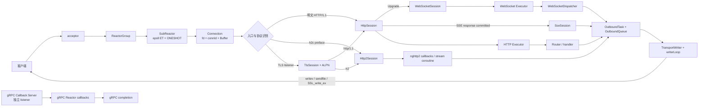

# 底层通信架构

本目录只回答一个问题：**字节怎样从客户端进入服务器，经过协议解析、调度和背压控制，再安全地写回网络。**
可以把这一层看成物流系统：Reactor 是分拣中心，Session 是某一种货物的处理规则，Codec 是拆箱/装箱器，
Executor 是后场工位，OutboundQueue 是待发货区，TransportWriter 是最后装车的人。

业务层不应直接操作 `epoll`、fd、TLS、HTTP 帧或 WebSocket 帧。它只接收已经解析好的请求，并返回业务结果。
业务架构见 [业务功能架构](../business/README.md)，跨层全景见 [总架构](../ARCHITECTURE.md)。

## 1. 阅读入口

| 内容 | 文档 |
|---|---|
| 当前通信架构、各协议逻辑和调用关系 | [协议与调用流程](protocol-call-flows.md) |
| 一次 HTTP 请求的逐步路径 | [request_flow.md](request_flow.md) |
| Reactor、协程、生命周期课程 | [phase3/README.md](phase3/README.md) |
| WebSocket 专题课程 | [websocket-lessons/README.md](websocket-lessons/README.md) |
| Phase 3：多 Reactor 与协程架构升级 | [phase3_architecture_upgrade.md](phase3_architecture_upgrade.md) |
| Phase 4：WebSocket 与跨 Reactor 出站 | [phase4_upgrade.md](phase4_upgrade.md) |
| Phase 4 中文讲义 | [第四阶段升级文档.md](第四阶段升级文档.md) |
| Phase 5：SSE | [phase5.md](phase5.md) |
| Phase 6：HTTP/2 与教学实现 | [phase6.md](phase6.md) |
| Phase 7：TLS 与 ALPN | [phase7.md](phase7.md) |
| Phase 8：gRPC 接入 | [phase8.md](phase8.md) |
| Phase 9：协议生产化护栏 | [phase9.md](phase9.md) |
| Phase 10：HTTP/gRPC 热路径优化 | [phase10.md](phase10.md) |

## 2. 通信层总图



## 3. 线程职责

| 所在线程 | 允许做的事 | 不允许做的事 |
|---|---|---|
| Acceptor | 接收连接、设置非阻塞、选择 SubReactor | 执行业务、解析完整请求 |
| SubReactor | `epoll`、Connection/Session 状态机、解析、出站冲刷 | 长时间阻塞、数据库查询、模型推理 |
| HTTP/WS Executor | Router/消息 handler、CPU 或短业务任务 | 直接修改 Reactor 的连接表 |
| 数据库执行器 | Repository 调用和事务 | 占住 Reactor |
| gRPC Callback | 接收完成事件、驱动异步状态机 | 在回调中同步等待慢操作 |
| 模型 Worker | ONNX/Ollama 生成 | 控制 socket 生命周期 |

## 4. 代码区域

```text
server/
├─ Reactor/ SubReactor/ CoroutineScheduler/  网络事件与协程恢复
├─ session/ Runtime/                         会话工厂与进程生命周期
├─ http/ http2/ websocket/ sse/ grpc/ tls/   各协议实现
├─ transport/                                统一出站任务、队列与写入器
├─ Executor/ Route/                          handler 执行和路由
├─ Buffer/ buffer_pool/ SegmentPool/         缓冲与对象复用
└─ security/ ops/ observability/              通信安全、指标与日志
```

历史阶段文档保留“当时为什么这样改”的学习价值；当前行为以
[协议与调用流程](protocol-call-flows.md) 和 [总架构](../ARCHITECTURE.md) 为准。
