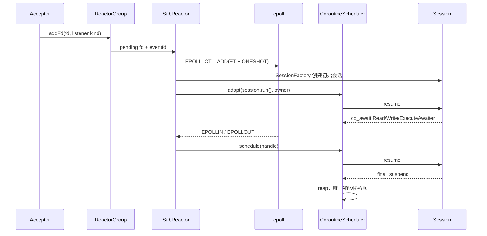
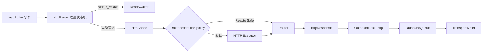
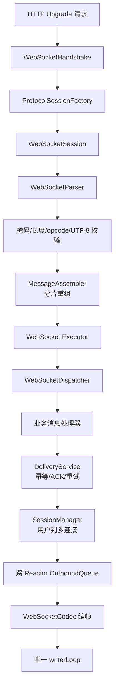
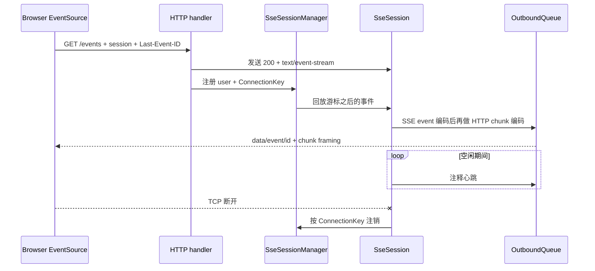
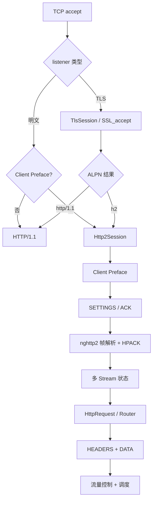
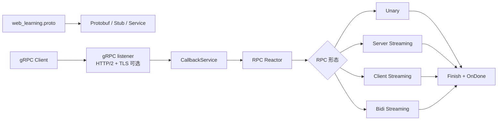
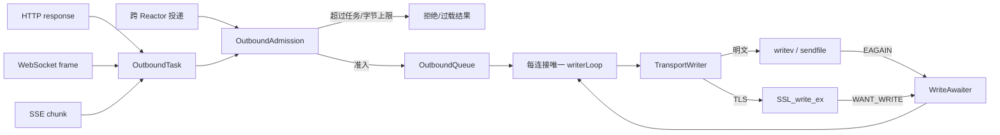

# 底层协议逻辑与调用关系

本文按当前代码说明每个通信功能。图中的“业务 handler”是通信层边界，具体账号、聊天和 AI 逻辑在
[业务调用流程](../business/business-call-flows.md) 中展开。

## 1. Reactor、Connection 与协程

关键点：

1. `fd` 像房间号，可能被系统复用；`ConnectionKey(fd, connId)` 才像“房间号 + 本次入住单号”。
2. 连接表只由所属 SubReactor 修改，跨线程任务必须通过邮箱和 `eventfd` 回到该线程。
3. 协程只是把状态机写得像顺序代码，不会把阻塞调用自动变成异步调用。
4. Reactor 关闭连接时请求协程协作退出，由 Scheduler 在 `final_suspend` 后统一销毁帧。

代码入口：[`ReactorGroup`](../../../server/Reactor/ReactorGroup.cpp)、
[`SubReactor`](../../../server/SubReactor/SubReactor.cpp)、
[`CoroutineScheduler`](../../../server/CoroutineScheduler/CoroutineScheduler.cpp)、
[`Connection`](../../../server/transport/Connection.h)。

## 2. HTTP/1.1

- 解析器保留请求行、Header、定长 Body、chunked Body 的中间状态，应对拆包和粘包。
- pipeline 的剩余字节留在 Buffer 中，下一轮先解析现有数据，再等待新的 `EPOLLIN`。
- Router 冻结后走只读查找；普通业务进入有界 Executor，避免慢 handler 卡住 Reactor。
- 队列满、业务异常和 deadline 分别收口为过载、500 和 504 类结果。

代码入口：[`HttpParser`](../../../server/http/HttpParser/HttpParser.cpp)、
[`HttpSession`](../../../server/http/HttpSession/HttpSession.cpp)、
[`HttpCodec`](../../../server/http/HttpCodec/HttpCodec.h)、
[`Router`](../../../server/Route/Router.cpp)。

## 3. WebSocket

- 握手只完成协议升级，之后 HTTP Session 退出，由 WebSocket Session 接管同一 Connection。
- 帧边界不是业务消息边界；Assembler 将 continuation 帧组合成一条完整消息。
- `ping/pong/close` 属于协议控制帧；`chat.send/chat.ack` 属于上层业务信封。
- 投递分为“邮箱接纳、写入内核、对端业务 ACK”三种不同完成程度。
- 接收方离线不等于业务发送失败：消息先持久化；实时推送只负责加速在线到达。

代码入口：[`WebSocketSession`](../../../server/websocket/WebSocketSession/WebSocketSession.cpp)、
[`WebSocketParser`](../../../server/websocket/WebSocketParser/WebSocketParser.cpp)、
[`WebSocketDispatcher`](../../../server/websocket/WebSocketDispatcher/WebSocketDispatcher.cpp)、
[`WebSocketDeliveryService`](../../../server/websocket/WebSocketDelivery/WebSocketDeliveryService.cpp)。

## 4. SSE

SSE 是一条长时间不结束的 HTTP 响应。SSE 格式负责事件语义，HTTP chunked 负责传输边界；二者不能混为一层。
`SseReplayBuffer` 保存有界历史，浏览器重连时用 `Last-Event-ID` 补发。SSE 适合通知与 AI token，客户端命令仍走
HTTP 或 WebSocket。

代码入口：[`SseCodec`](../../../server/sse/SseCodec.cpp)、
[`SseSession`](../../../server/sse/SseSession.cpp)、
[`SseSessionManager`](../../../server/sse/SseSessionManager.cpp)、
[`SseReplayBuffer`](../../../server/sse/SseReplayBuffer.cpp)。

## 5. HTTP/2、TLS 与 ALPN

- 明文端口使用 prior knowledge 前言识别；TLS 端口使用 ALPN 明确选择 `h2` 或 `http/1.1`。
- 生产路径把帧、HPACK、流状态和流量控制交给 nghttp2；`server/http2/learn` 是可逐步阅读的简化教学版。
- TLS 位于 HTTP 下面。`TlsTransport` 把 OpenSSL 的 `WANT_READ/WANT_WRITE` 映射回协程等待。
- HTTP/2 的 Stream 是一条连接里的逻辑请求，不等于线程；Stream 协程仍受连接级和流级窗口约束。

代码入口：[`Http2Codec`](../../../server/http2/Http2Codec.cpp)、
[`Http2StreamCoroutine`](../../../server/http2/Http2StreamCoroutine.h)、
[`TlsSession`](../../../server/tls/TlsSession.cpp)、
[`TlsTransport`](../../../server/tls/TlsTransport.cpp)。

## 6. gRPC

gRPC 使用 HTTP/2，但业务看到的是 Service/Method、Metadata、Deadline、Cancellation、Status 和 Streaming。
当前生产路径使用官方 gRPC C++ Callback API；`server/grpc/learn` 只演示 5 字节消息信封，不重复手写完整 HTTP/2。
Callback 对象的最终清理在 `OnDone`，避免异步 Alarm 或回调仍引用已经销毁的上下文。

代码入口：[`proto`](../../../server/grpc/proto/web_learning.proto)、
[`GrpcServer`](../../../server/grpc/GrpcServer.cpp)、
[`GrpcMain`](../../../server/grpc/GrpcMain.cpp)、
[`教学 Codec`](../../../server/grpc/learn/GrpcMessageCodec.cpp)。

## 7. 统一出站与背压

背压像仓库的限高门：它不是让卡车更快，而是在堆积失控之前停止继续收货。项目同时限制每连接任务数、
每连接字节、Reactor 邮箱任务/字节和单轮写预算。唯一 writerLoop 保证同一连接的字节顺序，
`OutboundReceipt` 只为需要追踪的任务记录终态。

代码入口：[`OutboundTask`](../../../server/transport/OutboundTask.h)、
[`OutboundAdmission`](../../../server/transport/OutboundAdmission.cpp)、
[`OutboundQueue`](../../../server/transport/OutboundQueue.cpp)、
[`TransportWriter`](../../../server/transport/TransportWriter.cpp)。
