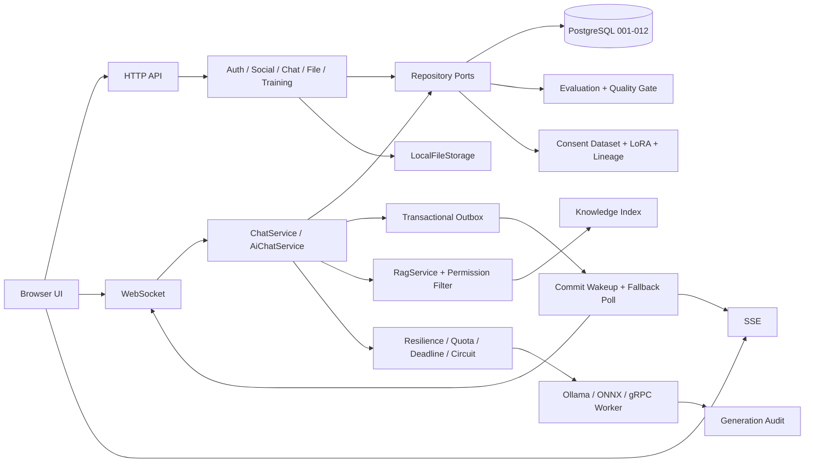

# Function2 与 Function1.0 对比

> 远程基线：`origin/Function1.0`，提交 `ef408bec852eccc7d35ff63ca4a9789ae951a20b`
>
> 当前版本：`Function2`
>
> 范围：Function1.0 的 Phase 11 应用平台，升级到 Function2 的 Phase 12–26；共 144 个文件变化，新增 24,364 行、删除 441 行。

## 1. 版本定位

Function1.0 完成了“应用能跑起来”的第一层闭环：用户可以注册登录、建立好友和会话，通过
WebSocket/SSE 收发持久消息，并调用 Ollama、进程内 ONNX 或独立 gRPC ONNX Worker。

Function2 继续解决“业务如何长期可靠运行、AI 如何受控演进、容量如何被证明”。可以把两个版本理解为：

- **Function1.0**：建成一座能营业的聊天与 AI 服务站；
- **Function2**：补上消息账本、群聊规则、文件仓库、模型考试与履历、运维值班和满载测试。

底层 HTTP/1.1、WebSocket、SSE、HTTP/2、TLS/ALPN、gRPC Callback、Multi-Reactor、协程、背压和
异步发送体系继续保留。Function2 的主要变化发生在业务一致性、资源治理、可观测性和模型生命周期。

## 2. 总体对比

| 维度 | Function1.0 | Function2 |
|---|---|---|
| 消息状态 | 持久化、幂等、ACK、历史和离线恢复 | 每用户未读、送达、已读、撤回和多设备同步 |
| 群聊 | 建群、成员与基础权限 | 群主/管理员、禁言、转让、退出、软解散和治理通知 |
| 联系人 | 双向好友与申请 | 备注、免打扰、删除好友、黑名单和最后活跃 |
| 实时在线 | 基础 WS/SSE 推送 | 同账号多设备 Presence，旧连接不会误删新连接 |
| 文件 | 文字消息 | 头像、图片/文件消息、分片上传、摘要、Range 与权限下载 |
| Outbox | 固定周期查询 | 提交后主动唤醒，保留低频兜底轮询和内部指标 |
| 运维 | 基础启动与测试脚本 | 迁移审计、备份恢复、日志轮转、磁盘门槛、长稳和用户态 Supervisor |
| AI 资源 | Provider、取消和基础 Worker | 分层配额、总期限、熔断、备用端点和停机强制收尾 |
| AI 审计 | 模型注册和切换 | 生成全生命周期、Prompt/输出摘要、版本与首 Token 审计 |
| 模型质量 | Adapter 校验和人工切换 | 版本化评测集、逐题结果、质量门禁、真实候选评测与人工发布 |
| RAG | 未形成完整知识链 | 私人/会话知识、权限检索、Prompt 注入和 Citation 持久化 |
| LoRA | 训练授权骨架 | 用户授权、脱敏、审核、内容寻址数据集、真实 PEFT/Olive 流水线 |
| 模型血缘 | 版本记录 | Dataset、基座、训练配置、PEFT、Adapter 和 ONNX 图不可变出生证明 |
| 性能证据 | `/fast` 与 Phase 11 功能测试 | 真实业务基线、Outbox A/B、长连接与 AI 混合容量矩阵 |
| 数据库 | 迁移 001 | 迁移 001–012 |

## 3. Function2 架构



网络 Reactor 继续只推进连接和协议。数据库、文件校验和模型生成进入各自有界执行器；AI 失败不会占住
Reactor，也不会阻断普通聊天。Repository 接口仍把业务与 PostgreSQL 细节隔开。

## 4. Phase 12–26 演进

| 阶段 | Function2 增量 | 主要结果 |
|---|---|---|
| Phase 12 | 消息生命周期 | 持久未读、送达/已读回执、撤回、多设备恢复 |
| Phase 13 | 群聊治理 | 群主/管理员、禁言、退出、转让、软解散和权限串行化 |
| Phase 14 | 联系人与在线状态 | 备注、免打扰、删除、黑名单、多设备 Presence |
| Phase 15 | 真实业务基线 | 登录、列表、私聊、群发、离线、WS/SSE 和混合负载三轮证据 |
| Phase 16 | 可观测性与运维 | Outbox 主动唤醒、内部指标、迁移审计、备份恢复和日志边界 |
| Phase 17 | 文件功能 | 头像、图片/文件、256 KiB 分片、SHA-256、Range 和下载权限 |
| Phase 18 | AI 韧性 | 并发配额、期限、熔断、备用端点、取消与停机回收 |
| Phase 19 | AI 审计 | 模型激活审计、生成状态、首 Token、输出摘要和 revision 防倒退 |
| Phase 20 | 模型质量门禁 | 评测集、题目、Run、逐题结果、加权策略和激活门禁 |
| Phase 21 | RAG | 权限先于检索、确定性切片、Retrieval/Citation 和网页引用查看 |
| Phase 22 | 授权 LoRA | 明确授权、脱敏审核、稳定 JSONL、真实梯度和 Adapter 转换 |
| Phase 23 | 候选发布 | 真实 ONNX 逐题评测、人工激活、失败保留旧 Active、长稳采集 |
| Phase 24 | 不可变血缘 | Dataset/基座/训练/PEFT/Adapter/图摘要与 Candidate 原子登记 |
| Phase 25 | 进程监督 | PID + start ticks、liveness、指数退避和重启预算 |
| Phase 26 | 容量矩阵 | 长驻 WS、每连接资源、AI 并发和 AI/聊天隔离测试工具 |

## 5. 消息和社交闭环

Function1.0 的 `messages + outbox_events` 保证消息先可靠入库，再进行实时发布。Function2 在此之上为
每位成员保存独立状态：

```text
chat.send
  ↓ 同一事务
messages + message_user_states + outbox_events
  ↓
chat.accepted
  ↓
在线设备收到 chat.message
  ↓
delivered / read / recalled
  ↓
离线或新设备按 conversation_seq 恢复
```

好友或群成员离线不会阻止发送。黑名单、群成员资格、禁言和解散状态由服务端业务层检查，前端隐藏按钮
不承担安全边界。群治理变化同样写 Outbox，让在线成员及时更新界面。

## 6. 文件消息

Function2 增加独立文件存储端口。数据库保存所有者、会话、MIME、大小、SHA-256 和状态，正文保存在
数据目录：

```text
创建上传 → 有界分片 → offset 校验 → SHA-256/魔数核验
        → 同文件系统原子封存 → 作为消息附件发送
        → 会话成员鉴权 → 整文件或 HTTP Range 下载
```

附件发送仍进入普通消息和 Outbox，因此接收者离线时也能发送，稍后通过历史记录恢复。

## 7. AI 与模型治理

### 7.1 在线生成

Function2 在 Provider 外增加统一韧性层：全局、用户和 AI 账号三级并发预算；业务总期限；取消与停机
回收；连续失败熔断；主端点尚未输出 Token 时才能切换同 Runtime 备用端点。每次生成保存请求者、
模型版本、Adapter、Prompt/输出摘要、首 Token 和终态。

### 7.2 RAG

RAG 先计算用户在当前会话可访问的资料集合，再检索和排名。私人资料只能进入本人和 AI 的私聊；群共享
资料只允许当前群成员使用。实际使用的片段随生成记录为 Citation，查看历史消息不会重新检索出另一份
证据。

### 7.3 LoRA 到候选发布

```text
用户明确授权
  → 脱敏副本
  → 人工审核/去重
  → 内容寻址 JSONL Dataset
  → 固定基座 revision 的 PEFT LoRA
  → Olive/OGA Adapter 转换
  → C++ Runtime 试装
  → Candidate + 不可变 Lineage 原子登记
  → 固定 Suite 真实生成与评分
  → 质量门禁
  → 管理员显式激活或回滚
```

流水线已经用合成样本证明可以完成真实梯度、转换和 C++ 加载；没有真实用户授权数据时，不宣称模型
质量已经提高。

## 8. PostgreSQL 迁移变化

Function1.0 只有 `001_phase11.sql`。Function2 保持追加迁移，不回写历史：

| Migration | 内容 |
|---|---|
| 002 | 消息未读、送达、已读与撤回 |
| 003 | 群主、管理员、禁言和群状态 |
| 004 | 联系人设置、黑名单与 Presence |
| 005 | 文件对象、上传与消息附件 |
| 006 | 模型激活审计与 AI 生成追踪 |
| 007 | 模型评测集、Run、Result 和策略 |
| 008 | 评测集版本约束 |
| 009 | RAG 文档、切片、检索和引用 |
| 010 | 训练 Dataset 制品 |
| 011 | 训练候选并发去重 |
| 012 | 模型训练血缘 |

业务层只依赖 Repository Port；内存实现和 PostgreSQL 实现继续复用同一套契约测试。

## 9. 性能与运维变化

Function2 不再用一个 `/fast` QPS 代表整个聊天系统：

- Phase 15 通过真实 HTTP、WS、SSE、PostgreSQL 和 Outbox 测量八类业务；
- Phase 16 用相同二进制完成固定轮询与提交后主动唤醒 A/B；
- `/metrics` 增加执行器、连接池、Outbox、实时会话和 AI 直方图；
- 迁移工具记录已应用版本，备份保存 SHA-256 并完成隔离恢复演练；
- Service 脚本增加磁盘预算、日志轮转、PID + start ticks 和 readiness；
- Supervisor 增加 liveness、指数退避和时间窗重启预算；
- Phase 26 工具准备测量 50 → 200 → 500 长驻 WS、真实 AI 并发与普通聊天隔离。

Phase 26 只在当前 24 小时长稳结束后运行，避免测试重启破坏固定 PID 证据。

## 10. 前端变化

Function2 在原有聊天工作台上增加：

- 未读徽标、送达/已读状态、消息撤回和历史恢复；
- 群角色、成员治理、禁言和解散状态；
- 联系人备注、免打扰、黑名单和多设备在线状态；
- 头像、图片/文件上传、下载与失败恢复；
- RAG 知识资料管理与 AI Citation 查看；
- 训练授权前的脱敏预览和明确同意；
- AI 配额、取消、模型故障和流式状态提示。

前端继续通过业务 HTTP API、WebSocket 和 SSE 与后端互通，不直接访问数据库或文件目录。

## 11. 验证证据

| 阶段证据 | 结果 |
|---|---|
| Phase 12–14 | Release、Debug、ASan/LSan/UBSan 均为 93/93 |
| Phase 15 | 三轮真实业务基线总错误 0，原始 JSON 已入文档证据目录 |
| Phase 16 | 主动唤醒 A/B、迁移审计、备份摘要和隔离恢复通过 |
| Phase 17 | 三套 94/94；真实网络上传、Range、权限与离线历史通过 |
| Phase 18–20 | 三套 95/95；AI 竞态、审计、评测和激活门禁通过 |
| Phase 21 | 三套 96/96；RAG 权限矩阵、持久化和引用链通过 |
| Phase 22–23 | 三套 97/97；LoRA/Adapter 与候选正反向发布通过 |
| Phase 24 | 血缘原子写入、摘要约束、CLI 查询与篡改反向通过 |
| Phase 25 | 隔离 SIGKILL 恢复连续三轮、重启预算反向通过 |
| Phase 26 | Windows/Linux 编排 4/4、Linux CTest 1/1、保护闸门通过 |

这些数字是各阶段提交时的证据，不能把较早阶段的全量回归冒充最新提交的最终全量结论。最新版本仍需
在 24 小时长稳结束后执行完整 Release、Debug、Sanitizer、正式进程恢复和 Phase 26 三轮容量矩阵。

## 12. 迁移与运行注意事项

从 Function1.0 升级到 Function2 时：

1. 先对 PostgreSQL 和文件数据目录做备份并保存摘要；
2. 使用项目迁移脚本按顺序应用 002–012，不手工跳版本；
3. 配置文件根目录、Token Key、模型根目录和数据库连接，密钥与模型不提交 Git；
4. 重新构建 Function2，再运行 Repository 契约和网络黑盒；
5. 模型 Candidate 必须经过质量门禁和 Runtime 试装，由管理员显式激活；
6. 启用 Supervisor 前先完成正式进程恢复演练；
7. 依据 Phase 26 在目标硬件上的结果设定连接数、AI 并发和告警阈值。

构建与测试不会偷偷下载依赖。PostgreSQL、libsodium、libcurl、ONNX Runtime/GenAI 等仍使用用户已批准
的 Linux 安装位置。

## 13. 当前边界

Function2 的代码功能主体已经实现，但提交时以下证据仍在收尾：

- 24 小时固定 PID 长稳最终汇总；
- 正式 Webserver `SIGKILL → Supervisor 恢复 → readiness → 登录/消息恢复`；
- Phase 26 三轮长连接和真实 AI 容量矩阵；
- 迁移 012 的正式库应用与最新三套完整回归；
- 使用真实授权 Dataset 的模型质量对比和人工发布决定。

因此 Function2 适合继续学习、单机集成和预生产验证；在这些证据完成前，不把它描述为已经获得任意
公网生产负载下的容量保证。

## 14. 文档入口

1. [Phase 11 总体架构](business/phase11.md)
2. [Phase 12：消息生命周期](business/phase12.md)
3. [Phase 13：群聊治理](business/phase13.md)
4. [Phase 14：联系人与多设备 Presence](business/phase14.md)
5. [Phase 15/16：真实性能与可观测性](business/phase15.md)
6. [Phase 17：文件消息](business/phase17.md)
7. [Phase 18–24：AI、RAG、评测、训练与血缘](business/phase18.md)
8. [Phase 25：用户态 Supervisor](business/phase25.md)
9. [Phase 26：长连接与 AI 容量矩阵](business/phase26.md)
10. [数据库表结构](../database/README.md)
