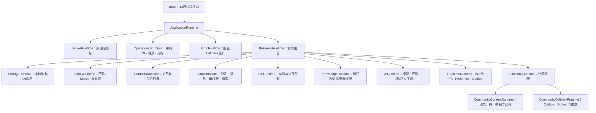

# 当前系统架构总览

本轮语音更新：[免绑卡方案](../../ops/runtime/free-speech.md)复用现有C++ Kokoro，并以独立BrowserSpeech封装设备中文朗读；停用代理已移除。设备模式只在浏览器内运行，全站公告仍由原Worker合成；通信核心、数据库和三端分工不变。

核对日期：2026-11-05。当前源码为Phase49加语音/神树交互修复与Azure目录补充；日常程序cb18d796、最新免Key语音页面9f3342acc65db2d7已更新，无关并发源码另行记账，不表示完成Phase50。原库结构未升级。

当前判断：**功能与结构已有阶段验证，严格性能门槛未通过**。第三轮ACK P99 8.710→15.545ms（+78.47%），不能以/fast的QPS代替真实聊天表现。[验收原文](../business/engineering/phase49.md)和[原始证据](../../../artifacts/function3/phase49/README.md)保持不变。

阅读入口：[完整端到端图](../business/flows/current-end-to-end.md) · [下一阶段建议](../../roadmap/next-steps.md) · [代码索引](../business/indexes/phase49-code-index.md) · [通信详细基线](../communication/runtime-baseline.md)。

2026-11-05：[语音/神树修复](../../ops/runtime/speech-settings-and-playback.md)已验证并获准恢复18090，详见[历史验收摘要](../../ops/validation/function3.1.md#历史补丁)；后续[可选Azure目录与免Key语音](../../ops/runtime/free-speech.md)直接查询官方区域接口，不增加服务器组件。[工程测量计划](../../roadmap/engineering-credibility.md)落实首批离线工具防护。校准脚本不属于线上请求链路，逐消息追踪尚未实现；三端职责与通信核心不变。

页面输入与呈现分开：[TreePageNavigation/TreePageTransition](../../ops/runtime/speech-and-scroll-polish.md)分别处理边界手势与动画/阅读位置，不改变业务接口或3D模型。语音设置保持统一请求入口，切换选择后清理旧播放器，连接试听显式触发，不自动重复调用云API。

## 1. 三端职责与实际运行位置

|位置|代码区域|当前职责|明确边界|
|---|---|---|---|
|Linux共享服务器|`backend/server`|连接、协议、TLS、Reactor、协程、发送与背压|通信核心152份文件继续冻结|
|Linux共享业务|`backend/application`|账号、社交聊天、文件、动态/神树、管理、数据库、事件投递|权限与共享状态的权威判断留在服务器|
|Linux AI核心与任务|`backend/ai`|Provider、模型注册、RAG、评测、私人限时推理、语音及训练/转换任务|默认复用独立ONNX Worker；教学进程内与外部API为可选路径|
|Windows用户电脑|`client/companion`、`client/assistant`、`client/storage`|本机入口、固定目标代理、私人历史/记忆/词法检索、确认操作、凭据保护|当前不代表Windows已部署本地大模型；授权片段仍可能发到Linux推理|
|用户浏览器|`frontend/phase11`|页面、交互、请求、实时状态、神树渲染和音频播放|也可直接访问Linux；私人本机功能需要本机入口|

通信核心、共享业务和AI核心的代码边界不等于三个微服务。当前主要是模块化单体，ONNX推理、TTS、显式训练/转换任务具有独立进程边界；不因移动目录就获得性能提升。

## 2. 装配根与资源所有权



`unique_ptr`仍用于明确独占所有权；改进是main不再亲自管理37个跨领域资源。各Runtime拥有本领域组件，其他领域通过明确接口借用。装配层可看到具体驱动；领域服务不能反向依赖装配入口。

旧 Store、聚合头和少数旧方法保留兼容。社区内容与投递分别拥有自己的执行资源，继续共用事务；投递用回调连接语音与实时会话，详见[模块边界](../business/engineering/community-runtime-modules.md)。KnowledgeRuntime 组合已有知识与训练服务，两者的规则仍各自维护。

## 3. 线程、异步和关闭顺序

|执行边界|负责|不应承担|
|---|---|---|
|Acceptor / Reactor|接收、连接身份、协议状态、协程恢复、网络读写|阻塞SQL、模型加载、媒体解码|
|HTTP / WS执行器|协议对象到业务用例、短任务与异步完成衔接|无界等待和绕过连接身份检查|
|有界DB执行器|事务、Repository与SQL；同一事务留在同一个任务/连接|为消息和Outbox分别借连接后独立提交|
|文件 / 知识等任务池|上传校验、文件处理、切片/检索等相应工作|阻塞网络Reactor|
|推理 / 语音 / 训练Worker|重计算与可取消任务|把普通聊天绑定到模型成功与否|
|浏览器 / Windows客户端|渲染、用户输入、本机检索与代理|擅自决定共享业务权限|

停止顺序为：网络任务排空 → RPC停止 → Presence回调解除 → 私人生成取消 → AI任务停止 → 文件/知识/DB任务排空 → Outbox与社区后台停止 → 反向销毁资源。重复stop安全；部分构造、TLS和监听失败的清理已有三种构建各4项验证。

HTTP/2的每Stream业务协程用于表达等待完成与恢复，不意味着SQL或模型代码自动变成非阻塞I/O。fd可复用，HTTP/2 Stream可重置，异步完成必须继续核验当前连接/Stream身份。

## 4. 前端、接口与业务分层

```text
页面 / 控制器
  → 同领域XxxApi绑定
  → BusinessApi（方法、路径、CSRF、取消、错误）
  → HTTP / WS业务适配器
  → Query / Command + 认证得到的可信actor
  → Application Service（权限、状态、事务、幂等）
  → Repository / Provider Port
  → PostgreSQL / 内存 / 文件 / 模型等驱动
  → 公开投影 / HTTP结果 / WS状态 / SSE通知
```

当前[HTTP路由目录](../../contracts/business-routes.json)包含120项方法/路径，分属18个逻辑领域，其中3项是健康接口。它不是120个业务功能，也不是所有字段的完整Schema；Windows本地接口和外部模型API有独立边界。字段、错误、权限、事件顺序和分页仍靠契约与真实用例测试约束。

账号、联系人、聊天、文件服务及相应前端控制器按领域组织；共享导航、请求层、上传和助手栏继续复用。对应的是用例与协议合同，不强制一个按钮、一个源文件、一个数据库表一一对应。

## 5. 数据权威与一次聊天写入

Linux复用原业务PostgreSQL；当前启动要求迁移024。Windows只维护账号隔离的私人SQLite，不创建另一份公共聊天库。连接池、领域DAO、Query/Command与公开投影见[数据库分层规范](../../database/domain-layering.md)。

消息与对应事件同事务提交，成功后才形成持久化ACK；对方离线不影响接受合法消息。ACK路径和Outbox通知路径独立，ACK不是已送达或已读，也不承诺两支网络到达顺序。

- 聊天端口保留`outbox_events`；Function3事件链使用`function3_outbox`、`function3_inbox`等表，聊天桥接由适配器处理。
- 按配置使用本地持久投递或RocketMQ；MQ消费确认不替代聊天ACK、已读和历史恢复。
- 发布失败与确认丢失允许重试，以稳定消息/事件身份和Inbox去重；不宣称整个系统exactly-once。
- 数据库保留必要状态与审计，公开读取仍过滤撤回/隐藏和无权限内容；前端隐藏按钮不是权限检查。

## 6. AI、私人资料与训练流

|链路|当前做法|限制|
|---|---|---|
|共享私聊 / 群AI|复用会话、权限、消息历史和模型路由；明确触发群参与|群AI不读取成员私人资料|
|好友式私人助手 / 全局侧栏|Windows中独立历史，共享本账号RAG、记忆与授权；独立私人推理契约|本机RAG当前是词法检索，非语义向量检索|
|网页助手|先明确非保密上传；通过相应网页推理契约使用模型|不能冒充Windows私人模式|
|模型执行|Ollama API、进程内ONNX、独立gRPC ONNX Worker三种Provider|源码/替身存在不等于每个环境均配置或真实云调用已通过|
|模型更新|授权候选→脱敏审核→数据集版本→显式训练/转换→制品/血缘→评测→人工激活或回滚|无自动训练发布全部子模型；教学制品验证不等于质量提高|
|公告语音|独立TTS、缓存、试听和可选云适配/回退|真实Key、主观音色与自然度需单独验收|

DPAPI保护凭据，私人正文保存于受本机访问权限保护的SQLite，未宣称整库加密。授权资料片段可能上传；私人推理不写服务器聊天/训练正文，但存在限时任务状态和必要运行元数据。旧服务器私人历史的迁移/清理需要用户确认。

共享AI会话可使用SSE推token；网页/私人生成还存在轮询或客户端适配，不能把所有AI响应都叫同一种SSE链路。浏览器也不是直接调用原生gRPC Worker。

## 7. 协议能力与验证状态

|协议/能力|当前范围|
|---|---|
|HTTP/1.1|请求/响应、静态资源、业务API及相应有界执行|
|WebSocket|帧/消息状态、业务命令、真实ACK和推送；应用恢复/幂等由业务协议完成|
|SSE|HTTP/1.1单向长响应；业务通知与部分AI流，仍需对应事件恢复契约|
|HTTP/2|nghttp2集成、Stream业务协程、HPACK/帧/流控及独立教学实现；不是手写教学版承载工程入口|
|HTTP/2限制|当前不支持在其上直接搬用SSE长流、RFC8441 WS或原HTTP/1.1大文件sendfile/chunked路径，相应受限路径返回501|
|TLS / ALPN|独立TLS入口及h2/http/1.1协商；学习证书信任按已确认边界配置|
|官方gRPC API|独立监听与Callback API，使用其自身运行时；不是放进现有HTTP Router的一条普通路由|
|AI gRPC Worker|独立推理服务，是另一条Provider通信路径，与通用gRPC示例监听区分|

这些是源码与已有阶段证据的范围，不是通用生产认证。`/health/live`表示进程存活，当前业务ready主要检查存储健康；通信最小模式也可能返回ready，应同时核对功能开关与版本信息的`schemaVerifiedAtStartup`。不能仅凭健康200推断完整业务、外部模型、MQ或云语音都已就绪。

语音补充：[设置与播放说明](../../ops/runtime/speech-settings-and-playback.md)。网页个人 Key 仅在当前页面内存，直接访问固定官方语音 API；Windows 继续 DPAPI。站点管理员通过 HTTPS 更新 Linux 私有 Key 文件，音色仍在原库，不新增数据库。短语音改用有界 PCM WAV 内存响应，兼容既有 HTTP/1 与 HTTP/2 输出。

## 8. 还缺什么与后续重点

最优先是[Phase50建议](../../roadmap/next-steps.md)：给同一条消息关联DB任务、SQL、COMMIT、ACK形成和客户端往返；没有现成写完成观察点就明确缺测，不解除冻结伪造完整追踪。

当前没有完整逐消息COMMIT到socket发送因果链，严格性能失败保留；后续再做多用户稳定性、接口字段契约、AI质量与取消回收、受控试运行。微服务与集群暂缓，继续采用当前模块化单体加独立重任务Worker的方向。

## 9. 源码与讲义入口

- [ApplicationRuntime](../../../backend/application/bootstrap/ApplicationRuntime/ApplicationRuntime.cpp)、[BusinessRuntime](../../../backend/application/bootstrap/BusinessRuntime/BusinessRuntime.cpp)：装配与停止。
- [RealtimeRuntime](../../../backend/application/bootstrap/RealtimeRuntime/RealtimeRuntime.cpp)、[ChatService](../../../backend/application/modules/chat/application/ChatService/ChatService.cpp)：消息、事务与投递衔接。
- [AI装配](../../../backend/ai/bootstrap/AiRuntime/AiRuntime.cpp)、[私人任务](../../../backend/ai/private/application/PrivateGenerationService/PrivateGenerationService.cpp)：Provider、取消和历史边界。
- [接口教学](../business/guides/phase49-teaching.md)、[代码索引](../business/indexes/phase49-code-index.md)、[协议专题](../communication/README.md)、[目录边界](project-layout.md)。
- [历史通信详细讲义](../communication/runtime-baseline.md)保留原线程/协程与协议说明，其中早期参数和001–012等阶段标记不作为当前数据模型依据。
