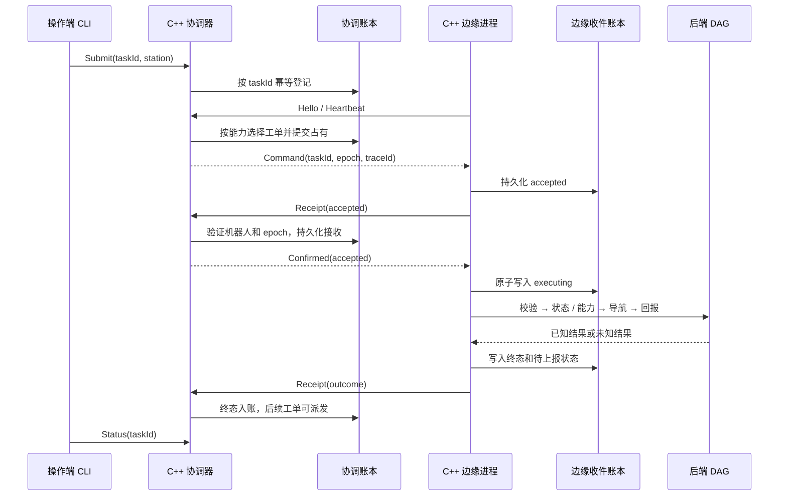

# C++ DAG 与车队系统架构

同一个 NEBULA 仓库提供 Web 业务构建和独立 C++ 系统构建。车队通过独立 gRPC 进程运行，使用自己的 SQLite 账本和端口。机器人边缘程序运行 C++ DAG，并可选择模拟导航或 ROS 2 Nav2 仿真适配。现有浏览器小研继续使用原来的本地上下文流程。通用工单由 C++ 后端执行器编排。

## 模块与依赖

| 区域 | 职责 | 可定位的实现 |
|---|---|---|
| 构建入口 | Standalone 构建与总工程集成，独立选择 gRPC、Nav2 及 ACK 基准 | [backend/systems](../../../backend/systems/CMakeLists.txt) |
| 通用 DAG | 图校验、确定的拓扑顺序、并发预算、重试、取消和超时；可选检查点恢复 | [WorkflowGraph](../../../backend/workflow/WorkflowGraph/WorkflowGraph.cpp) · [DagExecutor](../../../backend/workflow/DagExecutor/DagExecutor.cpp) · [DurableWorkflow](../../../backend/workflow/DurableWorkflow/DurableWorkflow.cpp) · [SQLite 实现](../../../backend/systems/SqliteWorkflowJournal/SqliteWorkflowJournal.cpp) |
| 共享工作队列 | 已注册图按节点领取，数据库时钟计算租约，按运行、节点、代次和领取人核对提交 | [PostgreSQL 工作队列](../../../backend/systems/PostgresWorkflowQueue/PostgresWorkflowQueue.cpp) · [双进程夹具](../../../tests/cpp_systems/workflow_pg.py) |
| 车队应用 | 工单分配、连接代号、心跳和状态查询；边缘按技能合同执行五节点图 | [FleetCoordinator](../../../backend/fleet/application/FleetCoordinator/FleetCoordinator.cpp) · [TaskWorkflow](../../../backend/fleet/application/TaskWorkflow/TaskWorkflow.cpp) · [EdgeWorker](../../../backend/fleet/application/EdgeWorker/EdgeWorker.cpp) |
| 持久化 | 协调器握有任务账本；每个边缘视实例拥有独立收件账本 | [FleetLedger Port](../../../backend/fleet/ports/FleetLedger/FleetLedger.h) · [协调器 SQLite](../../../backend/fleet/infrastructure/SqliteFleetLedger/SqliteFleetLedger.cpp) · [边缘 SQLite](../../../backend/fleet/infrastructure/SqliteEdgeLedger/SqliteEdgeLedger.cpp) |
| 传输 | Protobuf 生成代码、gRPC 控制流与有界状态流、身份与能力授予、进程装配 | [v1 协议](../../../backend/fleet/transport/grpc/proto/fleet.proto) · [gRPC 服务](../../../backend/fleet/transport/grpc/FleetService/FleetService.cpp) · [边缘连接](../../../backend/fleet/transport/grpc/EdgeSession/EdgeSession.cpp) |
| 导航适配 | 模拟器与 Nav2 实现同一个技能端口。ROS 本体管理 lifecycle、时钟、地图 TF 与导航许可 | [NavigationSkill](../../../backend/fleet/ports/NavigationSkill/NavigationSkill.h) · [本体生命周期](../../../robotics/nav2_gateway/BodyLifecycle/BodyLifecycle.cpp) · [Nav2 适配](../../../robotics/nav2_gateway/Nav2Navigation/Nav2Navigation.cpp) |
| 模拟执行器 | 本体许可、Nav2 目标和驱动反馈通过有界通道交给固定周期，私有仿真话题把有效期交给软件驱动 | [控制状态机](../../../robotics/actuator_control/ControlLoop/ControlLoop.h) · [ROS 装配](../../../robotics/actuator_ros_sim/ActuatorNode/ActuatorNode.cpp) · [计时与故障实验](../../ops/validation/m09-actuator-control.md) |
| 母 Agent | 三项只读工具通过回环 gRPC 取证，C++ 复核规则或 Ollama 候选。SQLite 保存有界工单上下文和审批交接检查点，由人工审批后交给现有边缘 | [Agent 编排](../../../backend/agent/application/FleetAgent/FleetAgent.cpp) · [审批事务](../../../backend/fleet/infrastructure/SqliteFleetLedger/SimulationReviewSql.cpp) · [实操](../../learning/v04-fleet-agent-dag.md) |
| 诊断 | DAG 与 Agent 事件按 Observer 契约编码、导入并查询；录制回放只上报摘要 | [C++ 事件编码](../../../backend/workflow/ObserverEvents/ObserverEvents.cpp) · [上传工具](../../../scripts/project/fleet_observer.py) · [本地回放](../../../tools/agent/episode_recording.py) |

领域层和 Port 只依赖 C++ 标准库。应用层依赖领域、Port 与 Workflow。gRPC、SQLite、ROS 各在适配器一侧。顶层 Web 入口的测试会检查通信核心文件摘要，源码门禁同时校验新模块的 include 方向。 [分层规则](../../../scripts/project/check_boundaries.py)

## 工单从提交到结果

- **应用接收回执**。边缘先入账再报告接受。协调器持久化接受并回送确认后，边缘才能启动导航。回执重复提交会返回同一逻辑结果。一个 `taskId` 使用相同站点重试时保留 `traceId` 与 `epoch`，站点变更返回冲突。
- **租约与连接**。数据库行的 `epoch` 是工单占有代号，连接代号由进程分配。心跳失效后，状态会提示待对账，原占有仍保留。掉线的旧连接和错误代号均无法推进任务。一次活动占有只挂一个机器人。
- **结果不明**。边缘崩溃时若账本只确认了 `executing`，启动恢复会报 `uncertain` 并锁住该边缘的后续工单，等待现场核对。v1 的接口提供保留和读取这类证据，人工解除占有需要后续受控恢复流程。
- **两种时钟**。执行和心跳期限依据单调钟。Observer 的事件时间使用系统墙钟，跨主机需要另外验证时钟质量。当前 gRPC 入口使用回环地址、每机器人凭据和操作端凭据，端点配置范围用于本机实验。

## 执行容量与线程边界

DAG 把工作节点交给线程池，状态只由调度线程修改。一台执行器最多同时执行一张图，单图最多 128 节点、1,024 条依赖和 16 个 worker。安全重试沿用逻辑键，外部副作用节点最多尝试一次。节点超时后的迟到结果继续占用 worker 到调用返回，无法推动下游。工作函数需要协作响应停止，隔离无法停止的外部进程属于上层边界。

边缘 gRPC 线程负责交换读写和持久回执，独立 Worker 管理技能执行。每机器人一个活动连接，接收应用帧限制为 2 KiB。协调器排队上限 256，账本达到 50,000 项后显式拒绝新任务。独立私有 SQLite 文件使用完整同步、单拥有者锁和主键约束。业务数据库结构与账号数据按现有部署管理。

Observer 事件只含受限 ID、状态、时长和错误码。边缘先提交执行结果，然后把该次图执行的事件批量写入可选 JSONL 文件。文件达到 8 MiB 后停止追加。调试查询通过专属生产者凭据导入现有 Observer，模拟来源使用模拟数据标记。

共享队列使用独立 schema。任一 Worker 只在短事务中领取，再于事务外执行节点。租约过期后，只读或幂等节点可由第二个 Worker 接管，外部动作进入待对账状态。当前验证包含同机双进程、真实 PostgreSQL 和 Observer，长任务续租与跨机压测留待后续验收。 [事件状态](../../contracts/dag-states.json) · [租约与复现](../../ops/validation/v04-fleet-reproduction.md)

M08 联调由 CentOS 运行协调器，Ubuntu_ros 运行两个带独立命名空间的 Nav2 边缘。本体使用已通过校验的 gRPC 回复续期本地单调时钟租约。租约、仿真时间、TF 或 Action 失去准备度时撤销导航许可，已发目标按 UUID 取消。恢复后沿原工单占有代号对账。DDS 留在 Ubuntu_ros 本机，gRPC 经过回环 SSH 转发。 [M08 两台虚拟机端到端](../../ops/validation/m08-ros-cross-vm.md)

M09 的三路输入是任务许可、Nav2 速度和模拟驱动反馈。ROS 回调只负责交接，C++ 周期线程在本地计算期望速度和最早到期时刻，再由 ROS 回调传给仿真驱动进程。驱动侧独立按期归零，故障复位后需要新任务许可。线程调度的实测长尾记录在验收报告。 [M09 实操](../../learning/m09-actuator-control.md)

[运行、测量与验收](../../ops/validation/cpp-systems.md) · [M00–M07 软件交付与复验](../../ops/validation/m00-m07.md) · [阶段路线](../../roadmap/embodied-systems/README.md)
