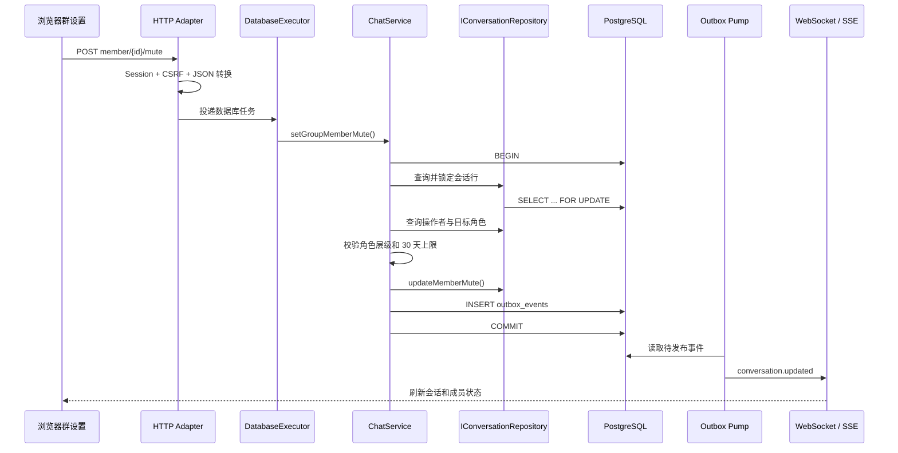

# Phase 13：群聊治理与权限闭环

> 当前分支：本地 `phase13`，基线为 Phase 12 的 `ecec6d2`。本阶段尚未推送远程仓库。

## 1. 本阶段解决什么问题

Phase 12 已经让消息的未读、送达、已读和撤回成为数据库事实，但群聊仍只有“创建者邀请成员”这一条规则。
Phase 13 把群聊从一个普通房间升级成有明确治理边界的协作空间：

1. 正式区分群主、管理员、普通成员。
2. 群主可以任命或取消管理员。
3. 群主和管理员可以邀请成员、修改群名与公告。
4. 群主可以管理所有非群主成员；管理员只能管理普通成员。
5. 群主和管理员可以禁言；最长 30 天，也可以提前解除。
6. 普通成员和管理员可以主动退出；群主必须先解散群聊。
7. 只有群主可以解散；解散采用软删除，历史审计数据仍保留。
8. 管理员可以在两分钟窗口内撤回普通成员消息，但不能越权撤回群主或其他管理员消息。
9. 所有治理变化都通过 Outbox，在 WebSocket 与 SSE 上通知在线成员。

可以把三种身份理解成一家公司：群主像法人，管理员像部门经理，普通成员像员工。经理可以管理普通员工，
却不能把法人开除，也不能任命另一位经理；只有法人能调整管理层或注销公司。

## 2. 权限矩阵

| 操作 | 群主 | 管理员 | 普通成员 |
|---|---:|---:|---:|
| 发送消息 | 是 | 是 | 是，未被禁言时 |
| 邀请成员 | 是 | 是 | 否 |
| 修改群名、群公告 | 是 | 是 | 否 |
| 任命、取消管理员 | 是 | 否 | 否 |
| 禁言普通成员 | 是 | 是 | 否 |
| 禁言管理员 | 是 | 否 | 否 |
| 移除普通成员 | 是 | 是 | 否 |
| 移除管理员 | 是 | 否 | 否 |
| 撤回普通成员消息 | 是 | 是 | 否 |
| 撤回群主或管理员消息 | 群主可撤回非本人消息 | 否 | 否 |
| 主动退出 | 群主不可直接退出 | 是 | 是 |
| 解散群聊 | 是 | 否 | 否 |

前端会根据角色隐藏无权按钮，但这只用于改善体验。真正的权限边界位于 `ChatService`：即使有人手工构造 HTTP
请求，业务层仍会拒绝越权操作。

## 3. 完整纵向流程



核心原则仍是“协议只翻译，业务层做决定，仓库层保存事实”。HTTP 不知道谁能禁言谁；PostgreSQL 也不承载整套
角色判断。这样 WebSocket、移动端或未来 gRPC 管理接口都能复用相同规则。

## 4. 领域模型与数据库迁移

### 4.1 三种成员角色

```cpp
enum class MemberRole {
    Member,
    Administrator,
    Owner
};
```

`administrator` 进入 `conversation_members.role` 约束。角色不是浏览器临时标签，而是持久权限事实。

### 4.2 群聊状态与软解散

```cpp
enum class ConversationState { Active, Dissolved };
```

`Conversation` 新增 `announcement`、`state`、`dissolvedBy`、`dissolvedAt`。解散后：

- 会话不再出现在活动会话列表；
- Repository 拒绝继续分配消息序号；
- 成员、消息与解散人/时间仍保留，便于审计和以后设计归档页；
- 只有群聊允许进入 `dissolved`，私聊不能伪装成已解散群。

物理删除像把档案室一起烧掉；软解散像给档案盖“终止”章。当前聊天系统需要后一种语义。

### 4.3 成员禁言

`conversation_members.muted_until` 保存禁言截止时间。空值表示未禁言；发送时由业务层比较服务器时间，
不能相信浏览器自己说“禁言已结束”。当前单次设置范围为 1 秒到 30 天，传入 0 表示解除。

第 3 号迁移位于
[003_group_governance.sql](../../server/phase11/storage/postgres/migrations/003_group_governance.sql)，包含字段、
外键、状态形状和长度约束。

## 5. Repository 与业务层

`IConversationRepository` 新增五类原子存储操作：

```text
updateConversationProfile  修改群名与公告
dissolveConversation       写入软解散状态和审计字段
updateMemberRole           修改管理员角色
updateMemberMute           设置或清除禁言截止时间
removeMember               删除活动成员关系
```

内存实现和 PostgreSQL 实现通过同一份 `RepositoryContract`。内存仓库像沙盘，便于快速验证规则；
PostgreSQL 仓库像真实仓库，必须保证 SQL 映射、时间字段和过滤条件具有相同语义。

`ChatService` 对外提供：

- `updateGroupProfile`
- `setGroupMemberRole`
- `setGroupMemberMute`
- `removeGroupMember`
- `leaveGroup`
- `dissolveGroup`

每个会改变状态的用例都在同一事务内写业务数据与 Outbox。被移除或退出的人已经不在成员表中，因此 Outbox payload
仍携带该用户 ID，实时层会把这位用户补回最后一次通知的收件人集合。

PostgreSQL 实现还会在事务内使用 `SELECT ... FOR UPDATE` 锁住当前会话行。它像群设置室门口的一把钥匙：同一群聊的
授权检查、成员变更、解散和发消息会按顺序确认状态，避免两个并发请求都拿着过期的成员身份同时通过；不同群聊仍可并行。

## 6. HTTP 接口

| 方法与路径 | 请求体 | 权限 |
|---|---|---|
| `POST /api/conversations/{id}/members` | `memberId` | 群主、管理员 |
| `PATCH /api/conversations/{id}` | `title`、`announcement` | 群主、管理员 |
| `POST /api/conversations/{id}/members/{memberId}/role` | `role=member/administrator` | 群主 |
| `POST /api/conversations/{id}/members/{memberId}/mute` | `seconds=0..2592000` | 群主、管理员，受层级限制 |
| `POST /api/conversations/{id}/members/{memberId}/remove` | 空对象 | 群主、管理员，受层级限制 |
| `POST /api/conversations/{id}/leave` | 空对象 | 管理员、普通成员 |
| `POST /api/conversations/{id}/dissolve` | 空对象 | 群主 |

所有写接口继续要求 Session Cookie、CSRF Token 和允许的 Origin；错误映射为 400、403、404 或 409。

## 7. 实时事件与前端

治理变化统一广播：

```json
{
  "type": "conversation.updated",
  "conversationId": 35,
  "action": "member-muted",
  "userId": 52
}
```

`action` 包括 `updated`、`member-added`、`member-removed`、`member-left`、
`member-role-changed`、`member-muted` 和 `dissolved`。WebSocket 用于即时刷新，SSE 提供通知补充；页面收到后重新读取
服务端数据，不在浏览器里猜测最终权限状态。

右侧详情栏现在显示：

- 群公告；
- 编辑群资料按钮；
- 群主/管理员/成员徽章；
- 成员禁言截止时间；
- 任命/取消管理员、禁言/解除、移除操作；
- 普通成员和管理员的退出按钮；
- 群主的解散按钮。

成员被移除、主动退出或群聊解散后，当前页面会关闭该会话并刷新列表。消息仍支持对方离线时单向写入；治理功能没有
改变“在线连接不是发送前提”的原则。

## 8. 文件索引

| 职责 | 文件 |
|---|---|
| 角色、会话状态、公告和禁言领域字段 | [Domain.h](../../server/phase11/domain/Domain/Domain.h) |
| Repository Port | [Ports.h](../../server/phase11/ports/Ports/Ports.h) |
| 业务门面 | [BusinessInterfaces.h](../../server/phase11/business/BusinessInterfaces/BusinessInterfaces.h) |
| 权限矩阵、事务和 Outbox | [ChatService.cpp](../../server/phase11/business/ChatService/ChatService.cpp) |
| 内存参考实现 | [InMemoryStore.cpp](../../server/phase11/storage/InMemoryStore/InMemoryStore.cpp) |
| PostgreSQL 实现 | [PostgresStore.cpp](../../server/phase11/storage/postgres/PostgresStore/PostgresStore.cpp) |
| 第 3 号迁移 | [003_group_governance.sql](../../server/phase11/storage/postgres/migrations/003_group_governance.sql) |
| HTTP 管理接口 | [Phase11SocialChatHttp.cpp](../../server/phase11/transport/http/Phase11SocialChatHttp/Phase11SocialChatHttp.cpp) |
| Outbox 实时广播 | [Phase11Realtime.cpp](../../server/phase11/transport/realtime/Phase11Realtime/Phase11Realtime.cpp) |
| 前端交互 | [app.js](../../frontend/phase11/app.js) |
| 页面结构 | [index.html](../../frontend/phase11/index.html) |
| 群治理样式 | [styles.css](../../frontend/phase11/styles.css) |
| 业务规则测试 | [core.cpp](../../tests/phase11/unit/core.cpp) |
| 双仓库契约 | [RepositoryContract.h](../../tests/phase11/unit/RepositoryContract.h) |
| 真实网络整链测试 | [runtime_blackbox.py](../../tests/phase11/integration/runtime_blackbox.py) |

## 9. 数据库升级与备份

2026-10-06 在虚拟机执行迁移前，正式学习库备份为：

```text
/home/pikachu/phase11-data/backups/pre-phase13-20261006-163058.dump
```

正式库与隔离测试库随后都升级到 schema version 3：

```bash
cd /home/pikachu/phase11-full-src
scripts/phase11/postgres-migrate.sh phase11
scripts/phase11/postgres-migrate.sh phase11_test
```

## 10. 验证结果

环境：`192.168.239.135`，CentOS Stream 9；本阶段没有安装或下载新依赖。

| 检查 | 结果 |
|---|---|
| JavaScript 语法 | `node --check` 通过 |
| Linux Release 全量 CTest | **93/93**，33.35 秒 |
| Linux Debug 全量 CTest | **93/93**，92.03 秒 |
| Linux ASan + LSan + UBSan 全量 CTest | **93/93**，70.35 秒 |
| 内存业务规则 | 角色、禁言、管理员撤回、退出、解散全部通过 |
| PostgreSQL 契约 | schema version 3 与新增 Repository 方法通过 |
| HTTP + WebSocket + PostgreSQL + Outbox 黑盒 | `PHASE11_RUNTIME_BLACKBOX_OK` |
| 正式服务 | Release，PID `101974`，端口 `18090` |

真实黑盒创建三名用户，覆盖普通成员越权邀请被拒、群主任命管理员、管理员邀请/改公告/禁言、禁言消息被拒、解除后
发送、管理员撤回普通成员消息、成员退出、管理员解散被拒、群主解散以及解散后活动列表过滤。

## 11. 当前限制与下一步

- 群主暂时不能转让；如果以后需要让群主退出，应先实现事务内唯一群主转移。
- 解散后的历史只保留在数据库，尚无“已解散群归档”页面。
- 禁言是成员级截止时间，尚无全员禁言、发言白名单与定时任务界面。
- 成员操作日志存在 Outbox 事实，但尚未形成独立审计表与管理员审计页面。
- 当前仍是单实例实时广播；多实例需要共享 Presence、事件总线和 Outbox 消费租约。

上述联系人能力已在 [Phase 14](phase14.md) 完成。下一阶段转向真实业务性能基准，测量登录、持久消息、
群广播、离线恢复、WebSocket/SSE 和 AI 混合负载，而不再用 `/fast` 代表全部业务性能。
