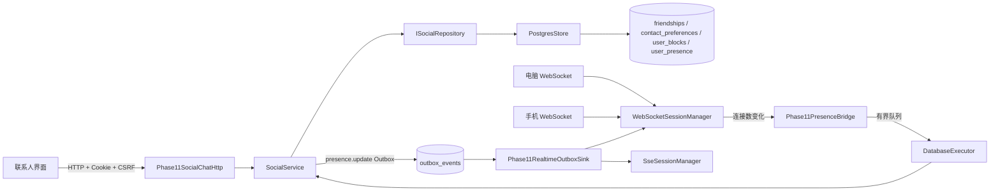

# Phase 14：联系人、黑名单与多设备在线状态

Phase 14 在 Phase 13 的群聊治理之后，补齐联系人日常使用所需的纵向闭环：好友备注、消息免打扰、
删除好友、黑名单、多设备同时在线和最后活跃时间。每项能力都经过领域模型、业务规则、Repository、
PostgreSQL、HTTP、WebSocket/SSE 和前端，而不是只在页面上添加按钮。

可以把这一阶段想成给聊天系统补齐“通讯录和门卫”：

- `friendships` 决定两个人是否互为好友；
- `contact_preferences` 是每个人自己的通讯录便签；
- `user_blocks` 是门卫的拒绝名单；
- `WebSocketSessionManager` 是实时在线登记簿；
- `user_presence` 是离线后仍能查看的最后打卡时间。

## 1. 用户可见能力

| 能力 | 当前行为 |
|---|---|
| 好友备注 | 每个用户独立保存，最多 64 字节，不会修改对方资料 |
| 消息免打扰 | 仅关闭该私聊的 SSE 提醒；消息仍持久化，打开的聊天页仍收到 WebSocket 消息 |
| 删除好友 | 双向好友关系和双方联系人设置一并删除，历史会话与消息保留 |
| 黑名单 | 单向保存；任意一方拉黑后，双方不能发好友申请、建立私聊或继续发送旧私聊消息 |
| 多设备在线 | 同一账号最多登记 4 条 WebSocket，聊天广播到全部在线设备 |
| 断开一个设备 | 只注销该连接，其他设备继续在线并接收消息 |
| 最后活跃 | WebSocket 连接数变化时异步落库；在线状态始终以当前进程内连接为准 |
| 离线消息 | 对方没有 WebSocket 也可发送，消息先写 PostgreSQL，重连后按 sequence 恢复 |

“免打扰”像关掉门铃，而不是锁住房门：快递仍会入库，用户主动打开会话仍能看到消息。
“删除好友”像从通讯录删除联系人，而不是烧掉过去的信件，所以历史消息不会消失。

## 2. 完整架构路径



联系人写操作的固定路径是：

```text
浏览器按钮
  → HTTP 路由进行身份、CSRF 和输入解析
  → SocialService 执行业务规则
  → ISocialRepository 抽象
  → InMemoryStore 或 PostgresStore
  → 事务内业务数据 + Outbox
  → WebSocket/SSE 通知
  → 前端重新读取服务端事实
```

前端只是遥控器，业务层才是保险柜的锁。即使用户绕过按钮直接调用接口，好友、黑名单和会话成员规则
仍会在 `SocialService` / `ChatService` 中执行。

## 3. 联系人设置为何是单向的

好友关系是双向的，但备注与免打扰属于个人视图。Alice 把 Bob 备注为“项目负责人”，Bob 不应该看到
自己的名字被改，也不应该自动关闭通知。因此使用有方向的复合主键：

```text
contact_preferences(owner_id, contact_id)

Alice → Bob：remark=项目负责人, muted=true
Bob   → Alice：remark='',       muted=false
```

业务层只有在二人仍是好友时才允许读写设置。删除好友或拉黑会同时清理两个方向的联系人设置，避免以后
重新加好友时继承过期备注。

## 4. 黑名单的事务语义

拉黑不是简单插入一行。`PostgresStore::blockUser` 在同一个事务中完成：

```text
写入 user_blocks
    + 删除双方 friendship
    + 删除双方 contact_preferences
    + 拒绝双方尚未处理的 friend_requests
    + 写入 friend.blocked Outbox
```

任一步失败都会整体回滚。拉黑方向虽然是单向的，但业务判断使用
`blockedEitherDirection(first, second)`：只要任何一方设置了门禁，双方的社交和私聊入口都关闭。
解除黑名单只移除门禁，不会自动恢复好友，因为恢复关系必须由新的好友申请明确完成。

## 5. 多设备 WebSocket

过去的会话目录是：

```cpp
std::unordered_map<UserId, Locator>
```

同一账号的新连接会覆盖旧连接。Phase 14 改为：

```cpp
std::unordered_map<UserId, std::vector<Locator>>
```

每个 `Locator` 保留 `weak_ptr<Session> + reactorIndex + fd + connId`。这像前台为一个客人登记手机和
电脑两个房间：广播会把同一份不可变 WebSocket 帧投递到所有房间；某个房间退房时只按
`fd + connId` 删除对应登记。`connId` 防止 fd 被系统复用后误删或误投给新连接。

当前每个用户最多 4 条连接，限制的是服务端内存和广播放大倍数。`broadcastText` 向所有设备发送；
旧的带单一回执接口仍选择最近登记的连接，从而保持原有返回值语义。

## 6. Presence 不阻塞 Reactor

WebSocket 注册/注销发生在网络线程，不能在回调中直接执行 PostgreSQL。`Phase11PresenceBridge` 只把
一张工作单提交给有界 `DatabaseExecutor`：

```text
Reactor 注册/注销连接
   → PresenceObserver(user, connectionCount)
   → DatabaseExecutor.submit
   → SocialService::recordPresence
   → user_presence + presence.update Outbox
```

因此数据库偶尔变慢不会把所有 socket 事件一起堵住。在线值来自当前
`WebSocketSessionManager::connectionCount`，数据库只保存最近一次连接变化时间；进程重启后不会把旧的
“在线”状态误认为当前事实。

## 7. HTTP 与实时事件

| 方法 | 路径 | 用途 |
|---|---|---|
| `GET` | `/api/friends` | 返回好友资料、备注、免打扰、在线连接数和最后活跃 |
| `PATCH` | `/api/friends/{id}` | 更新当前用户对该好友的备注和免打扰 |
| `DELETE` | `/api/friends/{id}` | 删除双向好友关系，保留历史消息 |
| `GET` | `/api/blocks` | 查询当前用户主动拉黑的账号 |
| `POST` | `/api/blocks/{id}` | 拉黑账号并事务化清理社交关系 |
| `DELETE` | `/api/blocks/{id}` | 解除黑名单，不自动恢复好友 |

新增/扩展实时事件：

- `friend.updated`：统一联系人刷新信号；`action` 区分 `updated`、`removed`、`blocked`、`unblocked`；
- `presence.update`：连接数和最后活跃变化；
- `chat.message`：广播到收件账号的全部 WebSocket 设备；
- `message.notification`：SSE 通知，私聊免打扰时按收件人的单向设置跳过。

## 8. 数据库迁移

第 4 号迁移新增三张表：

| 表 | 作用 | 关键约束 |
|---|---|---|
| `contact_preferences` | 单向备注和免打扰 | `(owner_id, contact_id)` 主键，不能指向自己 |
| `user_blocks` | 单向黑名单 | `(blocker_id, blocked_id)` 主键，不能拉黑自己 |
| `user_presence` | 最后活跃时间 | 每个用户一行，删除用户时级联删除 |

2026-10-06 正式库迁移前备份：

```text
/home/pikachu/phase11-data/backups/pre-phase14-20261006-200654.dump
```

正式库与隔离测试库均已升级到 schema version 4。

## 9. 前端交互

联系人窗口现在同时显示备注、账号、用户 ID、在线设备数、最后活跃和免打扰状态，并提供：

- 发起私聊；
- 修改备注；
- 开启/关闭免打扰；
- 删除好友；
- 拉黑与解除拉黑；
- 单独查看黑名单。

WebSocket 和 SSE 收到好友或 Presence 事件后刷新相同状态。页面不会用“对方离线”作为禁用发送的条件，
因为离线消息的可靠性来自 PostgreSQL 与 Outbox，而不是要求双方同时在线。

## 10. 代码索引

| 层 | 文件 |
|---|---|
| 领域对象 | [Domain.h](../../server/phase11/domain/Domain/Domain.h) |
| Repository 端口 | [Ports.h](../../server/phase11/ports/Ports/Ports.h) |
| 业务接口 | [BusinessInterfaces.h](../../server/phase11/business/BusinessInterfaces/BusinessInterfaces.h) |
| 联系人业务规则 | [SocialService.cpp](../../server/phase11/business/SocialService/SocialService.cpp) |
| 私聊权限复查 | [ChatService.cpp](../../server/phase11/business/ChatService/ChatService.cpp) |
| 内存参考实现 | [InMemoryStore.cpp](../../server/phase11/storage/InMemoryStore/InMemoryStore.cpp) |
| PostgreSQL 实现 | [PostgresStore.cpp](../../server/phase11/storage/postgres/PostgresStore/PostgresStore.cpp) |
| 第 4 号迁移 | [004_contacts_presence.sql](../../server/phase11/storage/postgres/migrations/004_contacts_presence.sql) |
| HTTP 接口 | [Phase11SocialChatHttp.cpp](../../server/phase11/transport/http/Phase11SocialChatHttp/Phase11SocialChatHttp.cpp) |
| Presence 与 Outbox | [Phase11Realtime.cpp](../../server/phase11/transport/realtime/Phase11Realtime/Phase11Realtime.cpp) |
| 多设备会话目录 | [WebSocketSessionManager.cpp](../../server/websocket/WebSocketSessionManager/WebSocketSessionManager.cpp) |
| 前端业务 | [app.js](../../frontend/phase11/app.js) |
| 页面与样式 | [index.html](../../frontend/phase11/index.html)、[styles.css](../../frontend/phase11/styles.css) |
| Repository 契约 | [RepositoryContract.h](../../tests/phase11/unit/RepositoryContract.h) |
| 真实网络黑盒 | [runtime_blackbox.py](../../tests/phase11/integration/runtime_blackbox.py) |

## 11. 验证结果

环境：`192.168.239.135`，CentOS Stream 9；本阶段没有下载或安装新依赖。

| 检查 | 结果 |
|---|---|
| Python / JavaScript 语法 | `py_compile`、`node --check` 通过 |
| Linux Release 全量 CTest | **93/93**，33.88 秒 |
| Linux Debug 全量 CTest | **93/93**，38.77 秒 |
| Linux ASan + LSan + UBSan 全量 CTest | **93/93**，79.71 秒 |
| PostgreSQL 契约 | schema version 4，内存与 PostgreSQL 同一套联系人契约通过 |
| 真实 HTTP + WebSocket + SSE + PostgreSQL + Outbox | `PHASE11_RUNTIME_BLACKBOX_OK` |

真实黑盒覆盖：联系人设置持久化、同账号 2 个 WebSocket 同时在线与同时收件、单设备退出不误删其他连接、
全部设备退出后的最后活跃、黑名单列表、黑名单绕过前端申请被拒、解除黑名单、删除好友、删除后使用旧
会话发消息被业务层拒绝，以及 Phase 12/13 原有的消息生命周期和群治理链路。

Sanitizer 首轮在 Release 服务同时运行时，两项固定网络等待出现超时；单独复现均通过。停止常驻服务释放
虚拟机资源后，再次完整运行得到 93/93，且无 ASan、LSan 或 UBSan 报告。

## 12. 当前限制与下一步

- Presence 当前是单进程事实，多实例部署需要 Redis/事件总线一类共享 Presence 与过期机制。
- 最多 4 个 WebSocket 连接是固定默认值，后续可做成配置并补充设备会话管理页面。
- 免打扰目前按联系人私聊生效，尚未支持群级免打扰、时间段和仅提及时提醒。
- 删除好友保留历史，但还没有“重新添加后是否复用旧会话”的产品设置。
- 黑名单已有业务阻断，尚缺独立审计表、管理员申诉和滥用检测。

下一阶段先做真实业务性能基准。它不会只测 `/fast`，而会分别测登录、会话列表、私聊持久化、群广播、
离线历史恢复、WebSocket 多连接、SSE 重连、AI 并发和混合负载，记录吞吐、P50/P95/P99、错误率、
数据库连接池、队列高水位、CPU 与内存。
