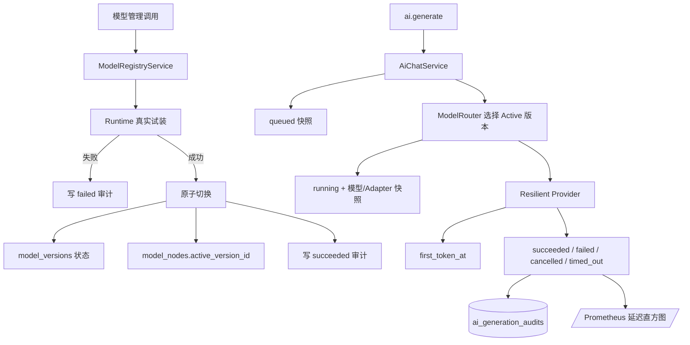

# Phase 19：模型变更审计与 AI 生成追踪

## 1. 本阶段解决什么问题

Phase 18 解决“模型端点卡住时，服务能否有界恢复”；Phase 19 继续解决“恢复后能否准确回答发生了什么”。

过去数据库能看见当前 Active 版本，AI 回复消息也保存了模型节点、版本和 Adapter，但仍缺少两类证据：

1. 谁在何时尝试启用或回滚哪个版本，切换前是什么版本，为什么成功或失败；
2. 某次生成从接纳、选模型、首 Token 到终态经历了哪些阶段，Prompt 与输出是否对应同一份内容。

可以把它们类比为：

- `model_activation_audits` 是机房的**操作票**；
- `ai_generation_audits` 是每趟推理的**行车记录仪**；
- Prometheus 延迟直方图是控制室的**仪表盘**。

本阶段没有下载新依赖，没有改变 WebSocket/SSE 消息格式，也没有向远程仓库推送。

## 2. 总体架构



审计仍经过 Repository 端口。业务层不知道 SQL，PostgreSQL 也不知道 WebSocket、Ollama 或 ONNX 类型。

## 3. 模型启用与回滚审计

### 3.1 记录内容

每条操作票包含：

| 字段 | 含义 |
|---|---|
| `node_id` | 被操作的逻辑模型节点 |
| `previous_version_id` | 操作前 Active 版本，可为空 |
| `target_version_id` | 目标版本 |
| `action` | `activate` 或 `rollback` |
| `outcome` | `succeeded` 或 `failed` |
| `actor` | 发起者标识，当前默认 `system`，管理端可显式传入 |
| `detail` | 成功说明或截断到 512 字节的失败原因 |
| `created_at` | 操作发生时间 |

### 3.2 为什么成功审计必须原子提交

错误做法是：

```text
先 UPDATE active_version_id
进程崩溃
还没来得及 INSERT audit
```

这会得到“模型已经换了，但没有操作票”的状态。Phase 19 的 PostgreSQL 实现使用一个数据修改 CTE，
把旧版本退休、目标版本激活、节点指针更新和成功审计插入放进同一条原子语句。任一步失败，整次操作都不成立。

失败尝试不会修改模型状态，但会单独写入 `failed` 审计。真实 Runtime 试装仍发生在切换之前，因此不兼容
Adapter、缺失校验器或模型加载异常都不会影响旧 Active 版本。

## 4. AI 生成生命周期追踪

### 4.1 状态机

```text
queued
  ├─ 校验/排队失败 ─────────────→ failed
  └─ 选定模型版本 → running
                       ├─ 完成并落库 → succeeded
                       ├─ Provider/落库失败 → failed
                       ├─ 用户或停机取消 → cancelled
                       └─ 业务总期限到达 → timed_out
```

终态不会被较旧的异步快照覆盖。每份快照都带 `revision`：queued、Prompt 上下文、选定模型、首 Token、
终态依次递增。Repository 只接受 revision 不小于数据库现值的快照。

这类似快递扫描枪：即使“到达转运中心”的网络包比“已经签收”更晚抵达数据库，也不能把包裹状态改回运输中。

### 4.2 追踪内容

| 类别 | 保存内容 |
|---|---|
| 身份与业务 | generation ID、请求用户、AI 账号、会话 |
| 模型选择 | node、version、runtime、model artifact、Adapter、模型校验和 |
| 输入指纹 | 规范化 Prompt 窗口 SHA-256 与字节数 |
| 输出指纹 | 输出 SHA-256、字节数与回调 Token 数 |
| 时间 | requested、started、first token、completed |
| 终态 | status、截断错误详情、成功回复 message ID |

Prompt 摘要覆盖最终发送给 Provider 的上下文窗口，而不只是用户最后一句话。规范串对 role 和 content 使用长度前缀，
避免不同字段拼接产生歧义。

### 4.3 为什么不把完整 Prompt 再存一次

聊天正文已经在 `messages` 中按权限保存。审计表只存哈希和长度，既能验证“当时使用的是不是这份上下文”，
又不会制造第二份难以删除、难以授权的聊天数据副本。

## 5. 延迟直方图

`/metrics` 新增：

- `webserver_phase11_ai_first_token_latency_seconds`：从选定模型并开始生成到首 Token；
- `webserver_phase11_ai_total_latency_seconds`：从业务接纳到成功、失败、取消或超时终态；
- `webserver_phase11_ai_audit_snapshots_queued_total`：成功送入数据库执行器的审计快照；
- `webserver_phase11_ai_audit_enqueue_rejected_total`：执行器满或停机时未接纳的快照。

直方图使用 10 ms、25 ms、50 ms、100 ms、250 ms、500 ms、1 s、2.5 s、5 s、10 s、30 s、60 s 和
`+Inf` 桶。首 Token 直方图只统计真正收到 Token 的请求；总耗时包含所有终态。

## 6. 数据库迁移

第 6 号迁移新增：

```text
model_activation_audits
ai_generation_audits
```

正式学习库和隔离测试库均已应用 1–6 号迁移。升级命令仍为：

```bash
scripts/phase11/postgres-migrate.sh phase11
scripts/phase11/postgres-migrate.sh phase11_test \
  /home/pikachu/phase11-data/secrets/phase11-test.pgpass
```

`phase11_test` 只用于会主动清空数据的 Repository 契约测试，不能把该连接串指向正式库。

## 7. 代码索引

| 职责 | 文件 |
|---|---|
| 审计领域对象 | [Domain.h](../../server/phase11/domain/Domain/Domain.h) |
| Repository 端口 | [Ports.h](../../server/phase11/ports/Ports/Ports.h) |
| 模型试装、启用、回滚与选择回调 | [ModelRegistryService.cpp](../../server/phase11/ai/ModelRegistryService/ModelRegistryService.cpp) |
| 生成状态、摘要、时间点和直方图采样 | [AiChatService.cpp](../../server/phase11/business/AiChatService/AiChatService.cpp) |
| 内存参考实现 | [InMemoryStore.cpp](../../server/phase11/storage/InMemoryStore/InMemoryStore.cpp) |
| PostgreSQL 原子切换与 revision upsert | [PostgresStore.cpp](../../server/phase11/storage/postgres/PostgresStore/PostgresStore.cpp) |
| 第 6 号迁移 | [006_ai_governance.sql](../../server/phase11/storage/postgres/migrations/006_ai_governance.sql) |
| Prometheus 输出与生产装配 | [main.cpp](../../main.cpp) |
| 模型审计业务测试 | [core.cpp](../../tests/phase11/unit/core.cpp) |
| 生成追踪与延迟测试 | [ai_chat.cpp](../../tests/phase11/unit/ai_chat.cpp) |
| PostgreSQL 契约 | [postgres_contract.cpp](../../tests/phase11/unit/postgres_contract.cpp) |

## 8. 验证结果

环境为 `192.168.239.135` 的 Linux 虚拟机，完整 PostgreSQL、libsodium、libcurl、ONNX Runtime GenAI
和 gRPC 构建开关均启用。

| 检查 | 结果 |
|---|---|
| 模型审计：成功、失败、回滚 | 通过 |
| 生成追踪：成功、校验失败、取消、超时、停机 | 通过 |
| Prompt/输出摘要、模型版本、首 Token、回复消息关联 | 通过 |
| revision 乱序保护 | PostgreSQL 契约通过 |
| 正式/测试库迁移状态 | `expected=6 applied=6 latest=6` |
| Linux Debug 全量 | **95/95**，27.09 秒 |
| Linux Release 全量 | **95/95**，26.68 秒 |
| ASan + LSan + UBSan 全量 | **95/95**，31.20 秒 |

Sanitizer 没有报告内存泄漏、越界或未定义行为。

## 9. 当前限制与后续顺序

当前审计已持久化，但尚未提供普通用户可见的审计 HTTP API；管理查询应在下一轮加入独立权限，而不能复用
聊天历史权限。两张审计表也还没有保留期限和归档任务，长期生产运行前需要按容量制定分区、归档和删除策略。
Prometheus 聚合值仍是单进程指标，多实例部署需要由 Prometheus 汇总。

下一阶段按以下顺序继续：

1. 建立版本化评测集、评测运行和结果表，让模型切换拥有质量门槛；
2. 把模型激活流程接到“评测通过才能启用”的策略；
3. 再加入 RAG 的文档、切片、向量索引和引用链；
4. 最后使用已授权数据进行真实 LoRA 训练，并与基础模型做可复现质量对照。
