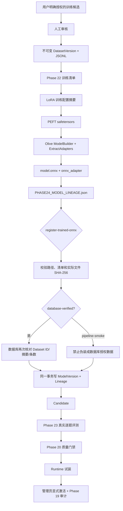

# Phase 24：训练数据、模型制品与候选版本不可变血缘

Phase 22 已经能从授权数据训练 LoRA 并导出 ONNX Adapter，Phase 23 已经能登记 Candidate、真实生成、
评测和人工激活。但两段流程此前只靠运维人员记住“这个 Candidate 是哪次训练产出的”，数据库里的
`model_versions` 并不知道训练数据、基座 revision 和 PEFT 权重。

Phase 24 补上这条断链。可以把血缘看成模型的“出生证明”：模型文件仍放在受控目录，数据库保存每个
关键材料的身份和 SHA-256。以后查看一个 Candidate，可以追溯它用什么数据、什么基座、什么配置训练，
由谁登记，以及最终交给哪次评测和激活。

## 1. 完整流程



这里的关键不是多存一张表，而是把“数据登记”和“模型登记”放进同一条可验证链。任何摘要不一致都会在
Candidate 创建前失败；数据库写入 Candidate 后却缺少血缘的半成品状态，也会被事务回滚。

## 2. 两种授权模式

| 模式 | 用途 | `dataset_version_id` | 约束 |
|---|---|---:|---|
| `database-verified` | 使用真实审核数据训练的候选版本 | 必须有 | ID 必须存在，数据库中的 checksum 和记录数必须与清单完全一致 |
| `pipeline-smoke` | 只验证训练/转换工具链的合成样本 | 必须为空 | 不能引用数据库 Dataset，避免把教学样本写成已授权数据 |

模式的作用类似实验室样品标签。`pipeline-smoke` 能证明机器和流程会工作，不能被当作真实训练数据，也不能
据此宣称模型质量提高。

## 3. 血缘保存了什么

`model_training_lineages` 与 `model_versions` 是一对一关系，以 `model_version_id` 为主键。它保存：

| 字段组 | 内容 | 目的 |
|---|---|---|
| 数据集 | 授权模式、Dataset ID、SHA-256、记录数 | 证明训练输入来自哪一版审核数据 |
| 基座 | Hugging Face repository、固定 revision、基础权重 SHA-256 | 防止相同模型名背后内容漂移 |
| 训练 | 原始训练清单 SHA-256、规范化训练配置 SHA-256 | 固定 seed、步数、学习率、rank 等关键条件 |
| 中间产物 | PEFT safetensors SHA-256 | 证明 Olive 转换前使用哪组 LoRA 权重 |
| 部署产物 | `.onnx_adapter` 与 `model.onnx` SHA-256 | 证明登记的文件就是训练链的最终输出 |
| 操作 | actor、created_at | 记录谁在什么时间建立 Candidate |

训练配置不是简单对 JSON 文件逐字节 Hash。导出器先取固定字段，按键排序并使用紧凑 JSON 编码，再计算
SHA-256。这样缩进或字段顺序变化不会把同一组训练参数误判成另一组配置。

## 4. 导出器与 C++ 注册边界

`export-trained-lora-onnx.py` 在原有导出完成后新增两项输出：

- 把 `PHASE22_TRAINING_MANIFEST.json` 复制到部署目录；
- 生成只含字符串值的 `PHASE24_MODEL_LINEAGE.json`。

第二份清单故意采用扁平结构。C++ 管理工具使用项目自己的 `FlatJson` 读取它，并要求字段集合与
`phase24-model-training-lineage-v1` 完全相等。未知字段、缺失字段、额外嵌套对象都会拒绝，避免脚本和
C++ 两边悄悄理解成不同格式。

```bash
WEB_PHASE11_DATABASE='postgresql:///phase11?host=/path/to/socket' \
  ./build-release/phase11-model-admin register-trained-onnx \
  <node-id> <model-root> <relative-model-dir> \
  <relative-adapter.onnx_adapter> \
  <relative-PHASE24_MODEL_LINEAGE.json> <actor>
```

注册时依次检查：

1. 模型目录、Adapter 和清单的规范化路径必须留在 `model-root` 内；
2. Adapter 必须是相对路径且以 `.onnx_adapter` 结尾；
3. 清单不超过有界读取上限，Schema 与字段集合必须精确匹配；
4. 所有 SHA-256 必须是 64 个十六进制字符；
5. 部署目录中的训练清单、Adapter 和 `model.onnx` 重新计算后必须与血缘清单一致；
6. `database-verified` 模式再到 PostgreSQL 锁定 Dataset 行，并核对 checksum 与记录数；
7. Candidate 与血缘在同一事务中创建。

这相当于仓库收货员不只看箱子外面的标签，还会重新称重、核对订单，并一次性登记“货物”和“来源”。

## 5. 原子性和不可变性

`IModelRepository::createTrainedModelVersion` 是一个明确的原子端口，内存 Repository 和 PostgreSQL
实现遵守同一契约：

- 新版本初始状态只能是 `Candidate`；
- 一个 ModelVersion 最多有一份 Lineage；
- `database-verified` 必须引用完全匹配的 DatasetVersion；
- `pipeline-smoke` 不能引用 DatasetVersion；
- 插入任意一边失败时，两边都不保留；
- 已登记血缘没有更新接口，后续评测和激活只引用它，不改写历史。

如果重新训练或重新导出，即使名称相同，也应建立新的 Candidate 和新的 Lineage。这样审计时不会遇到
“昨天与今天的版本 ID 相同，但文件已经换过”的问题。

## 6. 本阶段验证

验证在隔离的 `phase11_test` 数据库完成，没有修改运行中的正式数据库，也没有重启 24 小时稳定性测试所
监控的服务。

| 检查 | 结果 |
|---|---|
| Python 导出脚本语法 | 通过 |
| Python → FlatJson 字段契约 | 通过；13 个字段全部为字符串，数字字段按十进制字符串输出 |
| Release 增量构建 | `phase11_core_tests`、`phase11_postgres_contract_tests`、`phase11-model-admin` 通过 |
| 内存 Repository 契约 | 正确登记并读取血缘；Dataset 摘要不一致被拒绝 |
| PostgreSQL 契约 | 迁移 12 后原子写入并重新读取通过 |
| 真实 CLI 正向 | 登记 1 个 `database-verified` Candidate，并读取到对应血缘 |
| 文件篡改反向 | 修改 Adapter 后注册失败，版本数和血缘数都没有增加 |
| 运行中长稳 | 固定服务 PID 与采集器仍存活，检查时累计 13,990 个样本、0 个失败；最终汇总尚未生成 |

Release、Debug、Sanitizer 全矩阵以及正式库迁移会等待当前 24 小时稳定性测试结束后进行，避免构建和服务
重启污染资源水位证据。现在不能把这部分写成已经完成。

## 7. 代码索引

| 文件 | 作用 |
|---|---|
| `server/phase11/domain/Domain/Domain.h` | `TrainingAuthorizationMode` 与 `ModelTrainingLineage` 领域对象 |
| `server/phase11/ports/Ports/Ports.h` | 原子 Candidate+Lineage Repository 端口 |
| `server/phase11/ai/ModelRegistryService/` | 训练版本业务校验与登记入口 |
| `server/phase11/storage/InMemoryStore/` | 无数据库测试替身与契约实现 |
| `server/phase11/storage/postgres/PostgresStore/` | Dataset 再核对、事务写入与查询 |
| `server/phase11/storage/postgres/migrations/012_model_training_lineage.sql` | 血缘表、外键、模式与 Hash 约束 |
| `scripts/phase11/export-trained-lora-onnx.py` | 生成部署制品和 Phase 24 扁平血缘清单 |
| `tools/phase11_model_admin.cpp` | 路径/Hash 校验及 `register-trained-onnx` 命令 |
| `tests/phase11/unit/core.cpp` | 内存业务和错误 Dataset 反向用例 |
| `tests/phase11/unit/postgres_contract.cpp` | PostgreSQL 原子持久化契约 |

## 8. 与 Phase 23 的关系及当前边界

Phase 23 解决“这个 Candidate 答得怎么样、能否激活”，Phase 24 解决“这个 Candidate 从哪里来”。二者
组合后，单个线上版本可以沿两条链追溯：

```text
Dataset → Training → PEFT → ONNX Candidate
                                  ↓
Suite → Evaluation Run → Quality Gate → Activation Audit
```

当前正式数据库仍没有真实用户授权训练候选、DatasetVersion 或已完成 Evaluation Run。因此，本阶段证明了
血缘门禁和工具链正确，但没有可诚实宣称的 LoRA 质量提升。要得到质量结论，仍需用户主动授权数据、独立
验证集、基线/候选对照评测和人工复核。

后续优先顺序是：等待 24 小时汇总 → 运行三套完整回归 → 迁移正式数据库 → 使用真实授权 Dataset 建立
首个血缘完整的 Candidate → 与当前 Active 做同 Suite 对照 → 人工决定是否激活。进程异常恢复测试也仍需
在长稳结束后单独执行。
