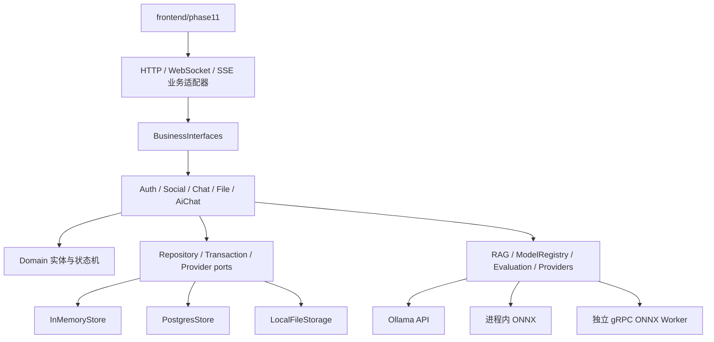

> 历史导航快照（2026-10），当前分类见 [文档入口](../../README.md)。其中的“当前/未推送”描述属于当时阶段。

# 业务功能架构

Phase49新增：[接口与装配重整](../../architecture/business/engineering/phase49.md)、[教学](../../architecture/business/guides/phase49-teaching.md)、[代码索引](../../architecture/business/indexes/phase49-code-index.md)、[数据库分层](../../database/domain-layering.md)、[当前总图](../../architecture/business/flows/phase49-end-to-end.md)。

上一补齐阶段：[Phase48 配色、领域拆分与 Outbox](../../architecture/business/engineering/phase48.md)、[代码索引](../../architecture/business/indexes/phase48-code-index.md)、[教学](../../architecture/business/guides/phase48-teaching.md)。原Phase36–47文档作为历史阶段保留。


本目录集中说明“用户能做什么，以及这些操作如何落到业务服务、Repository、数据库、实时通知和模型系统”。
通信层负责送货，业务层负责判断这件货能不能收、应该写入哪些状态、之后通知谁。

底层 HTTP/WebSocket/SSE/gRPC 不在这里重复，见 [底层通信架构](../../architecture/communication/README.md)。

学习“业务如何接到服务器接口”请从 [接入教学讲义](../../architecture/business/guides/server-business-integration-tutorial.md) 开始：按六课跟踪真实登录、消息提交、Outbox、未读/撤回和 AI 链路，附代码索引、自检题以及当前仍需补齐的验收与交互边界。

## 1. 当前功能入口

| 业务域 | 主要能力 | 详细流程 |
|---|---|---|
| 账号与会话 | 注册、登录、退出、资料、Cookie Session、CSRF、限流 | [业务调用流程](../../architecture/business/flows/business-call-flows.md#2-账号注册与登录) |
| 社交关系 | 好友申请、接受/拒绝、好友列表、备注、免打扰、黑名单 | [业务调用流程](../../architecture/business/flows/business-call-flows.md#3-好友与联系人) |
| 聊天 | 私聊、群聊、离线消息、幂等、未读、送达/已读、撤回、搜索 | [业务调用流程](../../architecture/business/flows/business-call-flows.md#4-消息发送与离线接收) |
| 群治理 | 创建群、邀请、角色、禁言、移除、退出、解散 | [业务调用流程](../../architecture/business/flows/business-call-flows.md#5-群聊治理) |
| 文件 | 头像、分片上传、完整性校验、文件消息、授权下载 | [业务调用流程](../../architecture/business/flows/business-call-flows.md#6-文件与头像) |
| 实时事件 | WebSocket 命令、SSE 通知、Outbox、Presence | [业务调用流程](../../architecture/business/flows/business-call-flows.md#7-outbox-与实时通知) |
| AI 对话 | 模型路由、流式 token、取消、超时、配额、熔断、备用端点 | [业务调用流程](../../architecture/business/flows/business-call-flows.md#8-ai-生成与-rag) |
| RAG | 知识登记、切片、权限过滤、检索、引用追踪 | [业务调用流程](../../architecture/business/flows/business-call-flows.md#8-ai-生成与-rag) |
| 模型生命周期 | 训练授权、数据集、LoRA、候选版本、评测、门禁、激活/回滚、审计 | [业务调用流程](../../architecture/business/flows/business-call-flows.md#9-训练评测发布与回滚) |
| 运行保障 | 指标、健康检查、性能基线、监督与异常恢复 | Phase 15、16、25、26 |

## 2. 分层



上层只依赖接口，PostgreSQL、Ollama、ONNX 和 gRPC Worker 都是可替换的适配器。这样测试可以使用内存实现，
正式运行再切换真实依赖，而业务规则不会复制两份。

## 3. Phase 11–27

| 阶段 | 内容 |
|---|---|
| [Phase 11](../../architecture/business/accounts-chat/phase11.md) | 账号、社交聊天、AI Provider 与模型治理地基 |
| [依赖审批](../../ops/dependencies/phase11-dependency-gates.md) | PostgreSQL、libsodium、curl、ONNX、训练工具链 |
| [Phase 12](../../architecture/business/accounts-chat/phase12.md) | 持久消息、未读、送达/已读和撤回 |
| [Phase 13](../../architecture/business/accounts-chat/phase13.md) | 群聊治理与权限 |
| [Phase 14](../../architecture/business/accounts-chat/phase14.md) | 联系人、黑名单和多设备 Presence |
| [Phase 15](../../architecture/business/runtime/phase15.md) | 真实业务性能基线 |
| [Phase 16](../../architecture/business/runtime/phase16.md) | 可观测性、Outbox 主动唤醒和运维闭环 |
| [Phase 17](../../architecture/business/accounts-chat/phase17.md) | 头像、图片与文件消息 |
| [Phase 18](../../architecture/business/ai/phase18.md) | AI 生成韧性与资源治理 |
| [Phase 19](../../architecture/business/ai/phase19.md) | 模型审计与生成追踪 |
| [Phase 20](../../architecture/business/ai/phase20.md) | 评测集和激活质量门禁 |
| [Phase 21](../../architecture/business/ai/phase21.md) | RAG 权限隔离与引用链 |
| [Phase 22](../../architecture/business/ai/phase22.md) | 授权数据集与 LoRA 闭环 |
| [Phase 23](../../architecture/business/ai/phase23.md) | 候选模型真实评测与人工发布 |
| [Phase 24](../../architecture/business/ai/phase24.md) | 数据、制品和模型版本血缘 |
| [Phase 25](../../architecture/business/runtime/phase25.md) | 用户态进程监督与恢复 |
| [Phase 26](../../architecture/business/runtime/phase26.md) | 长连接、AI 并发和混合负载容量 |
| [Phase 27](../../architecture/business/accounts-chat/phase27.md) | 历史分页、断线补齐、ACK 超时幂等重试与管理员撤回入口 |

## 4. 代码区域

```text
backend/application/
├─ domain/          用户、会话、消息、文件、知识、训练与模型实体
├─ ports/           Repository、事务、安全、索引和模型端口
├─ business/        Auth、Social、Chat、File、AiChat、Outbox 用例
├─ transport/       HTTP 路由、实时命令/事件、序列化契约
├─ storage/         内存、PostgreSQL、文件正文
├─ security/        密码哈希与登录限流
└─ runtime/         数据库等慢任务的有界执行器
```

## Function3：模块隔离与苦情树社区

[Phase28](../../architecture/business/runtime/phase28.md) → [Phase29](../../architecture/business/messaging/phase29.md) → [Phase30](../../architecture/business/community/phase30.md) → [Phase31](../../architecture/business/community/phase31.md) → [Phase32](../../architecture/business/community/phase32.md) → [Phase33](../../architecture/business/community/phase33.md) → [Phase34 验收](../../reports/stages/phase34.md)。

参见 [总图](../../architecture/business/flows/function3-end-to-end.md)、[组件索引](../../architecture/business/indexes/function3-code-index.md)、[实际进度](../../roadmap/function3-progress.md)。

Function3逐步教学：[从浏览器发布到事务、MQ与语音](../../architecture/business/guides/function3-walkthrough.md)。

当前增量：[Phase35：原业务库复用、语音修复、Redis与界面重构](../../architecture/business/client-ui/phase35.md)。日常实例使用原 `phase11` 和18090，操作见[启动与停止](../../ops/runtime/function3-runtime.md)；Phase34旧性能未达标项仍保留。

本地新轮次：[Phase36 聊天布局](../../architecture/business/client-ui/phase36.md) → [Phase37 统一动态/主页](../../architecture/business/community/phase37.md) → [Phase38 Windows客户端](../../architecture/business/client-ui/phase38.md) → [Phase39 三形态AI/确认操作](../../architecture/business/ai/phase39.md) → [Phase40 语音](../../architecture/business/ai/phase40.md)。[新端到端架构图](../../architecture/business/flows/phase36-41-end-to-end.md)、[Phase41验收与未达标项](../../reports/stages/phase41.md)、[组件索引](../../architecture/business/indexes/phase36-41-code-index.md)、[本地预览](../../ops/runtime/phase36-41-local-preview.md)。模型、训练和语音代码位于 `backend/ai`，不再放在 `backend/application` 内。

保持上述架构方向的后续改进：[Phase42：TLS复用、神树批量读取与绘制/外观优化](../../architecture/business/community/phase42.md)。

本轮冻结通信核心后的业务演进见[Phase43–47](../../roadmap/phase43-47-progress.md)，[代码索引](../../architecture/business/indexes/phase43-47-code-index.md)、[业务接入教学](../../architecture/business/guides/phase43-47-teaching.md)与[总图](../../architecture/business/flows/phase43-47-end-to-end.md)。
