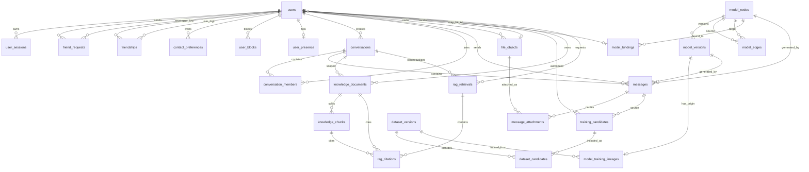

# Phase 11 PostgreSQL 表结构学习指南

这份文档对应当前十二份数据库迁移：建库基线
[001_phase11.sql](../../server/phase11/storage/postgres/migrations/001_phase11.sql) 和消息生命周期增量
[002_message_lifecycle.sql](../../server/phase11/storage/postgres/migrations/002_message_lifecycle.sql)，以及群聊治理增量
[003_group_governance.sql](../../server/phase11/storage/postgres/migrations/003_group_governance.sql)，以及联系人增量
[004_contacts_presence.sql](../../server/phase11/storage/postgres/migrations/004_contacts_presence.sql)，以及文件增量
[005_files.sql](../../server/phase11/storage/postgres/migrations/005_files.sql)、AI 治理增量
[006_ai_governance.sql](../../server/phase11/storage/postgres/migrations/006_ai_governance.sql)、模型评测增量
[007_model_evaluation.sql](../../server/phase11/storage/postgres/migrations/007_model_evaluation.sql)、评测集版本约束增量
[008_evaluation_suite_versioning.sql](../../server/phase11/storage/postgres/migrations/008_evaluation_suite_versioning.sql)，以及 RAG 增量
[009_rag_knowledge_and_citations.sql](../../server/phase11/storage/postgres/migrations/009_rag_knowledge_and_citations.sql)，以及训练数据制品和去重增量
[010_training_dataset_artifacts.sql](../../server/phase11/storage/postgres/migrations/010_training_dataset_artifacts.sql)、
[011_training_candidate_deduplication.sql](../../server/phase11/storage/postgres/migrations/011_training_candidate_deduplication.sql)，以及训练到模型版本血缘增量
[012_model_training_lineage.sql](../../server/phase11/storage/postgres/migrations/012_model_training_lineage.sql)。
它解释当前真实代码中的 33 张表（1 张迁移登记表和 32 张业务表），不把规划中的功能写成已经实现。

当前虚拟机的实际行数、AI 绑定和本地测试账号统一记录在同目录的
`phase11-app-data.local.md`。该文件包含测试密码并被 `.gitignore` 排除，只保留在本地与虚拟机，
不会随项目提交到公开仓库。

可以把整个数据库想成一座聊天园区：

- `users` 是人员花名册，`user_sessions` 是出入证；
- `friend_requests` 是申请单，`friendships` 是已经生效的双向关系；
- `conversations` 是房间，`conversation_members` 是房间名单；
- `messages` 是按房间编号保存的信件，`outbox_events` 是等待通知系统领取的发货单；
- `file_objects` 是文件登记卡，`message_attachments` 把文件贴到消息上；
- `model_*` 是 AI 模型资产目录，`training_*` 和 `dataset_*` 是经过授权的数据加工区。
- `knowledge_documents` 和 `knowledge_chunks` 是知识资料与切片仓库，`rag_*` 保存每次检索及实际引用。

## 1. 总体关系



`outbox_events` 通过 `aggregate_type + aggregate_id` 指向业务对象，而不是数据库外键。这样一张表可以统一保存
消息、好友申请和会话邀请等不同事件。

## 2. 账号与登录

### `phase11_schema_migrations`：数据库版本登记簿

| 字段 | 含义 |
|---|---|
| `version` | 迁移版本号，当前最新为 `12` |
| `description` | 该版本做了什么 |
| `applied_at` | 迁移执行时间 |

它像数据库的“装修记录”。迁移脚本会按编号依次检查和执行尚未登记的文件，因此已有版本 1 的数据库只应用
版本 2–12，新建空库则依次应用版本 1–12。

### `users`：用户花名册

| 关键字段 | 含义 |
|---|---|
| `id` | 数据库生成的用户主键，也是界面里使用的用户 ID |
| `username` | 唯一登录名，只允许小写字母、数字、下划线和连字符，长度 3–32 |
| `display_name` / `biography` | 展示名称和个人简介 |
| `password_hash` | Argon2id 密码散列，不保存明文密码 |
| `disabled` | 是否停用账号 |
| `ai_account` | 是否为 AI 特殊账号 |
| `avatar_file_id` | 当前头像对应的已封存图片；空值表示使用默认头像 |

注册主要写入这张表。`username` 的唯一约束是最后一道并发防线：两个人同时注册同名账号时，只能成功一个。

### `user_sessions`：登录出入证

| 关键字段 | 含义 |
|---|---|
| `id` | Session 标识 |
| `user_id` | 这张出入证属于哪个用户 |
| `token_hash` | Session Token 的带密钥 Hash；数据库泄漏时也不能直接冒充用户 |
| `csrf_hash` | 防止跨站请求伪造的校验值 |
| `expires_at` | 自动过期时间 |
| `revoked_at` | 主动退出或吊销时间；非空表示不能再使用 |

登录会创建 Session；退出登录不会删除历史记录，而是填写 `revoked_at`。这使安全审计比“直接删掉”更清楚。

## 3. 好友关系

### `friend_requests`：好友申请单

`sender_id` 是申请人，`receiver_id` 是接收人，`state` 只能是 `pending`、`accepted`、`rejected`。
`decided_at` 记录处理时间。

唯一索引会先用 `LEAST/GREATEST` 把 A→B 和 B→A 排成同一对用户，所以同一时间只能存在一张待处理申请，
可以挡住双方同时点击添加造成的重复数据。

### `friendships`：已经确认的双向好友关系

它没有保存“谁关注谁”，而是只保存较小的用户 ID `user_low_id` 和较大的 `user_high_id`。一行数据代表双方已经
是好友，因此读取时要检查当前用户出现在任意一列。

```text
用户 8 和用户 3 成为好友
        ↓ 统一排序
user_low_id=3, user_high_id=8
```

这种结构天然阻止 `(3,8)` 与 `(8,3)` 同时存在。

### `contact_preferences`：每个人自己的联系人便签

`owner_id` 是设置人，`contact_id` 是好友；`remark` 保存备注，`notifications_muted` 保存私聊免打扰。
复合主键说明同一个人对同一好友只有一份设置。它有方向：A 对 B 的备注不会覆盖 B 对 A 的备注。

删除好友或拉黑时，双方的联系人设置会在同一事务内清除。免打扰只跳过该收件人的 SSE 门铃通知，
不会删除消息，也不会阻止已打开会话通过 WebSocket 收到消息。

### `user_blocks`：单向黑名单

`blocker_id` 是设置门禁的人，`blocked_id` 是被屏蔽的人，`created_at` 记录时间。一行只表达一个方向，
但业务层用“双向任意命中”判断：任何一方拉黑后，都不能创建好友申请、私聊或继续向旧私聊发消息。
解除黑名单不会自动恢复好友。

### `user_presence`：最后活跃时间

只保存每个用户最近一次 WebSocket 连接数变化的时间 `last_active_at`。当前在线与设备数来自进程内
`WebSocketSessionManager`，不会把数据库中的旧状态误报为在线。连接变化通过数据库执行器异步写入，
不会在 Reactor 网络线程里直接执行 SQL。

## 4. 会话与消息

### `conversations`：聊天房间

| 关键字段 | 含义 |
|---|---|
| `kind` | `direct` 私聊或 `group` 群聊 |
| `title` | 群名称；私聊可以由成员资料生成显示名称 |
| `announcement` | 群公告；最多 4096 字节 |
| `state` | `active` 活动中或 `dissolved` 已软解散 |
| `dissolved_by / dissolved_at` | 解散人和解散时间；活动会话必须为空 |
| `created_by` | 创建者 |
| `next_sequence` | 下一条消息应使用的房间内序号 |
| `direct_pair_key` | 私聊双方的规范化组合，保证同一对用户只有一个私聊 |

`next_sequence` 像房间自己的取号机。每个会话独立从 1 递增，客户端断线重连时可以说“给我序号 27 之后的消息”。

### `conversation_members`：房间名单与阅读进度

这是用户与会话之间的多对多连接表：一个用户可以加入多个会话，一个会话也可以有多个用户。

| 关键字段 | 含义 |
|---|---|
| `role` | `owner` 群主、`administrator` 管理员或普通 `member` |
| `last_delivered_sequence` | 服务端确认已经投递到该用户的最大序号 |
| `last_read_sequence` | 用户确认已经读到的最大序号 |
| `joined_at` | 加入时间 |
| `muted_until` | 禁言截止时间；空值表示未禁言 |

两个游标像书签。`last_read_sequence <= last_delivered_sequence` 的约束防止出现“已经读到 20，但其实只投递到 10”的
不可能状态。

### `messages`：持久化消息正文

| 关键字段 | 含义 |
|---|---|
| `conversation_id + conversation_seq` | 一条消息在会话中的稳定位置 |
| `sender_id` | 发送人 |
| `client_message_id` | 浏览器生成的幂等 ID，重试不会重复写入 |
| `body` | 1–16384 字节的文字正文 |
| `model_node_id / model_version_id / adapter_name` | AI 回复的模型来源；普通消息为空 |
| `state` | `active` 表示正常消息，`recalled` 表示已经撤回 |
| `recalled_by` | 执行撤回的发送者 ID；正常消息为空 |
| `recalled_at` | 撤回时间；正常消息为空 |

消息先写 PostgreSQL，所以接收人不在线也不影响发送。对方再次登录后，服务端依据会话序号恢复漏掉的消息。

撤回不会删除数据库行，也不会重新使用 `conversation_seq`。它更像在信件上盖“已撤回”章：HTTP 历史、
WebSocket 和 SSE 只返回撤回状态，不返回原正文；搜索也排除撤回消息，但数据库仍保留原记录供审计和后续治理。
`messages_recall_shape` 约束保证 `state='recalled'` 时撤回人和时间必须同时存在。

`messages_body_search_idx` 是全文检索索引。当前使用 PostgreSQL `simple` 分词配置，适合教学和基础搜索；它不是完整的
中文分词系统，复杂中文搜索以后可接专用分词或搜索引擎。

### `outbox_events`：可靠通知发货单

写消息时，`messages` 和 `outbox_events` 在同一事务内提交：

```text
消息入库 + 生成待推送事件
            ↓ 同一事务成功
Outbox Dispatcher 领取事件
            ↓
WebSocket / SSE 推送
            ↓
published_at 标记完成
```

如果进程在消息落库后、推送前崩溃，`published_at IS NULL` 的事件仍在，恢复后可以继续处理。这解决了“数据库写成功，
实时推送却丢了”的双写问题。投递语义是至少一次，接收端仍需按事件或消息 ID 去重。

## 5. 文件元数据与附件

### `file_objects`：文件登记卡

文件正文不进入 PostgreSQL。数据库只保存一张登记卡：

| 关键字段 | 含义 |
|---|---|
| `owner_id` | 上传文件的用户，也是未发送前唯一可读取者 |
| `original_name` / `media_type` | 展示文件名和经过允许列表校验的 MIME |
| `expected_size` | 创建上传时申报的最终大小，范围 1–25 MiB |
| `uploaded_size` | 服务端已落盘并确认的连续游标 |
| `sha256` | 文件完成时计算的 64 位十六进制指纹 |
| `state` | `pending`、`ready`、`failed` 或预留的 `deleted` |
| `ready_at` | 封存完成时间；只有 `ready` 状态可以非空 |

`expected_size` 和 `uploaded_size` 像订单总件数和仓库已收件数。只有二者相等、SHA-256 合法且
`ready_at` 存在时，数据库约束才允许状态变成 `ready`。正文默认保存到
`/home/pikachu/phase11-data/files`，数据库备份不会自动包含该目录，运维备份必须把二者作为同一恢复点管理。

### `message_attachments`：消息与文件的装箱单

`message_id` 指向消息，`file_id` 指向文件，`position` 表示附件顺序。数据库允许一条消息 0–7 号共八个
位置，当前第一版业务只发送一个附件。复合主键阻止同一文件重复贴到同一消息，
`UNIQUE(message_id, position)` 阻止两个附件占据同一位置。

发送文件消息时，`messages`、`message_attachments` 和 `outbox_events` 在一个事务内提交。接收者不在线时，
附件关系仍会保留；之后读取历史消息即可得到文件元数据和下载 URL。读取文件的最终权限依据当前会话成员关系，
不是依据客户端传来的文件名或 URL。

### 头像引用

`users.avatar_file_id` 指向 `file_objects`。绑定头像前，业务层要求文件属于本人、状态为 `ready` 且 MIME
以 `image/` 开头。附件默认只对会话成员可见；头像是个人资料的一部分，因此绑定后对任意已登录用户可读。

完整上传状态机、磁盘布局、安全边界和 Range 下载见
[Phase 17](../architecture/business/phase17.md)。

## 6. AI 模型注册

### `model_nodes`：逻辑模型节点

表示“星云助手”“代码助手”这类稳定身份。`kind` 为根模型 `root` 或专业模型 `specialist`，
`active_version_id` 指向当前启用版本。

### `model_versions`：可以部署的具体版本

同一个节点可以有多个版本。`runtime` 决定交给 `ollama`、`onnx-inprocess` 或 `onnx-grpc` Provider；
`model_artifact`、`adapter_artifact` 描述模型和 Adapter，`checksum` 校验内容，`state` 管理候选、启用、退役和拒绝状态。

### `model_training_lineages`：训练模型的出生证明

每个训练得到的 `model_versions` 最多对应一行血缘。它保存训练授权模式、DatasetVersion、数据摘要和
记录数、基座仓库/revision、基础权重、训练清单与配置、PEFT 权重、ONNX Adapter 和基础图的 SHA-256，
以及登记操作者和时间。

`database-verified` 必须引用 DatasetVersion；Repository 在同一事务中重新核对该数据集的 checksum 与
记录数，再一起插入 Candidate 和 Lineage。`pipeline-smoke` 必须不引用 DatasetVersion，因此合成教学
样本不会伪装成用户授权数据。主键就是 `model_version_id`，也没有更新接口：重新训练必须建立新版本，
不能覆盖旧模型的出生记录。完整门禁见 [Phase 24](../architecture/business/phase24.md)。

### `model_edges`：模型关系图

保存父模型控制子模型 `parent_controls_child`，或同级模型协作 `peer_collaborates`。当前只搭建关系和约束，
没有实现根模型自动调度整棵模型树。

### `model_bindings`：AI 账号与模型绑定

`ai_user_id` 必须来自 `users`，`model_node_id` 指向模型节点。业务收到对某个 AI 账号的生成请求后，通过这张表找到模型，
再读取它的激活版本和运行时。

### `model_activation_audits`：模型变更操作票

保存启用与回滚的前一版本、目标版本、动作、结果、发起者和原因。成功记录与 Active 指针原子提交；
失败记录不改变当前 Active 版本。

### `ai_generation_audits`：生成生命周期记录

按 `generation_id` 保存请求者、会话、模型/版本/Adapter、Prompt 与输出 SHA-256、Token 数、首 Token
和完成时间、终态以及成功回复消息。它不复制 Prompt 或输出正文。`revision` 阻止乱序异步任务用旧快照
覆盖新终态。完整设计见 [Phase 19](../architecture/business/phase19.md)。

### `model_evaluation_suites` 与 `model_evaluation_cases`：固定评测试卷

Suite 通过 `name + version` 标识不可变评测版本，并保存内容 `checksum`；Case 保存题目、期望答案、
权重和是否必答。二者在一个事务中创建，避免留下只有部分题目的评测集；同一 Suite 内题目名称唯一。

### `model_evaluation_runs` 与 `model_evaluation_case_results`：版本化成绩

每个 Run 固定绑定一个 `model_version_id`。单题结果以 `(run_id, case_id)` 为主键，保存分数、通过状态、
输出 SHA-256 和耗时。总通过数与加权分由业务层根据完整答题卡重新计算，客户端不能直接伪造汇总成绩。

### `model_activation_policies`：模型节点及格线

每个节点最多一条策略，指定评测集、最低通过率、最低加权分和成绩有效期。模型启用读取同版本最新的
completed Run；缺少成绩、必答题失败、不达标或过期都会拒绝激活。完整设计见
[Phase 20](../architecture/business/phase20.md)。

## 7. 授权训练数据

### `training_candidates`：训练候选样本

它不是“所有聊天自动拿去训练”。只有用户明确授权的消息，经过脱敏后才能形成候选项。字段记录数据所有者、来源消息、
脱敏后的提示与回答、同意协议版本以及审核状态。部分唯一索引保证同一用户对同一来源消息最多只有
一条未撤销授权；撤销后允许重新脱敏并再次授权。

状态依次可能是：

```text
submitted → approved → exported
          ↘ rejected
任意允许的阶段 → revoked
```

### `dataset_versions`：不可混淆的数据集版本

保存数据集名称、SHA-256、创建时间、内容寻址 JSONL 的相对路径和记录数。训练脚本必须显式提供这里
登记的 SHA-256，确认训练时使用的内容与审核通过的内容完全一致。

### `dataset_candidates`：数据集内容清单

连接数据集版本与候选样本。一份候选样本可以进入不同实验数据集，一个数据集也可以包含多份样本，因此使用多对多表。

## 8. RAG 知识库与引用链

### `knowledge_documents`：知识资料登记卡

一行代表用户登记的一份文本或 Markdown 资料。`scope` 决定可见范围：

- `private`：`conversation_id` 必须为空，只属于 `owner_id`；当前还要求会话另一端是已启用的 AI 账号，
  普通人与人的私聊不会读取私人资料；
- `conversation`：`conversation_id` 必须存在，只有当前会话成员可以登记、查询和检索。

`sha256` 是原文指纹，`state` 按 `indexing → ready` 或 `indexing → failed` 演进。只有 `ready`
资料能进入回答上下文。它像图书馆的“书目卡”，先登记、分章节、建索引，成功后才允许借阅。

### `knowledge_chunks`：UTF-8 安全切片

一份资料会拆成多个有重叠的切片。`ordinal` 表示原文顺序，`content` 保存切片正文，`sha256`
保存切片指纹；`UNIQUE(document_id, ordinal)` 阻止同一资料出现两个相同位置。

切片边界不会从 UTF-8 多字节字符中间断开。当前索引是便于学习和确定性测试的词法余弦检索，
接口 `IKnowledgeIndex` 已与业务解耦，后续可以替换成向量数据库而不改 HTTP、AI 会话和权限层。

### `rag_retrievals`：一次生成的检索封面

主键直接使用 `generation_id`，并记录请求者、会话、查询 Hash 和时间。同一个生成 ID 重试时，
服务端会核对身份、会话和查询 Hash，再复用已经持久化的结果；不允许拿另一个请求者的生成 ID
读取引用。

### `rag_citations`：回答实际引用的切片

每行保存检索排名、资料、切片和分数。复合外键 `(document_id, chunk_id)` 保证“引用的切片确实属于
这份资料”，`PRIMARY KEY(generation_id, rank)` 保证排名稳定。前端展示的是这些已经落库的引用，
而不是生成结束后临时再搜一次，因此回答与证据不会悄悄错位。

完整权限矩阵、检索流程和故障一致性见
[Phase 21](../architecture/business/phase21.md)。

## 9. 主要业务写入路径

### 注册和登录

```text
注册 → users
登录 → 读取 users → 新增 user_sessions
退出 → user_sessions.revoked_at
```

### 添加好友

```text
发送申请 → friend_requests + outbox_events
接受申请 → friend_requests.state=accepted
         → friendships
         → outbox_events
```

### 创建会话

```text
创建房间 → conversations
加入人员 → conversation_members
邀请通知 → outbox_events
```

### 发送离线消息

```text
锁定 conversations.next_sequence
          ↓
写入 messages
          ↓ 同一事务
写入 outbox_events
          ↓
在线成员立即收到；离线成员以后按 sequence 恢复
```

### 上传并发送文件

```text
创建上传 → file_objects(state=pending)
分片落盘 → uploaded_size 比较并推进
完成核验 → state=ready + sha256 + ready_at
发送消息 → messages + message_attachments + outbox_events（同一事务）
```

发送者写入成功时，自己的 `last_delivered_sequence` 和 `last_read_sequence` 会推进到新消息序号，避免自己的消息
反过来计入自己的未读数。接收者的游标只在真实 `chat.ack` / `chat.read` 到达后前进。

### 送达、已读与持久未读

```text
浏览器收到消息
    ├─ chat.ack  → last_delivered_sequence 单调前进
    └─ chat.read → last_read_sequence 与 last_delivered_sequence 单调前进
                         ↓ 同一事务
                    outbox_events
                         ↓
             chat.receipt / message.receipt
```

会话列表的未读数由 `next_sequence - 1 - last_read_sequence` 计算，因此刷新页面或换设备后不会丢失。
重复或倒退的 ACK/已读命令不会改写游标，也不会重复产生 Outbox 事件。

### 两分钟内撤回

```text
发送者 chat.recall(message_id)
       ↓ 校验成员身份、发送者、两分钟窗口
messages.state = recalled
recalled_by / recalled_at 写入
       ↓ 同一事务
message.recalled Outbox
       ↓
WebSocket + SSE 通知所有会话成员
```

### 登记知识与生成引用

```text
登记资料 → knowledge_documents(state=indexing) + knowledge_chunks（同一事务）
          → 写入进程内检索索引
          → CAS 更新 state=ready

发起 AI 生成 → 按当前用户和会话计算允许的 document_id
              → 检索候选并再次校验资料状态/权限
              → rag_retrievals + rag_citations（同一事务）
              → 引用片段进入系统 Prompt
              → AI 回复沿用原有生成审计和消息链路
```

如果索引写入失败，资料会转为 `failed`；如果进程在数据库提交后崩溃，启动时会从所有 `ready`
切片重建索引。数据库是事实来源，内存索引只是可以重新生成的“目录卡”。

## 10. 在 Navicat 中建议先看的内容

先注册两个测试账号，再按下面顺序观察：

1. 打开 `users`，确认账号生成了不同的 `id`，密码列只有 Hash。
2. 登录后打开 `user_sessions`，比较 `expires_at` 和 `revoked_at`。
3. 发送并接受好友申请，观察 `friend_requests` 与 `friendships` 的变化。
4. 创建私聊，观察一行 `conversations` 和两行 `conversation_members`。
5. 让接收者离线后发送消息，确认 `messages` 仍然新增。
6. 查看 `outbox_events.published_at`，理解落库和实时通知是两个阶段。
7. 让接收者打开会话，观察 `conversation_members` 的两个游标只增不减。
8. 两分钟内撤回一条消息，观察 `messages.state/recalled_by/recalled_at`，并确认前端不再显示正文。
9. 修改好友备注和免打扰，观察 `contact_preferences`；拉黑后确认 friendship 和设置被事务清理。
10. 用同一账号打开两个 WebSocket，关闭后观察 `user_presence.last_active_at` 更新。
11. 上传文件时观察 `file_objects.uploaded_size` 从 0 推进到最终大小，再变为 `ready`。
12. 发送文件消息后联查 `messages` 与 `message_attachments`；正文实际字节不会出现在数据库中。
13. 登记私人或会话资料，观察 `knowledge_documents` 与按 `ordinal` 排列的 `knowledge_chunks`。
14. 在 AI 会话中提问后，联查 `rag_retrievals` 和 `rag_citations`，确认引用属于当前用户可访问的资料。

只读查询示例：

```sql
SELECT id, username, display_name, ai_account, created_at
FROM users
ORDER BY id;

SELECT conversation_id, conversation_seq, sender_id, state,
       CASE WHEN state = 'active' THEN body ELSE '[已撤回]' END AS visible_body,
       recalled_by, recalled_at, created_at
FROM messages
ORDER BY conversation_id, conversation_seq;

SELECT id, event_type, aggregate_type, aggregate_id,
       published_at IS NOT NULL AS published
FROM outbox_events
ORDER BY id DESC;

SELECT r.generation_id, r.requester_id, r.conversation_id,
       c.rank, d.title, c.chunk_id, c.score
FROM rag_retrievals AS r
JOIN rag_citations AS c ON c.generation_id = r.generation_id
JOIN knowledge_documents AS d ON d.id = c.document_id
ORDER BY r.created_at DESC, c.rank;
```

学习时优先执行 `SELECT`。直接在 Navicat 修改游标、序号、Session Hash 或模型激活版本，可能绕开业务层约束，制造
应用正常操作不会产生的状态。

## 11. 代码索引

| 内容 | 文件 |
|---|---|
| 基础表、约束和索引 | [001_phase11.sql](../../server/phase11/storage/postgres/migrations/001_phase11.sql) |
| 消息状态与撤回约束 | [002_message_lifecycle.sql](../../server/phase11/storage/postgres/migrations/002_message_lifecycle.sql) |
| 群角色、公告、禁言与软解散约束 | [003_group_governance.sql](../../server/phase11/storage/postgres/migrations/003_group_governance.sql) |
| 联系人、黑名单与最后活跃 | [004_contacts_presence.sql](../../server/phase11/storage/postgres/migrations/004_contacts_presence.sql) |
| 文件元数据、附件与头像 | [005_files.sql](../../server/phase11/storage/postgres/migrations/005_files.sql) |
| 模型激活与生成生命周期审计 | [006_ai_governance.sql](../../server/phase11/storage/postgres/migrations/006_ai_governance.sql) |
| 模型评测集、执行结果与激活策略 | [007_model_evaluation.sql](../../server/phase11/storage/postgres/migrations/007_model_evaluation.sql) |
| 评测集不可变版本约束 | [008_evaluation_suite_versioning.sql](../../server/phase11/storage/postgres/migrations/008_evaluation_suite_versioning.sql) |
| RAG 资料、切片、检索与引用 | [009_rag_knowledge_and_citations.sql](../../server/phase11/storage/postgres/migrations/009_rag_knowledge_and_citations.sql) |
| 训练数据集文件路径、记录数与 SHA-256 约束 | [010_training_dataset_artifacts.sql](../../server/phase11/storage/postgres/migrations/010_training_dataset_artifacts.sql) |
| 未撤销训练授权来源去重 | [011_training_candidate_deduplication.sql](../../server/phase11/storage/postgres/migrations/011_training_candidate_deduplication.sql) |
| RAG 编排与权限校验 | [RagService.cpp](../../server/phase11/ai/RagService/RagService.cpp) |
| 可替换的确定性学习索引 | [DeterministicKnowledgeIndex.cpp](../../server/phase11/ai/DeterministicKnowledgeIndex/DeterministicKnowledgeIndex.cpp) |
| PostgreSQL Repository | [PostgresStore.cpp](../../server/phase11/storage/postgres/PostgresStore/PostgresStore.cpp) |
| 连接池 | [PostgresConnectionPool.cpp](../../server/phase11/storage/postgres/PostgresConnectionPool/PostgresConnectionPool.cpp) |
| Repository 业务接口 | [Ports.h](../../server/phase11/ports/Ports/Ports.h) |
| 数据库契约测试 | [postgres_contract.cpp](../../tests/phase11/unit/postgres_contract.cpp) |
| 迁移脚本 | [postgres-migrate.sh](../../scripts/phase11/postgres-migrate.sh) |
