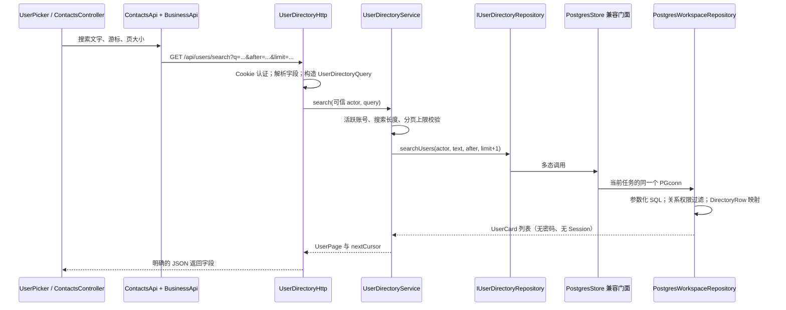
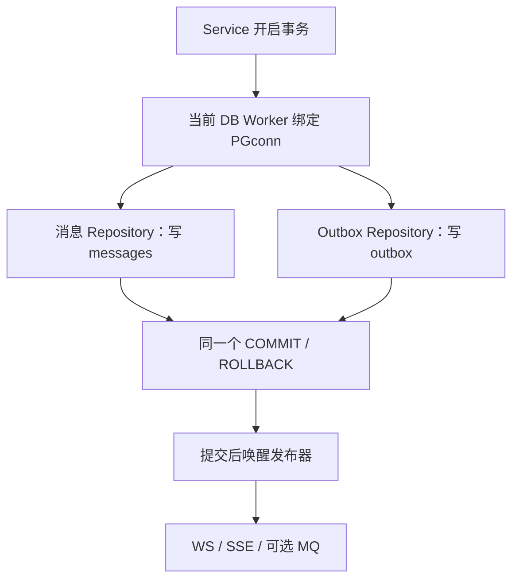

# 数据库领域分层：从页面请求到持久化行

本规范从 Phase49 开始用于新增代码及逐块迁移。沿用 Linux 权威数据库、Windows 私人 SQLite 的分工；本阶段没有增加数据库或表，没有修改已应用迁移，迁移版本仍为 024。

## 1. 五类对象分别站在哪个位置

可以把一次请求理解为去办事大厅：请求表单是 DTO/Query，办事规则属于业务层，档案格式属于 DAO，办完后给用户的回执属于 VO。表单、档案和回执可能有相同字段，但不能因此把密码、内部审核字段一并交给页面。

|名称|职责与边界|当前实际例子|
|---|---|---|
|Query|明确的查询条件，不修改状态；不以任意 Map 传递条件|`contacts::UserDirectoryQuery`、`chat::MessageSearchQuery`、`chat::MessageContextQuery`|
|Command / DTO|应用操作的明确输入；认证身份由适配器单独提供|`chat::SetConversationPreference`；HTTP 适配器解析 `notificationsMuted` 后构造它|
|BO / 领域对象|业务实体、状态与规则使用的数据，不含 HTTP、SQL 或驱动句柄|`Message`、`Conversation`、`ConversationPreference`；权限与规则由对应 Service 执行|
|DO / DAO 行投影|持久化格式及 SQL 查询结果，只属于驱动内部|`workspace_rows::DirectoryRow` 是用户和关系表的联查投影，**不冒充完整 users 表实体**|
|VO / 返回投影|经权限和脱敏处理的用例返回结果，由 transport 序列化|`UserCard` / `UserPage`；HTTP 返回十进制字符串 ID、头像 URL、是否好友及可申请状态|

不要求每个操作都同时创建五套 class。当前 `UserCard` 是有明确公开字段的业务读投影，HTTP 适配器再生成 JSON；没有为每次返回新建空壳 VO 类。已有 `User` 含认证所需字段，不得直接作为公开用户列表返回。

## 2. 当前落地的完整链路

代码入口：

- [查询与公开投影](../../backend/application/modules/contacts/domain/ContactDirectoryTypes/ContactDirectoryTypes.h)
- [联系人目录 Port](../../backend/application/modules/contacts/ports/IUserDirectoryRepository/IUserDirectoryRepository.h)
- [目录用例](../../backend/application/modules/contacts/application/UserDirectoryService/UserDirectoryService.cpp)
- [HTTP 适配器](../../backend/application/modules/contacts/transport/UserDirectoryHttp/UserDirectoryHttp.cpp)
- [驱动内部行投影](../../backend/application/storage/postgres/PostgresWorkspaceRepository/WorkspaceRows.h)
- [SQL 与显式映射](../../backend/application/storage/postgres/PostgresWorkspaceRepository/PostgresWorkspaceRepository.cpp)
- [聊天 Query / Command](../../backend/application/modules/chat/application/WorkspaceRequests/WorkspaceRequests.h)

## 3. 按领域拆分数据库功能，保持一个事务

已有存储在 Phase48 拆成账号、联系人、会话、消息读写、文件、Outbox、模型、评测、知识、训练等驱动。`PostgresStore` 保留多接口兼容门面与事务连接管理，领域驱动不反向包含门面，也不自行向连接池再借一条连接。

拆文件不能拆散事务。消息和 Outbox 像同一张订单的商品与发货单，必须一起成立。内存实现也复用同一 `MemoryState` 和事务快照，不能为各领域复制独立状态后分别回滚。

## 4. 增加功能时的约束

1. 先确定业务归属。用户搜索属于联系人目录，不继续塞进聊天工作区；当前 `ChatWorkspaceService::users` 只作兼容委托，规则只在 `UserDirectoryService` 有一份。
2. 在所属模块定义明确 Query / Command；可信用户 ID 来自认证，不能相信浏览器传来的 `actorId`。
3. Service 依赖窄 Port；DAO 保留 libpq、SQL、行解码和枚举/时间转换。禁止把 PGconn、PGresult、HTTP Context 穿入领域接口。
4. 返回公开投影或经过脱敏的结果；撤回消息正文、私有资料、密码散列和 Token 不进入公开返回值。
5. 写入与 Outbox 共用同一事务任务。完成回调核验连接/Stream 身份；事务不能跨 Worker 转移。
6. 同一份业务契约同时运行内存和真实 PG；并发唯一性、事务回滚和 SQL 权限过滤另用真实 PG 验证。

## 5. 仍保留的兼容部分

`PostgresStore`、`InMemoryStore`、`Domain.h`、`Ports.h` 以及旧服务头文件是渐进迁移入口。它们仍可较长，但不再保存各领域 SQL 和重复业务规则。其他老用例没有在本轮被强制改名为 DO/BO/VO；后续修改对应领域时，按本规范渐进迁移。共享连接池与值解码器属于基础设施复用，不按每个表复制一套。

适合当前模块化单体：规则与持久化清楚、测试替身可替换、事务容易保持。代价是要维护明确映射与兼容入口。不要把每列都无条件复制五遍，也不要为追求文件数量将同一条规则拆到几个互相依赖的组件。
